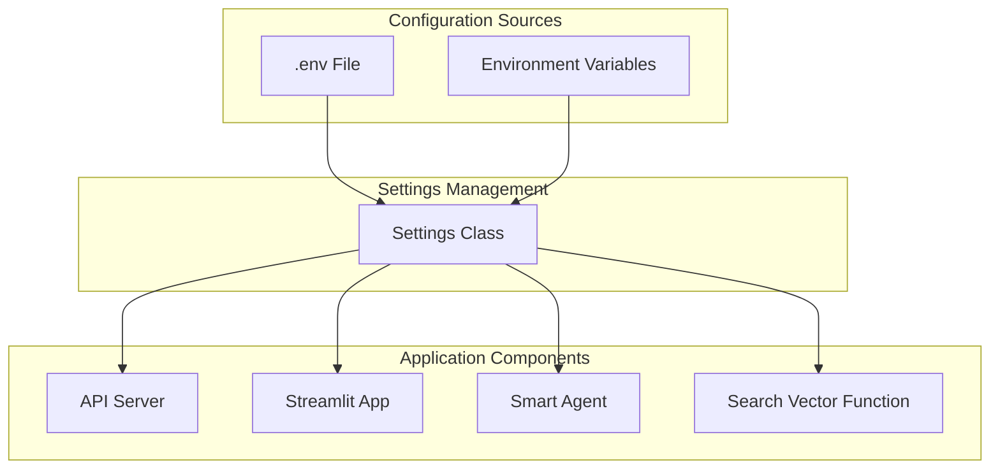
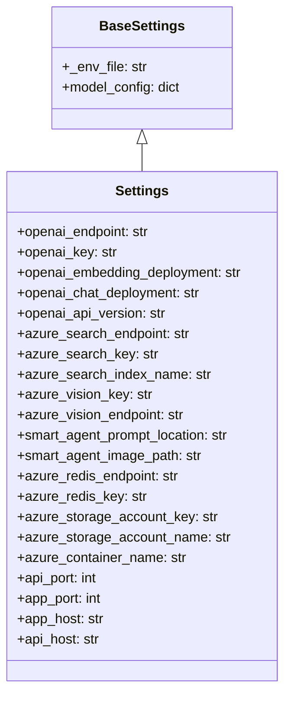
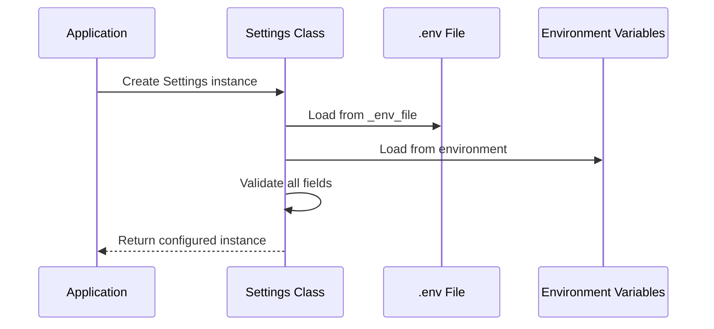
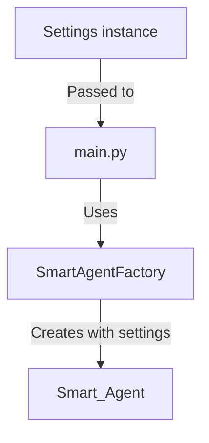
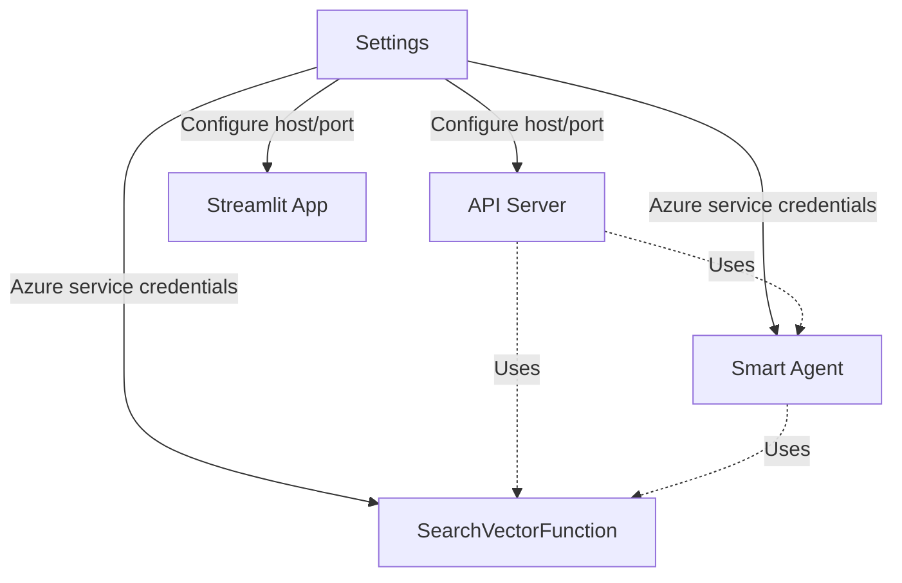
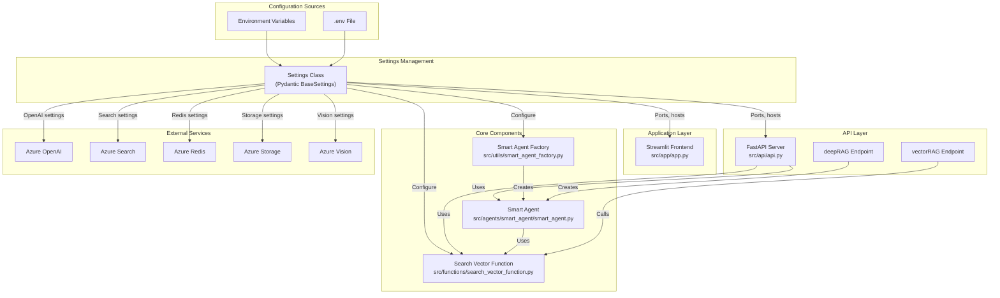

<!-- source: DeepWiki mcp.deepwiki.com · repo microsoft/deepRAG · page 7 Settings and Configuration · fetched 2026-10-26 -->

# Settings and Configuration

<details>
<summary>Relevant source files</summary>

The following files were used as context for generating this wiki page:

- [.devcontainer/devcontainer.json](.devcontainer/devcontainer.json)
- [.vscode/launch.json](.vscode/launch.json)
- [pyproject.toml](pyproject.toml)
- [src/main.py](src/main.py)
- [src/models/settings.py](src/models/settings.py)

</details>


This document details the configuration system used in the deepRAG project, explaining how environment variables, settings management, and configuration flows work throughout the application. For information about API-specific configurations, see [API](#5), and for details on the Smart Agent configuration, see [Agent Configuration](#3.1).

## Overview

The deepRAG application uses a centralized configuration approach based on Pydantic's `BaseSettings` class. This provides environment variable loading with validation, type conversion, and default values. The configuration system manages settings for:

- Azure OpenAI services
- Azure Cognitive Search 
- Azure Redis Cache
- Azure Storage
- Azure Vision services
- Application parameters (ports, hosts)



Sources: [src/models/settings.py:1-27](), [src/main.py:1-17]()

## Settings Model

The core of the configuration system is the `Settings` class defined in `src/models/settings.py`. This class leverages Pydantic's `BaseSettings` to automatically load and validate environment variables.



Sources: [src/models/settings.py:1-27]()

### Environment Variables

The following table lists all environment variables used by the application, their corresponding field names in the `Settings` class, and their purposes:

| Environment Variable | Settings Field | Purpose |
|----------------------|----------------|---------|
| AZURE_OPENAI_ENDPOINT | openai_endpoint | Base URL for Azure OpenAI service |
| AZURE_OPENAI_API_KEY | openai_key | Authentication key for Azure OpenAI |
| AZURE_OPENAI_EMB_DEPLOYMENT | openai_embedding_deployment | Deployment name for embedding model |
| AZURE_OPENAI_CHAT_DEPLOYMENT | openai_chat_deployment | Deployment name for chat model |
| AZURE_OPENAI_API_VERSION | openai_api_version | API version for OpenAI service |
| AZURE_SEARCH_ENDPOINT | azure_search_endpoint | Base URL for Azure Search service |
| AZURE_SEARCH_KEY | azure_search_key | Authentication key for Azure Search |
| AZURE_SEARCH_INDEX_NAME | azure_search_index_name | Name of the search index |
| AZURE_AI_VISION_API_KEY | azure_vision_key | Authentication key for Azure Vision |
| AZURE_AI_VISION_ENDPOINT | azure_vision_endpoint | Base URL for Azure Vision service |
| SMART_AGENT_PROMPT_LOCATION | smart_agent_prompt_location | Path to prompt template for Smart Agent |
| IMAGE_PATH | smart_agent_image_path | Path to store/retrieve images |
| AZURE_REDIS_ENDPOINT | azure_redis_endpoint | Base URL for Azure Redis service |
| AZURE_REDIS_KEY | azure_redis_key | Authentication key for Azure Redis |
| AZURE_STORAGE_ACCOUNT_KEY | azure_storage_account_key | Authentication key for Azure Storage |
| AZURE_STORAGE_ACCOUNT_NAME | azure_storage_account_name | Name of Azure Storage account |
| AZURE_CONTAINER_NAME | azure_container_name | Name of Azure Storage container |
| API_PORT | api_port | Port for FastAPI server (default: 8080) |
| APP_PORT | app_port | Port for Streamlit app (default: 8000) |
| APP_HOST | app_host | Host for Streamlit app (default: localhost) |
| API_HOST | api_host | Host for FastAPI server (default: localhost) |

Sources: [src/models/settings.py:1-27]()

## Configuration Loading

The application loads configuration using Pydantic's built-in environment variable handling. The typical pattern is:



A typical example of loading the settings is shown in `src/main.py`:

```python
env_path: Path = Path('.') / '.env'
settings: Settings = Settings(_env_file=env_path) # type: ignore
```

This loads environment variables from a `.env` file located in the project root. If environment variables are already set in the system, they take precedence over values in the `.env` file.

Sources: [src/main.py:9-10]()

## Configuration Usage

The settings instance is passed to various components throughout the application. This allows components to access configuration without directly handling environment variables.

### Main Application



In the main application, the settings instance is used to configure the Smart Agent:

```python
agent_path: str = settings.smart_agent_prompt_location
protocol: str = get_protocol(url=agent_path)
fs: fsspec.AbstractFileSystem = fsspec.filesystem(protocol=protocol)
agent: Smart_Agent = SmartAgentFactory.create_smart_agent(fs=fs, settings=settings, session_id='session_id')
```

Sources: [src/main.py:10-14]()

### API and Frontend

Both the API server and Streamlit frontend application access the settings for:
- Configuring server ports and hosts
- Setting up connections to Azure services
- Creating Smart Agent instances
- Configuring search functions

The configuration flow looks like this:



Sources: [src/models/settings.py:1-27]()

## Project Configuration

The project uses Poetry for dependency management and packaging. The main configuration is in `pyproject.toml`, which defines:

1. Project metadata
2. Dependencies
3. Development dependencies
4. Test configuration

Key configurations include:

- Python version requirement: `^3.11`
- Localized dependencies for API, app, and tests
- Development and test dependencies
- pytest configuration

Sources: [pyproject.toml:1-39]()

## Development Environment

The project includes configurations for development environments to ensure consistency across developer machines.

### VS Code Launch Configuration

The `.vscode/launch.json` file contains debug configurations for both the API and Streamlit app:

| Configuration | Purpose | Command |
|---------------|---------|---------|
| Api | Run the API server | `python -m main` |
| App | Run the Streamlit app | `streamlit run src/app/app.py --server.port 8000` |
| Server/Client | Run both in parallel | Combination of both configurations |

The launch configuration ensures proper Python path settings and port configuration.

Sources: [.vscode/launch.json:1-39]()

### Dev Container Configuration

For containerized development, the project includes a `.devcontainer/devcontainer.json` configuration that:

1. Uses Microsoft's Universal developer container image
2. Adds Python 3.11 to the container
3. Initializes Poetry and installs dependencies
4. Configures VS Code extensions for development

Sources: [.devcontainer/devcontainer.json:1-22]()

## Configuration Flow Diagram

The following diagram shows how configuration flows through the deepRAG system:



Sources: [src/models/settings.py:1-27](), [src/main.py:1-17]()

## Best Practices

When working with the configuration system in deepRAG, follow these practices:

1. **Never hardcode credentials** - Always use the `Settings` class to access sensitive information
2. **Use environment files for local development** - Create a `.env` file for local settings
3. **Override with environment variables** - For production deployment, use environment variables
4. **Extend the Settings class** - When adding new configuration, extend the `Settings` class
5. **Follow dependency injection pattern** - Pass the settings object to components that need it

Sources: [src/models/settings.py:1-27](), [src/main.py:1-17]()

---

