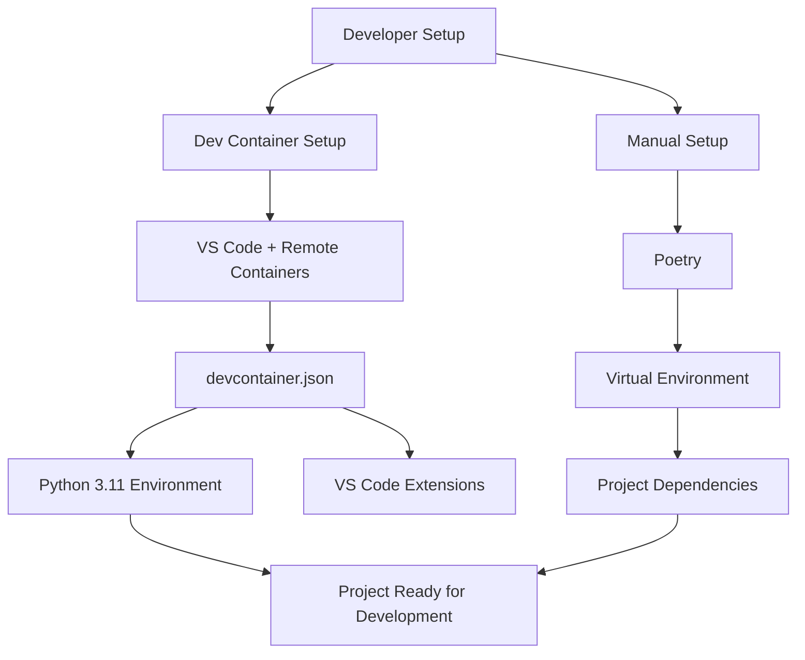
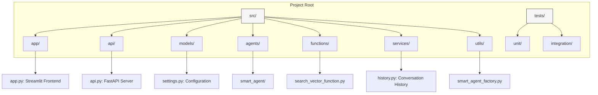
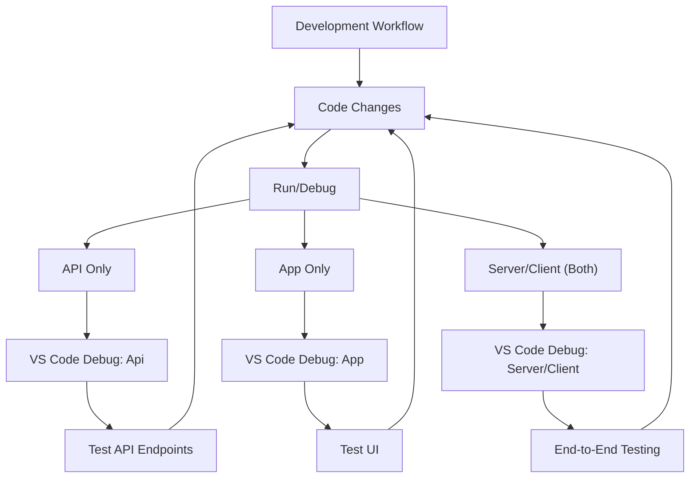
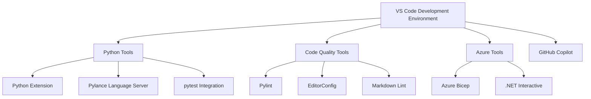

<!-- source: DeepWiki mcp.deepwiki.com · repo microsoft/deepRAG · page 8 Development Guide · fetched 2026-10-26 -->

# Development Guide

<details>
<summary>Relevant source files</summary>

The following files were used as context for generating this wiki page:

- [.devcontainer/devcontainer.json](.devcontainer/devcontainer.json)
- [.vscode/launch.json](.vscode/launch.json)
- [.vscode/settings.json](.vscode/settings.json)
- [pyproject.toml](pyproject.toml)
- [src/models/settings.py](src/models/settings.py)

</details>


This guide provides instructions for setting up the development environment and contributing to the deepRAG project. It covers environment setup, project structure, development workflow, testing, and debugging. For information about the system architecture and components, see [System Architecture](#2).

## Development Environment Setup

The deepRAG project uses Python 3.11, Poetry for dependency management, and development containers for consistent development environments.

### Prerequisites

- [Python 3.11](https://www.python.org/downloads/)
- [Poetry](https://python-poetry.org/docs/#installation)
- [Docker](https://www.docker.com/products/docker-desktop/) (for development containers)
- [Visual Studio Code](https://code.visualstudio.com/) with Remote Containers extension

### Setup Steps

1. **Clone the Repository**

   ```bash
   git clone https://github.com/microsoft/deepRAG
   cd deepRAG
   ```

2. **Using Dev Containers (Recommended)**

   The project includes a dev container configuration that sets up all required dependencies automatically:

   - Open the project folder in VS Code
   - When prompted, click "Reopen in Container"
   - The container will build with Python 3.11 and all required extensions

3. **Manual Setup (Alternative)**

   If you prefer not to use dev containers:

   ```bash
   # Install dependencies
   poetry install
   
   # Activate the virtual environment
   poetry shell
   ```



Sources: [.devcontainer/devcontainer.json:1-22](), [pyproject.toml:1-39]()

## Project Configuration

### Environment Variables

The project requires several environment variables to be set for connecting to various Azure services. These are defined in the `Settings` class in `settings.py`:

| Category | Environment Variables |
|----------|----------------------|
| Azure OpenAI | `AZURE_OPENAI_ENDPOINT`, `AZURE_OPENAI_API_KEY`, `AZURE_OPENAI_EMB_DEPLOYMENT`, `AZURE_OPENAI_CHAT_DEPLOYMENT`, `AZURE_OPENAI_API_VERSION` |
| Azure Search | `AZURE_SEARCH_ENDPOINT`, `AZURE_SEARCH_KEY`, `AZURE_SEARCH_INDEX_NAME` |
| Azure Vision | `AZURE_AI_VISION_API_KEY`, `AZURE_AI_VISION_ENDPOINT` |
| Azure Redis | `AZURE_REDIS_ENDPOINT`, `AZURE_REDIS_KEY` |
| Azure Storage | `AZURE_STORAGE_ACCOUNT_KEY`, `AZURE_STORAGE_ACCOUNT_NAME`, `AZURE_CONTAINER_NAME` |
| Application | `SMART_AGENT_PROMPT_LOCATION`, `IMAGE_PATH`, `API_PORT`, `APP_PORT`, `APP_HOST`, `API_HOST` |

Create a `.env` file in the project root to set these variables for local development.

Sources: [src/models/settings.py:1-27]()

## Project Structure

The deepRAG project is organized into several modules with clear separation of concerns:



### Key Components

- **app**: Streamlit frontend for user interaction
- **api**: FastAPI server that exposes endpoints for vectorRAG and deepRAG
- **models**: Data models and application settings
- **agents**: Smart Agent implementation for advanced RAG capabilities
- **functions**: Functions used by agents, including search vector functionality
- **services**: Services for managing conversation history and other stateful features
- **utils**: Utility functions and factories

Sources: [pyproject.toml:10-15]()

## Development Workflow

### Running the Application

The application has two main components that can be run separately or together:

1. **API Server**

   ```bash
   # From project root
   cd src/api
   python main.py
   ```

2. **Streamlit Frontend**

   ```bash
   # From project root
   cd src/app
   streamlit run app.py
   ```

### VS Code Debugging

The project includes VS Code launch configurations for debugging both components:

- **API**: Debugging the FastAPI server
- **App**: Debugging the Streamlit frontend
- **Server/Client**: Compound configuration to debug both simultaneously



Sources: [.vscode/launch.json:1-39]()

## Testing

The project uses pytest for testing. Tests are located in the `tests` directory.

### Running Tests

```bash
# Run all tests
poetry run pytest

# Run specific test file
poetry run pytest tests/path/to/test_file.py

# Run with coverage
poetry run pytest --cov=src
```

### Test Configuration

The pytest configuration is defined in the `pyproject.toml` file:

```toml
[tool.pytest.ini_options]
minversion = "8.0"
addopts = [
    "--import-mode=importlib",
]
testpaths = [
    "tests",
]
pythonpath = [
    ".",
    "src",
]
```

For more detailed information about testing approaches and test structure, see [Testing](#8.1).

Sources: [pyproject.toml:23-34]()

## Development Tools and Extensions

The devcontainer configuration includes several VS Code extensions to enhance the development experience:

- **Python Extension**: For Python language support
- **Pylint**: For code linting
- **GitHub Copilot**: For AI-assisted development
- **Markdown Lint**: For markdown validation
- **EditorConfig**: For consistent coding styles
- **Bicep**: For Azure Bicep template development
- **Dotnet Interactive**: For .NET notebooks

VS Code settings are configured for Python development with type checking, test discovery, and IntelliSense features enabled.



Sources: [.devcontainer/devcontainer.json:9-21](), [.vscode/settings.json:1-31]()

## Dependency Management

The project uses Poetry for dependency management. The main dependencies are defined in `pyproject.toml`:

### Managing Dependencies

```bash
# Add a new dependency
poetry add package-name

# Add a development dependency
poetry add --group dev package-name

# Update dependencies
poetry update

# Install all dependencies
poetry install
```

### Project Dependencies

The project has several dependencies organized in different groups:

- **Main dependencies**: Python 3.11, local packages (api, app, tests), and langchain-openai
- **Development dependencies**: pytest
- **Test dependencies**: pytest-mock

Sources: [pyproject.toml:10-22]()

## Debugging Tips

### Using VS Code Debuggers

1. Set breakpoints in your code
2. Select the appropriate launch configuration (Api, App, or Server/Client)
3. Start debugging with F5

### Compound Debugging

To debug both the API and frontend simultaneously:
1. Select the "Server/Client" compound configuration
2. Press F5 to start debugging
3. Breakpoints in both components will be hit

### Common Issues

- **Port conflicts**: Ensure ports 8000 (App) and 8080 (API) are available or configure different ports
- **Environment variables**: Check that all required environment variables are set
- **Dependencies**: Make sure all dependencies are installed with `poetry install`

Sources: [.vscode/launch.json:1-39]()

## Contribution Guidelines

When contributing to the deepRAG project:

1. **Create a feature branch**: Don't work directly on main
2. **Follow code style guidelines**: Use the EditorConfig and linting tools
3. **Write tests**: Add tests for new functionality
4. **Update documentation**: Document new features or changes
5. **Create a pull request**: Submit your changes for review

### Code Style

The project follows standard Python coding conventions:
- Use Python type hints
- Follow PEP 8 guidelines
- Keep functions and classes single-purpose
- Document public APIs

### Documentation

When adding new functionality:
- Update or add docstrings
- Consider updating wiki documentation
- Include examples of how to use the new functionality

---

