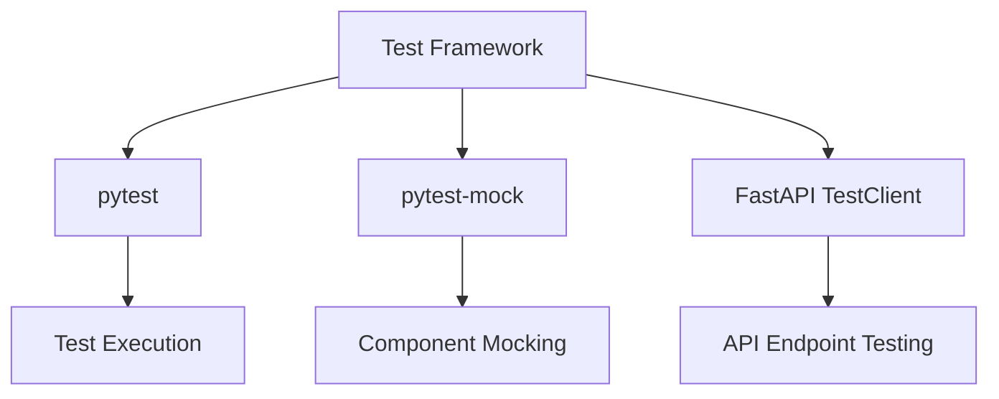
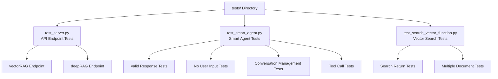
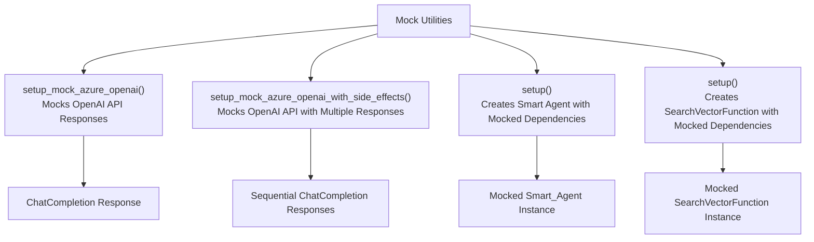

<!-- source: DeepWiki mcp.deepwiki.com · repo microsoft/deepRAG · page 8.1 Testing · fetched 2026-10-26 -->

# Testing

<details>
<summary>Relevant source files</summary>

The following files were used as context for generating this wiki page:

- [src/agents/pyproject.toml](src/agents/pyproject.toml)
- [src/functions/functions.py](src/functions/functions.py)
- [tests/pyproject.toml](tests/pyproject.toml)
- [tests/test_search_vector_function.py](tests/test_search_vector_function.py)
- [tests/test_server.py](tests/test_server.py)
- [tests/test_smart_agent.py](tests/test_smart_agent.py)

</details>


This page documents the testing approach, test structure, and how to run tests in the deepRAG project. The testing framework is designed to validate core system components including API endpoints, Smart Agent functionality, and vector search capabilities.

## Test Framework and Dependencies

The deepRAG project uses pytest as its primary testing framework. Test dependencies are managed using Poetry, which allows for consistent test environments across development machines.



Sources: [tests/pyproject.toml:24-26]()

Key dependencies include:
- pytest - Core testing framework
- pytest-mock - Provides mocking utilities
- FastAPI TestClient - For testing API endpoints

The testing configuration is defined in the pyproject.toml file with the following pytest configuration:

```toml
[tool.pytest.ini_options]
pythonpath = [
    ".",
    "../src",
]
```

Sources: [tests/pyproject.toml:28-31]()

## Test Structure

The tests are organized by component, with each test file focusing on a specific system module. This structure aligns with the modular architecture of the deepRAG system.



Sources: [tests/test_server.py:10-18](), [tests/test_smart_agent.py:83-185](), [tests/test_search_vector_function.py:47-113]()

## Component Testing Approach

### API Endpoint Testing

API endpoints are tested using FastAPI's TestClient, which simulates HTTP requests without starting an actual server. These tests validate that endpoints return appropriate responses.

```python
@pytest.fixture
def client() -> TestClient:
    return TestClient(app=app)

def test_vector_rag(client: TestClient) -> None:
    response: Response = client.post(url="/vectorRAG/invoke", json={"input": "NESCAFÉ's New Global Initiative"})
    assert response.status_code == 200
```

Sources: [tests/test_server.py:6-14]()

### Smart Agent Testing

Smart Agent tests use pytest-mock to create mock versions of external dependencies such as Azure OpenAI. This allows testing the agent's behavior without making actual API calls.

```mermaid
classDiagram
    class "Smart_Agent Tests" {
        +test_for_valid_response()
        +test_for_no_user_input()
        +test_if_conversation_is_not_none()
        +test_for_max_run_count()
        +test_for_tool_calls()
    }
    
    class "Mock Components" {
        +AzureOpenAI
        +Logger
        +SearchVectorFunction
        +AgentConfiguration
    }
    
    "Smart_Agent Tests" --> "Mock Components" : uses
    "Smart_Agent Tests" --> "Smart_Agent" : tests
```

Sources: [tests/test_smart_agent.py:13-185]()

The tests use utility functions like `setup_mock_azure_openai()` and `setup()` to create consistent test fixtures with controlled behavior.

### Search Vector Function Testing

The SearchVectorFunction tests mock both Azure OpenAI for embeddings and Azure Search for document retrieval. These tests verify that search results are properly processed and formatted.

```python
def test_valid_search_return(mocker: pytest_mock.MockerFixture,):
    # Test implementation validating proper image path and related content
```

Sources: [tests/test_search_vector_function.py:47-76]()

## Mock Utilities

The test suite includes several mock utilities that simplify the creation of test fixtures. These utilities are especially important for testing components that interact with external Azure services.



Sources: [tests/test_smart_agent.py:13-82](), [tests/test_search_vector_function.py:10-45]()

Key mock utilities include:
- Mock Azure OpenAI client with configurable responses
- Mock Search client with predefined document results
- Mock file system for storage operations

## Running Tests

To run tests in the deepRAG project, navigate to the project root directory and use the following commands:

1. Install test dependencies:
```bash
cd tests
poetry install
```

2. Run all tests:
```bash
poetry run pytest
```

3. Run a specific test file:
```bash
poetry run pytest test_server.py
```

Sources: [tests/pyproject.toml:1-36]()

## Test Coverage

The current test suite covers the following components:

| Component | Test File | Coverage Areas |
|-----------|-----------|----------------|
| API Endpoints | test_server.py | - vectorRAG endpoint<br>- deepRAG endpoint |
| Smart Agent | test_smart_agent.py | - Response generation<br>- Conversation management<br>- Tool calling<br>- Error handling |
| Search Vector Function | test_search_vector_function.py | - Document search<br>- Result formatting<br>- Multiple document handling |

## Extending Tests

When adding new features to the deepRAG system, corresponding tests should be added to maintain test coverage. The existing test structure provides patterns for testing new components:

1. For new API endpoints, extend test_server.py with additional test methods
2. For enhancements to Smart Agent, add test cases in test_smart_agent.py
3. For search functionality changes, update test_search_vector_function.py

When testing components that integrate with Azure services, use the existing mock utilities to simulate service responses.

Sources: [tests/test_server.py:1-18](), [tests/test_smart_agent.py:1-185](), [tests/test_search_vector_function.py:1-113]()

---

