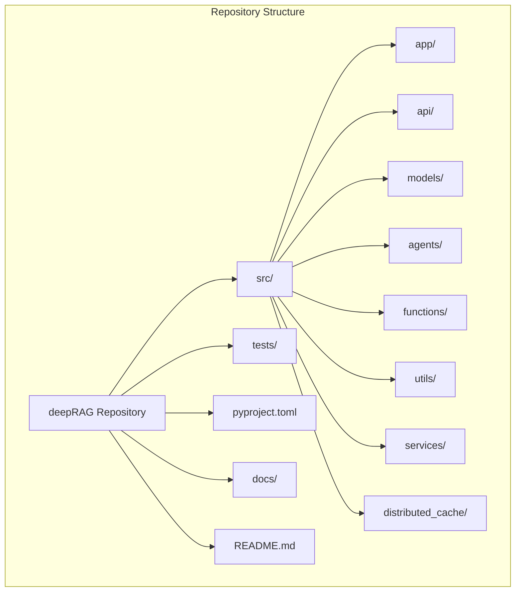
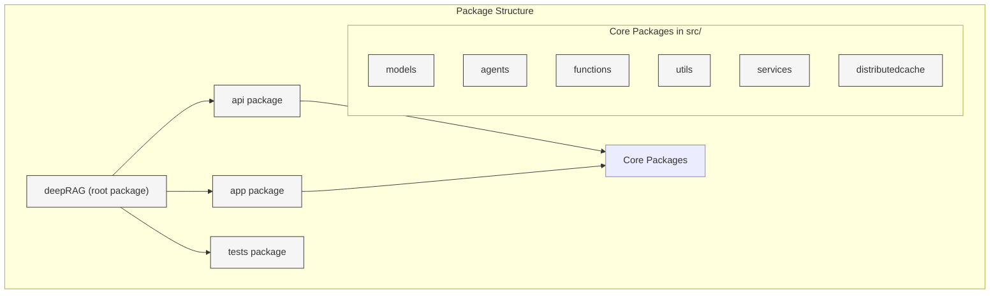
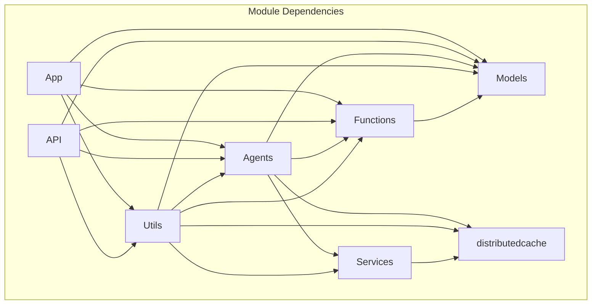
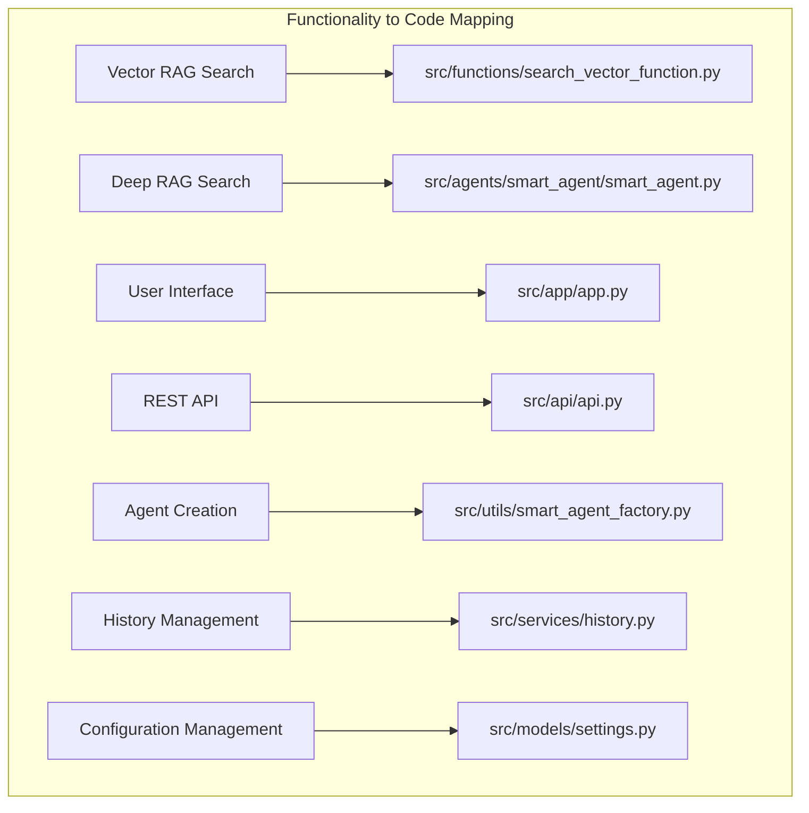
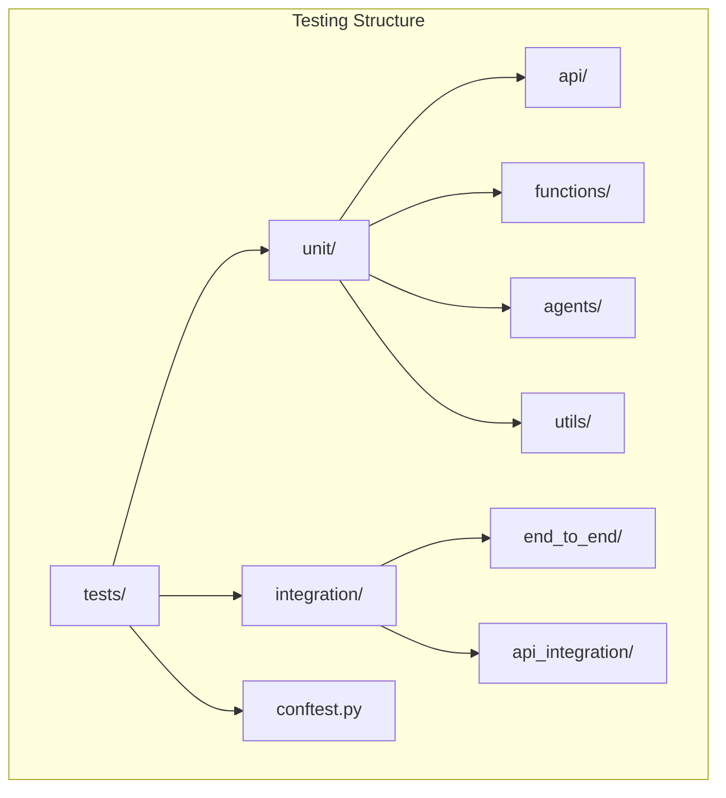

<!-- source: DeepWiki mcp.deepwiki.com · repo microsoft/deepRAG · page 9 Project Structure · fetched 2026-10-26 -->

# Project Structure

<details>
<summary>Relevant source files</summary>

The following files were used as context for generating this wiki page:

- [pyproject.toml](pyproject.toml)
- [src/distributed_cache/distributedcache.py](src/distributed_cache/distributedcache.py)
- [src/distributed_cache/pyproject.toml](src/distributed_cache/pyproject.toml)
- [src/services/pyproject.toml](src/services/pyproject.toml)
- [src/utils/poetry.lock](src/utils/poetry.lock)
- [src/utils/pyproject.toml](src/utils/pyproject.toml)

</details>


This document outlines the organization and structure of the deepRAG repository, detailing the main modules, dependencies, and relationships between different components. It serves as a guide to help developers understand how the codebase is organized and how the various parts fit together.

For information about the overall system architecture, see [System Architecture](#2).

## 1. Repository Overview

The deepRAG repository is organized as a Python monorepo with multiple packages managed using Poetry. The codebase follows a modular structure with clearly defined responsibilities for each component.



Sources: [pyproject.toml]()

## 2. Package Organization

The repository is structured as a collection of related Python packages, each with its own `pyproject.toml` file that defines its dependencies. This modular approach allows for clear separation of concerns and easier maintenance.



Sources: [pyproject.toml](), [src/utils/pyproject.toml](), [src/services/pyproject.toml](), [src/distributed_cache/pyproject.toml]()

## 3. Module Dependencies

The following diagram shows the dependencies between different modules within the codebase. This helps understand how the modules interact with each other.



Sources: [src/utils/pyproject.toml](), [src/services/pyproject.toml](), [src/distributed_cache/pyproject.toml](), [pyproject.toml]()

## 4. Core Modules

### 4.1 API Module

The API module implements a FastAPI server that exposes the deepRAG functionality through RESTful endpoints.

Main components:
- FastAPI server
- `/vectorRAG` endpoint
- `/deepRAG` endpoint

Sources: [pyproject.toml]()

### 4.2 App Module

The App module contains a Streamlit-based frontend application that provides a user interface for interacting with the deepRAG system.

Main components:
- Streamlit web interface
- User interaction handling
- Result visualization

Sources: [pyproject.toml]()

### 4.3 Agents Module

The Agents module implements the agent-based approach to RAG, particularly the Smart Agent that can perform complex retrieval and reasoning.

Main components:
- Smart Agent
- Agent Configuration
- Agent Factory

Sources: [pyproject.toml](), [src/utils/pyproject.toml]()

### 4.4 Functions Module

The Functions module provides specialized functions used by agents, particularly search-related functionality.

Main components:
- Search Vector Function
- Azure Search integration

Sources: [pyproject.toml](), [src/utils/pyproject.toml]()

### 4.5 Models Module

The Models module contains data models, settings, and schemas used throughout the application.

Main components:
- Settings models
- Data schemas
- Configuration classes

Sources: [pyproject.toml](), [src/utils/pyproject.toml]()

### 4.6 Utils Module

The Utils module provides utility functions and helpers used across the application.

Main components:
- Smart Agent Factory
- Integration utilities
- Helper functions

Sources: [src/utils/pyproject.toml]()

### 4.7 Services Module

The Services module implements common services used by other components.

Main components:
- History service
- Shared functionalities

Sources: [src/services/pyproject.toml]()

### 4.8 Distributed Cache Module

The Distributed Cache module implements caching functionality used for session management and history persistence.

Main components:
- Cache Protocol
- Cache implementations

Sources: [src/distributed_cache/pyproject.toml](), [src/distributed_cache/distributedcache.py]()

## 5. Dependency Management

deepRAG uses Poetry for dependency management, which provides reliable package resolution and ensures consistent development environments.

### 5.1 Main Project Dependencies

| Dependency | Purpose |
|------------|---------|
| api | API implementation |
| app | Frontend application |
| tests | Testing framework |
| langchain-openai | Integration with LangChain and OpenAI |

Sources: [pyproject.toml]()

### 5.2 Module-specific Dependencies

#### Utils Module Dependencies

| Dependency | Purpose |
|------------|---------|
| azure-search-documents | Azure Cognitive Search integration |
| azure-storage-blob | Azure Blob Storage integration |
| streamlit | Frontend web framework |
| openai | OpenAI API client |
| models | Data models (internal) |
| functions | Search functions (internal) |
| agents | Smart Agent (internal) |
| distributedcache | Caching (internal) |
| redis | Redis client |

Sources: [src/utils/pyproject.toml]()

## 6. Code to Functionality Mapping

This diagram maps the main system components to their implementing code entities:



Sources: [pyproject.toml]()

## 7. Testing Structure

The repository includes a comprehensive testing structure in the `tests` directory.



Sources: [pyproject.toml]()

## 8. Repository Root Files

The repository root contains several important configuration files:

| File | Purpose |
|------|---------|
| pyproject.toml | Main Poetry configuration file |
| README.md | Project overview and instructions |
| .gitignore | Files and directories to exclude from version control |
| pytest.ini | PyTest configuration |

Sources: [pyproject.toml]()

## 9. Development Environment Setup

Poetry is used for creating and managing virtual environments:

```bash
# Install dependencies
poetry install

# Activate the virtual environment
poetry shell

# Add a dependency
poetry add <package_name>
```

The `pyproject.toml` specifies Python 3.11 as the required version.

Sources: [pyproject.toml]()