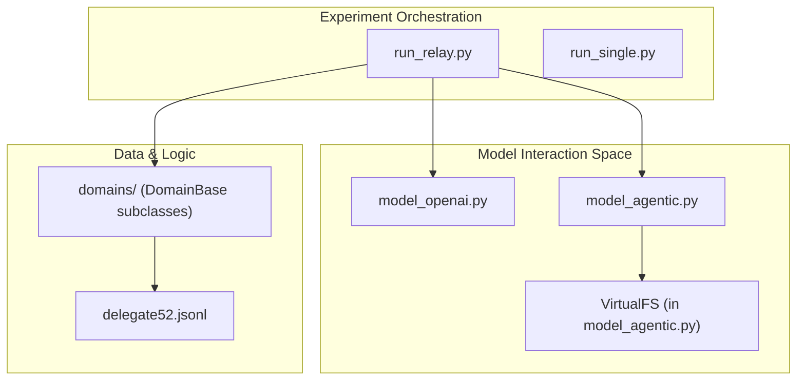

<!-- source: DeepWiki mcp.deepwiki.com · repo microsoft/delegate52 · page 1 DELEGATE-52 Overview · fetched 2026-10-26 -->

# DELEGATE-52 Overview

<details>
<summary>Relevant source files</summary>

The following files were used as context for generating this wiki page:

- [README.md](README.md)
- [assets/figures/domains.png](assets/figures/domains.png)
- [assets/figures/evaluation.png](assets/figures/evaluation.png)
- [assets/figures/results.png](assets/figures/results.png)
- [assets/figures/teaser.png](assets/figures/teaser.png)
- [assets/figures/work_environments.png](assets/figures/work_environments.png)

</details>


DELEGATE-52 is a technical benchmark designed to evaluate Large Language Models (LLMs) on **long-horizon delegated document editing** across 52 professional domains. Unlike traditional benchmarks that focus on short snippets, DELEGATE-52 simulates multi-turn workflows where an LLM acts as an agent, performing complex structural edits on documents (e.g., crystallography files, music notation, or DNS zones) and attempting to maintain document integrity over repeated interactions.

The benchmark is introduced in the research paper: "[LLMs Corrupt Your Documents When You Delegate](https://arxiv.org/abs/2604.15597)" [README.md:9-9]().

### Purpose and Research Context
The core objective of DELEGATE-52 is to measure "document corruption"—the gradual loss of structural or semantic fidelity—that occurs when LLMs perform sequential edits. It uses a **round-trip relay** methodology: an LLM is asked to perform a "forward" edit (e.g., adding a record) followed by a "backward" edit (e.g., removing that same record) [README.md:15-15](). By chaining these round-trips, the benchmark assesses how well the model can return a document to its exact original state (the seed document) after $k$ interactions [README.md:36-36]().

**Sources:** [README.md:7-15](), [README.md:36-38]()

### Key Concepts

*   **Work Environment:** A self-contained unit of evaluation consisting of a seed document, reversible edit pairs, and optional distractor context [README.md:44-45]().
*   **Round-Trip Relay:** A simulation where the LLM performs a sequence of edits. A single round-trip consists of one forward edit and one backward edit [README.md:15-15]().
*   **Reconstruction Score (RS@k):** The primary metric, measuring the similarity between the original seed document and the document after $k$ relay steps [README.md:36-36]().
*   **Domain-Specific Evaluators:** Custom logic for each of the 52 domains that parses the document format and calculates fidelity (e.g., using AST comparison for Python or Hungarian matching for Accounting) [README.md:23-23]().

### Repository Layout

The codebase is structured to support large-scale simulations, agentic tool-use, and domain-specific parsing.

| Directory/File | Description |
| :--- | :--- |
| `run_relay.py` | Main entry point for multi-turn relay experiments [README.md:19-19](). |
| `run_single.py` | Script for testing individual forward/backward edits [README.md:20-20](). |
| `domains/` | Contains 52 sub-modules, each defining a `DomainBase` subclass for parsing and evaluation [README.md:23-23](). |
| `model_agentic.py` | A harness for "agentic" LLMs that use tools like `read_file` and `write_file` [README.md:22-22](). |
| `model_openai.py` | Wrapper for OpenAI and Azure OpenAI API interactions [README.md:21-21](). |
| `prompts/` | Directory containing Jinja2-style prompt templates for different domains [README.md:24-24](). |
| `domain_viewer/` | Markdown-based documentation and visual examples for every domain [README.md:23-23](). |

**Sources:** [README.md:17-24]()

### System Mapping: Natural Language to Code Entities

The following diagrams bridge high-level benchmark concepts to specific implementation entities in the repository.

**Benchmark Execution Flow**
This diagram maps the experimental process to the primary execution scripts and model wrappers.


**Sources:** [README.md:17-24](), [README.md:42-45]()

**Domain System Architecture**
This diagram shows how the abstract domain concepts are realized through the `DomainBase` class and its relationship to specific file formats.

```mermaid
graph LR
    subgraph "Code Entity Space: domains/"
        BASE["DomainBase (domain_base.py)"]
        REGISTRY["get_domain() (__init__.py)"]
        
        subgraph "Domain Categories"
            CODE["Code (e.g., python.py)"]
            SCI["Science (e.g., molecule.py)"]
            REC["Records (e.g., accounting.py)"]
        end
    end

    subgraph "Natural Language / Format Space"
        PY[".py files"]
        SDF[".sdf files"]
        LEDGER[".ledger files"]
    end

    REGISTRY --> BASE
    BASE <|-- CODE
    BASE <|-- SCI
    BASE <|-- REC

    CODE -.-> PY
    SCI -.-> SDF
    REC -.-> LEDGER
```
**Sources:** [README.md:23-23](), [README.md:44-44]()

### Detailed Documentation Pages

For in-depth technical details, refer to the following child pages:

*   **[Getting Started](#1.1)**: Step-by-step guide for installation, API configuration, and running your first simulation.
*   **[Benchmark Design & Evaluation Methodology](#1.2)**: Detailed explanation of the relay mechanism, the Reconstruction Score, and how domain evaluators function.
*   **[Project Governance & Legal](#1.3)**: Information on the MIT license, Code of Conduct, and security reporting.

**Sources:** [README.md:59-91](), [README.md:92-108](), [README.md:122-128]()

---

