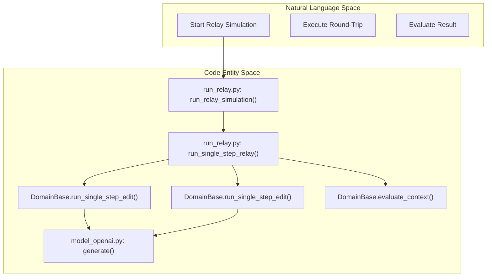

<!-- source: DeepWiki mcp.deepwiki.com · repo microsoft/delegate52 · page 2 Core Architecture · fetched 2026-10-26 -->

# Core Architecture

<details>
<summary>Relevant source files</summary>

The following files were used as context for generating this wiki page:

- [README.md](README.md)

</details>


The DELEGATE-52 architecture is designed to simulate long-horizon, multi-turn document editing workflows. It treats Large Language Models (LLMs) as agents that perform "round-trip" edits: a **forward** edit that modifies a document based on a prompt, followed by a **backward** edit that attempts to revert the change. The system is modular, separating the experiment orchestration logic from model-specific communication and domain-specific document parsing/evaluation.

## High-Level System Overview

The system operates as a pipeline that transforms a seed document through a series of state transitions. The orchestration logic in the experiment runners manages the state chain, while utility modules handle data persistence and environment setup.

### Workflow Diagram: Natural Language to Code Entities

The following diagram illustrates how high-level concepts like "Simulating a Relay" and "Executing an Edit" map to specific classes and functions in the codebase.

**Relay Simulation Logic**

Sources: [run_relay.py:118-175](), [run_relay.py:59-116](), [domains/domain_base.py:108-144](), [domains/domain_base.py:84-90]()

## Component Relationships

The core architecture consists of four primary layers that interact to produce simulation results.

| Layer | Primary Responsibility | Key Files |
| :--- | :--- | :--- |
| **Orchestration** | Manages the loop of forward/backward edits and parallelizes jobs. | `run_relay.py`, `run_single.py` |
| **Execution** | Handles LLM interaction, tool-use loops, and sandboxing. | `model_openai.py`, `model_agentic.py` |
| **Domain Logic** | Defines how to parse, edit, and score documents for 52 specific formats. | `domains/domain_base.py`, `domains/` |
| **Utilities** | Provides file I/O, dataset management, and context serialization. | `utils_env.py`, `utils_results.py`, `utils_context.py` |

### System Component Interaction

This diagram shows the flow of data between the major modules during a single simulation step.

**Data Flow Architecture**
```mermaid
graph LR
    subgraph "Experiment Runners"
        RR["run_relay.py"]
    end

    subgraph "Domain Subsystem"
        DB["DomainBase"]
        DR["Domain Registry"]
    end

    subgraph "Model Wrappers"
        MO["model_openai.py"]
        MA["model_agentic.py"]
    end

    subgraph "Utilities"
        UE["utils_env.py"]
        UR["utils_results.py"]
        UC["utils_context.py"]
    end

    RR --> UE : "load_sample_from_jsonl()"
    RR --> DR : "get_domain()"
    DR --> DB : "instantiates"
    DB --> MO : "generate()"
    DB --> MA : "run_agentic_loop()"
    MO --> UC : "fenced_block_to_dict()"
    RR --> UR : "save_results()"
```
Sources: [run_relay.py:126-130](), [domains/domain_base.py:108-115](), [utils_env.py:14-43](), [utils_results.py:10-33]()

---

## 2.1 Experiment Runners
The experiment runners are the entry points for the benchmark. 
- `run_relay.py` implements the multi-turn "relay" logic, where the output of one edit becomes the input for the next, tracking the accumulation of errors over time.
- `run_single.py` is used for isolated testing of individual forward/backward pairs to ensure environment quality.

Both runners support parallelization via `multiprocessing.Pool` and handle result persistence to JSONL files.

For details, see [Experiment Runners](#2.1).

Sources: [run_relay.py:1-20](), [run_single.py:1-15]()

## 2.2 Model Wrappers
Model wrappers provide a unified interface for different LLM providers and interaction modes.
- `model_openai.py` manages standard completion and JSON-mode requests, including cost estimation and model-specific formatting (e.g., handling `o1`/`o3` system message constraints).
- `model_agentic.py` provides a "VirtualFS" environment where the LLM can use tools like `read_file`, `write_file`, and `run_python` inside a sandboxed `bwrap` container.

For details, see [Model Wrappers](#2.2).

Sources: [model_openai.py:15-40](), [model_agentic.py:20-55]()

## 2.3 Utility Modules
The utility layer provides shared logic used across the runners and domains:
- **`utils_context.py`**: Handles the conversion between raw LLM text (often containing Markdown fenced blocks) and the internal dictionary-based file representations.
- **`utils_env.py`**: Manages the "Work Environment," including loading seed documents and merging distractor context to increase task difficulty.
- **`utils_results.py`**: Provides thread-safe file locking for writing simulation results and computing real-time statistics.
- **`utils_dataset.py`**: Manages the DELEGATE-52 dataset, including automatic downloading from Hugging Face and local JSONL export/import.

For details, see [Utility Modules](#2.3).

Sources: [utils_context.py:1-10](), [utils_env.py:1-10](), [utils_results.py:1-10](), [utils_dataset.py:1-10]()

---

