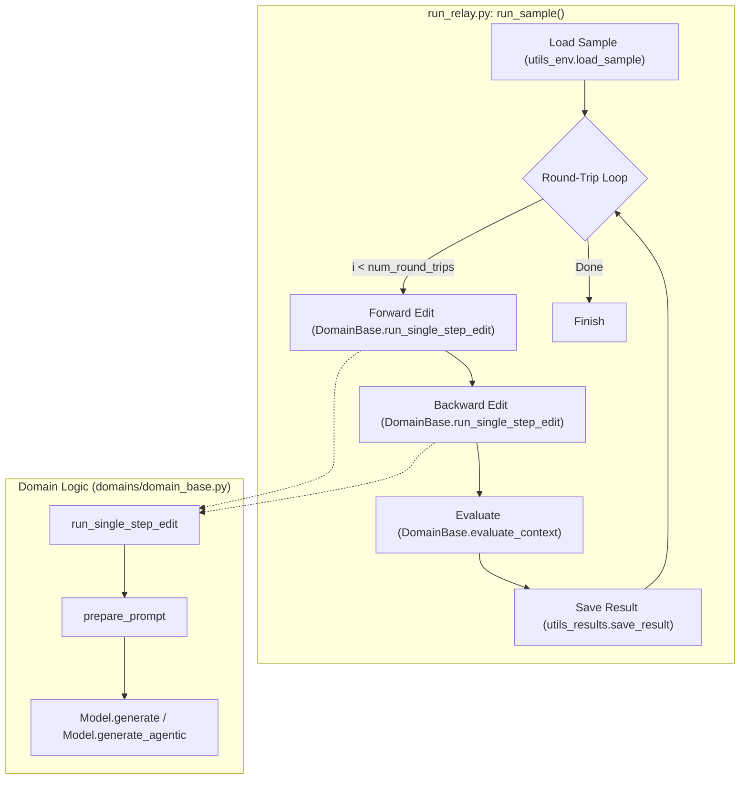
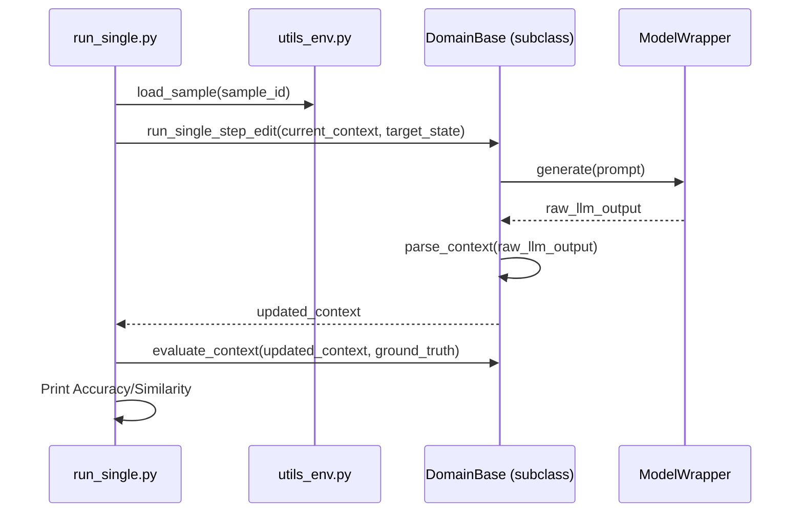

<!-- source: DeepWiki mcp.deepwiki.com · repo microsoft/delegate52 · page 2.1 Experiment Runners · fetched 2026-10-26 -->

# Experiment Runners

Relevant source files

The following files were used as context for generating this wiki page:

- [README.md](README.md)

The DELEGATE-52 benchmark relies on two primary entry points for executing LLM evaluations: `run_relay.py` and `run_single.py`. These scripts manage the lifecycle of an experiment, from loading work environments and initializing model wrappers to orchestrating multi-turn edits and persisting results.

## Overview of Runners

| Script | Purpose | Key Logic |
| :--- | :--- | :--- |
| `run_relay.py` | Main evaluation script for measuring long-horizon document corruption. | Executes $N$ round-trips (Forward $\to$ Backward) to form a state-chain. |
| `run_single.py` | Quality assurance and unit testing for work environments. | Executes a single forward or backward edit in isolation to verify task feasibility. |

**Sources:** [run_relay.py:1-15](), [run_single.py:1-15](), [README.md:19-20]()

---

## 1. Multi-Turn Relay Simulation (`run_relay.py`)

The relay simulation is the core experimental design of DELEGATE-52. It simulates a "delegation chain" where an LLM is repeatedly asked to modify a document and then revert those modifications.

### State-Chain Logic
A "round-trip" consists of two steps:
1.  **Forward Edit**: The LLM receives `state_A` and a prompt to reach `state_B`.
2.  **Backward Edit**: The LLM receives the output of the forward edit and a prompt to return to `state_A`.

The runner chains these round-trips. For example, a 2-round-trip simulation follows:
$S_0 \xrightarrow{f_1} S_1 \xrightarrow{b_1} S_2 \xrightarrow{f_2} S_3 \xrightarrow{b_2} S_4$
Where $S_0$ is the original seed document, and $S_2, S_4$ are "reconstructed" versions of $S_0$.

### Implementation and Data Flow
The `run_sample` function in `run_relay.py` manages the state transitions for a single work environment.

**Sources:** [run_relay.py:34-110](), [domains/domain_base.py:130-175]()

### CLI Arguments and Parallelization
`run_relay.py` uses `multiprocessing.Pool` to parallelize experiments across samples and models.

*   `--model_names`: List of model aliases (e.g., `gpt-4o`, `claude-3-5-sonnet`). [run_relay.py:126-127]()
*   `--domains`: Filter for specific domains (e.g., `subtitles`, `python`). [run_relay.py:124-125]()
*   `--num_round_trips`: Number of $k$ cycles to run (default: 10). [run_relay.py:132-133]()
*   `--num_workers`: Number of parallel processes for `Pool`. [run_relay.py:138-139]()
*   `--skip_distractor`: If set, the LLM only sees the relevant files instead of the full work environment context. [run_relay.py:136-137]()

**Sources:** [run_relay.py:115-160](), [run_relay.py:165-185]()

---

## 2. Single Edit Testing (`run_single.py`)

This script is used for debugging and validating the dataset. It executes exactly one edit (either forward or backward) from a specific state in a work environment.

### Logic Flow
Unlike the relay, `run_single.py` does not chain outputs. It tests if an LLM can successfully transition from `state_i` to `state_j` as defined in the `sample.json` state machine.

**Sources:** [run_single.py:30-80](), [utils_env.py:15-45]()

---

## 3. Result Persistence

Both runners use `utils_results.py` to handle I/O and prevent data loss during parallel execution.

### Persistence Mechanism
1.  **File Locking**: The `save_result` function uses file locking to ensure that multiple processes in the `multiprocessing.Pool` do not corrupt the JSONL output file when writing simultaneously. [utils_results.py:10-25]()
2.  **Output Pathing**: Results are stored in `results/{model_name}/{domain_name}.jsonl`. [run_relay.py:85-90]()
3.  **Schema**: Each line in the result file contains:
    *   `sample_id`: Unique identifier for the work environment.
    *   `turn_index`: The specific step in the relay chain.
    *   `edit_type`: "forward" or "backward".
    *   `similarity_score`: The domain-specific evaluation result.
    *   `model_output`: The raw text generated by the LLM.

**Sources:** [utils_results.py:1-30](), [run_relay.py:95-105]()

---

## 4. Key Implementation Details

### Forward/Backward State Chain
In `run_relay.py`, the `target_state_id` is toggled between `forward` and `backward` prompts found in the dataset's `sample.json`. The `current_context` is updated at every step, meaning errors in `turn 1` propagate to `turn 2`.

### Agentic vs. Standard Generation
The runners check if the model is "agentic" (e.g., using `model_agentic.py`). If so, `run_single_step_edit` bypasses standard prompt templates and enters a tool-use loop where the LLM can call `read_file`, `write_file`, and `run_python` to perform the edit.

**Sources:** [domains/domain_base.py:155-170](), [run_relay.py:65-75]()

---

