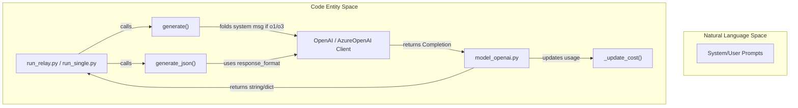
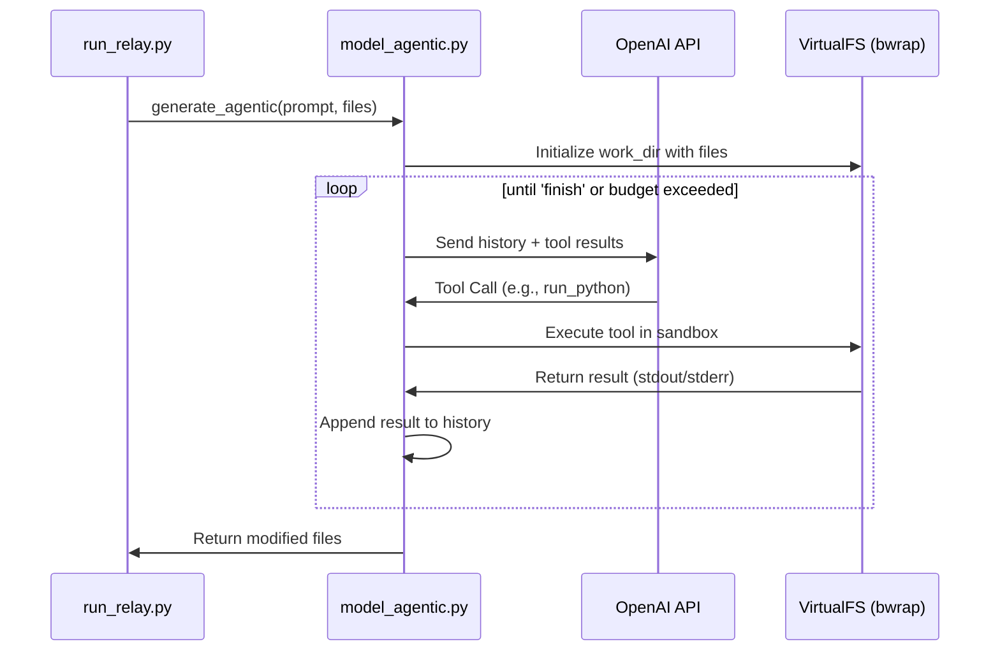

<!-- source: DeepWiki mcp.deepwiki.com · repo microsoft/delegate52 · page 2.2 Model Wrappers · fetched 2026-10-26 -->

# Model Wrappers

Relevant source files

The following files were used as context for generating this wiki page:

- [README.md](README.md)

This page documents the two primary interfaces for Large Language Model (LLM) interaction in DELEGATE-52: `model_openai.py` and `model_agentic.py`. These modules abstract the complexities of API communication, cost tracking, and tool-use loops, providing a unified interface for the experiment runners.

## OpenAI Wrapper (`model_openai.py`)

The `model_openai.py` module provides a robust wrapper for interacting with OpenAI and Azure OpenAI endpoints. It handles model alias resolution, token-based cost estimation, and specific formatting requirements for reasoning models like `o1` and `o3`.

### Key Features

*   **Model Alias Resolution**: Maps friendly names (e.g., `gpt-4o`) to specific API model strings [model_openai.py:38-59]().
*   **System Message Folding**: For models that do not support a `system` role (specifically `o1` and `o3`), it automatically prepends the system message to the first user message [model_openai.py:108-112]().
*   **JSON Enforcement**: Supports both `response_format={"type": "json_object"}` and Pydantic-based structured outputs via `beta.chat.completions.parse` [model_openai.py:126-150]().
*   **Cost Estimation**: Tracks cumulative usage and calculates costs based on hardcoded pricing for input, output, and cached tokens [model_openai.py:61-94]().

### Data Flow: OpenAI Generation

The following diagram illustrates the flow of a standard generation request through `model_openai.py`.

**Figure 1: OpenAI Generation Logic**

Sources: [model_openai.py:102-124](), [model_openai.py:126-153](), [model_openai.py:155-171]()

### Functionality Overview

| Function | Description |
| :--- | :--- |
| `generate()` | Standard chat completion. Handles retry logic and system message folding for `o1`/`o3` models. |
| `generate_json()` | Requests JSON output. Can take a Pydantic `response_model` for schema enforcement. |
| `_update_cost()` | Updates a global `MODEL_STATS` dictionary with token counts and USD costs. |
| `get_model_stats()` | Returns the current session's total cost and token usage. |

Sources: [model_openai.py:102-171](), [model_openai.py:61-94]()

---

## Agentic Wrapper (`model_agentic.py`)

The `model_agentic.py` module implements a tool-use loop where the LLM acts as an agent. Instead of simply generating text, the model can interact with a virtual filesystem and execute Python code to perform complex edits.

### Virtual File System & Sandboxing
The agent operates within a temporary directory (`work_dir`). For Python execution, the wrapper uses `bwrap` (Bubblewrap) to create a Linux sandbox, preventing the LLM from accessing the host system [model_agentic.py:165-185]().

### Tool Schema
The agent has access to a set of predefined tools defined in `AGENTIC_TOOLS`:
*   `read_file`: Reads content from a specific path.
*   `write_file`: Overwrites or creates a file.
*   `delete_file`: Removes a file.
*   `run_python`: Executes a Python script within the sandbox and returns `stdout`/`stderr`.
*   `finish`: Signals the end of the task and provides the final status.

Sources: [model_agentic.py:16-95]()

### The Agentic Loop
The `generate_agentic()` function manages a multi-turn conversation. In each turn, the model either generates a thought/tool call or responds to the result of a previous tool execution.

**Figure 2: Agentic Tool-Use Loop**

Sources: [model_agentic.py:202-285](), [model_agentic.py:120-163]()

### Budget and Constraints
To prevent infinite loops or excessive API spend, the agentic wrapper enforces:
*   **Max Turns**: Default limit on the number of tool-use iterations [model_agentic.py:199]().
*   **Error Handling**: If a tool fails (e.g., Python syntax error), the error message is fed back to the LLM to allow for self-correction [model_agentic.py:145-151]().

### Integration with Domains
When a domain's `run_single_step_edit` is called with an agentic model name (prefixed with `agentic:`), the `DomainBase` class routes the request to `model_agentic.generate_agentic` instead of the standard `generate` function.

Sources: [domains/domain_base.py:157-175](), [model_agentic.py:195-200]()

---

