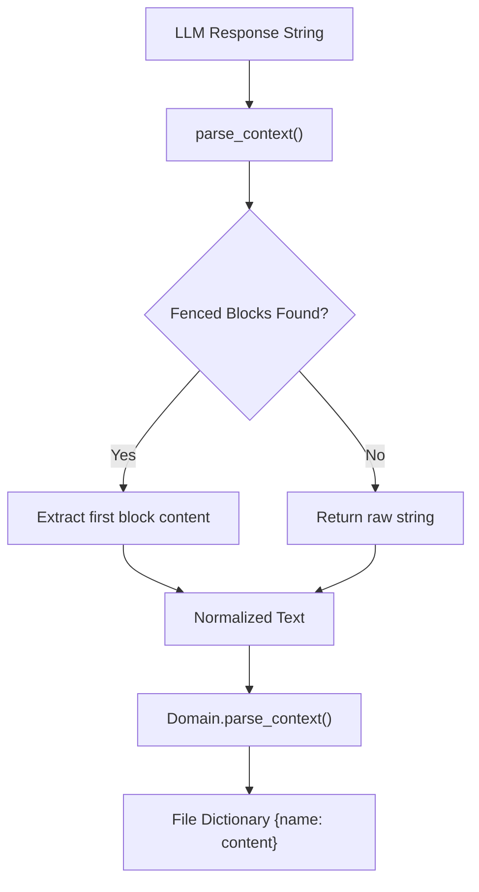
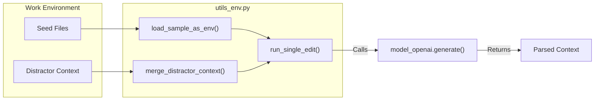
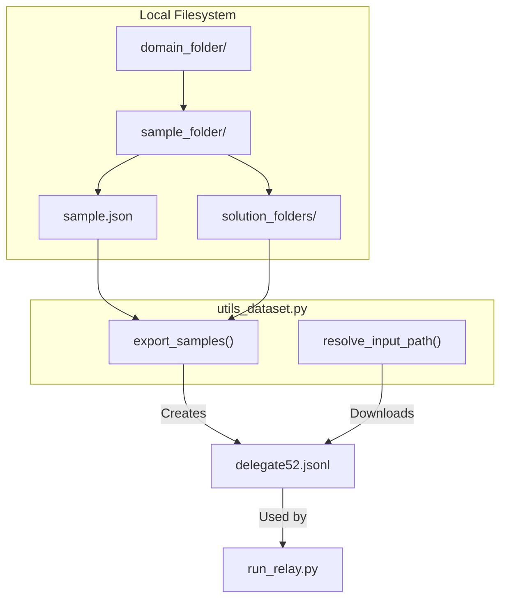

<!-- source: DeepWiki mcp.deepwiki.com · repo microsoft/delegate52 · page 2.3 Utility Modules · fetched 2026-10-26 -->

# Utility Modules

<details>
<summary>Relevant source files</summary>

The following files were used as context for generating this wiki page:

- [README.md](README.md)

</details>


The utility modules in the DELEGATE-52 repository provide the foundational logic for data handling, context manipulation, and result persistence. These modules abstract the complexities of interacting with the Hugging Face Hub, managing concurrent file access, and normalizing LLM outputs across 52 different document domains.

## Context and Text Processing (`utils_context.py`)

`utils_context.py` is the primary engine for transforming raw LLM outputs into structured document states and calculating text-level statistics. It handles the extraction of content from Markdown fenced blocks and provides wildcard matching for domain-specific evaluation.

### Key Functionalities
- **Fenced Block Normalization**: LLMs often wrap document content in Markdown code blocks. `parse_context` [utils_context.py:15-39]() extracts content from these blocks, handling both labeled (e.g., ` ```python `) and unlabeled blocks. It prioritizes the first block found but returns the full string if no blocks are present.
- **Serialization**: `serialize_context` [utils_context.py:4-13]() converts a dictionary of filename-content pairs into a single string formatted with headers (e.g., `--- filename.txt ---`), which is the standard input format for the model prompts.
- **Wildcard Matching**: The `match_with_wildcards` [utils_context.py:64-77]() function allows for flexible string comparison where `*` acts as a placeholder for any sequence of characters, supporting robust evaluation in domains with non-deterministic identifiers.
- **Text Statistics**: `compute_text_statistics` [utils_context.py:41-62]() provides basic metrics including character count, word count, and line count for a given text string.

### Data Flow: LLM Output to Parsed Context
The following diagram illustrates how raw model responses are cleaned and structured for the domain evaluators.

**Context Normalization Flow**

Sources: [utils_context.py:4-77]()

---

## Environment and Simulation Utilities (`utils_env.py`)

`utils_env.py` manages the setup of work environments for simulations, including the loading of seed documents and the integration of distractor files.

### Core Components
- **Sample Loading**: `load_sample_as_env` [utils_env.py:13-35]() initializes a work environment by extracting files from a specific state in the dataset and optionally merging them with distractor context.
- **Distractor Merging**: `merge_distractor_context` [utils_env.py:37-43]() injects "noise" into the model's context window by adding files from the `distractor_context` directory of a sample. This tests the model's ability to ignore irrelevant files during editing.
- **Single Edit Execution**: `run_single_edit` [utils_env.py:45-71]() encapsulates a single turn of the relay. It prepares the prompt using the domain's logic, calls the model wrapper, and parses the resulting context.

### Relationship: Environment Setup and Model Interaction
This diagram bridges the "Natural Language" instructions with the "Code Entity" environment state.

**Environment State Transition**

Sources: [utils_env.py:13-71](), [run_relay.py:19-22]()

---

## Result Persistence and Locking (`utils_results.py`)

To support high-concurrency experiments (using `multiprocessing.Pool` in `run_relay.py`), `utils_results.py` implements a thread-safe and process-safe result logging system using file locks.

### Implementation Details
- **Result Persistence**: `persist_result` [utils_results.py:13-25]() appends experiment results to a JSONL file. It uses `portalocker` [utils_results.py:18-18]() to ensure that multiple worker processes do not corrupt the output file when writing simultaneously.
- **Result Counting**: `count_results` [utils_results.py:27-40]() scans an existing results file to determine which experiments have already been completed, allowing the runners to resume interrupted jobs.
- **Result Loading**: `load_results` [utils_results.py:42-53]() reads the JSONL file and returns a list of result dictionaries for post-simulation analysis.

Sources: [utils_results.py:13-53](), [run_relay.py:50-100]()

---

## Dataset Management (`utils_dataset.py`)

`utils_dataset.py` handles the I/O operations for the DELEGATE-52 dataset, including conversion between the JSONL format and local directory structures, as well as automatic fetching from Hugging Face.

### Key Functions
- **resolve_input_path**: [utils_dataset.py:101-118]() This is the entry point for data loading. If the provided path does not exist locally, it attempts to download `delegate52.jsonl` from the `microsoft/delegate52` repository on Hugging Face Hub using `hf_hub_download`.
- **import_samples**: [utils_dataset.py:12-25]() Loads a JSONL file into a list of Python dictionaries.
- **export_samples**: [utils_dataset.py:27-99]() A complex utility that traverses a local directory of work environments and packages them into the standard JSONL schema. It reads `sample.json` files to reconstruct the state machine and captures file contents from "solution folders".

### Dataset Schema Integration
The following diagram maps the filesystem structure to the `delegate52.jsonl` entity used by the experiment runners.

**Filesystem to JSONL Mapping**

Sources: [utils_dataset.py:12-118](), [README.md:41-57]()

---

