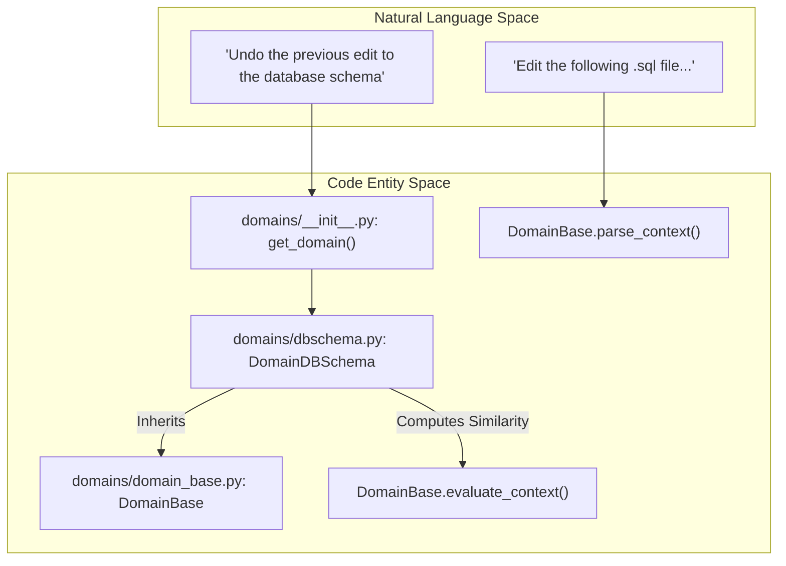
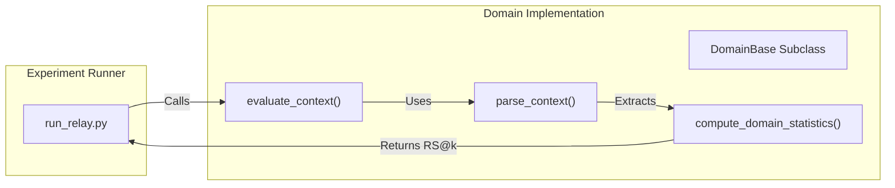

<!-- source: DeepWiki mcp.deepwiki.com · repo microsoft/delegate52 · page 3 Domain System · fetched 2026-10-26 -->

# Domain System

Relevant source files

The following files were used as context for generating this wiki page:

- [README.md](README.md)
- [assets/figures/domains.png](assets/figures/domains.png)
- [domain_viewer/README.md](domain_viewer/README.md)

The **Domain System** is the architectural backbone of DELEGATE-52, providing a unified interface for interacting with 52 distinct professional and everyday document formats [README.md:9-10](). By abstracting domain-specific logic into a standardized class hierarchy, the system allows the experiment runners to perform complex editing tasks and evaluate document fidelity without needing to understand the underlying file syntax for every domain.

### 52-Domain Architecture

The system is organized into five high-level categories, each containing specialized domains that range from scientific data formats to creative media scripts [README.md:26-28](). Every domain is implemented as a subclass of `DomainBase`, ensuring that the relay simulation can treat a Python script, a protein structure, or a musical score through the same programmatic API.

The following diagram illustrates how the Domain System bridges the gap between high-level Natural Language instructions and the concrete Code Entities that handle them:

**Natural Language to Code Entity Mapping**

Sources: [domains/domain_base.py:1-20](), [README.md:23-24]()

---

### Core Components

The domain system relies on three primary pillars: the base class, the registry for auto-discovery, and the specific implementations.

#### 1. DomainBase Class
The `DomainBase` abstract class defines the contract for all 52 domains. It handles prompt preparation, context parsing, and the execution of single-step edits [README.md:23](). It also mandates that subclasses implement domain-specific evaluation logic to measure how well an LLM preserved a document's integrity.
*   **For details, see [DomainBase & Domain Registry](#3.1).**

#### 2. Domain Registry
The registry, located in `domains/__init__.py`, facilitates the automatic discovery of domain implementations. It provides a `get_domain()` utility that the experiment runners use to instantiate the correct domain object based on the `sample_type` found in the dataset [README.md:56]().
*   **For details, see [DomainBase & Domain Registry](#3.1).**

#### 3. Category Classifications
The 52 domains are partitioned into five categories to organize the benchmark's breadth:

| Category | Description | Examples |
| :--- | :--- | :--- |
| **Code & Config** | Technical build and infra files. | `Dockerfile`, `.py`, `.tf` |
| **Science & Eng.** | Specialized research formats. | `.pdb` (Protein), `.cif` (Crystal) |
| **Creative & Media** | Artistic and document scripts. | `.ly` (Music), `.fadein` (Screenplay) |
| **Structured Records** | Data-heavy logs and tables. | `.ledger` (Accounting), `.csv` |
| **Everyday** | Common life and business tasks. | `.pgn` (Chess), `.yaml` (Food Menu) |

Sources: [domain_viewer/README.md:7-80](), [assets/figures/domains.png:1-10]()

---

### Domain Categories Overview

The following sections provide a high-level overview of the five categories. Each category contains detailed logic for parsing (e.g., regex-based or AST-based) and evaluation (e.g., structural similarity or Hungarian matching).

#### Code & Configuration Domains
This category focuses on machine-readable formats where syntax errors often lead to immediate failure. It includes 11 domains such as Database Schemas, DNS zones, and Python source code.
*   **For details, see [Code & Configuration Domains](#3.2).**

#### Science & Engineering Domains
These 11 domains handle high-precision data. Evaluation often involves specialized similarity metrics for physical structures, such as molecular coordinates in `.sdf` files or orbital data in `.tle` files.
*   **For details, see [Science & Engineering Domains](#3.3).**

#### Creative & Media Domains
Covering 11 domains, this category evaluates the LLM's ability to maintain stylistic and structural consistency in formats like LaTeX, LilyPond music notation, and SVG vector graphics.
*   **For details, see [Creative & Media Domains](#3.4).**

#### Structured Records Domains
These 11 domains focus on records where data integrity is paramount. A notable example is the Accounting domain, which uses Hungarian matching to compare financial transactions between document versions.
*   **For details, see [Structured Records Domains](#3.5).**

#### Everyday Domains
The final 8 domains represent common tasks like managing a Chess game in PGN format or updating a transit schedule in GTFS format.
*   **For details, see [Everyday Domains](#3.6).**

---

### Evaluation Pipeline

The domain system is central to the DELEGATE-52 evaluation pipeline. When a relay simulation is running, the `DomainBase` implementation for the specific sample is responsible for comparing the state of the document at turn $k$ against the original seed document.

**System Architecture: Evaluation Flow**

Sources: [run_relay.py:19-20](), [domains/domain_base.py:1-20]()

---

