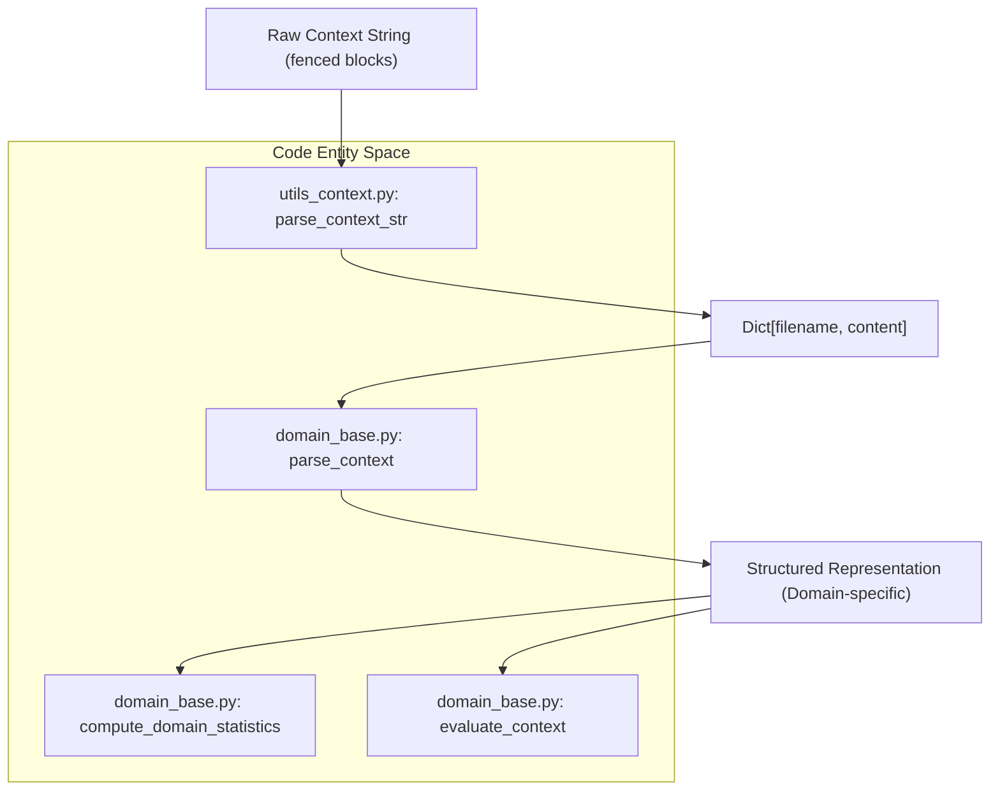
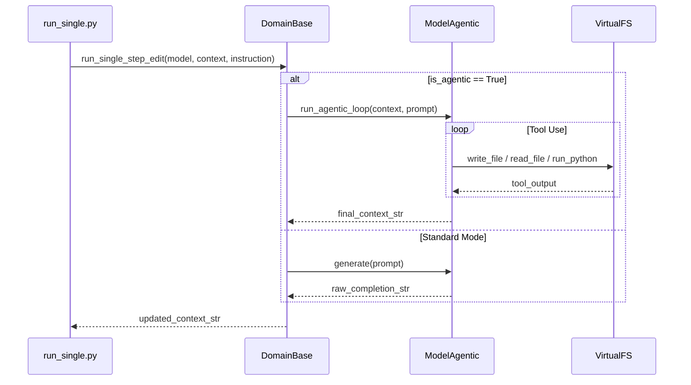
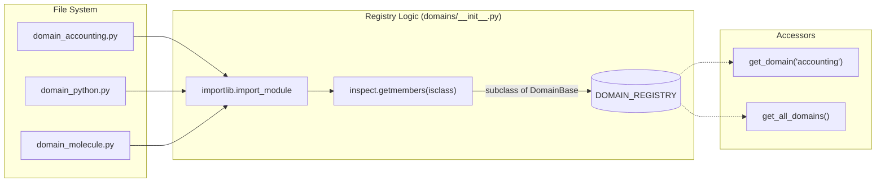

<!-- source: DeepWiki mcp.deepwiki.com · repo microsoft/delegate52 · page 3.1 DomainBase & Domain Registry · fetched 2026-10-26 -->

# DomainBase & Domain Registry

Relevant source files

The following files were used as context for generating this wiki page:

- [README.md](README.md)
- [domain_viewer/accounting.md](domain_viewer/accounting.md)

The **Domain System** is the architectural backbone of DELEGATE-52, providing a standardized interface for handling document editing across 52 distinct professional domains. This system abstracts away the complexities of different file formats (e.g., `.ledger`, `.py`, `.cif`, `.qasm`) and provides a unified mechanism for parsing, evaluation, and agentic interaction.

## DomainBase Abstract Class

`DomainBase` is the base class defined in `domains/domain_base.py`. Every domain in the benchmark must subclass this class and implement its abstract methods to provide domain-specific logic for parsing and scoring.

### Class Attributes
These attributes define the identity and metadata of a domain:
- `sample_type`: A string identifier for the domain (e.g., `"accounting"`). [domains/domain_base.py:16-16]()
- `file_format`: The primary file extension associated with the domain (e.g., `".ledger"`). [domains/domain_base.py:17-17]()
- `category`: One of the five benchmark categories (Code & Configuration, Science & Engineering, Creative & Media, Structured Records, Everyday). [domains/domain_base.py:18-18]()
- `domain_parser`: A string identifier for the parsing logic (often matches `sample_type`). [domains/domain_base.py:19-19]()

### Abstract Methods
Subclasses must implement the following methods to enable the evaluation pipeline:
- `parse_context(context_str)`: Converts a raw string (containing one or more files) into a structured dictionary representation. [domains/domain_base.py:27-29]()
- `compute_domain_statistics(structured_context)`: Calculates domain-specific metrics (e.g., number of transactions, lines of code, or atom counts) from the structured representation. [domains/domain_base.py:31-33]()
- `evaluate_context(structured_gold, structured_pred)`: The core scoring function. It compares a "gold" (original) structured context against a "predicted" (edited) one and returns a float score between 0.0 and 1.0. [domains/domain_base.py:35-37]()
- `render_context_visual(structured_context)`: Generates a human-readable or simplified visualization of the context, used primarily for logging or debugging. [domains/domain_base.py:39-41]()

### Data Flow: Context Processing
The following diagram illustrates how `DomainBase` processes document strings into structured data for evaluation.

**Domain Processing Pipeline**

Sources: [domains/domain_base.py:27-41](), [utils_context.py:13-35]()

---

## Core Functionality

### prepare_prompt()
This method prepares the instructions for the LLM by populating prompt templates with work environment data. It handles the inclusion of distractor context (irrelevant files meant to test LLM robustness) and formats the target file names and editing instructions. [domains/domain_base.py:43-69]()

### run_single_step_edit()
This is the primary execution entry point for a single editing task. It supports two distinct operational modes:
1.  **Standard Mode**: The LLM is provided with a prompt and returns a single completion containing the edited files. [domains/domain_base.py:107-111]()
2.  **Agentic Mode**: If `model.is_agentic` is true, the domain delegates the task to a tool-use loop (implemented in `model_agentic.py`). The agent can read, write, and delete files within a virtual filesystem. [domains/domain_base.py:94-105]()

**Agentic Routing Logic**

Sources: [domains/domain_base.py:84-111](), [model_agentic.py:145-195]()

---

## Domain Registry & Auto-Discovery

The `domains/__init__.py` file manages the global registry of all 52 domains. It uses an auto-discovery mechanism to avoid manual imports.

### Auto-Discovery Mechanism
The registry iterates through all files in the `domains/` directory. If a file starts with `domain_` and ends with `.py`, it is dynamically imported. The registry then inspects the module for any class that inherits from `DomainBase` (excluding `DomainBase` itself). [domains/__init__.py:12-28]()

### Key Functions
- `get_domain(domain_name)`: Retrieves the singleton instance of a domain class from the `DOMAIN_REGISTRY` dictionary. [domains/__init__.py:36-41]()
- `get_all_domains()`: Returns a list of all registered domain names. [domains/__init__.py:44-46]()

### Domain Registry Structure
| Component | Description |
| :--- | :--- |
| `DOMAIN_REGISTRY` | A dictionary mapping `sample_type` strings to instantiated `DomainBase` subclasses. |
| `DOMAIN_TO_PROMPT` | A mapping that determines which prompt template file (from the `prompts/` directory) a domain should use. |

**Domain Registration Flow**

Sources: [domains/__init__.py:12-46]()

---

## Implementation Example: Accounting Domain
The `AccountingDomain` (in `domains/domain_accounting.py`) illustrates the complexity of the `evaluate_context` method. Because transactions in a ledger can be reordered or split across files, it uses the **Hungarian Matching Algorithm** to find the optimal alignment between original and predicted transactions before calculating the final reconstruction score. [domain_viewer/accounting.md:16-23]()

Sources: [domain_viewer/accounting.md:1-25](), [domains/domain_base.py:1-111]()

---

