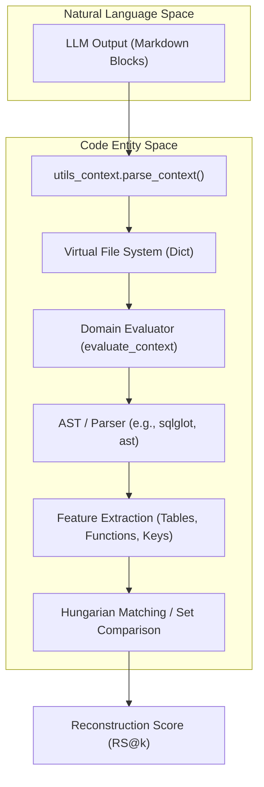
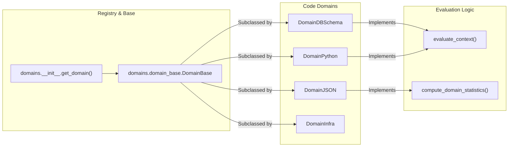

<!-- source: DeepWiki mcp.deepwiki.com · repo microsoft/delegate52 · page 3.2 Code & Configuration Domains · fetched 2026-10-26 -->

# Code & Configuration Domains

Relevant source files

The following files were used as context for generating this wiki page:

- [assets/domain_icons/dbschema.svg](assets/domain_icons/dbschema.svg)
- [assets/domain_icons/dns.svg](assets/domain_icons/dns.svg)
- [assets/domain_icons/docker.svg](assets/domain_icons/docker.svg)
- [assets/domain_icons/filesystem.svg](assets/domain_icons/filesystem.svg)
- [assets/domain_icons/graphviz.svg](assets/domain_icons/graphviz.svg)
- [assets/domain_icons/infra.svg](assets/domain_icons/infra.svg)
- [assets/domain_icons/json.svg](assets/domain_icons/json.svg)
- [assets/domain_icons/makefile.svg](assets/domain_icons/makefile.svg)
- [assets/domain_icons/malware.svg](assets/domain_icons/malware.svg)
- [assets/domain_icons/python.svg](assets/domain_icons/python.svg)
- [assets/domain_icons/translation.svg](assets/domain_icons/translation.svg)
- [domain_viewer/dbschema.md](domain_viewer/dbschema.md)
- [domain_viewer/dns.md](domain_viewer/dns.md)
- [domain_viewer/docker.md](domain_viewer/docker.md)
- [domain_viewer/filesystem.md](domain_viewer/filesystem.md)
- [domain_viewer/graphviz.md](domain_viewer/graphviz.md)
- [domain_viewer/infra.md](domain_viewer/infra.md)
- [domain_viewer/json.md](domain_viewer/json.md)
- [domain_viewer/makefile.md](domain_viewer/makefile.md)
- [domain_viewer/malware.md](domain_viewer/malware.md)
- [domain_viewer/python.md](domain_viewer/python.md)

This page documents the 11 domains within the **Code & Configuration** category. These domains focus on formal languages used for software development, system administration, and data representation. Unlike natural language domains, these require strict adherence to syntax, structural integrity, and logical consistency across multiple files.

The category covers a diverse set of formats:
- **Programming & Logic:** Python (`.py`), Makefile, Malware Rules (`.yar`).
- **Infrastructure & Systems:** Docker (`Dockerfile`), Infrastructure (`.tf`), DNS (`.zone`), Database Schema (`.sql`).
- **Data & Serialization:** JSON (`.json`), Translation (`.po`), Filesystem (`.txt`), Graphviz (`.dot`).

## Domain Implementation Overview

Each domain is implemented as a subclass of `DomainBase` [domains/domain_base.py:15-17](), providing specific logic for parsing, statistics, and evaluation. The evaluation strategies typically involve a mix of structural parsing (e.g., AST analysis for Python, SQL schema inspection) and text-based similarity metrics.

### Technical Data Flow: Code Domain Evaluation

The following diagram illustrates how a "Code & Configuration" document transitions from a raw string generated by an LLM to a structured fidelity score.

**Code Domain Evaluation Pipeline**

**Sources:** [domains/domain_base.py:108-112](), [utils_context.py:44-55]()

---

## 1. Database Schema (.sql)
The `dbschema` domain handles MySQL DDL (Data Definition Language). It tests the ability to reason about relational structures, including tables, columns, constraints, and indexes.

*   **Format:** `.sql` files containing `CREATE TABLE` statements.
*   **Parsing:** Uses `sqlite3` to dry-run the schema in-memory to validate syntax and extract metadata [domain_viewer/dbschema.md:16-17]().
*   **Evaluation:**
    *   **Table Presence (25%):** Exact match on table names.
    *   **Column Matching (40%):** Validates names and data types.
    *   **Index Coverage (20%):** Checks for index preservation.
    *   **Primary Key Correctness (15%):** Validates PK definitions [domain_viewer/dbschema.md:18-23]().

**Sources:** [domain_viewer/dbschema.md:1-25]()

## 2. DNS (.zone)
This domain focuses on RFC 1035 zone files used by BIND and other DNS servers.

*   **Format:** `.zone` files.
*   **Key Entities:** SOA records, A/AAAA records, MX, CNAME, and TXT records.
*   **Evaluation:** Measures the fidelity of resource record (RR) sets. It ensures that IP mappings and TTL values remain consistent across transformations like "Split by Subdomain" or "Export to CSV".

## 3. Docker (Dockerfile)
The `docker` domain involves containerization logic.

*   **Format:** `Dockerfile` and associated `.dockerignore` files.
*   **Logic:** Focuses on the sequence of instructions (`FROM`, `RUN`, `COPY`, `ENV`).
*   **Evaluation:** Compares the effective build layers and environment variables. It checks if the semantic intent (e.g., "Install python and copy requirements") is preserved even if the command structure changes.

## 4. Filesystem (.txt)
A meta-domain representing directory structures and file metadata.

*   **Format:** `.txt` (usually a tree representation) or actual directory hierarchies.
*   **Tasks:** Operations like "Flatten directory," "Generate tree.txt," or "Archive metadata."
*   **Evaluation:** Uses path-based matching to ensure file permissions, ownership, and relative paths are reconstructed correctly.

## 5. Graphviz (.dot)
The `graphviz` domain handles directed and undirected graphs.

*   **Format:** `.dot` files.
*   **Evaluation:** Focuses on graph topology. It extracts nodes and edges to compute a graph isomorphism-style similarity, ensuring that the connectivity of the graph is maintained regardless of visual attribute changes (like node color or shape).

## 6. Infrastructure (.tf)
This domain covers HashiCorp Terraform configurations.

*   **Format:** `.tf` (HCL - HashiCorp Configuration Language).
*   **Entities:** `resource`, `variable`, `output`, and `provider` blocks.
*   **Evaluation:** Parses the HCL to identify resource types and their attributes. It measures how many cloud resources (e.g., `aws_instance`, `azurerm_storage_account`) were correctly recovered.

## 7. JSON (.json)
The standard data interchange format.

*   **Format:** `.json`.
*   **Parsing:** Uses standard Python `json` library.
*   **Evaluation:** Performs a deep comparison of JSON objects, ignoring key order but strictly validating value types and nested structures.

## 8. Makefile
Focuses on build automation logic.

*   **Format:** `Makefile`.
*   **Entities:** Targets, dependencies, and shell commands.
*   **Evaluation:** Extracts the dependency graph. It checks if the "rules" to build specific targets remain functionally identical after edits like "Convert to CMake" and back.

## 9. Malware Rules (.yar)
Uses the YARA format for identifying and classifying malware samples.

*   **Format:** `.yar`.
*   **Entities:** `meta`, `strings` (hex, regex, text), and `condition`.
*   **Evaluation:** Specifically monitors the `condition` logic (e.g., `uint16(0) == 0x5A4D and any of ($s*)`). It ensures that the detection signatures remain semantically equivalent.

## 10. Python (.py)
The primary programming domain, testing complex logic and refactoring.

*   **Format:** `.py` files.
*   **Evaluation:** Uses Python's `ast` (Abstract Syntax Tree) module. It compares the tree structure to identify functions, classes, and variable assignments, allowing for minor whitespace variations while enforcing logic preservation.
*   **Special Prompting:** Uses `domain_python.txt` which enforces a strict fenced-block format for multi-file codebases [prompts/domain_python.txt:1-10]().

**Sources:** [prompts/domain_python.txt:1-10]()

## 11. Translation (.po)
Handles Gettext Portable Object files for software localization.

*   **Format:** `.po` files.
*   **Entities:** `msgid` (source) and `msgstr` (target).
*   **Evaluation:** Checks for the preservation of all translation keys and the accuracy of the translated strings, often involving multi-lingual consistency checks.

---

## System Mapping: From Code to Evaluation

The following diagram maps the internal Python classes and functions to the conceptual "Domains" described above.

**Code Entity Mapping**

**Sources:** [domains/__init__.py:22-25](), [domains/domain_base.py:15-30]()

---

