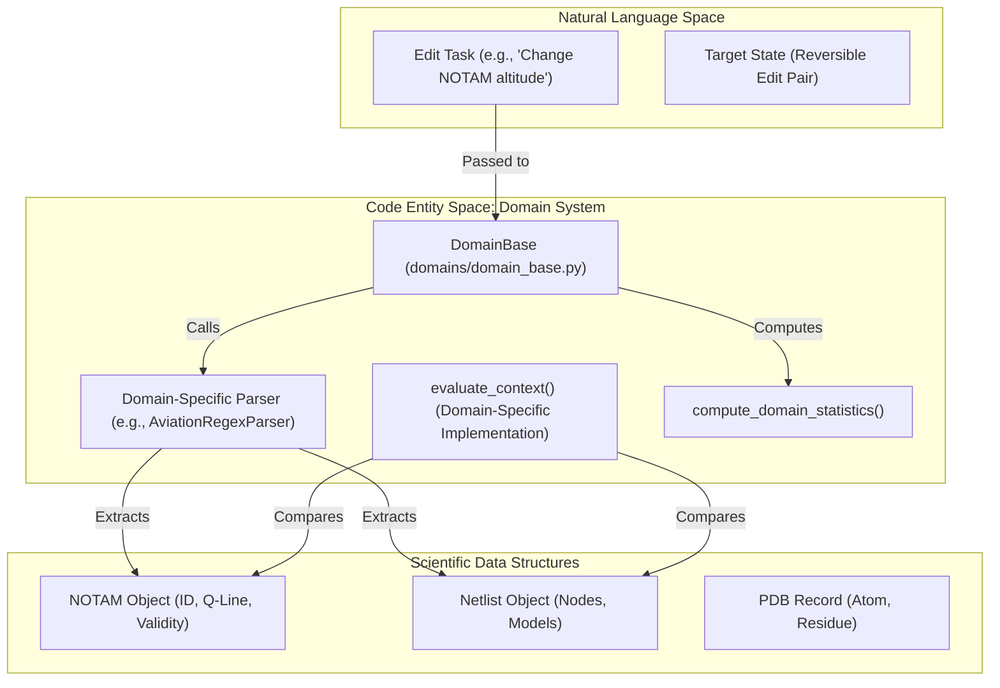

<!-- source: DeepWiki mcp.deepwiki.com · repo microsoft/delegate52 · page 3.3 Science & Engineering Domains · fetched 2026-10-26 -->

# Science & Engineering Domains

<details>
<summary>Relevant source files</summary>

The following files were used as context for generating this wiki page:

- [assets/domain_icons/aviation.svg](assets/domain_icons/aviation.svg)
- [assets/domain_icons/circuit.svg](assets/domain_icons/circuit.svg)
- [assets/domain_icons/crystal.svg](assets/domain_icons/crystal.svg)
- [assets/domain_icons/mathlean.svg](assets/domain_icons/mathlean.svg)
- [assets/domain_icons/molecule.svg](assets/domain_icons/molecule.svg)
- [assets/domain_icons/protein.svg](assets/domain_icons/protein.svg)
- [assets/domain_icons/quantum.svg](assets/domain_icons/quantum.svg)
- [assets/domain_icons/robotics.svg](assets/domain_icons/robotics.svg)
- [assets/domain_icons/satellite.svg](assets/domain_icons/satellite.svg)
- [assets/domain_icons/starcatalog.svg](assets/domain_icons/starcatalog.svg)
- [assets/domain_icons/weather.svg](assets/domain_icons/weather.svg)
- [domain_viewer/aviation.md](domain_viewer/aviation.md)
- [domain_viewer/circuit.md](domain_viewer/circuit.md)
- [domain_viewer/crystal.md](domain_viewer/crystal.md)
- [domain_viewer/mathlean.md](domain_viewer/mathlean.md)
- [domain_viewer/molecule.md](domain_viewer/molecule.md)
- [domain_viewer/protein.md](domain_viewer/protein.md)

</details>


The Science & Engineering category in DELEGATE-52 encompasses 11 domains that represent highly specialized technical formats. These domains range from aerospace communications and molecular modeling to formal mathematical proofs and quantum circuit descriptions. Unlike standard text or code, these formats often require domain-specific parsers to validate structural integrity and custom similarity metrics to evaluate the preservation of scientific semantics during LLM-driven edits.

## Domain Overview

Each domain is implemented as a subclass of `DomainBase` [domains/domain_base.py:16-18](), providing specialized logic for parsing, statistics, and evaluation.

| Domain | File Format | Icon | Primary Evaluation Focus |
| :--- | :--- | :--- | :--- |
| **Aviation** | `.notam` |  | ICAO field accuracy (Q-lines, validity periods) |
| **Circuit** | `.cir` |  | SPICE netlist topology and component parameters |
| **Crystal** | `.cif` |  | Crystallographic symmetry and atomic coordinates |
| **MathLean** | `.lean` |  | Formal proof structure and tactic blocks |
| **Molecule** | `.sdf` |  | V2000/V3000 atom blocks and bond tables |
| **Protein** | `.pdb` |  | Protein Data Bank ATOM/HETATM records |
| **Quantum** | `.qasm` |  | OpenQASM gate sequences and register declarations |
| **Robotics** | `.urdf` |  | Kinematic chain (links/joints) XML structure |
| **Satellite** | `.tle` |  | Two-Line Element set orbital parameters |
| **Star Catalog**| `.vot` |  | VOTable astronomical data and metadata |
| **Weather** | `.metar` |  | METAR/SPECI airport weather observation codes |

Sources: [domain_viewer/aviation.md:1-5](), [domain_viewer/circuit.md:1-5](), [domain_viewer/crystal.md:1-5](), [domain_viewer/mathlean.md:1-5](), [domain_viewer/molecule.md:1-5](), [domain_viewer/protein.md:1-5]().

## System Architecture: Science Domains

The following diagram illustrates how science-specific files are processed within the `DomainBase` framework, mapping the natural language editing requests to the underlying code entities.

### Science Domain Data Flow

Sources: [domains/domain_base.py:16-100](), [domain_viewer/aviation.md:14-25]().

## Specialized Parsers and Metrics

### Aviation (.notam)
The Aviation domain handles ICAO NOTAM (Notice to Air Missions) bulletins. The implementation uses a regex-based parser to decompose bulletins into approximately 20 fields [domain_viewer/aviation.md:16-23]().

*   **Key Function:** `evaluate_context` in `domain_aviation.py`.
*   **Metric:** A composite score combining NOTAM coverage (Jaccard on ID fingerprints), header accuracy (weighted fields like `qcode` and `valid_from`), and text accuracy [domain_viewer/aviation.md:18-24]().
*   **Formula:** `coverage² × content_accuracy × √((metadata + sequence) / 2)` [domain_viewer/aviation.md:24-24]().

### Circuit (.cir)
Processes SPICE netlists used for electronic circuit simulation.
*   **Implementation:** The parser identifies component types (Resistors, Capacitors, Transistors) and their connectivity (nodes).
*   **Similarity:** Focuses on netlist topology preservation and parameter value precision (e.g., ensuring a 10k resistor doesn't become 1k during an unrelated edit).

### Crystal (.cif) and Molecule (.sdf)
These domains handle chemical and structural data.
*   **Crystal (.cif):** Uses the Crystallographic Information File format. Evaluation checks for the preservation of space groups and unit cell parameters [domain_viewer/crystal.md:1-8]().
*   **Molecule (.sdf):** Processes Structure-Data Files. The evaluator parses the Atom and Bond blocks, ensuring that chemical valency and connectivity remain consistent [domain_viewer/molecule.md:1-8]().

### Robotics (.urdf)
The Unified Robot Description Format (URDF) is an XML-based representation of robot kinematics.
*   **Parser:** XML-based tree comparison.
*   **Metrics:** Measures the fidelity of the kinematic tree, specifically the `link` and `joint` attributes (origin, axis, limits).

## Technical Implementation Mapping

The following diagram bridges the domain concepts to the specific file-based architecture used for science domains.

### Science Domain Implementation Map
```mermaid
classDiagram
    class DomainBase {
        <<abstract>>
        +parse_context()
        +evaluate_context()
        +compute_domain_statistics()
    }

    class DomainAviation {
        +parse_notam_id()
        +regex_icao_parser()
    }

    class DomainCircuit {
        +parse_spice_netlist()
        +match_topology()
    }

    class DomainMathLean {
        +extract_tactic_blocks()
        +verify_proof_structure()
    }

    DomainBase <|-- DomainAviation : "Implementation (domain_aviation.py)"
    DomainBase <|-- DomainCircuit : "Implementation (domain_circuit.py)"
    DomainBase <|-- DomainMathLean : "Implementation (domain_mathlean.py)"

    style DomainAviation stroke-dasharray: 5 5
    style DomainCircuit stroke-dasharray: 5 5
    style DomainMathLean stroke-dasharray: 5 5
```
Sources: [domains/domain_base.py:16-40](), [domain_viewer/aviation.md:10-10](), [domain_viewer/mathlean.md:10-10]().

## Domain Statistics

Science domains provide specialized statistics via `compute_domain_statistics()` [domains/domain_base.py:46-55](). Examples include:
*   **Quantum:** Gate count, qubit depth, and circuit width.
*   **Protein:** Atom count, residue count, and chain identification.
*   **Satellite:** Epoch distribution and mean motion variance.
*   **Weather:** Station density and observation frequency (METAR vs SPECI).

Sources: [domains/domain_base.py:46-55](), [domain_viewer/aviation.md:8-8](), [domain_viewer/protein.md:1-8]().

---

