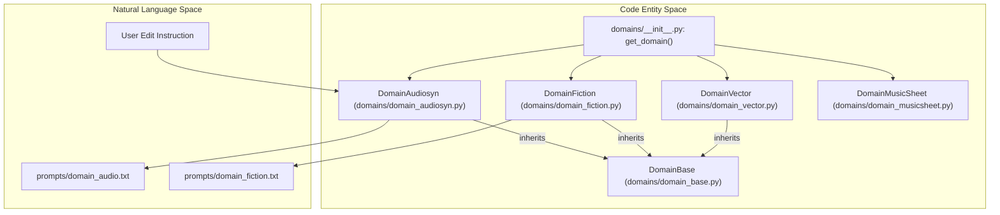
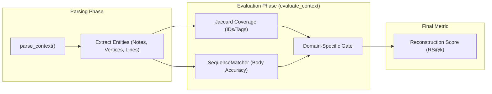

<!-- source: DeepWiki mcp.deepwiki.com · repo microsoft/delegate52 · page 3.4 Creative & Media Domains · fetched 2026-10-26 -->

# Creative & Media Domains

Relevant source files

The following files were used as context for generating this wiki page:

- [assets/domain_icons/audiosyn.svg](assets/domain_icons/audiosyn.svg)
- [assets/domain_icons/fiction.svg](assets/domain_icons/fiction.svg)
- [assets/domain_icons/fonteng.svg](assets/domain_icons/fonteng.svg)
- [assets/domain_icons/latex.svg](assets/domain_icons/latex.svg)
- [assets/domain_icons/musicsheet.svg](assets/domain_icons/musicsheet.svg)
- [assets/domain_icons/obj3d.svg](assets/domain_icons/obj3d.svg)
- [assets/domain_icons/screenplay.svg](assets/domain_icons/screenplay.svg)
- [assets/domain_icons/slides.svg](assets/domain_icons/slides.svg)
- [assets/domain_icons/subtitles.svg](assets/domain_icons/subtitles.svg)
- [assets/domain_icons/vector.svg](assets/domain_icons/vector.svg)
- [assets/domain_icons/weaving.svg](assets/domain_icons/weaving.svg)
- [domain_viewer/audiosyn.md](domain_viewer/audiosyn.md)
- [domain_viewer/fiction.md](domain_viewer/fiction.md)
- [domain_viewer/fonteng.md](domain_viewer/fonteng.md)
- [domain_viewer/latex.md](domain_viewer/latex.md)
- [domain_viewer/musicsheet.md](domain_viewer/musicsheet.md)
- [domain_viewer/obj3d.md](domain_viewer/obj3d.md)

The Creative & Media category in DELEGATE-52 encompasses 11 domains that bridge the gap between technical specification and artistic expression. These domains cover a diverse range of formats including audio synthesis, typography, musical notation, 3D modeling, and cinematic screenplays. The evaluation in these domains focuses on **creative fidelity**—ensuring that while structural edits are performed, the aesthetic or functional "soul" of the media (e.g., pitch sequences, visual paths, or narrative flow) remains intact.

### Overview of Domains

| Domain | Format | Description | Key Challenges |
|:---|:---|:---|:---|
| **Audio Synthesis** | `.csd` | CSound digital signal processing. | Pitch notation conversion, UDO extraction. |
| **Fiction** | `.md` | Narrative prose with Markdown. | Narrative consistency, word count constraints. |
| **Font Engineering**| `.fea` | Adobe OpenType feature files. | Ligature rules, kerning adjustments. |
| **LaTeX** | `.tex` | Document preparation system. | Mathematical notation, macro definitions. |
| **Music Sheet** | `.ly` | LilyPond musical notation. | Transposition, lyric alignment, polyphony. |
| **3D Object** | `.obj` | Wavefront 3D geometry. | Vertex manipulation, face normal preservation. |
| **Screenplay** | `.fadein` | Screenwriting XML/Text format. | Character dialogue flow, scene headings. |
| **Slides** | `.md` | Presentation content. | Structural hierarchy, bullet point density. |
| **Subtitles** | `.srt` | SubRip text timing. | Timecode arithmetic, sequence numbering. |
| **Vector Graphics** | `.svg` | XML-based vector images. | Path geometry, coordinate transformations. |
| **Weaving** | `.wif` | Weaving Information File. | Threading patterns, treadling sequences. |

Sources: [domain_viewer/audiosyn.md:3-5](), [domain_viewer/fiction.md:3-5](), [domain_viewer/fonteng.md:3-5](), [domain_viewer/latex.md:3-5](), [domain_viewer/musicsheet.md:3-5](), [domain_viewer/obj3d.md:3-5]()

---

### Data Flow & System Integration

The Creative & Media domains utilize specialized prompt templates to handle the nuances of artistic content. For example, the `Fiction` domain uses `domain_fiction.txt` for editing and `domain_fiction_eval.txt` for specific length-based scoring [prompts/domain_fiction.txt:1-10]().

#### Creative Domain Class Hierarchy

The following diagram illustrates how creative domains interface with the `DomainBase` and the central registry.

**Creative Domain Registry & Class Map**

Sources: [domains/domain_base.py:10-50](), [domain_viewer/audiosyn.md:10-10](), [prompts/domain_fiction.txt:1-5]()

---

### Domain Deep Dives

#### 1. Audio Synthesis (.csd)
The `Audiosyn` domain evaluates the ability to manipulate CSound synthesis code. Files consist of `<CsInstruments>` (orchestra) and `<CsScore>` (events) [domain_viewer/audiosyn.md:37-41]().

*   **Parsing:** Extracts instrument blocks (`instr` ... `endin`) and score statements (`f` for tables, `i` for notes) [domain_viewer/audiosyn.md:51-68]().
*   **Evaluation:** Uses a "Core x Aux" formula. Core scoring checks instrument coverage and note accuracy. Aux scoring covers function tables, global settings (`sr`, `ksmps`), and event sequencing [domain_viewer/audiosyn.md:16-24]().
*   **Tasks:** Pitch conversion (octave.pitch to MIDI), UDO (User Defined Opcode) extraction, and carry notation expansion [domain_viewer/audiosyn.md:99-102]().

#### 2. Vector Graphics (.svg)
The `Vector` domain focuses on geometric manipulation of XML-based graphics.

*   **Logic:** Models must transform path data (`d` attributes), adjust coordinate systems, or modify style attributes without breaking the XML structure.
*   **Evaluation:** Measures geometric fidelity by comparing path command sequences and coordinate precision.
*   **Icons:** The domain uses a standardized 24x24 viewBox icon system [assets/domain_icons/vector.svg:1-8]().

#### 3. Fiction (.md)
Unlike code-heavy domains, `Fiction` focuses on prose. It uses a specific evaluator that checks for narrative consistency and adherence to style constraints.

*   **Prompting:** Uses `domain_fiction.txt` which emphasizes maintaining the tone and character voices [prompts/domain_fiction.txt:1-10]().
*   **Scoring:** Includes word-count-to-target ratios and semantic similarity between the original and reconstructed prose [domain_viewer/fiction.md:14-20]().

---

### Specialized Scoring Architectures

Creative domains often require non-standard scoring because a single character change (e.g., in a 3D vertex or a musical note) can have a catastrophic effect on the output.

**Creative Fidelity Scoring Flow**

Sources: [domains/domain_base.py:130-150](), [domain_viewer/audiosyn.md:16-24]()

### Creative Assets & Visuals
Each domain is associated with a specific SVG icon used in the `Domain Viewer` to represent the file format visually. These icons follow a strict design language: 24x24 pixels, stroke-width 2, and no fill [assets/domain_icons/obj3d.svg:1-6]().

| Domain | Icon Preview (SVG Path) | Design Rationale |
|:---|:---|:---|
| **3D Object** | `M12 2l9 5v10l-9 5-9-5V7z` | Isometric cube representation [assets/domain_icons/obj3d.svg:2-2](). |
| **Music Sheet** | `M9 18V5l12-2v13` | Musical eighth notes [assets/domain_icons/musicsheet.svg:2-2](). |
| **Subtitles** | `rect x="2" y="4" ... SRT` | Video frame with text lines [assets/domain_icons/subtitles.svg:2-7](). |
| **Weaving** | `line x1="6" y1="2" ...` | Thread grid with over-segments [assets/domain_icons/weaving.svg:3-8](). |

Sources: [assets/domain_icons/obj3d.svg:1-6](), [assets/domain_icons/musicsheet.svg:1-5](), [assets/domain_icons/subtitles.svg:1-8](), [assets/domain_icons/weaving.svg:1-20]()

---

