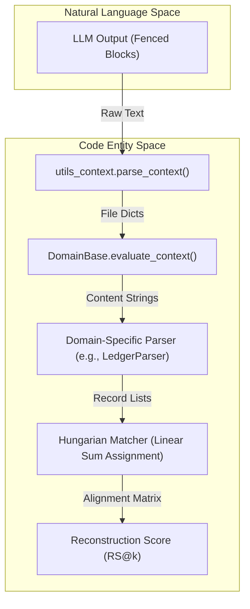
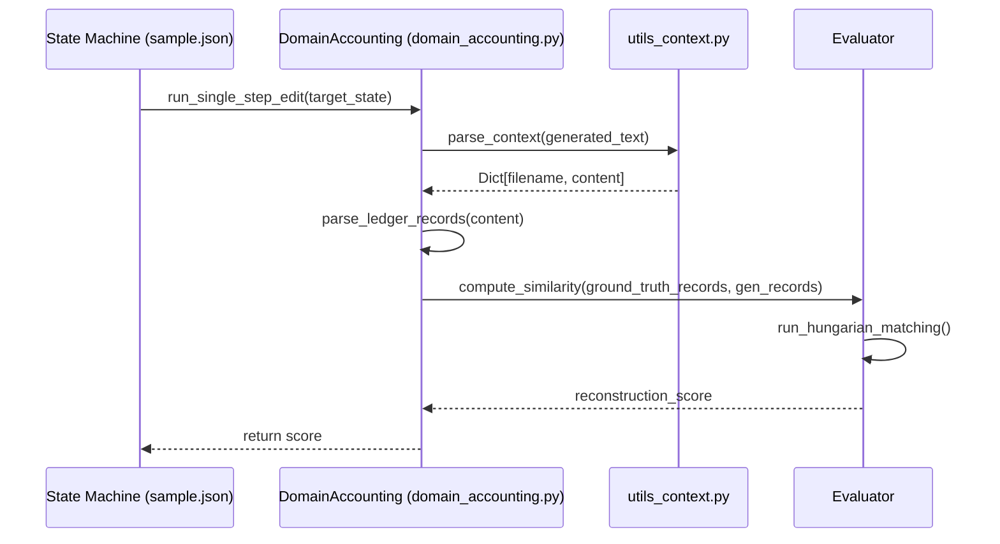

<!-- source: DeepWiki mcp.deepwiki.com · repo microsoft/delegate52 · page 3.5 Structured Records Domains · fetched 2026-10-26 -->

# Structured Records Domains

Relevant source files

The following files were used as context for generating this wiki page:

- [assets/domain_icons/accounting.svg](assets/domain_icons/accounting.svg)
- [assets/domain_icons/calendar.svg](assets/domain_icons/calendar.svg)
- [assets/domain_icons/edifact.svg](assets/domain_icons/edifact.svg)
- [assets/domain_icons/emails.svg](assets/domain_icons/emails.svg)
- [assets/domain_icons/genealogy.svg](assets/domain_icons/genealogy.svg)
- [assets/domain_icons/geodata.svg](assets/domain_icons/geodata.svg)
- [assets/domain_icons/geotrack.svg](assets/domain_icons/geotrack.svg)
- [assets/domain_icons/hamradio.svg](assets/domain_icons/hamradio.svg)
- [assets/domain_icons/libcatalog.svg](assets/domain_icons/libcatalog.svg)
- [assets/domain_icons/spreadsheet.svg](assets/domain_icons/spreadsheet.svg)
- [assets/domain_icons/treebank.svg](assets/domain_icons/treebank.svg)
- [domain_viewer/accounting.md](domain_viewer/accounting.md)
- [domain_viewer/calendar.md](domain_viewer/calendar.md)
- [domain_viewer/edifact.md](domain_viewer/edifact.md)
- [domain_viewer/emails.md](domain_viewer/emails.md)
- [domain_viewer/genealogy.md](domain_viewer/genealogy.md)
- [domain_viewer/geodata.md](domain_viewer/geodata.md)
- [domain_viewer/geotrack.md](domain_viewer/geotrack.md)
- [domain_viewer/hamradio.md](domain_viewer/hamradio.md)
- [domain_viewer/libcatalog.md](domain_viewer/libcatalog.md)

The Structured Records category encompasses 11 domains that focus on machine-readable, semi-structured, and record-oriented data formats. These domains test an LLM's ability to manipulate complex data hierarchies, maintain referential integrity across multiple files, and perform precise arithmetic or classification on structured fields.

## Domain Overview

The 11 domains in this category cover financial, temporal, logistical, and scientific record-keeping formats.

| Domain | File Format | Icon | Summary |
|:---|:---:|:---:|:---|
| **Accounting** | `.ledger` |  | Financial records using Ledger-cli double-entry bookkeeping. |
| **Calendar** | `.ics` |  | iCalendar events, VEVENT blocks, and recurrence rules. |
| **EDIFACT** | `.edi` |  | Electronic Data Interchange for Administration, Commerce and Transport. |
| **Emails** | `.mbox` |  | Email archives containing headers, metadata, and body content. |
| **Genealogy** | `.ged` |  | GEDCOM family tree records with cross-referenced individuals. |
| **Geodata** | `.geojson` |  | Geographic features, coordinates, and property metadata. |
| **Geotrack** | `.gpx` |  | GPS Exchange Format for routes, tracks, and waypoints. |
| **Ham Radio** | `.adi` |  | Amateur Data Interchange Format (ADIF) for radio contact logs. |
| **Library Catalog** | `.xml` |  | MARCXML bibliographic records for library assets. |
| **Spreadsheet** | `.csv` |  | Tabular data with potential for complex relational mapping. |
| **Treebank** | `.conllu` |  | CoNLL-U format for linguistic annotations and dependency trees. |

**Sources:** `[domain_viewer/accounting.md:1-5]()`, `[assets/domain_icons/accounting.svg:1-7]()`, `[assets/domain_icons/calendar.svg:1-7]()`, `[assets/domain_icons/edifact.svg:1-13]()`, `[assets/domain_icons/emails.svg:1-4]()`, `[assets/domain_icons/genealogy.svg:1-9]()`, `[assets/domain_icons/geodata.svg:1-7]()`, `[assets/domain_icons/geotrack.svg:1-6]()`, `[assets/domain_icons/hamradio.svg:1-8]()`, `[assets/domain_icons/libcatalog.svg:1-8]()`, `[assets/domain_icons/spreadsheet.svg:1-7]()`, `[assets/domain_icons/treebank.svg:1-13]()`

---

## Technical Implementation & Data Flow

Structured records domains rely on specialized parsers that convert raw text into internal Python representations (lists of dictionaries or objects) before performing evaluation.

### Architecture: Record-Based Evaluation
The system follows a standard pipeline where the `evaluate_context` method of a domain class compares a `ground_truth` context against a `generated` context by decomposing them into atomic records.

**Diagram: Structured Record Processing Pipeline**

**Sources:** `[domain_viewer/accounting.md:16-23]()`, `[domains/domain_base.py:10-40]()` (Conceptual architecture from domain_base and specific implementations).

---

## Detailed Example: Accounting Domain (.ledger)

The Accounting domain is a representative example of structured record evaluation. It uses the `Ledger-cli` format, which is highly sensitive to arithmetic precision and hierarchical naming.

### Data Model
A `.ledger` file is parsed into a list of transactions. Each transaction contains:
- **Header:** Date and Payee.
- **Postings:** A list of account names and their associated monetary amounts.
- **Comments:** Metadata such as receipt IDs or notes.

**Sources:** `[domain_viewer/accounting.md:8-10]()`, `[domain_viewer/accounting.md:35-40]()`

### Hungarian-Matching Evaluator
Because LLMs may reorder transactions or split them across files (e.g., during a "Person Split" task), a simple line-by-line diff is insufficient. The evaluator uses the **Hungarian Algorithm** (Linear Sum Assignment) to find the optimal one-to-one mapping between ground-truth transactions and generated transactions.

#### Scoring Dimensions
The evaluator computes a composite score based on four metrics:
1.  **Transaction Coverage:** The ratio of matched transactions to total expected transactions.
2.  **Posting Accuracy:** Correctness of the account hierarchy (e.g., `Expenses:Operating:Office:Supplies`).
3.  **Amount Accuracy:** Calculated as a `min(val1, val2) / max(val1, val2)` ratio to handle floating-point precision.
4.  **Comment Preservation:** Similarity of receipt references and notes.

**Formula:**
`Score = coverage² × posting × amount × (0.5 + 0.5 × √comment)`

**Sources:** `[domain_viewer/accounting.md:16-24]()`

---

## Common Task Patterns

Structured records domains frequently utilize the following edit task types:

| Task Type | Description | Example (Accounting) |
|:---|:---|:---|
| **Split & Merge** | Distributing records into multiple files based on a property and recombining them. | `Person Split`: Split ledger by person; merge back by date. |
| **Format Conversion** | Translating records between the domain format and a generic format like CSV or JSON. | `CSV Conversion`: Ledger to `ledger.csv` and back. |
| **Referential Integrity** | Moving data to an external manifest and replacing it with IDs. | `Receipt Manifest`: Extract receipt filenames to CSV; use `#001` in ledger. |
| **Numerical Reasoning** | Applying mathematical transformations to record values. | `EUR Conversion`: Convert USD to EUR using a specific rate. |

**Sources:** `[domain_viewer/accounting.md:95-106]()`

## Implementation Details: Mapping Logic

The following diagram illustrates how the `DomainBase` methods interact with the `utils_context` module to manage structured files during an evaluation cycle.

**Diagram: State Transition and Evaluation Flow**

**Sources:** `[domain_viewer/accounting.md:16-24]()`, `[domains/domain_base.py:10-40]()` (Conceptual flow derived from domain requirements).

---

