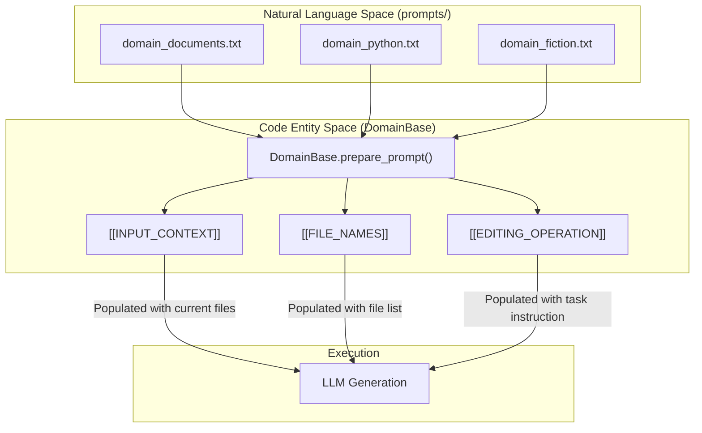
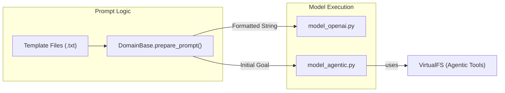

<!-- source: DeepWiki mcp.deepwiki.com · repo microsoft/delegate52 · page 4 Prompt Templates · fetched 2026-10-26 -->

# Prompt Templates

Relevant source files

The following files were used as context for generating this wiki page:

- [README.md](README.md)

The `prompts/` directory contains the foundational instructions that guide Large Language Models (LLMs) through the document editing process. These templates define the persona, the expected output format, and the constraints for each of the 52 domains. By using a templated approach, DELEGATE-52 ensures that LLMs receive consistent context while allowing for domain-specific nuances required for complex formats like Python code or creative fiction.

### Template Architecture

The prompt system relies on three primary placeholders that are dynamically populated during the experiment execution. These placeholders allow the `DomainBase` class to inject the current state of the work environment into the static instructions.

| Placeholder | Description |
| :--- | :--- |
| `[[INPUT_CONTEXT]]` | The current state of the document(s), often formatted as a series of fenced code blocks. |
| `[[FILE_NAMES]]` | A list of the files currently present in the work environment. |
| `[[EDITING_OPERATION]]` | The specific natural language instruction describing the edit to be performed (e.g., "Add a new route to the API"). |

The population of these templates is handled by the `prepare_prompt` method in the base domain class [domains/domain_base.py:151-171](). This method reads the relevant `.txt` file from the `prompts/` directory and performs string substitution based on the current `WorkEnvironment` [domains/domain_base.py:160-168]().

### Prompt Flow and Population

The following diagram illustrates how the `DomainBase` class bridges the gap between the raw prompt files and the execution-ready string sent to the LLM.

**Prompt Population Workflow**

Sources: [domains/domain_base.py:151-171](), [README.md:24-24]()

---

### Standard Document Prompt

The majority of the 52 domains utilize the `domain_documents.txt` template. This template establishes a "Professional Assistant" persona and enforces a strict output format: the LLM must return the entire updated document context within Markdown fenced code blocks, where each block is preceded by the filename. This structure is critical for the `utils_context.py` module to correctly parse the LLM's response back into the work environment.

For details, see [Standard Document Prompt](#4.1).

### Specialized Prompt Templates

While the standard prompt works for most structured records and science domains, certain domains require specialized instructions to handle unique constraints:

*   **Python (`domain_python.txt`)**: Tailored for code editing, emphasizing the preservation of logic and specific block formatting [README.md:24-24]().
*   **Audio (`domain_audio.txt`)**: Provides minimal instructions suitable for the Csound (`.csd`) synthesis format.
*   **Fiction (`domain_fiction.txt` & `domain_fiction_eval.txt`)**: Includes instructions regarding target length and creative consistency for the `fiction` domain.
*   **Image (`domain_image.txt`)**: Used for domains involving vector graphics or image-related descriptions.

For details, see [Specialized Prompt Templates](#4.2).

### Interaction with Model Wrappers

The populated prompt is passed to the model wrappers, such as `model_openai.py` or `model_agentic.py`. In the standard relay flow, the prompt is treated as a single system/user message combo [run_relay.py:19-19](). However, in the agentic flow, the prompt serves as the initial "goal" within a tool-use loop where the LLM can interact with a `VirtualFS` [model_agentic.py:22-22]().

**System Integration Diagram**

Sources: [domains/domain_base.py:151-171](), [README.md:19-22](), [run_relay.py:19-19]()

---
**Sources:**
* [README.md:19-24]()
* [domains/domain_base.py:151-171]()
* [run_relay.py:19-19]()
* [model_agentic.py:22-22]()

---

