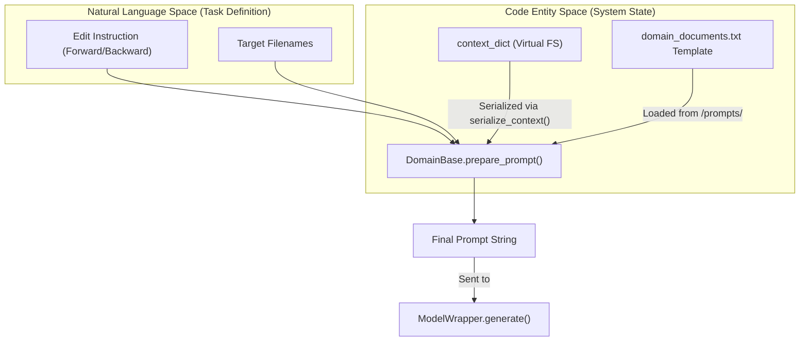
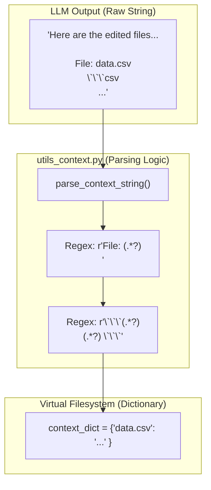

<!-- source: DeepWiki mcp.deepwiki.com · repo microsoft/delegate52 · page 4.1 Standard Document Prompt · fetched 2026-10-26 -->

# Standard Document Prompt

<details>
<summary>Relevant source files</summary>

The following files were used as context for generating this wiki page:

- [README.md](README.md)
- [domain_viewer/accounting.md](domain_viewer/accounting.md)

</details>


The Standard Document Prompt is the primary instruction template used by the DELEGATE-52 benchmark to guide Large Language Models (LLMs) through document editing tasks. Defined in `prompts/domain_documents.txt`, it establishes the "rules of engagement" for how models should interpret input context, execute requested edits, and format their multi-file outputs to ensure they are machine-parseable by the evaluation framework.

## Purpose and Scope

The prompt is designed to handle the majority of the 52 domains that involve structured or semi-structured text (e.g., Accounting, Science, Engineering, and Structured Records). It forces the LLM to act as a precise document editor rather than a conversational assistant. 

Key objectives of the prompt include:
1.  **Context Definition**: Explicitly marking the boundaries of the provided "Work Environment" using the `[[INPUT_CONTEXT]]` placeholder.
2.  **Task Specification**: Defining the transformation via the `[[EDITING_OPERATION]]` placeholder.
3.  **Format Enforcement**: Requiring the use of fenced code blocks with specific filename headers to allow `utils_context.py` to parse the results.

| Component | Code Reference | Role |
| :--- | :--- | :--- |
| **Template File** | `prompts/domain_documents.txt` | The raw markdown/text template. |
| **Placeholder Logic** | `domains/domain_base.py` [101-125]() | `prepare_prompt()` method that populates placeholders. |
| **Parser** | `utils_context.py` [22-54]() | `parse_context_string()` which extracts files from the LLM response. |

Sources: [prompts/domain_documents.txt:1-15](), [domains/domain_base.py:101-125](), [utils_context.py:22-54]()

## Data Flow and Substitution

The standard prompt relies on a substitution mechanism within the `DomainBase` class. When an experiment runner (like `run_relay.py`) triggers an edit, the system fetches the current state of the virtual filesystem and injects it into the template.

### Prompt Generation Diagram

This diagram illustrates how the system transitions from the "Natural Language Space" (the human-readable instructions) to the "Code Entity Space" (the actual file strings and variables) using the `prepare_prompt` method.

**Figure 1: Prompt Substitution Flow**

Sources: [domains/domain_base.py:101-125](), [utils_context.py:1-20](), [run_relay.py:55-80]()

## Output Format Requirements

The prompt contains strict instructions regarding the output format. To ensure that the `utils_context.py` module can reliably reconstruct the edited environment, the LLM is instructed to:
1.  Use triple backticks for code blocks.
2.  Precede every block with a filename header (e.g., `File: example.sql`).
3.  Include the full content of the file, not just diffs.

### Example Template Structure
The following is the conceptual structure of `prompts/domain_documents.txt`:

```text
You are an expert assistant specialized in document editing...

[[INPUT_CONTEXT]]

Your task is to: [[EDITING_OPERATION]]

The output should strictly follow this format:
File: [[FILE_NAMES]]
```
Sources: [prompts/domain_documents.txt:1-10]()

## LLM-to-Context Parsing

Once the LLM generates a response based on the Standard Document Prompt, the system must translate that natural language response back into a structured dictionary (the "Context"). This is handled by `utils_context.parse_context_string`.

**Figure 2: Context Reconstruction Logic**


### Key Functions in the Parsing Chain
*   **`serialize_context(context_dict)`**: Converts the internal dictionary of filenames and content into a single string for the `[[INPUT_CONTEXT]]` placeholder [utils_context.py:1-20]().
*   **`parse_context_string(output_string)`**: The inverse operation. It scans for the "File: " markers mandated by the prompt and extracts the subsequent code blocks [utils_context.py:22-54]().
*   **`normalize_fenced_code_blocks(text)`**: Cleans up common LLM formatting errors (like missing language tags or trailing whitespace) to ensure the parser remains robust [utils_context.py:56-75]().

Sources: [utils_context.py:1-75](), [domains/domain_base.py:130-150]()

## Integration in DomainBase

While `domain_documents.txt` is the default, `DomainBase` allows specific domains to override this. However, most domains (like `domain_accounting.py` or `domain_notam.py`) inherit the standard behavior.

The `prepare_prompt` method in `DomainBase` [101-125]() performs the following steps:
1.  Identifies the correct template file (defaulting to `domain_documents.txt`).
2.  Calls `serialize_context` to format the current files.
3.  Joins the `target_filenames` into a comma-separated string for the `[[FILE_NAMES]]` placeholder.
4.  Performs a global string replacement to produce the final instruction set.

Sources: [domains/domain_base.py:101-125](), [domain_viewer/accounting.md:10-11]()

---

