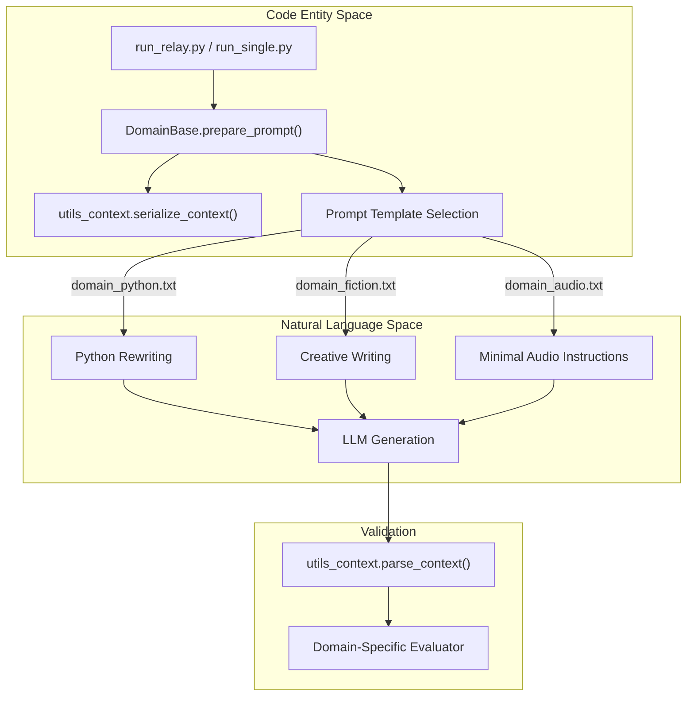
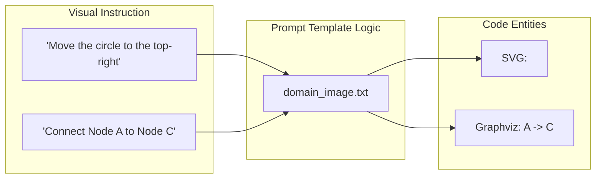

<!-- source: DeepWiki mcp.deepwiki.com · repo microsoft/delegate52 · page 4.2 Specialized Prompt Templates · fetched 2026-10-26 -->

# Specialized Prompt Templates

Relevant source files

The following files were used as context for generating this wiki page:

- [README.md](README.md)
- [domain_viewer/audiosyn.md](domain_viewer/audiosyn.md)
- [domain_viewer/fiction.md](domain_viewer/fiction.md)
- [domain_viewer/python.md](domain_viewer/python.md)

The DELEGATE-52 benchmark utilizes a variety of prompt templates to guide LLMs through the delegated document editing process. While the majority of the 52 domains use the standard `domain_documents.txt` template, several domains require specialized instructions to handle specific technical constraints, output formats, or evaluation criteria. These specialized templates are located in the `prompts/` directory and are dynamically selected by `DomainBase.prepare_prompt()`.

## Template Architecture and Data Flow

The specialized templates utilize a set of common placeholders that are populated during the experiment runtime. The `DomainBase` class (and its domain-specific overrides) is responsible for resolving these placeholders before sending the final string to the `ModelWrapper`.

| Placeholder | Description | Source |
| :--- | :--- | :--- |
| `[[INPUT_CONTEXT]]` | The current state of the document(s) being edited. | `utils_context.serialize_context()` |
| `[[FILE_NAMES]]` | A comma-separated list of filenames in the current environment. | `utils_context.parse_context().keys()` |
| `[[EDITING_OPERATION]]` | The specific natural language instruction for the forward or backward edit. | `sample.json` (states/prompts) |
| `[[TARGET_LENGTH]]` | Used in fiction domains to specify the desired word count. | `domain_fiction.py` |

### System Data Flow Diagram

The following diagram illustrates how the specialized templates bridge the gap between the raw dataset entities and the final LLM prompt.

**Prompt Generation and Execution Flow**

Sources: [run_relay.py:1-100](), [domains/domain_base.py:120-150](), [utils_context.py:10-50]()

---

## Python Domain (`domain_python.txt`)

The Python domain template is designed for code refactoring and rewriting. It emphasizes an explicit file block format to ensure that the LLM provides the full source code for every file in the environment, even if only one file is modified. This prevents the model from providing "diffs" or partial snippets which would break the `utils_context.parse_context()` logic.

### Key Characteristics
- **Explicit Formatting**: Instructs the model to use `File: <filename>` headers followed by triple-backtick code blocks.
- **Refactoring Focus**: Optimized for tasks like splitting files, merging modules, or converting procedural code to Object-Oriented Programming (OOP).
- **Integrity**: Explicitly forbids the use of ellipses (`...`) or comments like "rest of code remains the same."

Sources: [domains/domain_python.py:1-20](), [domain_viewer/python.md:90-110]()

---

## Fiction Domains (`domain_fiction.txt` & `domain_fiction_eval.txt`)

The Fiction domain is unique because it does not evaluate against a static reference document. Instead, it evaluates the quality of the creative output using an LLM-as-a-judge and a length-fidelity penalty.

### Creative Writing Template (`domain_fiction.txt`)
This template includes a `[[TARGET_LENGTH]]` placeholder. The LLM is instructed to maintain narrative coherence and character voice while strictly adhering to a word count. This is critical because the `domain_fiction.py` evaluator applies an exponential penalty if the output deviates by more than 10% from the target.

### Evaluation Template (`domain_fiction_eval.txt`)
Used by the evaluator to score the LLM's output across 14 aspects of the **TTCW (Technical Tool for Creative Writing)**.

| Aspect | Description |
| :--- | :--- |
| **Coherence** | Logical consistency of the narrative. |
| **Perspective** | Consistency of the narrative voice. |
| **Rhetorical Complexity** | Use of subtext and layered meaning. |

Sources: [domains/domain_fiction.py:40-80](), [domain_viewer/fiction.md:14-36]()

---

## Audio Domain (`domain_audio.txt`)

The `domain_audio.txt` template is used for the **Audiosyn** domain, which involves editing CSound (`.csd`) files. Because `.csd` files are highly structured (containing XML-like tags, orchestral code, and score events), this template provides minimal editing instructions that focus on the relationship between the instrument definitions (`<CsInstruments>`) and the score events (`<CsScore>`).

### Implementation Details
The template ensures the LLM understands that:
1. **Instrument IDs** must match between the orchestra and the score.
2. **Function Tables** (f-statements) are global resources.
3. **Timing and Frequency** calculations must be precise across blocks.

Sources: [domain_viewer/audiosyn.md:1-25](), [domains/domain_audiosyn.py:1-15]()

---

## Image Domain (`domain_image.txt`)

The Image domain prompt is specialized for formats like **SVG** and **Graphviz (.dot)**. It focuses on the spatial and structural nature of the documents. Unlike text-heavy prompts, this template encourages the LLM to think in terms of coordinates, connections, and visual attributes.

### Logical Entity Mapping
The following diagram shows how the `domain_image.txt` template maps high-level visual instructions to the underlying code entities.

**Visual-to-Code Entity Mapping**

Sources: [domains/domain_base.py:100-110](), [domain_viewer/README.md:1-50]()

---

## Summary of Specialized Templates

| Template File | Primary Domains | Key Placeholder | Logic Class |
| :--- | :--- | :--- | :--- |
| `domain_python.txt` | Python | `[[INPUT_CONTEXT]]` | `DomainPython` |
| `domain_fiction.txt` | Fiction | `[[TARGET_LENGTH]]` | `DomainFiction` |
| `domain_audio.txt` | Audiosyn | `[[EDITING_OPERATION]]` | `DomainAudiosyn` |
| `domain_image.txt` | SVG, Graphviz | `[[INPUT_CONTEXT]]` | `DomainBase` |

Sources: [domains/__init__.py:1-50](), [README.md:17-25]()

---

