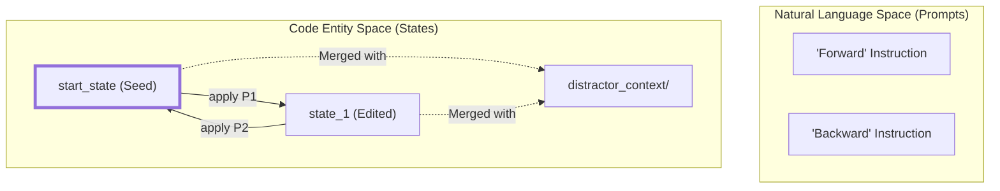
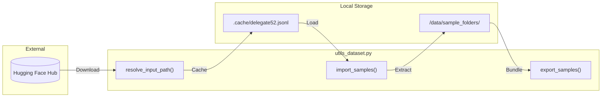

<!-- source: DeepWiki mcp.deepwiki.com · repo microsoft/delegate52 · page 5 Dataset & Work Environments · fetched 2026-10-26 -->

# Dataset & Work Environments

Relevant source files

The following files were used as context for generating this wiki page:

- [README.md](README.md)
- [assets/figures/work_environments.png](assets/figures/work_environments.png)

DELEGATE-52 is a specialized benchmark comprising 234 redistributable work environments across 52 professional domains. These environments are designed to simulate long-horizon delegated workflows where an AI agent must perform reversible structural edits on complex documents.

## Dataset Overview

The dataset is hosted on Hugging Face at [microsoft/delegate52](https://huggingface.co/datasets/microsoft/delegate52) and is automatically managed by the repository's utility functions [README.md:42-46](). 

Each "Work Environment" consists of:
*   **Seed Document:** A high-fidelity original file (e.g., a `.sql` schema, a `.pdb` protein structure, or a `.py` source file).
*   **State Machine:** A set of predefined "states" representing the document after specific edits, along with "prompts" that instruct the model on how to transition between them.
*   **Distractor Context:** A collection of auxiliary files (often 100+ files) that do not need editing but serve to test the model's ability to navigate large contexts [README.md:44-45]().

### Work Environment Structure

The following diagram illustrates how a work environment bridges the natural language instructions (prompts) to the concrete file states within the `sample.json` configuration.

**Work Environment State Machine**

Sources: [README.md:13-17](), [assets/figures/work_environments.png:1-30]()

---

## Dataset Schema & Format

The dataset is distributed as a single `delegate52.jsonl` file. Each line represents a unique sample (work environment) containing the full state machine and file contents.

### JSONL Sample Schema
Key fields in the sample object include:
*   `sample_id`: Unique identifier for the environment.
*   `sample_type`: The domain category (e.g., `subtitles`, `python`, `circuit`).
*   `states`: A dictionary mapping state IDs to the folder containing the document version.
*   `prompts`: A list of transition instructions, each specifying a `target_state`.
*   `ok_to_redistribute`: A boolean flag ensuring compliance with original document licenses.

For a deep dive into the specific JSON fields and the state machine logic, see **[Dataset Format & Schema (#5.1)]()**.

---

## Data Management & Integration

The repository provides automated tools in `utils_dataset.py` to handle the lifecycle of these environments, from downloading them for experiments to exporting new ones for contribution.

### Integration Workflow

The `resolve_input_path()` function in `utils_dataset.py` acts as the primary entry point, checking for local files before defaulting to a Hugging Face download [utils_dataset.py:125-145]().

**Data Flow Architecture**

Sources: [utils_dataset.py:10-50](), [utils_dataset.py:125-145](), [README.md:48-57]()

### Distractor Context Mechanism
The `distractor_context` is a critical component for evaluating long-context performance. During an experiment, `utils_env.py` merges the active state's files with the contents of the `distractor_context/` directory before presenting them to the model [README.md:90](). This forces the model to identify the correct file to edit amidst "noise."

For details on how to programmatically import, export, or download the dataset, see **[Dataset Import, Export & HuggingFace Integration (#5.2)]()**.

---

## Related Components
*   **Experiment Runners:** `run_relay.py` utilizes the dataset to chain these states together for multi-turn evaluation [run_relay.py:1-20]().
*   **Domain System:** Each `sample_type` corresponds to a class in `domains/` that knows how to parse and evaluate the files within the states [domains/domain_base.py:10-30]().

Sources:
- [README.md:13-25]()
- [README.md:40-57]()
- [utils_dataset.py:1-150]()
- [assets/figures/work_environments.png:1-30]()

---

