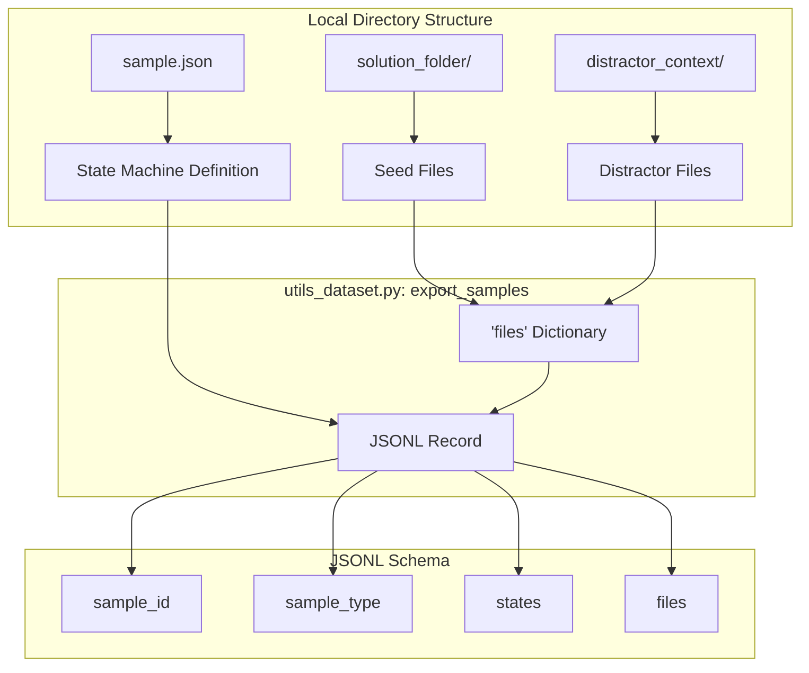
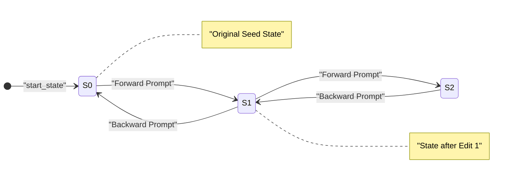
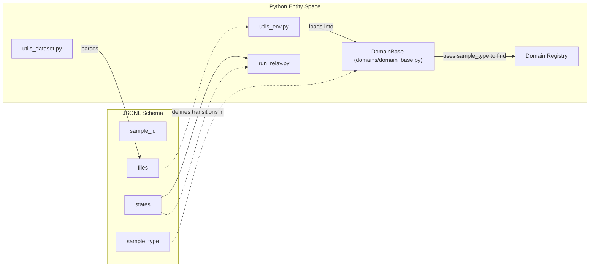

<!-- source: DeepWiki mcp.deepwiki.com · repo microsoft/delegate52 · page 5.1 Dataset Format & Schema · fetched 2026-10-26 -->

# Dataset Format & Schema

<details>
<summary>Relevant source files</summary>

The following files were used as context for generating this wiki page:

- [README.md](README.md)

</details>


The DELEGATE-52 dataset is structured to facilitate long-horizon delegated document editing simulations. It uses a state-machine approach where each "Work Environment" consists of a seed document and a set of reversible edit pairs. This page documents the technical schema of the JSONL dataset and the underlying directory structure used for local development and ingestion.

## JSONL Dataset Schema

The primary distribution format is a single JSONL file (typically `delegate52.jsonl`). Each line in this file represents a complete "Work Environment" and follows a standardized schema. This schema encapsulates all information required to perform round-trip relay simulations without external file dependencies [utils_dataset.py:40-62]().

### Top-Level Fields

| Field | Type | Description |
| :--- | :--- | :--- |
| `sample_id` | `string` | A unique identifier for the environment (e.g., `chess_001`). |
| `sample_type` | `string` | The domain name corresponding to a registered domain class (e.g., `chess`, `python`, `ledger`). |
| `sample_name` | `string` | A human-readable name for the specific sample. |
| `states` | `dict` | A mapping of `state_id` to state objects (the state machine nodes). |
| `metadata` | `dict` | Includes the `start_state` ID and an `ok_to_redistribute` boolean flag. |
| `files` | `dict` | A flat mapping of filenames to their UTF-8 string content. |

### The `files` Dictionary
The `files` dictionary acts as a virtual filesystem for the sample. It contains:
1.  **Seed Documents**: The initial files located in the `solution_folder` of the `start_state`.
2.  **Distractor Context**: Files originally located in the `distractor_context/` directory [utils_env.py:30-40]().
3.  **State-Specific Files**: Files belonging to intermediate or final states in the edit chain.

### Dataset Data Flow
The following diagram illustrates how the `utils_dataset.py` module transforms a directory-based work environment into the JSONL schema.

**Title: Directory to JSONL Transformation**

Sources: [utils_dataset.py:40-62](), [utils_env.py:18-45]()

---

## State Machine Format (`sample.json`)

The core of a work environment is the `sample.json` file. This file defines the "ground truth" states of the document and the instructions (prompts) required to transition between them.

### State Object
Each entry in the `states` dictionary represents a specific version of the document collection.
*   **`state_id`**: A unique string (e.g., `S0`, `S1_forward`).
*   **`solution_folder`**: The relative path to the directory containing the files for this state.
*   **`prompts`**: A list of prompt objects defining transitions to other states.

### Prompt Object
Prompts define the delegated task.
*   **`target_state`**: The ID of the state that should result if the LLM follows the prompt correctly.
*   **`prompt`**: The natural language instruction provided to the LLM.
*   **`operation`**: (Optional) A tag describing the edit type (e.g., `add_player`, `refactor_function`).

### Reversible Edit Logic
A "Round-Trip" is formed by a pair of prompts where the first prompt transitions from `S_initial` to `S_modified`, and the second prompt transitions from `S_modified` back to `S_initial` [run_relay.py:53-75]().

**Title: State Machine Transition Logic**

Sources: [run_relay.py:53-75](), [utils_env.py:47-65]()

---

## Work Environment Directory Structure

When the dataset is imported using `import_samples()`, it is expanded into a directory structure that `run_relay.py` and `run_single.py` use to initialize simulation environments [utils_dataset.py:73-102]().

```text
domain_name/
└── sample_id/
    ├── sample.json           # State machine & prompt definitions
    ├── distractor_context/   # Optional: Files to be added to every prompt
    ├── S0/                   # Seed files (start_state)
    ├── S1_forward/           # Files after first forward edit
    └── S2_forward/           # Files after second forward edit
```

### Distractor Context
The `distractor_context/` directory contains files that are irrelevant to the specific editing task but increase the LLM's context window. During simulation, the `utils_env.load_sample` function merges these files with the current state's files unless the `--skip_distractor` flag is used [utils_env.py:30-40]().

### Redistributability
The `ok_to_redistribute` field [utils_dataset.py:51]() is a critical metadata flag.
*   **`true`**: The sample is included in the public Hugging Face dataset.
*   **`false`**: The sample is excluded from public distribution (often due to seed document licensing) but can be used locally by researchers who own the source files.

---

## Technical Implementation Details

### Key Classes and Functions

| Symbol | Location | Role |
| :--- | :--- | :--- |
| `export_samples` | [utils_dataset.py:40]() | Crawls the directory structure and serializes it into a JSONL format. |
| `import_samples` | [utils_dataset.py:73]() | Deserializes a JSONL file back into the directory structure. |
| `load_sample` | [utils_env.py:18]() | Loads a sample from disk and prepares the `files` dictionary for the `DomainBase`. |
| `run_single_edit` | [utils_env.py:47]() | Executes a single state transition (forward or backward) for testing. |

### Data Association Diagram
This diagram maps the high-level dataset concepts to the specific code entities that handle them.

**Title: Code-to-Schema Mapping**

Sources: [utils_dataset.py:40-102](), [utils_env.py:18-65](), [domains/domain_base.py:15-40]()

---

