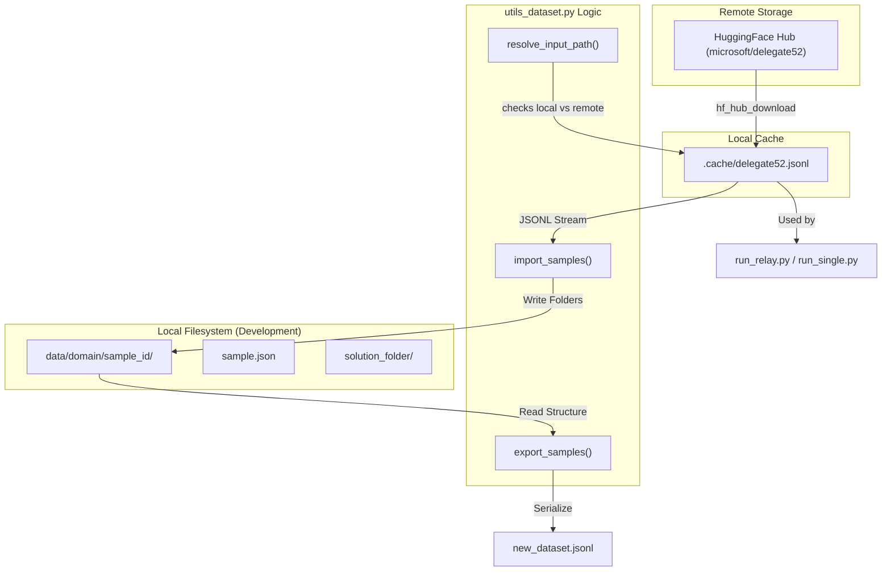
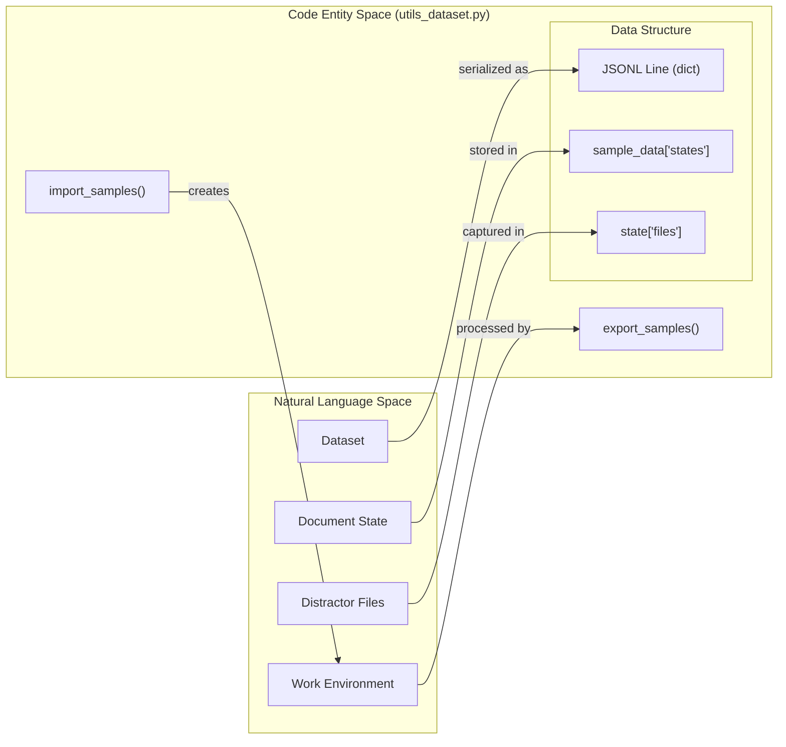

<!-- source: DeepWiki mcp.deepwiki.com · repo microsoft/delegate52 · page 5.2 Dataset Import, Export & HuggingFace Integration · fetched 2026-10-26 -->

# Dataset Import, Export & HuggingFace Integration

<details>
<summary>Relevant source files</summary>

The following files were used as context for generating this wiki page:

- [README.md](README.md)

</details>


This page documents the utility functions and command-line interface (CLI) responsible for managing the DELEGATE-52 dataset. The system supports seamless transitions between the flat JSONL distribution format and the hierarchical directory structure required for active development and simulation. It also handles automated dataset acquisition from the HuggingFace Hub.

## Overview of Data Flow

The dataset exists in two primary states:
1.  **JSONL Format**: A single file containing serialized work environments, used for distribution on HuggingFace and as input for experiment runners like `run_relay.py`.
2.  **Folder Format**: A nested directory structure where each sample has its own folder containing a `sample.json` state machine and subdirectories for each document state (e.g., `solution_folder`).

### System Data Flow Diagram

The following diagram illustrates how `utils_dataset.py` bridges the gap between the HuggingFace Hub, the local filesystem, and the experiment runners.

**Data Movement and Persistence**

Sources: [utils_dataset.py:1-137](), [README.md:40-57]()

---

## Key Functions

### resolve_input_path()
This function ensures that the experiment runners have access to the dataset. It implements a fallback logic: if no local path is provided via CLI, it attempts to locate the dataset in a local `.cache/` directory. If missing, it uses `huggingface_hub` to download the `delegate52.jsonl` file from the official repository.

*   **Logic**: [utils_dataset.py:113-137]()
*   **Default Repo**: `microsoft/delegate52` [utils_dataset.py:114]()
*   **Caching**: Files are stored in `.cache/` to avoid redundant network calls [utils_dataset.py:121]().

### export_samples()
Converts a directory of work environments into a single JSONL file. This is the primary tool for preparing a new version of the benchmark for release. It iterates through domain folders, reads `sample.json` files, and captures the content of all associated state folders.

*   **Implementation**: [utils_dataset.py:11-64]()
*   **Recursive Discovery**: Uses `os.walk` to find all `sample.json` files [utils_dataset.py:22]().
*   **Content Capture**: Reads every file within the `solution_folder` of every state defined in the sample [utils_dataset.py:44-55]().

### import_samples()
The inverse of export. It takes a JSONL file and recreates the hierarchical folder structure. This is essential for researchers who wish to inspect specific samples or add new edit tasks to existing environments.

*   **Implementation**: [utils_dataset.py:67-110]()
*   **Structure Creation**: Reconstructs the `solution_folder` for every state and writes the `sample.json` metadata [utils_dataset.py:90-106]().

---

## Mapping Code Entities to Dataset Concepts

The following diagram maps the logical concepts of the DELEGATE-52 dataset to the specific functions and file structures defined in `utils_dataset.py`.

**Code Entity Mapping**

Sources: [utils_dataset.py:11-110](), [README.md:40-57]()

---

## CLI Interface

`utils_dataset.py` can be executed as a standalone script to perform manual data management tasks.

### Command-Line Arguments
| Argument | Description |
| :--- | :--- |
| `--action` | Either `export` (folder to JSONL) or `import` (JSONL to folder). |
| `--input_path` | The source path (directory for export, file for import). |
| `--output_path` | The destination path (file for export, directory for import). |

**Example: Exporting local changes to a new JSONL**
```bash
python utils_dataset.py --action export --input_path ./data --output_path my_dataset.jsonl
```
[utils_dataset.py:141-153]()

**Example: Importing the benchmark for manual inspection**
```bash
python utils_dataset.py --action import --input_path .cache/delegate52.jsonl --output_path ./inspected_data
```
[utils_dataset.py:141-153]()

---

## Implementation Details

### JSONL Schema Serialization
When `export_samples()` runs, it constructs a dictionary for each sample with the following key fields:
*   `sample_id`: Unique identifier [utils_dataset.py:34]().
*   `sample_type`: The domain (e.g., `subtitles`, `python`) [utils_dataset.py:35]().
*   `states`: A list of dictionaries, where each entry contains the `state_id` and a `files` dictionary mapping filenames to their text content [utils_dataset.py:44-55]().

### File Encoding
The system assumes `utf-8` encoding for all document content during both import and export operations to ensure cross-platform compatibility of the professional documents [utils_dataset.py:51](), [utils_dataset.py:101]().

Sources:
- `utils_dataset.py`: [1-153]()
- `README.md`: [40-57](), [85-86]()

---

