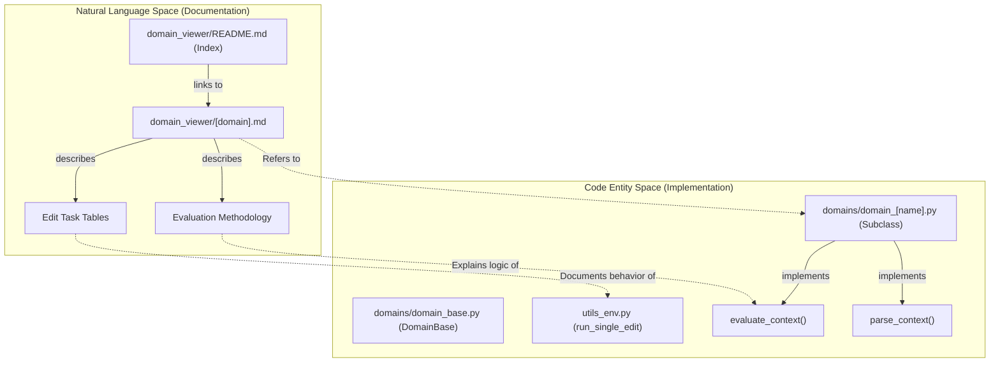
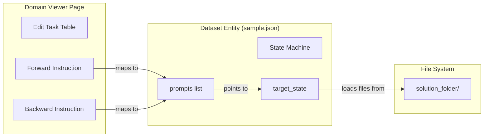

<!-- source: DeepWiki mcp.deepwiki.com · repo microsoft/delegate52 · page 6 Domain Viewer · fetched 2026-10-26 -->

# Domain Viewer

Relevant source files

The following files were used as context for generating this wiki page:

- [domain_viewer/README.md](domain_viewer/README.md)
- [domain_viewer/accounting.md](domain_viewer/accounting.md)
- [domain_viewer/audiosyn.md](domain_viewer/audiosyn.md)
- [domain_viewer/python.md](domain_viewer/python.md)

The **Domain Viewer** is a collection of documentation pages located in the `domain_viewer/` directory. Its purpose is to provide a human-readable, visual index of the 52 domains included in the DELEGATE-52 benchmark. It serves as a bridge between the raw dataset files and the technical implementation details of each domain's parser and evaluator.

The system consists of a central index (`domain_viewer/README.md`) and 52 individual Markdown files that detail the specific formats, evaluation logic, and example work environments for every domain.

### High-Level Documentation Flow

The following diagram illustrates how the Domain Viewer documentation relates to the underlying code entities and data structures.

**Documentation to Code Mapping**

**Sources:** [domain_viewer/README.md:1-4](), [domain_viewer/accounting.md:10-10](), [domain_viewer/python.md:10-10]()

---

## Domain Viewer Structure & Navigation

The `domain_viewer/README.md` serves as the entry point for exploring the benchmark. It organizes the 52 domains into five distinct categories: **Code & Configuration**, **Science & Engineering**, **Creative & Media**, **Structured Records**, and **Everyday**.

Each category is presented as a table containing:
*   **Icon:** A 18x18 SVG icon sourced from `assets/domain_icons/`.
*   **Domain:** A link to the specific domain's Markdown page.
*   **Format:** The primary file extension or format name (e.g., `.sql`, `Dockerfile`, `.ledger`).
*   **Released:** A count indicating how many work environments for that domain are publicly redistributable.
*   **Description:** A brief summary of the domain's content.

For more details on the index layout and icon system, see [Domain Viewer Structure & Navigation](#6.1).

**Sources:** [domain_viewer/README.md:7-80]()

---

## Per-Domain Page Format

Each of the 52 domain pages (e.g., `domain_viewer/accounting.md`, `domain_viewer/python.md`) follows a standardized template to ensure consistency across the benchmark. These pages provide the technical depth required to understand how an LLM's performance is measured in that specific context.

### Standard Components
1.  **Header:** Displays the domain icon, category, file format, and a summary of the domain's scope.
2.  **Implementation Reference:** Direct links to the Python class implementing the domain logic (e.g., `domain_accounting.py`).
3.  **Evaluation Section:** Explains the scoring dimensions (e.g., "Transaction coverage", "Amount accuracy") and the specific mathematical formula used to calculate the Reconstruction Score (RS).
4.  **Example Work Environment:** A deep dive into a specific sample (e.g., `accounting1`), including:
    *   **Seed Document Excerpt:** A snippet of the original file to illustrate the format's complexity.
    *   **Edit Task Table:** A list of reversible edit pairs, showing the "Forward Instruction", "Backward Instruction", and the specific operations involved (e.g., "split & merge", "numerical reasoning").

For a detailed breakdown of the page schema and evaluation formulas, see [Per-Domain Page Format](#6.2).

**Sources:** [domain_viewer/accounting.md:1-106](), [domain_viewer/audiosyn.md:1-104](), [domain_viewer/python.md:1-102]()

---

## Technical Mapping: Documentation to Dataset

The following diagram bridges the "Domain Viewer" descriptions to the actual data structures found in the work environments.

**Edit Task Table to Dataset Mapping**

**Sources:** [domain_viewer/accounting.md:95-106](), [domain_viewer/python.md:95-102]()

---

