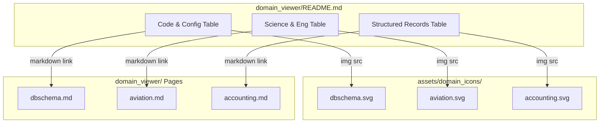
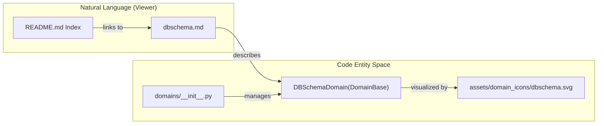

<!-- source: DeepWiki mcp.deepwiki.com · repo microsoft/delegate52 · page 6.1 Domain Viewer Structure & Navigation · fetched 2026-10-26 -->

# Domain Viewer Structure & Navigation

Relevant source files

The following files were used as context for generating this wiki page:

- [assets/domain_icons/accounting.svg](assets/domain_icons/accounting.svg)
- [assets/domain_icons/audiosyn.svg](assets/domain_icons/audiosyn.svg)
- [assets/domain_icons/aviation.svg](assets/domain_icons/aviation.svg)
- [assets/domain_icons/calendar.svg](assets/domain_icons/calendar.svg)
- [assets/domain_icons/chess.svg](assets/domain_icons/chess.svg)
- [domain_viewer/README.md](domain_viewer/README.md)

The **Domain Viewer** serves as the primary documentation hub for the 52 distinct domains within the DELEGATE-52 benchmark. It provides a structured interface for researchers to explore the specific file formats, evaluation metrics, and task types associated with each domain. The system is indexed via a central `README.md` that categorizes domains into five thematic groups, each supported by custom visual assets.

## Index Structure & Categorization

The `domain_viewer/README.md` file acts as the entry point for the viewer. It organizes the 52 domains into five specific category tables [domain_viewer/README.md:7-80](). Each table contains columns for visual identification, domain name (linked to a detailed sub-page), primary file format, release status, and a brief description.

### The Five Category Tables

1.  **Code & Configuration**: Technical domains focusing on software development and system administration (e.g., Python, Docker, Terraform) [domain_viewer/README.md:7-21]().
2.  **Science & Engineering**: Domains requiring specialized scientific notation or engineering formats (e.g., Molecule SDF, Quantum OpenQASM, Satellite TLE) [domain_viewer/README.md:23-37]().
3.  **Creative & Media**: Formats related to arts, music, and media production (e.g., Music Sheet LilyPond, 3D Object OBJ, Screenplay) [domain_viewer/README.md:39-53]().
4.  **Structured Records**: Formalized data logging and record-keeping formats (e.g., Accounting Ledger, Calendar iCS, Library Catalog MARCXML) [domain_viewer/README.md:55-69]().
5.  **Everyday**: Common formats encountered in daily life or general business (e.g., Chess PGN, Food Menu YAML, Recipe) [domain_viewer/README.md:71-80]().

### Released Count Column
The "Released" column in each table indicates the number of publicly redistributable samples available for that domain versus the total samples used in the benchmark [domain_viewer/README.md:11-13](). For example, a value of `2 / 6` for the DNS domain indicates that while 6 environments exist, only 2 are included in the open-source distribution due to licensing or privacy constraints [domain_viewer/README.md:12]().

**Sources:**
- [domain_viewer/README.md:1-80]()

---

## Visual Identity: SVG Icon System

Every domain is associated with a unique SVG icon located in `assets/domain_icons/`. These icons are embedded directly into the category tables using HTML `` tags with fixed dimensions of 18x18 pixels [domain_viewer/README.md:11-13]().

### Icon Implementation Standards
The icons follow a strict design language to ensure consistency across the viewer:
- **ViewBox**: Standardized at `0 0 24 24` [assets/domain_icons/accounting.svg:1]().
- **Styling**: Most icons use a `stroke-width` of 2 (or 1.5 for complex paths), `fill="none"`, and `stroke="black"` [assets/domain_icons/audiosyn.svg:1](), [assets/domain_icons/chess.svg:1]().
- **Line Treatment**: Uses `stroke-linecap="round"` and `stroke-linejoin="round"` for a clean, modern aesthetic [assets/domain_icons/aviation.svg:1]().

### Mapping Visuals to Domain Categories
The following diagram illustrates how the `README.md` index links specific domain categories to their respective SVG assets and detailed documentation pages.

**Table to Asset Mapping**

**Sources:**
- [domain_viewer/README.md:9-74]()
- [assets/domain_icons/accounting.svg:1-7]()
- [assets/domain_icons/audiosyn.svg:1-4]()
- [assets/domain_icons/aviation.svg:1-13]()
- [assets/domain_icons/calendar.svg:1-7]()
- [assets/domain_icons/chess.svg:1-15]()

---

## Navigation and Data Flow

The navigation logic follows a hierarchical path from the index to domain-specific details. When a user clicks a domain link (e.g., `[Database Schema](dbschema.md)`), they are directed to a page that bridges high-level descriptions with the underlying code implementation.

### From Viewer to Code Entities
The Domain Viewer documentation reflects the structure defined in the `DomainBase` class and the `DomainRegistry`. Each page in the viewer corresponds to a class registered in the system.

**Domain Entity Relationship**

### Navigation Flow Summary
1.  **Entry**: User opens `domain_viewer/README.md`.
2.  **Category Selection**: User identifies a domain within one of the five tables (e.g., "Aviation" under "Science & Engineering") [domain_viewer/README.md:27]().
3.  **Visual Confirmation**: The user sees the `aviation.svg` icon [assets/domain_icons/aviation.svg:1-13]().
4.  **Detail Drill-down**: Clicking the link opens `aviation.md`, which details the `.notam` format and the specific evaluation logic implemented in the corresponding Python domain class.

**Sources:**
- [domain_viewer/README.md:1-80]()
- [assets/domain_icons/aviation.svg:1-13]()

---

