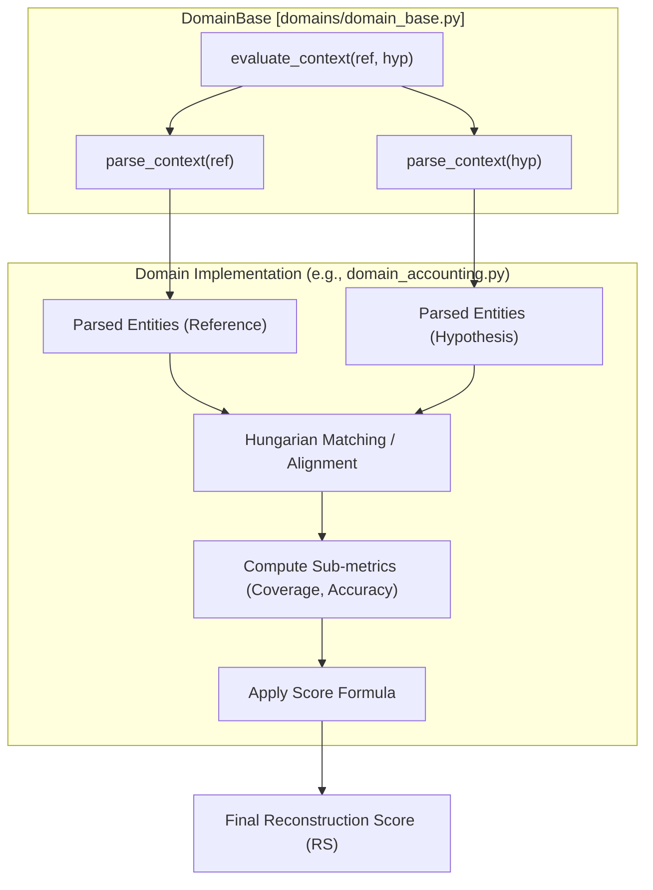

<!-- source: DeepWiki mcp.deepwiki.com · repo microsoft/delegate52 · page 6.2 Per-Domain Page Format · fetched 2026-10-26 -->

# Per-Domain Page Format

<details>
<summary>Relevant source files</summary>

The following files were used as context for generating this wiki page:

- [domain_viewer/accounting.md](domain_viewer/accounting.md)
- [domain_viewer/audiosyn.md](domain_viewer/audiosyn.md)
- [domain_viewer/fiction.md](domain_viewer/fiction.md)
- [domain_viewer/python.md](domain_viewer/python.md)

</details>


This page documents the standardized structure of the 52 domain-specific documentation pages located in the `domain_viewer/` directory. These pages serve as the primary technical reference for each domain's file format, evaluation methodology, and the specific work environments used in the DELEGATE-52 benchmark.

## Overview and Metadata Header

Each domain page begins with a standardized header that identifies the domain's high-level characteristics. This section bridges the visual representation (icons) with the technical categorization used in the codebase.

| Field | Description | Code Entity Reference |
|:---|:---|:---|
| **Category** | One of the five major domain groups. | `DomainBase.category` [[domains/domain_base.py:16-16]]() |
| **File Format** | The primary file extension handled by the domain. | `DomainBase.file_format` [[domains/domain_base.py:15-15]]() |
| **Summary** | A brief technical description of the data type. | N/A (Documentation only) |
| **Work Environments** | Count of released vs. total environments. | N/A (Hugging Face sync status) |

**Sources:** [domain_viewer/accounting.md:1-6](), [domains/domain_base.py:14-20]()

## Evaluation Methodology

The **Evaluation** section describes how the `evaluate_context` method is implemented for that specific domain. It details the dimensions of the reconstruction score (RS@k) and the specific logic used to compare a model's output against the ground truth.

### Scoring Dimensions
Most domains decompose the final score into multiple sub-metrics:
*   **Structural Integrity:** Using parsers to ensure the document follows format-specific rules (e.g., Ledger-cli syntax in `Accounting`).
*   **Content Coverage:** Often implemented using **Hungarian Matching** to align sets of entities (like transactions or audio instruments) between the reference and the hypothesis.
*   **Attribute Accuracy:** Fine-grained comparison of values, such as monetary amounts or coordinate positions.

### Score Formula
The page provides the exact mathematical formula used in the domain's `evaluate_context` implementation. For example, the **Accounting** domain uses a multiplicative formula to ensure that failure in transaction coverage heavily penalizes the final score:

`coverage² × posting × amount × (0.5 + 0.5 × √comment)` [[domain_viewer/accounting.md:23-23]]()

### System Data Flow: Evaluation
The following diagram illustrates how the `DomainBase` class interacts with domain-specific evaluators to produce the final score.

**Title: Evaluation Data Flow**

**Sources:** [domains/domain_base.py:73-86](), [domain_viewer/accounting.md:16-23]()

## Example Work Environment

This section provides a concrete look at a specific `sample_id` within the domain. It includes a seed document excerpt and the table of reversible edit tasks.

### Seed Document Excerpt
A fenced code block showing a representative portion of the domain's data. This helps developers understand the complexity and syntax of the target files (e.g., `.csd` for **Audiosyn** or `.py` for **Python**).

### Edit Task Table
The core of the benchmark is the reversible edit pair. The table documents:
1.  **Forward Instruction:** The task given to the model to transform the seed document.
2.  **Backward Instruction:** The task given to the model to revert the transformed document to the original state.
3.  **Operations:** Tags indicating the cognitive skills required (e.g., `split & merge`, `format knowledge`, `numerical reasoning`).

**Sources:** [domain_viewer/audiosyn.md:93-106](), [domain_viewer/python.md:91-102]()

## Mapping Natural Language to Code Entities

The domain viewer pages translate high-level research concepts into the specific classes and files that implement them.

**Title: Domain Documentation to Code Mapping**
```mermaid
classDiagram
    class DomainViewerPage {
        +Category: "Structured Records"
        +Format: ".ledger"
        +DomainImplementation: "domain_accounting.py"
        +ScoreFormula: "coverage^2 * ..."
    }

    class DomainBase {
        <<abstract>>
        +category: str
        +file_format: str
        +parse_context(text)
        +evaluate_context(ref, hyp)
    }

    class DomainAccounting {
        +parse_context(text)
        +evaluate_context(ref, hyp)
    }

    DomainViewerPage ..> DomainAccounting : "Documents"
    DomainAccounting --|> DomainBase : "Inherits from"
    
    style DomainViewerPage stroke-dasharray: 5 5
```

### Component Summary Table

| Wiki Section | Code Entity / File | Purpose |
|:---|:---|:---|
| **Domain implementation** | `domains/domain_[name].py` | The logic for parsing and scoring. [[domains/domain_base.py:101-104]]() |
| **Edit Tasks** | `sample.json` (in work env) | Defines the `prompts` and `states` for the relay. [[utils_env.py:18-25]]() |
| **Forward/Backward** | `run_relay.py` | The execution logic that applies these instructions. [[run_relay.py:54-82]]() |

**Sources:** [domains/domain_base.py:1-40](), [domain_viewer/accounting.md:10-10](), [domain_viewer/python.md:10-10]()

---

