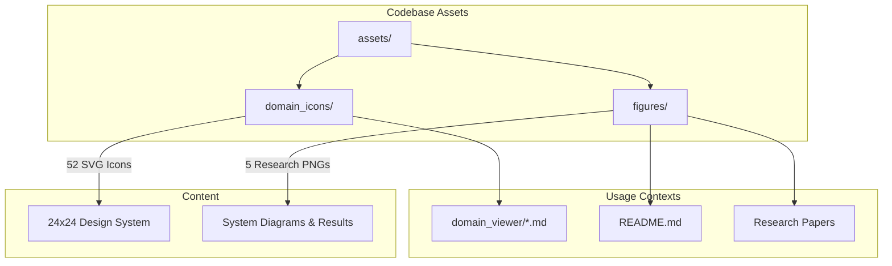
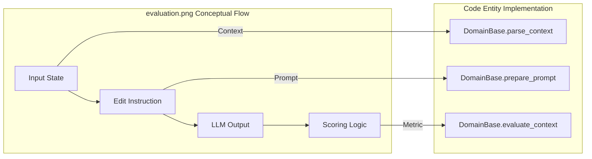

<!-- source: DeepWiki mcp.deepwiki.com · repo microsoft/delegate52 · page 7 Assets · fetched 2026-10-26 -->

# Assets

Relevant source files

The following files were used as context for generating this wiki page:

- [assets/domain_icons/accounting.svg](assets/domain_icons/accounting.svg)
- [assets/domain_icons/audiosyn.svg](assets/domain_icons/audiosyn.svg)
- [assets/domain_icons/aviation.svg](assets/domain_icons/aviation.svg)
- [assets/domain_icons/calendar.svg](assets/domain_icons/calendar.svg)
- [assets/domain_icons/chess.svg](assets/domain_icons/chess.svg)
- [assets/figures/domains.png](assets/figures/domains.png)
- [assets/figures/evaluation.png](assets/figures/evaluation.png)
- [assets/figures/results.png](assets/figures/results.png)
- [assets/figures/teaser.png](assets/figures/teaser.png)
- [assets/figures/work_environments.png](assets/figures/work_environments.png)

The `assets/` directory contains the visual identity and research documentation for the DELEGATE-52 benchmark. It is divided into two primary subdirectories: `domain_icons/`, which houses the technical design system for the 52 individual domains, and `figures/`, which contains high-level diagrams and data visualizations used in the project's README and research publications.

## Visual Asset Organization

The following diagram maps the high-level asset categories to their respective storage locations and functional roles within the documentation and web interfaces.

### Asset Architecture Overview

Sources: [assets/domain_icons/accounting.svg:1-7](), [assets/figures/domains.png:1-5]()

---

## Domain Icon System

The `assets/domain_icons/` directory contains 52 SVG files, one for each domain in the benchmark [assets/domain_icons/](). These icons are utilized in the `domain_viewer` to provide immediate visual identification for each data category.

### Design Standards
All icons follow a strict technical specification to ensure consistency across the UI:
*   **ViewBox**: Fixed at `0 0 24 24` [assets/domain_icons/accounting.svg:1]().
*   **Style**: Minimalist line-art using `stroke-linecap="round"` and `stroke-linejoin="round"` [assets/domain_icons/aviation.svg:1]().
*   **Colors**: Primarily black (`stroke="black"`) with `fill="none"` to allow for transparency [assets/domain_icons/calendar.svg:1]().
*   **Weight**: Standardized `stroke-width="2"` for most elements [assets/domain_icons/chess.svg:1](), with occasional use of `1.5` for complex wave patterns [assets/domain_icons/audiosyn.svg:1]().

For a full list of icons and implementation details, see **[Domain Icon System](#7.1)**.

Sources: [assets/domain_icons/accounting.svg:1-7](), [assets/domain_icons/audiosyn.svg:1-4](), [assets/domain_icons/aviation.svg:1-13](), [assets/domain_icons/calendar.svg:1-7](), [assets/domain_icons/chess.svg:1-15]()

---

## Research Figures

The `assets/figures/` directory contains high-resolution PNG files that illustrate the core concepts and empirical findings of the DELEGATE-52 study.

### Key Figures
| Figure | File Path | Description |
| :--- | :--- | :--- |
| **Teaser** | `teaser.png` | Illustrates the "Document Corruption" concept inherent in multi-turn relay edits. |
| **Domains** | `domains.png` | Provides a categorical overview of the 52 domains across 5 major groups. |
| **Results** | `results.png` | Displays the Reconstruction Score (RS@k) for 19 evaluated LLMs. |
| **Evaluation** | `evaluation.png` | A technical flowchart of the evaluation pipeline and scoring logic. |
| **Work Environments** | `work_environments.png` | Structural diagram of a sample work environment, including seed docs and edit pairs. |

### Evaluation Workflow Mapping
The following diagram bridges the visual representation in `evaluation.png` to the actual logic implemented in the `DomainBase` class.

For detailed breakdowns of each figure's content and its role in the benchmark's narrative, see **[Research Figures](#7.2)**.

Sources: [assets/figures/domains.png:1-5](), [assets/figures/evaluation.png:1-5](), [assets/figures/results.png:1-5](), [assets/figures/teaser.png:1-5](), [assets/figures/work_environments.png:1-5]()

---

