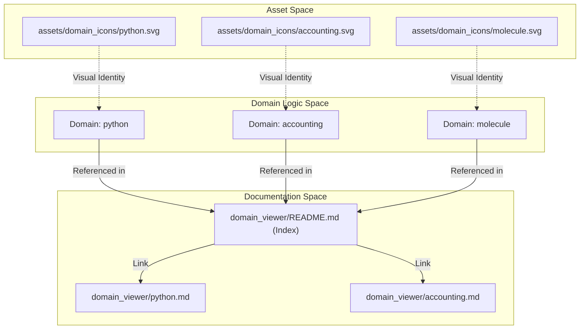

<!-- source: DeepWiki mcp.deepwiki.com · repo microsoft/delegate52 · page 7.1 Domain Icon System · fetched 2026-10-26 -->

# Domain Icon System

<details>
<summary>Relevant source files</summary>

The following files were used as context for generating this wiki page:

- [assets/domain_icons/accounting.svg](assets/domain_icons/accounting.svg)
- [assets/domain_icons/audiosyn.svg](assets/domain_icons/audiosyn.svg)
- [assets/domain_icons/aviation.svg](assets/domain_icons/aviation.svg)
- [assets/domain_icons/calendar.svg](assets/domain_icons/calendar.svg)
- [assets/domain_icons/chess.svg](assets/domain_icons/chess.svg)
- [assets/domain_icons/circuit.svg](assets/domain_icons/circuit.svg)
- [assets/domain_icons/crystal.svg](assets/domain_icons/crystal.svg)
- [assets/domain_icons/dbschema.svg](assets/domain_icons/dbschema.svg)
- [assets/domain_icons/dns.svg](assets/domain_icons/dns.svg)
- [assets/domain_icons/docker.svg](assets/domain_icons/docker.svg)

</details>


The **Domain Icon System** provides a standardized visual identity for the 52 domains within the DELEGATE-52 benchmark. These icons are used primarily in the `domain_viewer/` documentation to categorize and identify the diverse data formats supported by the system.

## Design Standards

All icons in the `assets/domain_icons/` directory follow a strict technical specification to ensure consistency across the documentation and any potential UI implementations.

### Technical Specification
*   **Format**: Scalable Vector Graphics (SVG).
*   **ViewBox**: `0 0 24 24` [assets/domain_icons/accounting.svg:1-1]().
*   **Dimensions**: Defaulting to `width="24" height="24"` [assets/domain_icons/calendar.svg:1-1]().
*   **Stroke Style**: 
    *   `fill="none"` (except for specific small accents) [assets/domain_icons/dns.svg:1-1]().
    *   `stroke-width="2"` (Standard) or `1.5` (for high-detail paths) [assets/domain_icons/audiosyn.svg:1-1]().
    *   `stroke-linecap="round"` and `stroke-linejoin="round"` for a soft, modern aesthetic [assets/domain_icons/chess.svg:1-1]().
*   **Color**: Hardcoded to `stroke="black"` in the source files, though this can be overridden by CSS when embedded [assets/domain_icons/dbschema.svg:1-1]().

### Visual Style: Line-Art Minimalism
The icons use basic geometric primitives (`<rect>`, `<circle>`, `<line>`, `<path>`, and `<polygon>`) to represent domain concepts:
*   **Structural Domains**: Use grids and boxes (e.g., `calendar.svg` [assets/domain_icons/calendar.svg:2-6](), `docker.svg` [assets/domain_icons/docker.svg:3-7]()).
*   **Scientific Domains**: Use abstract symbolic representations (e.g., `crystal.svg` using a hexagonal lattice [assets/domain_icons/crystal.svg:2-5]()).
*   **Media Domains**: Use waveform or metaphorical shapes (e.g., `audiosyn.svg` using an AM-modulated waveform path [assets/domain_icons/audiosyn.svg:3-3]()).

**Sources:**
* `assets/domain_icons/accounting.svg`
* `assets/domain_icons/audiosyn.svg`
* `assets/domain_icons/calendar.svg`
* `assets/domain_icons/dns.svg`
* `assets/domain_icons/docker.svg`
* `assets/domain_icons/crystal.svg`

---

## Integration and Data Flow

The icons serve as the visual entry point for the **Domain Viewer**. The following diagram illustrates how an icon asset is associated with a domain and rendered in the documentation.

### Icon Asset to Documentation Mapping
This diagram bridges the physical file system (SVG assets) to the logical domain documentation in the `domain_viewer/` subsystem.



**Sources:**
* `domain_viewer/README.md`
* `assets/domain_icons/`

---

## Implementation Examples

The following table demonstrates how different SVG elements are utilized to create the domain-specific line art.

| Domain | Key SVG Elements | Design Rationale |
| :--- | :--- | :--- |
| **Accounting** | `rect`, `line`, `text` | Represents a ledger sheet with a currency symbol [assets/domain_icons/accounting.svg:2-6](). |
| **Aviation** | `path`, `line` | Top-down view of a fuselage and wings [assets/domain_icons/aviation.svg:3-9](). |
| **Circuit** | `rect`, `line` | Represents an integrated circuit (IC) with lead pins [assets/domain_icons/circuit.svg:2-8](). |
| **DNS** | `rect`, `circle`, `line` | Visualizes stacked servers in a rack with status lights [assets/domain_icons/dns.svg:2-6](). |
| **Docker** | `path`, `rect` | Represents a shipping container vessel [assets/domain_icons/docker.svg:2-8](). |

### Sample SVG Structure: `aviation.svg`
The aviation icon demonstrates the use of complex paths to create a recognizable silhouette within the 24x24 grid.

```xml
<svg xmlns="http://www.w3.org/2000/svg" viewBox="0 0 24 24" ...>
  <!-- Fuselage -->
  <path d="M12 2C12 2 13 4 13 8L13 16C13 18 12 22 12 22C12 22 11 18 11 16L11 8C11 4 12 2 12 2Z"/>
  <!-- Wings -->
  <path d="M11 9L2 13L2 14L11 12"/>
  <path d="M13 9L22 13L22 14L13 12"/>
</svg>
```
[assets/domain_icons/aviation.svg:1-13]()

**Sources:**
* `assets/domain_icons/aviation.svg`
* `assets/domain_icons/accounting.svg`
* `assets/domain_icons/circuit.svg`
* `assets/domain_icons/dns.svg`

---

## Full List of Domain Icons

The system includes 52 icons, one for each domain in the benchmark. They are categorized by their respective domain groups.

### Code & Configuration
*   `dbschema.svg`: Database cylinder icon [assets/domain_icons/dbschema.svg:1-5]().
*   `dns.svg`: Server rack icon [assets/domain_icons/dns.svg:1-7]().
*   `docker.svg`: Container ship icon [assets/domain_icons/docker.svg:1-9]().
*   *Other icons include: filesystem, graphviz, infrastructure, json, makefile, malware, python, translation.*

### Science & Engineering
*   `aviation.svg`: Airplane silhouette [assets/domain_icons/aviation.svg:1-13]().
*   `circuit.svg`: Microchip/IC symbol [assets/domain_icons/circuit.svg:1-9]().
*   `crystal.svg`: Hexagonal lattice structure [assets/domain_icons/crystal.svg:1-6]().
*   *Other icons include: mathlean, molecule, protein, quantum, robotics, satellite, starcatalog, weather.*

### Creative & Media
*   `audiosyn.svg`: Waveform envelope [assets/domain_icons/audiosyn.svg:1-4]().
*   *Other icons include: fiction, font, latex, music, object3d, screenplay, slides, subtitles, vectorgraphics, weaving.*

### Structured Records
*   `accounting.svg`: Ledger with "$" symbol [assets/domain_icons/accounting.svg:1-7]().
*   `calendar.svg`: Calendar grid with a marked day [assets/domain_icons/calendar.svg:1-7]().
*   *Other icons include: edifact, emails, genealogy, geodata, geotrack, hamradio, library, spreadsheet, treebank.*

### Everyday
*   `chess.svg`: King piece silhouette [assets/domain_icons/chess.svg:1-15]().
*   *Other icons include: earnings, foodmenu, jobboard, landmarks, playlist, recipe, transit.*

**Sources:**
* `assets/domain_icons/` (Directory listing)
* `assets/domain_icons/dbschema.svg`
* `assets/domain_icons/dns.svg`
* `assets/domain_icons/docker.svg`
* `assets/domain_icons/aviation.svg`
* `assets/domain_icons/circuit.svg`
* `assets/domain_icons/crystal.svg`
* `assets/domain_icons/audiosyn.svg`
* `assets/domain_icons/accounting.svg`
* `assets/domain_icons/calendar.svg`
* `assets/domain_icons/chess.svg`

---

