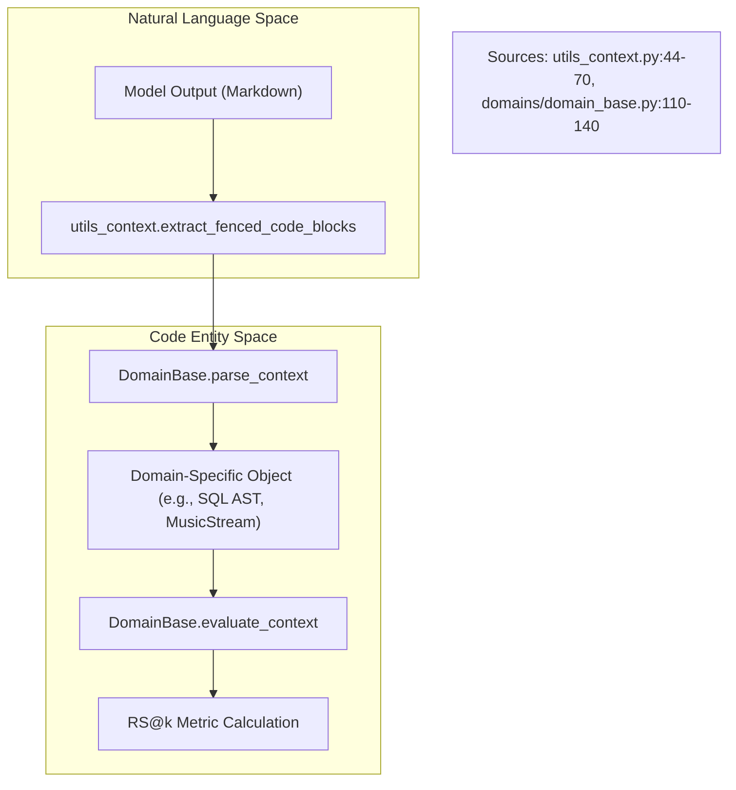

<!-- source: DeepWiki mcp.deepwiki.com · repo microsoft/delegate52 · page 7.2 Research Figures · fetched 2026-10-26 -->

# Research Figures

<details>
<summary>Relevant source files</summary>

The following files were used as context for generating this wiki page:

- [assets/figures/domains.png](assets/figures/domains.png)
- [assets/figures/evaluation.png](assets/figures/evaluation.png)
- [assets/figures/results.png](assets/figures/results.png)
- [assets/figures/teaser.png](assets/figures/teaser.png)
- [assets/figures/work_environments.png](assets/figures/work_environments.png)

</details>


This page documents the visual assets used to represent the research methodology, dataset composition, and experimental results of the DELEGATE-52 benchmark. These figures are stored in the `assets/figures/` directory and are utilized in technical reports, the project README, and the Domain Viewer to bridge the gap between high-level concepts and specific code implementations.

## 1. Document Corruption Concept (teaser.png)

The teaser figure illustrates the core premise of DELEGATE-52: the "Document Corruption" or "Round-trip Relay" task. It conceptualizes how a structured document undergoes a series of edits and must be restored to its original state or a functionally equivalent state.

*   **Conceptual Flow**: Shows an initial document $D_0$ undergoing a forward editing operation $E_f$ to reach state $D_1$, followed by a backward operation $E_b$ intended to reconstruct $D_0$.
*   **Technical Mapping**: In the codebase, this flow is implemented by `run_relay.py`, which manages the state transitions defined in the `sample.json` of each work environment.
*   **Code Entities**:
    *   `run_relay.py`: The main entry point for executing these multi-turn relays [run_relay.py:1-10]().
    *   `DomainBase.run_single_step_edit()`: The method responsible for a single transition between $D_n$ and $D_{n+1}$ [domains/domain_base.py:171-228]().

**Sources**: [run_relay.py:1-50](), [domains/domain_base.py:171-228]()

## 2. 52-Domain Category Overview (domains.png)

This figure provides a categorical breakdown of the 52 domains included in the benchmark. It organizes the diverse file formats into five logical groups, facilitating an understanding of the benchmark's breadth.

### Domain Taxonomy
| Category | Example Domains | Implementation Class |
| :--- | :--- | :--- |
| **Code & Config** | Docker, SQL, Terraform | `DomainCode`, `DomainConfig` |
| **Science & Eng.** | Molecule (SDF), Quantum (QASM) | `DomainScience` |
| **Creative & Media** | Music (LilyPond), 3D (OBJ) | `DomainCreative` |
| **Structured Records** | Ledger, EDIFACT, MARCXML | `DomainRecords` |
| **Everyday** | Chess (PGN), Recipe (YAML) | `DomainEveryday` |

The domain discovery logic in `domains/__init__.py` uses these categories to register subclasses of `DomainBase`.

**Sources**: [domains/__init__.py:1-60](), [domains/domain_base.py:20-40]()

## 3. Evaluation Pipeline (evaluation.png)

The evaluation figure diagrams the data flow from model output to the final **Reconstruction Score (RS@k)**. It highlights the role of domain-specific parsers and evaluators in handling heterogeneous data types.

### Pipeline Data Flow


*   **Key Function**: `extract_fenced_code_blocks` in `utils_context.py` is the primary bridge, stripping natural language explanations to isolate the technical content [utils_context.py:44-78]().
*   **Key Method**: `evaluate_context` in each domain subclass performs the actual comparison between the ground truth and the model's reconstructed state [domains/domain_base.py:133-140]().

**Sources**: [utils_context.py:44-100](), [domains/domain_base.py:110-150]()

## 4. RS@k Results for 19 LLMs (results.png)

This figure visualizes the performance benchmarks across 19 different Large Language Models. It plots the Reconstruction Score (RS@k) across various domains, highlighting the "Code-to-Document Gap."

*   **Metric Definition**: RS@k measures the percentage of relay turns where the model successfully restored the document to its expected state.
*   **Data Aggregation**: Results are processed by `utils_results.py`, which parses JSONL output files generated during `run_relay.py` executions.
*   **Performance Tracking**: The `ModelOpenAI` and `ModelAgentic` wrappers track token usage and success rates, which are then aggregated into the format seen in this figure [model_openai.py:150-180]().

**Sources**: [utils_results.py:1-50](), [model_openai.py:145-190]()

## 5. Work Environment Structure (work_environments.png)

This figure illustrates the internal structure of a single "Work Environment," which is the fundamental unit of the DELEGATE-52 dataset. It shows how seed documents, edit pairs, and distractors are organized.

### Work Environment Component Mapping
```mermaid
classDiagram
    class WorkEnvironment {
        +String sample_id
        +List states
        +List distractor_context
    }
    class State {
        +String state_id
        +String solution_folder
        +List prompts
    }
    class Prompt {
        +String target_state
        +String prompt_text
    }
    
    WorkEnvironment "1" *-- "n" State : contains
    State "1" *-- "n" Prompt : defines transitions
    
    style WorkEnvironment stroke-width:2px
    style State stroke-width:2px
```

*   **State Machine**: Each environment is a directed graph where nodes are `states` (containing file snapshots in `solution_folder`) and edges are `prompts` [utils_env.py:20-45]().
*   **Distractor Mechanism**: The `distractor_context` folder contains files that are provided to the LLM to increase context pressure but are not relevant to the specific editing task [utils_env.py:55-75]().
*   **Implementation**: `utils_env.load_sample()` is the function that parses this directory structure into a runtime object [utils_env.py:15-40]().

**Sources**: [utils_env.py:1-80](), [utils_dataset.py:10-40]()

---

