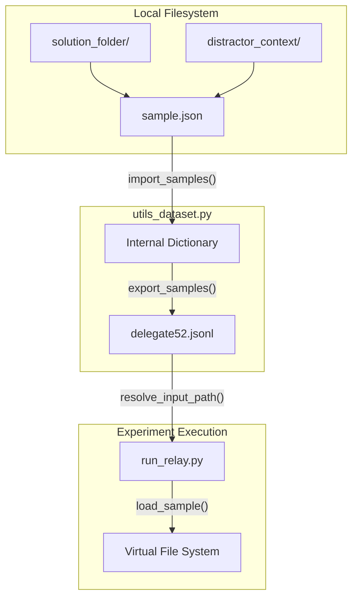
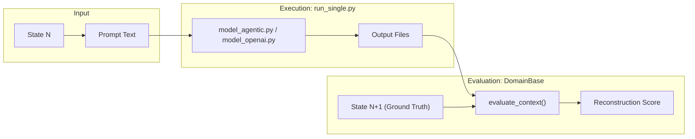

<!-- source: DeepWiki mcp.deepwiki.com · repo microsoft/delegate52 · page 8.1 Adding Work Environments · fetched 2026-10-26 -->

# Adding Work Environments

<details>
<summary>Relevant source files</summary>

The following files were used as context for generating this wiki page:

- [README.md](README.md)
- [domain_viewer/accounting.md](domain_viewer/accounting.md)

</details>


This page provides technical instructions for adding new work environments to existing domains in the DELEGATE-52 benchmark. A work environment consists of a seed document, a set of reversible edit pairs, and optional distractor context. Adding environments allows for greater diversity in testing how LLMs handle long-horizon delegated workflows [README.md:92-97]().

## Work Environment Structure

A work environment is defined by a directory structure that is later serialized into a JSONL format for the benchmark. Each environment must follow a specific layout to be compatible with the experiment runners.

### Directory Layout

When developing a new environment locally, organize files as follows:

```text
domain_name/
├── sample_name/
│   ├── sample.json             # State machine and metadata
│   ├── solution_folder/        # Seed document(s)
│   │   └── seed_file.ext
│   └── distractor_context/     # (Optional) Irrelevant files
│       └── noise.txt
```

### The `sample.json` Schema

The `sample.json` file acts as the configuration for the work environment. It defines the "ground truth" states and the instructions (prompts) to move between them [utils_dataset.py:1-10]().

| Field | Type | Description |
| :--- | :--- | :--- |
| `sample_id` | String | Unique identifier (e.g., `accounting1`). |
| `sample_type` | String | The domain name (e.g., `accounting`). |
| `ok_to_redistribute` | Boolean | Must be `true` for the sample to be included in the public HF dataset [README.md:42-44](). |
| `states` | Object | Map of state IDs (e.g., `state0`) to file snapshots. |
| `prompts` | Array | List of reversible edit pairs. |

**Example Prompt Object:**
```json
{
  "prompt_id": 1,
  "start_state": "state0",
  "target_state": "state1",
  "prompt_text": "Split this ledger by person...",
  "backward_prompt_text": "Merge these files back into accounting.ledger..."
}
```

### Reversible Edit Pairs

Each edit task must be **reversible**. This is the core requirement for the "round-trip relay" methodology [README.md:13-15]().
1.  **Forward Edit:** Transforms `state_N` to `state_N+1`.
2.  **Backward Edit:** Transforms `state_N+1` back to `state_N`.

Sources: [README.md:13-15](), [utils_dataset.py:1-20]()

---

## Implementation Workflow

### 1. Prepare Seed Documents
Place the initial document(s) in the `solution_folder/`. These should be high-quality, real-world examples representative of the domain. For example, in the `accounting` domain, this would be a `.ledger` file [domain_viewer/accounting.md:33-35]().

### 2. Define Edit Tasks
Create 5–10 edit pairs. Common operations include:
*   **Format Conversion:** (e.g., Ledger to CSV and back) [domain_viewer/accounting.md:99]().
*   **Structural Splitting:** (e.g., Splitting one file into many by category) [domain_viewer/accounting.md:98]().
*   **Data Manipulation:** (e.g., Currency conversion or account flattening) [domain_viewer/accounting.md:102-103]().

### 3. Add Distractor Context
Optionally, add files to `distractor_context/`. These files are merged into the LLM's working directory during experiments to test its ability to ignore irrelevant information [README.md:90]().

### 4. Data Flow: From Folders to JSONL
The `utils_dataset.py` module handles the transformation of these folders into the benchmark format.

**Natural Language Space to Code Entity Space**


Sources: [utils_dataset.py:1-50](), [run_relay.py:1-20]()

---

## Testing with `run_single.py`

Before contributing a new environment, you must verify that the instructions are clear enough for a top-tier model to execute. The `run_single.py` script is designed for this quality assurance [README.md:20]().

### Execution Steps

1.  **Forward Test:**
    Test if the model can perform the first edit.
    ```bash
    python run_single.py --model_names gpt-4o --domains [your_domain] --state_idx 0 --direction forward
    ```

2.  **Backward Test:**
    Test if the model can undo the edit from the resulting state.
    ```bash
    python run_single.py --model_names gpt-4o --domains [your_domain] --state_idx 0 --direction backward
    ```

### Key Functions for Testing
The following functions in `utils_env.py` are critical during the testing phase:

| Function | Role |
| :--- | :--- |
| `load_sample()` | Loads the state machine and files from the dataset [utils_env.py:10-15](). |
| `run_single_edit()` | Executes one turn of the LLM and returns the modified context [utils_env.py:40-45](). |
| `evaluate_context()` | (In `DomainBase`) Compares the LLM output against the `target_state` [domains/domain_base.py:50-60](). |

**Single Edit Data Flow**


Sources: [run_single.py:1-30](), [domains/domain_base.py:1-60](), [utils_env.py:1-50]()

---

## Final Validation Checklist

1.  **Format:** Does the output match the domain's expected file format (e.g., `.ledger` for accounting)? [domain_viewer/accounting.md:4]().
2.  **Redistribution:** Is `ok_to_redistribute` set correctly based on the source material's license? [README.md:42-44]().
3.  **Parsability:** Does the `DomainBase.parse_context` function successfully process the model's response? [domains/domain_base.py:40-45]().
4.  **Score:** Does a state-of-the-art model achieve a Reconstruction Score (RS) near 1.0 on a single-step edit? [README.md:36-38]().

Sources: [README.md:36-44](), [domains/domain_base.py:40-60](), [domain_viewer/accounting.md:1-10]()

---

