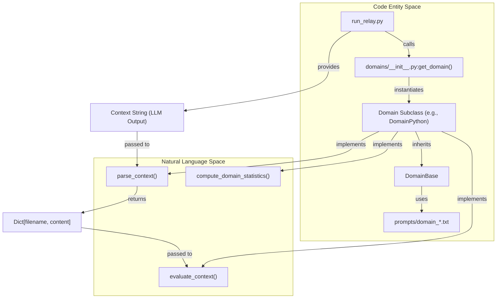
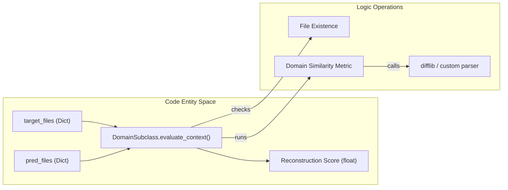

<!-- source: DeepWiki mcp.deepwiki.com · repo microsoft/delegate52 · page 8.2 Implementing a New Domain · fetched 2026-10-26 -->

# Implementing a New Domain

Relevant source files

The following files were used as context for generating this wiki page:

- [README.md](README.md)
- [assets/domain_icons/accounting.svg](assets/domain_icons/accounting.svg)
- [assets/domain_icons/audiosyn.svg](assets/domain_icons/audiosyn.svg)

This guide provides the technical specifications for adding a new domain to the DELEGATE-52 benchmark. A domain consists of a specialized parser, an evaluator, prompt templates, and a set of work environments. Implementing a new domain allows the benchmark to measure LLM fidelity in specialized document formats not currently covered by the 52 existing domains.

## Domain Architecture Overview

The DELEGATE-52 domain system is built on an auto-discovery architecture. All domains must reside within the `domains/` directory and subclass the `DomainBase` abstract class defined in [domains/domain_base.py:16-16]().

The following diagram illustrates the relationship between the core experiment runner and the domain-specific components:

**Domain Integration Flow**

Sources: [run_relay.py:1-20](), [domains/__init__.py:1-15](), [domains/domain_base.py:16-16]()

## Step 1: Subclassing DomainBase

To implement a new domain, create a new file in the `domains/` directory (e.g., `domains/domain_new.py`). Your class must define several mandatory attributes and implement four abstract methods.

### Mandatory Attributes
*   `sample_type`: A string identifier for the domain (e.g., `"new_domain"`).
*   `file_format`: The file extension associated with the domain (e.g., `".txt"`).
*   `category`: One of the five benchmark categories: "Code & Configuration", "Science & Engineering", "Creative & Media", "Structured Records", or "Everyday".
*   `domain_prompt`: The filename of the prompt template in the `prompts/` directory.

### Abstract Methods to Implement
1.  **`parse_context(self, context_str)`**: Converts the raw LLM output string into a dictionary of filenames and their contents. Most domains use `utils_context.parse_context_fenced` [utils_context.py:46-46]() to extract content from Markdown code blocks.
2.  **`compute_domain_statistics(self, files_dict)`**: Returns a dictionary of domain-specific metrics (e.g., line count, character count, or syntax-specific counts).
3.  **`evaluate_context(self, target_files, pred_files)`**: The core evaluation logic. It compares the ground truth `target_files` against the LLM-generated `pred_files` and returns a score between 0.0 and 1.0.
4.  **`render_context_visual(self, files_dict)`**: (Optional) Returns a visual representation of the context, often used for debugging or logging.

Sources: [domains/domain_base.py:16-72]()

## Step 2: Implementation Logic and Data Flow

The evaluation logic in `evaluate_context` is the most critical part of a new domain. It must be robust to minor formatting changes while penalizing structural or content errors.

**Evaluation Data Flow**

Sources: [domains/domain_base.py:61-72](), [utils_context.py:1-20]()

## Step 3: Writing a Prompt Template

Each domain requires a prompt template in the `prompts/` directory. If your domain uses standard document editing, you may reuse `prompts/domain_documents.txt` [prompts/domain_documents.txt:1-10]().

The template must include the following placeholders:
*   `[[INPUT_CONTEXT]]`: The current state of the files.
*   `[[FILE_NAMES]]`: A list of files the LLM is allowed to edit.
*   `[[EDITING_OPERATION]]`: The specific instruction for the edit.

The `DomainBase.prepare_prompt` method handles the substitution of these placeholders at runtime [domains/domain_base.py:74-111]().

Sources: [prompts/domain_documents.txt:1-10](), [domains/domain_base.py:74-111]()

## Step 4: Registration and Auto-Discovery

DELEGATE-52 uses an auto-discovery mechanism in `domains/__init__.py`. To register your new domain:
1.  Ensure your class is imported in `domains/__init__.py`.
2.  The `get_domain` function will automatically find your subclass if it is correctly imported and subclasses `DomainBase`.

The registry is accessed by the experiment runners using `get_domain(sample_type)` [domains/__init__.py:41-41]().

Sources: [domains/__init__.py:1-50]()

## Step 5: Domain Viewer and Icon Design

To maintain the benchmark's documentation standards, you must create a domain viewer page and a custom SVG icon.

### Domain Viewer Page
Create a Markdown file in `domain_viewer/your_domain.md`. This page should follow the structure documented in [6.2 Per-Domain Page Format] and include:
*   A summary of the format and category.
*   The evaluation formula used in `evaluate_context`.
*   Examples of seed documents and edit tasks.

### SVG Icon Design
Design a 24x24 SVG icon and place it in `assets/domain_icons/`. 
*   **Standard**: `viewBox="0 0 24 24"`, `fill="none"`, `stroke="black"`, `stroke-width="2"`.
*   **Style**: Use clean, stroke-based line art as seen in `assets/domain_icons/accounting.svg` [assets/domain_icons/accounting.svg:1-7]() or `assets/domain_icons/audiosyn.svg` [assets/domain_icons/audiosyn.svg:1-4]().

Sources: [assets/domain_icons/accounting.svg:1-7](), [assets/domain_icons/audiosyn.svg:1-4]()

---

