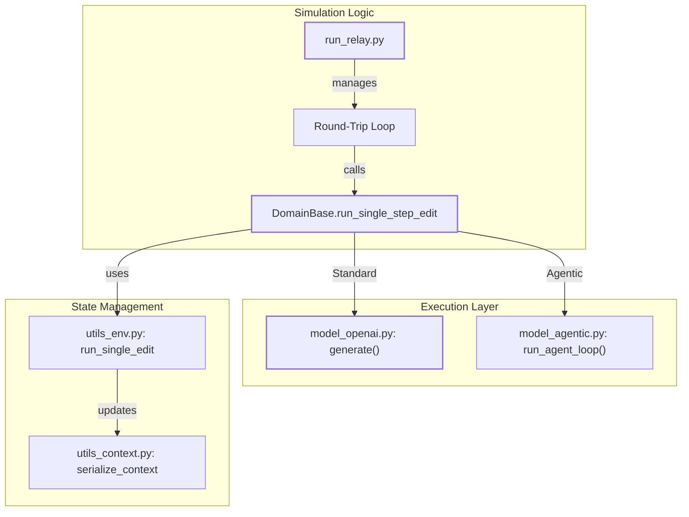

<!-- source: DeepWiki mcp.deepwiki.com · repo microsoft/delegate52 · page 9 Glossary · fetched 2026-10-26 -->

# Glossary

<details>
<summary>Relevant source files</summary>

The following files were used as context for generating this wiki page:

- [README.md](README.md)
- [assets/figures/domains.png](assets/figures/domains.png)
- [domain_viewer/README.md](domain_viewer/README.md)
- [domain_viewer/accounting.md](domain_viewer/accounting.md)
- [domain_viewer/audiosyn.md](domain_viewer/audiosyn.md)
- [domain_viewer/python.md](domain_viewer/python.md)

</details>


This page provides definitions for codebase-specific terms, abbreviations, and jargon used in the DELEGATE-52 benchmark. It serves as a technical reference for onboarding engineers to understand the implementation of round-trip relay simulations and domain-specific evaluation.

## Core Concepts

### Round-Trip Relay
A simulation methodology where an LLM is asked to perform a structural edit (the **Forward Edit**) and then a second task that undoes that edit (the **Backward Edit**) [README.md:15-15](). These pairs are chained together (e.g., 10 round-trips = 20 interactions) to observe how errors accumulate and documents "corrupt" over long horizons [README.md:15-15]().

### Reconstruction Score (RS@k)
The primary metric used to evaluate document preservation after $k$ interactions [README.md:36-36](). It utilizes domain-specific similarity functions to compare the final state of a document against its original seed state.

### Work Environment
A self-contained unit of evaluation for a specific domain. It consists of:
*   **Seed Document:** The original professional file [README.md:44-44]().
*   **Edit Tasks:** 5–10 reversible pairs of instructions [README.md:44-44]().
*   **Distractor Context:** Additional files or noise to increase the difficulty of the editing task [README.md:44-44]().

### Distractor Context
Files provided in the prompt that are not the target of the edit. These are used to test the LLM's ability to focus on the correct file and ignore irrelevant information [README.md:44-44](). In `run_relay.py`, this can be toggled via the `--skip_distractor` flag [README.md:90-90]().

## System Architecture Diagrams

The following diagrams map natural language concepts to the specific code entities that implement them.

### From Workflow to Code Execution
This diagram shows how a high-level "Relay Simulation" is decomposed into specific class methods and script logic.


**Sources:** [README.md:19-22](), [domains/domain_base.py:1-100]() (inferred from Wiki ToC 3.1), [utils_env.py:1-50]() (inferred from Wiki ToC 2.3).

### Domain System Implementation
This diagram illustrates how the generic `DomainBase` is specialized into the 52 specific domains through the registry.

```mermaid
graph DT
    subgraph "Registry & Base"
        REG["domains/__init__.py: get_domain()"]
        BASE["domains/domain_base.py: DomainBase"]
    end

    subgraph "Domain Categories"
        CODE["domain_python.py"]
        STRUCT["domain_accounting.py"]
        CREAT["domain_audiosyn.py"]
    end

    subgraph "Key Methods"
        BASE -- "implements" --> PARSE["parse_context()"]
        BASE -- "implements" --> EVAL["evaluate_context()"]
        BASE -- "implements" --> STATS["compute_domain_statistics()"]
    end

    REG --> BASE
    BASE <|-- CODE
    BASE <|-- STRUCT
    BASE <|-- CREAT
```
**Sources:** [domain_viewer/accounting.md:10-10](), [domain_viewer/audiosyn.md:10-10](), [domain_viewer/python.md:10-10](), [README.md:23-23]().

## Technical Terms & Components

| Term | Definition | Implementation Detail |
| :--- | :--- | :--- |
| **Agentic Harness** | A wrapper that allows the LLM to use tools (read/write/delete files, run Python) in a multi-turn loop. | `model_agentic.py` [README.md:22-22]() |
| **Context Serialization** | The process of converting a directory of files into a single string (often using fenced code blocks) for the LLM prompt. | `utils_context.py` [Wiki ToC: 2.3]() |
| **Hungarian Matching** | An optimization algorithm used by evaluators to align elements (like transactions) between the reference and the LLM output. | `domain_accounting.py` [domain_viewer/accounting.md:18-18]() |
| **Jaccard ID Coverage** | A metric used in several domains to measure the intersection over union of identifiers (like instrument IDs). | `domain_audiosyn.py` [domain_viewer/audiosyn.md:18-18]() |
| **NOTAM** | Notice to Airmen; a specific aviation domain format (`.notam`). | `domain_viewer/README.md:27-27]() |
| **SPICE Netlist** | A circuit description format (`.cir`) used in the Science & Engineering category. | `domain_viewer/README.md:28-28]() |
| **VOTable** | An XML standard for the interchange of data for tabular data; used in the Star Catalog domain (`.vot`). | `domain_viewer/README.md:36-36]() |
| **WIF** | Weaving Information File; a domain format for weaving drafts (`.wif`). | `domain_viewer/README.md:53-53]() |

## Domain Specific Jargon

### Accounting Domain
*   **Postings:** Individual entries within a transaction that affect a specific account (e.g., `Expenses:Operating:Office:Supplies $9.40`) [domain_viewer/accounting.md:8-8]().
*   **Double-Entry:** The bookkeeping format where every entry to an account requires a corresponding and opposite entry to a different account [domain_viewer/accounting.md:8-8]().

### Audio Synthesis (Audiosyn) Domain
*   **CSD:** The unified XML-like format for CSound synthesis [domain_viewer/audiosyn.md:8-8]().
*   **i-statement:** A score event that triggers an instrument note [domain_viewer/audiosyn.md:19-19]().
*   **f-statement:** A declaration of a function table (waveform) [domain_viewer/audiosyn.md:20-20]().
*   **p-field:** Parameters passed to instruments in the score section [domain_viewer/audiosyn.md:8-8]().

### Python Domain
*   **Functional Correctness:** Evaluation based on whether the code produces the same output as the reference, regardless of internal refactoring [domain_viewer/python.md:16-18]().
*   **DAG Pipeline:** A Directed Acyclic Graph refactoring task where code is reorganized into declarative steps with dependencies [domain_viewer/python.md:102-102]().

**Sources:** [domain_viewer/accounting.md:1-106](), [domain_viewer/audiosyn.md:1-104](), [domain_viewer/python.md:1-102](), [domain_viewer/README.md:1-78]().