# Page: DELEGATE-52 Overview

# DELEGATE-52 Overview

<details>
<summary>Relevant source files</summary>

The following files were used as context for generating this wiki page:

- [README.md](README.md)
- [assets/figures/domains.png](assets/figures/domains.png)
- [assets/figures/evaluation.png](assets/figures/evaluation.png)
- [assets/figures/results.png](assets/figures/results.png)
- [assets/figures/teaser.png](assets/figures/teaser.png)
- [assets/figures/work_environments.png](assets/figures/work_environments.png)

</details>


DELEGATE-52 is a technical benchmark designed to evaluate Large Language Models (LLMs) on **long-horizon delegated document editing** across 52 professional domains. Unlike traditional benchmarks that focus on short snippets, DELEGATE-52 simulates multi-turn workflows where an LLM acts as an agent, performing complex structural edits on documents (e.g., crystallography files, music notation, or DNS zones) and attempting to maintain document integrity over repeated interactions.

The benchmark is introduced in the research paper: "[LLMs Corrupt Your Documents When You Delegate](https://arxiv.org/abs/2604.15597)" [README.md:9-9]().

### Purpose and Research Context
The core objective of DELEGATE-52 is to measure "document corruption"—the gradual loss of structural or semantic fidelity—that occurs when LLMs perform sequential edits. It uses a **round-trip relay** methodology: an LLM is asked to perform a "forward" edit (e.g., adding a record) followed by a "backward" edit (e.g., removing that same record) [README.md:15-15](). By chaining these round-trips, the benchmark assesses how well the model can return a document to its exact original state (the seed document) after $k$ interactions [README.md:36-36]().

**Sources:** [README.md:7-15](), [README.md:36-38]()

### Key Concepts

*   **Work Environment:** A self-contained unit of evaluation consisting of a seed document, reversible edit pairs, and optional distractor context [README.md:44-45]().
*   **Round-Trip Relay:** A simulation where the LLM performs a sequence of edits. A single round-trip consists of one forward edit and one backward edit [README.md:15-15]().
*   **Reconstruction Score (RS@k):** The primary metric, measuring the similarity between the original seed document and the document after $k$ relay steps [README.md:36-36]().
*   **Domain-Specific Evaluators:** Custom logic for each of the 52 domains that parses the document format and calculates fidelity (e.g., using AST comparison for Python or Hungarian matching for Accounting) [README.md:23-23]().

### Repository Layout

The codebase is structured to support large-scale simulations, agentic tool-use, and domain-specific parsing.

| Directory/File | Description |
| :--- | :--- |
| `run_relay.py` | Main entry point for multi-turn relay experiments [README.md:19-19](). |
| `run_single.py` | Script for testing individual forward/backward edits [README.md:20-20](). |
| `domains/` | Contains 52 sub-modules, each defining a `DomainBase` subclass for parsing and evaluation [README.md:23-23](). |
| `model_agentic.py` | A harness for "agentic" LLMs that use tools like `read_file` and `write_file` [README.md:22-22](). |
| `model_openai.py` | Wrapper for OpenAI and Azure OpenAI API interactions [README.md:21-21](). |
| `prompts/` | Directory containing Jinja2-style prompt templates for different domains [README.md:24-24](). |
| `domain_viewer/` | Markdown-based documentation and visual examples for every domain [README.md:23-23](). |

**Sources:** [README.md:17-24]()

### System Mapping: Natural Language to Code Entities

The following diagrams bridge high-level benchmark concepts to specific implementation entities in the repository.

**Benchmark Execution Flow**
This diagram maps the experimental process to the primary execution scripts and model wrappers.

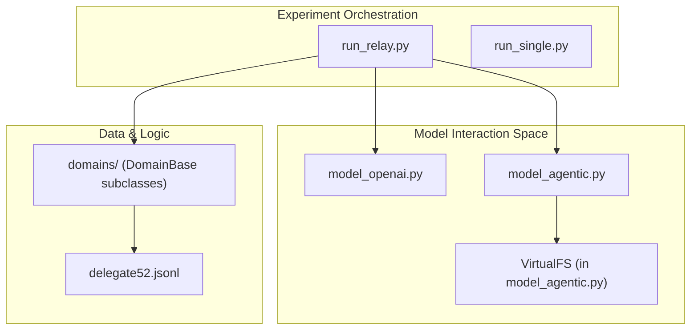
**Sources:** [README.md:17-24](), [README.md:42-45]()

**Domain System Architecture**
This diagram shows how the abstract domain concepts are realized through the `DomainBase` class and its relationship to specific file formats.

```mermaid
graph LR
    subgraph "Code Entity Space: domains/"
        BASE["DomainBase (domain_base.py)"]
        REGISTRY["get_domain() (__init__.py)"]
        
        subgraph "Domain Categories"
            CODE["Code (e.g., python.py)"]
            SCI["Science (e.g., molecule.py)"]
            REC["Records (e.g., accounting.py)"]
        end
    end

    subgraph "Natural Language / Format Space"
        PY[".py files"]
        SDF[".sdf files"]
        LEDGER[".ledger files"]
    end

    REGISTRY --> BASE
    BASE <|-- CODE
    BASE <|-- SCI
    BASE <|-- REC

    CODE -.-> PY
    SCI -.-> SDF
    REC -.-> LEDGER
```
**Sources:** [README.md:23-23](), [README.md:44-44]()

### Detailed Documentation Pages

For in-depth technical details, refer to the following child pages:

*   **[Getting Started](#1.1)**: Step-by-step guide for installation, API configuration, and running your first simulation.
*   **[Benchmark Design & Evaluation Methodology](#1.2)**: Detailed explanation of the relay mechanism, the Reconstruction Score, and how domain evaluators function.
*   **[Project Governance & Legal](#1.3)**: Information on the MIT license, Code of Conduct, and security reporting.

**Sources:** [README.md:59-91](), [README.md:92-108](), [README.md:122-128]()

---

# Page: Getting Started

# Getting Started

<details>
<summary>Relevant source files</summary>

The following files were used as context for generating this wiki page:

- [README.md](README.md)

</details>


This page provides a step-by-step guide for setting up the **DELEGATE-52** environment, installing dependencies, configuring API access, and executing your first round-trip relay simulation.

## Overview
The DELEGATE-52 repository is designed to evaluate how Large Language Models (LLMs) maintain document integrity over long-horizon delegated workflows [README.md:9-15](). It achieves this through a "relay" mechanism where a model performs a structural edit (forward) and then attempts to undo that edit (backward), repeating this cycle across multiple rounds [README.md:15-17]().

### Data Flow and System Components
The following diagram illustrates the relationship between the execution scripts, the model wrappers, and the domain-specific logic.

**System Architecture and Data Flow**
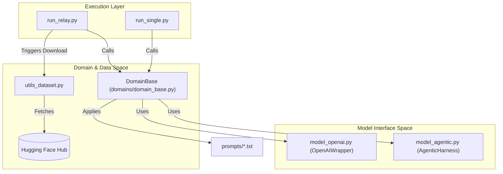
Sources: [README.md:19-24](), [domains/domain_base.py:1-20](), [utils_dataset.py:1-10]()

## Installation

### 1. Clone the Repository
Begin by cloning the source code from GitHub:
```sh
git clone https://github.com/microsoft/delegate52.git
cd delegate52
```
Sources: [README.md:61-64]()

### 2. Install Dependencies
The project requires Python 3.x and several domain-specific libraries for parsing various file formats (e.g., music notation, crystallography, CAD files).
```sh
pip install -r requirements.txt
```
Sources: [README.md:67-69]()

### 3. Configure API Keys
The benchmark primarily uses OpenAI or Azure OpenAI models. You must export your credentials as environment variables.

**For OpenAI:**
```sh
export OPENAI_API_KEY="your-key-here"
```

**For Azure OpenAI:**
```sh
export AZURE_OPENAI_API_KEY="your-key-here"
export AZURE_OPENAI_ENDPOINT="your-endpoint-here"
```
Sources: [README.md:72-78]()

## Loading the Dataset
The DELEGATE-52 dataset consists of 234 work environments across 48 redistributable domains [README.md:44-45]().

### Automatic Loading
When you run `run_relay.py` or `run_single.py`, the system calls `resolve_input_path()` in `utils_dataset.py`. This function automatically checks for a local file and, if missing, downloads the dataset from the Hugging Face Hub [README.md:85]().

### Manual Loading (Python)
You can interact with the dataset programmatically using the `huggingface_hub` library:

```python
from huggingface_hub import hf_hub_download
import json

path = hf_hub_download(repo_id="microsoft/delegate52", filename="delegate52.jsonl", repo_type="dataset")
with open(path) as f:
    samples = [json.loads(line) for line in f]
```
Sources: [README.md:48-57](), [utils_dataset.py:1-15]()

## Running Your First Simulation

The primary entry point for experiments is `run_relay.py`. This script manages the state-chain logic, iterating through "round-trips" (a forward edit followed by a backward edit).

### Execution Command
To run a simulation on the `subtitles` domain for 10 round-trips using `gpt-4o`:
```sh
python run_relay.py --model_names gpt-4o --domains subtitles --num_round_trips 10
```
Sources: [README.md:80-83]()

### Key Arguments
| Argument | Description |
| :--- | :--- |
| `--model_names` | List of models to evaluate (defined in `model_openai.py`). |
| `--domains` | Specific domains to run (e.g., `python`, `subtitles`, `accounting`). |
| `--num_round_trips` | Number of forward/backward cycles to perform. |
| `--num_workers` | Number of parallel processes for simulation. |
| `--skip_distractor` | If set, excludes distractor files from the LLM context. |

Sources: [README.md:80-90]()

## Implementation Details: The Relay Loop
The simulation relies on the `DomainBase` class to handle the transformation of raw data into LLM prompts and the subsequent parsing of model outputs.

**Relay Execution Logic**
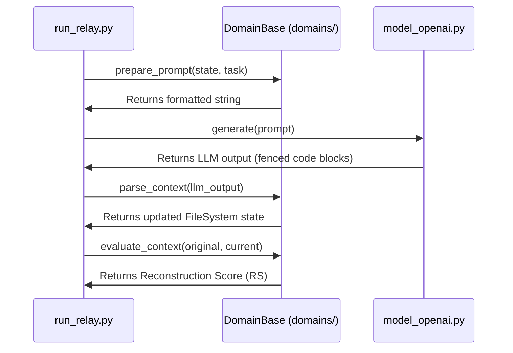
Sources: [README.md:15-23](), [domains/domain_base.py:10-40]()

---

# Page: Benchmark Design & Evaluation Methodology

# Benchmark Design & Evaluation Methodology

<details>
<summary>Relevant source files</summary>

The following files were used as context for generating this wiki page:

- [README.md](README.md)
- [assets/figures/evaluation.png](assets/figures/evaluation.png)
- [assets/figures/results.png](assets/figures/results.png)

</details>


DELEGATE-52 is designed to evaluate the fidelity of Large Language Models (LLMs) when performing long-horizon document editing tasks. Unlike static benchmarks that measure single-turn instruction following, DELEGATE-52 employs a **Round-Trip Relay** methodology to simulate real-world collaborative workflows where documents undergo successive modifications.

## Round-Trip Relay Experimental Design

The core experimental unit is the "Round-Trip." This process tests if an LLM can perform an edit and subsequently reverse it without corrupting the underlying document structure or losing peripheral information.

### The Relay Process
1.  **Forward Edit ($f$):** The LLM receives a seed document ($D_0$) and a prompt describing a structural modification (e.g., "Add a new column to the database schema"). The result is $D_1$.
2.  **Backward Edit ($b$):** The LLM receives $D_1$ and a prompt to undo the previous change (e.g., "Remove the column you just added"). The result is $D_2$.
3.  **Chaining:** This process is repeated for $k$ round-trips ($2k$ total interactions). A perfect model would maintain $D_{2k} = D_0$ for all $k$.

The experiment is orchestrated by `run_relay.py`, which manages the state chain and invokes model wrappers for each step [run_relay.py:1-20]().

### Data Flow and State Management
The following diagram illustrates how the `run_relay.py` runner interacts with the `DomainBase` and `Model` entities to execute the relay.

**Relay Simulation Architecture**
```mermaid
graph TD
    subgraph "Relay Runner (run_relay.py)"
        [Runner] --> |"loads"| [Sample]
        [Runner] --> |"iterates k times"| [RoundTripLoop]
    end

    subgraph "Domain Logic (domains/domain_base.py)"
        [RoundTripLoop] --> |"prepare_prompt()"| [DomainBase]
        [DomainBase] --> |"parse_context()"| [Parser]
        [Parser] --> |"evaluate_context()"| [Evaluator]
    end

    subgraph "Model Execution"
        [DomainBase] --> |"run_single_step_edit()"| [ModelWrapper]
        [ModelWrapper] --> |"generate()"| [LLM_API]
    end

    [LLM_API] --> |"Edited Content"| [Runner]
    [Runner] --> |"RS@k Score"| [Results_JSONL]
```
Sources: [run_relay.py:126-150](), [domains/domain_base.py:151-180](), [domains/domain_base.py:113-125]()

---

## Reconstruction Score (RS@k)

To quantify performance across diverse domains, DELEGATE-52 uses the **Reconstruction Score (RS@k)**. This metric measures the fidelity of the document after $k$ round-trips compared to the original seed document $D_0$.

### Scoring Formula
The score is derived from domain-specific similarity functions implemented in each domain's `evaluate_context` method [domains/domain_base.py:127-135]().

*   **RS@k = Similarity($D_0$, $D_{2k}$)**
*   The score ranges from **0.0** (complete corruption/loss) to **1.0** (perfect reconstruction) [README.md:36-38]().

### Domain-Specific Evaluators
Because standard string metrics (like BLEU or Edit Distance) fail to capture structural validity, each of the 52 domains implements a custom evaluator:
*   **Code Domains:** Often use AST-based comparisons or canonicalized formatting [domains/domain_base.py:34-36]().
*   **Structured Records:** Use "Hungarian Matching" to compare sets of records (e.g., in the Accounting domain) to ensure all transactions are preserved regardless of line order.
*   **Science Domains:** Use specialized parsers (e.g., SPICE for circuits, PDB for proteins) to measure semantic equivalence.

Sources: [README.md:36-38](), [domains/domain_base.py:127-149]()

---

## Work Environment Structure

Each "Work Environment" in DELEGATE-52 is a self-contained test case defined in a `sample.json` or as a line in the `delegate52.jsonl` dataset [utils_dataset.py:11-25]().

### Components of a Work Environment
1.  **Seed Document:** The initial "gold" file ($D_0$).
2.  **Reversible Edit Pairs:** A collection of prompt pairs where the "backward" prompt is the functional inverse of the "forward" prompt.
3.  **Distractor Context:** Additional files or text provided in the prompt that are irrelevant to the current task. This tests the model's ability to ignore noise and avoid "hallucinating" changes to unrelated parts of the document [utils_env.py:53-65]().

### Model-Domain Interaction (Code Entity Mapping)
The following diagram bridges the Natural Language prompts to the internal Code Entities that handle them.

**Prompt Processing and Execution**
```mermaid
graph LR
    subgraph "Input Space"
        [Instruction] --> [Placeholder_Substitution]
        [Seed_Doc] --> [Placeholder_Substitution]
        [Distractors] --> [Placeholder_Substitution]
    end

    subgraph "DomainBase (Code Entity)"
        [Placeholder_Substitution] --> [prepare_prompt]
        [prepare_prompt] --> [run_single_step_edit]
    end

    subgraph "Execution Strategy"
        [run_single_step_edit] --> |"Standard"| [model_openai.py]
        [run_single_step_edit] --> |"Agentic"| [model_agentic.py]
    end

    [model_agentic.py] --> [VirtualFS]
    [VirtualFS] --> [read_file/write_file]
```
Sources: [domains/domain_base.py:151-165](), [model_agentic.py:124-150](), [utils_env.py:67-85]()

---

## Evaluation Methodology

The evaluation pipeline ensures that models are penalized not just for failing the edit, but for any collateral damage (corruption) introduced during the process.

### Fidelity Dimensions
The `evaluate_context` function typically checks multiple dimensions [domains/domain_base.py:127-135]():
*   **Syntactic Validity:** Does the document still parse according to the domain's rules?
*   **Structural Integrity:** Were the requested changes made without affecting other nodes/records?
*   **Peripheral Preservation:** Were comments, whitespace (if significant), and unrelated data maintained?

### Execution Modes
The benchmark supports two primary execution modes for evaluation:
1.  **Direct Text Editing:** The LLM outputs the entire document in fenced code blocks. This is the default mode used by `model_openai.py` [model_openai.py:45-60]().
2.  **Agentic Tool-Use:** The LLM uses a `VirtualFS` to perform granular edits via `write_file` or `run_python` commands. This is managed by `model_agentic.py` and provides a more realistic simulation of a developer environment [model_agentic.py:18-45]().

Sources: [README.md:19-22](), [domains/domain_base.py:127-149](), [model_agentic.py:124-150]()

---

# Page: Project Governance & Legal

# Project Governance & Legal

<details>
<summary>Relevant source files</summary>

The following files were used as context for generating this wiki page:

- [CODE_OF_CONDUCT.md](CODE_OF_CONDUCT.md)
- [LICENSE](LICENSE)
- [SECURITY.md](SECURITY.md)
- [SUPPORT.md](SUPPORT.md)

</details>


This page outlines the legal framework, community standards, and security protocols governing the DELEGATE-52 repository. As a Microsoft-managed open-source project, it adheres to corporate standards for licensing, behavioral conduct, and vulnerability disclosure to ensure a secure and collaborative research environment.

## Licensing

The DELEGATE-52 codebase is distributed under the **MIT License**. This is a permissive free software license that allows for reuse within proprietary software provided that all copies of the licensed software include a copy of the MIT License terms and the copyright notice.

### License Terms
The license grants permission, free of charge, to any person obtaining a copy of the software and associated documentation files to:
*   Deal in the software without restriction.
*   Use, copy, modify, merge, publish, distribute, sublicense, and/or sell copies.
*   Permit persons to whom the software is furnished to do so.

### Warranty Disclaimer
The software is provided "as is", without warranty of any kind, express or implied, including but not limited to the warranties of merchantability or fitness for a particular purpose [LICENSE:15-21]().

**Sources:**
* [LICENSE:1-21]()

---

## Code of Conduct

This project has adopted the **Microsoft Open Source Code of Conduct**. This policy defines the standard for interactions within the project's community, including issue tracking, pull requests, and discussions.

### Key Resources
*   **Full Policy:** [Microsoft Open Source Code of Conduct](https://opensource.microsoft.com/codeofconduct/) [CODE_OF_CONDUCT.md:7]().
*   **FAQ:** [Microsoft Code of Conduct FAQ](https://opensource.microsoft.com/codeofconduct/faq/) [CODE_OF_CONDUCT.md:8]().
*   **Reporting:** Questions or concerns regarding conduct should be directed to the Microsoft Open Source Programs Office at `opencode@microsoft.com` [CODE_OF_CONDUCT.md:9]().

**Sources:**
* [CODE_OF_CONDUCT.md:1-10]()

---

## Security Policy

Microsoft takes the security of the DELEGATE-52 repository seriously. The project follows the principle of **Coordinated Vulnerability Disclosure** [SECURITY.md:39]().

### Reporting Vulnerabilities
**Do not report security vulnerabilities through public GitHub issues** [SECURITY.md:11](). Instead, use the following channels:

1.  **MSRC Portal:** Report via the [Microsoft Security Response Center (MSRC)](https://msrc.microsoft.com/create-report) [SECURITY.md:13]().
2.  **Email:** Send reports to `secure@microsoft.com`. Encrypted communication is supported via the MSRC PGP key [SECURITY.md:15]().

### Submission Requirements
When reporting an issue, include the following technical details to facilitate triage:
*   **Issue Type:** (e.g., buffer overflow, injection) [SECURITY.md:21]().
*   **Source Location:** Full paths to affected files and specific tags/branches/commits [SECURITY.md:22-23]().
*   **Reproduction:** Step-by-step instructions and any special configurations [SECURITY.md:24-25]().
*   **Impact:** Proof-of-concept (PoC) code and an explanation of how an attacker might exploit the issue [SECURITY.md:26-27]().

### Response Process
The MSRC aims to respond within 24 hours [SECURITY.md:17](). High-quality reports may be eligible for the [Microsoft Bug Bounty Program](https://aka.ms/security.md/msrc/bounty) [SECURITY.md:31]().

**Sources:**
* [SECURITY.md:1-42]()

---

## Support and Contributions

The project utilizes GitHub's native features for community engagement and maintenance.

### Issue Tracking
GitHub Issues is the primary mechanism for:
*   **Bug Reports:** Identifying errors in the benchmark runners or domain evaluators.
*   **Feature Requests:** Proposing new domains, metrics, or model wrappers.
*   **Search First:** Users are requested to search existing issues before filing new ones to avoid duplicates [SUPPORT.md:5-7]().

### Communication Flow
The following diagram illustrates the relationship between community input and the repository's legal/governance entities.

**Community Engagement and Governance Flow**
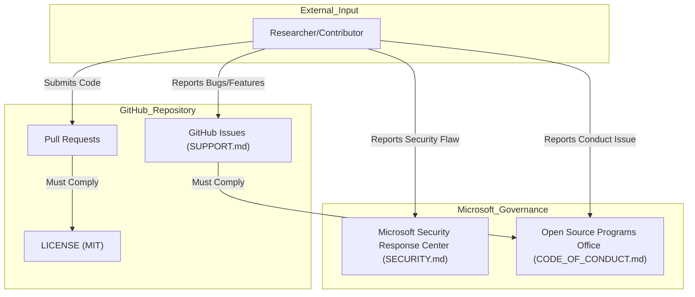

**Sources:**
* [SUPPORT.md:1-10]()
* [SECURITY.md:13-15]()
* [CODE_OF_CONDUCT.md:9]()

### Technical Support
For specific questions regarding the usage of the DELEGATE-52 benchmark that are not covered in the documentation, users should refer to the contact information provided in the main `README.md` file [SUPPORT.md:9]().

**Sources:**
* [SUPPORT.md:3-10]()

---

# Page: Core Architecture

# Core Architecture

<details>
<summary>Relevant source files</summary>

The following files were used as context for generating this wiki page:

- [README.md](README.md)

</details>


The DELEGATE-52 architecture is designed to simulate long-horizon, multi-turn document editing workflows. It treats Large Language Models (LLMs) as agents that perform "round-trip" edits: a **forward** edit that modifies a document based on a prompt, followed by a **backward** edit that attempts to revert the change. The system is modular, separating the experiment orchestration logic from model-specific communication and domain-specific document parsing/evaluation.

## High-Level System Overview

The system operates as a pipeline that transforms a seed document through a series of state transitions. The orchestration logic in the experiment runners manages the state chain, while utility modules handle data persistence and environment setup.

### Workflow Diagram: Natural Language to Code Entities

The following diagram illustrates how high-level concepts like "Simulating a Relay" and "Executing an Edit" map to specific classes and functions in the codebase.

**Relay Simulation Logic**
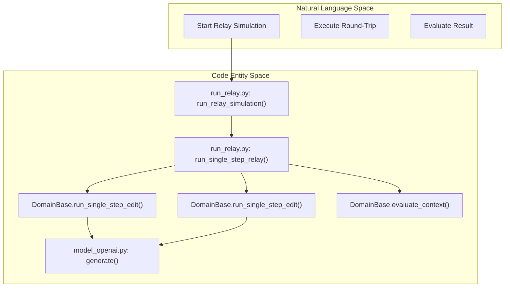
Sources: [run_relay.py:118-175](), [run_relay.py:59-116](), [domains/domain_base.py:108-144](), [domains/domain_base.py:84-90]()

## Component Relationships

The core architecture consists of four primary layers that interact to produce simulation results.

| Layer | Primary Responsibility | Key Files |
| :--- | :--- | :--- |
| **Orchestration** | Manages the loop of forward/backward edits and parallelizes jobs. | `run_relay.py`, `run_single.py` |
| **Execution** | Handles LLM interaction, tool-use loops, and sandboxing. | `model_openai.py`, `model_agentic.py` |
| **Domain Logic** | Defines how to parse, edit, and score documents for 52 specific formats. | `domains/domain_base.py`, `domains/` |
| **Utilities** | Provides file I/O, dataset management, and context serialization. | `utils_env.py`, `utils_results.py`, `utils_context.py` |

### System Component Interaction

This diagram shows the flow of data between the major modules during a single simulation step.

**Data Flow Architecture**
```mermaid
graph LR
    subgraph "Experiment Runners"
        RR["run_relay.py"]
    end

    subgraph "Domain Subsystem"
        DB["DomainBase"]
        DR["Domain Registry"]
    end

    subgraph "Model Wrappers"
        MO["model_openai.py"]
        MA["model_agentic.py"]
    end

    subgraph "Utilities"
        UE["utils_env.py"]
        UR["utils_results.py"]
        UC["utils_context.py"]
    end

    RR --> UE : "load_sample_from_jsonl()"
    RR --> DR : "get_domain()"
    DR --> DB : "instantiates"
    DB --> MO : "generate()"
    DB --> MA : "run_agentic_loop()"
    MO --> UC : "fenced_block_to_dict()"
    RR --> UR : "save_results()"
```
Sources: [run_relay.py:126-130](), [domains/domain_base.py:108-115](), [utils_env.py:14-43](), [utils_results.py:10-33]()

---

## 2.1 Experiment Runners
The experiment runners are the entry points for the benchmark. 
- `run_relay.py` implements the multi-turn "relay" logic, where the output of one edit becomes the input for the next, tracking the accumulation of errors over time.
- `run_single.py` is used for isolated testing of individual forward/backward pairs to ensure environment quality.

Both runners support parallelization via `multiprocessing.Pool` and handle result persistence to JSONL files.

For details, see [Experiment Runners](#2.1).

Sources: [run_relay.py:1-20](), [run_single.py:1-15]()

## 2.2 Model Wrappers
Model wrappers provide a unified interface for different LLM providers and interaction modes.
- `model_openai.py` manages standard completion and JSON-mode requests, including cost estimation and model-specific formatting (e.g., handling `o1`/`o3` system message constraints).
- `model_agentic.py` provides a "VirtualFS" environment where the LLM can use tools like `read_file`, `write_file`, and `run_python` inside a sandboxed `bwrap` container.

For details, see [Model Wrappers](#2.2).

Sources: [model_openai.py:15-40](), [model_agentic.py:20-55]()

## 2.3 Utility Modules
The utility layer provides shared logic used across the runners and domains:
- **`utils_context.py`**: Handles the conversion between raw LLM text (often containing Markdown fenced blocks) and the internal dictionary-based file representations.
- **`utils_env.py`**: Manages the "Work Environment," including loading seed documents and merging distractor context to increase task difficulty.
- **`utils_results.py`**: Provides thread-safe file locking for writing simulation results and computing real-time statistics.
- **`utils_dataset.py`**: Manages the DELEGATE-52 dataset, including automatic downloading from Hugging Face and local JSONL export/import.

For details, see [Utility Modules](#2.3).

Sources: [utils_context.py:1-10](), [utils_env.py:1-10](), [utils_results.py:1-10](), [utils_dataset.py:1-10]()

---

# Page: Experiment Runners

# Experiment Runners

<details>
<summary>Relevant source files</summary>

The following files were used as context for generating this wiki page:

- [README.md](README.md)

</details>


The DELEGATE-52 benchmark relies on two primary entry points for executing LLM evaluations: `run_relay.py` and `run_single.py`. These scripts manage the lifecycle of an experiment, from loading work environments and initializing model wrappers to orchestrating multi-turn edits and persisting results.

## Overview of Runners

| Script | Purpose | Key Logic |
| :--- | :--- | :--- |
| `run_relay.py` | Main evaluation script for measuring long-horizon document corruption. | Executes $N$ round-trips (Forward $\to$ Backward) to form a state-chain. |
| `run_single.py` | Quality assurance and unit testing for work environments. | Executes a single forward or backward edit in isolation to verify task feasibility. |

**Sources:** [run_relay.py:1-15](), [run_single.py:1-15](), [README.md:19-20]()

---

## 1. Multi-Turn Relay Simulation (`run_relay.py`)

The relay simulation is the core experimental design of DELEGATE-52. It simulates a "delegation chain" where an LLM is repeatedly asked to modify a document and then revert those modifications.

### State-Chain Logic
A "round-trip" consists of two steps:
1.  **Forward Edit**: The LLM receives `state_A` and a prompt to reach `state_B`.
2.  **Backward Edit**: The LLM receives the output of the forward edit and a prompt to return to `state_A`.

The runner chains these round-trips. For example, a 2-round-trip simulation follows:
$S_0 \xrightarrow{f_1} S_1 \xrightarrow{b_1} S_2 \xrightarrow{f_2} S_3 \xrightarrow{b_2} S_4$
Where $S_0$ is the original seed document, and $S_2, S_4$ are "reconstructed" versions of $S_0$.

### Implementation and Data Flow
The `run_sample` function in `run_relay.py` manages the state transitions for a single work environment.

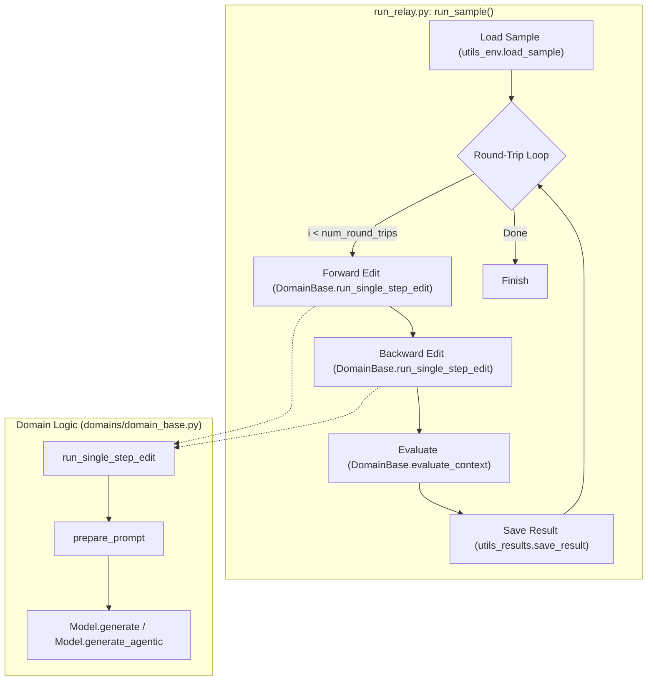
**Sources:** [run_relay.py:34-110](), [domains/domain_base.py:130-175]()

### CLI Arguments and Parallelization
`run_relay.py` uses `multiprocessing.Pool` to parallelize experiments across samples and models.

*   `--model_names`: List of model aliases (e.g., `gpt-4o`, `claude-3-5-sonnet`). [run_relay.py:126-127]()
*   `--domains`: Filter for specific domains (e.g., `subtitles`, `python`). [run_relay.py:124-125]()
*   `--num_round_trips`: Number of $k$ cycles to run (default: 10). [run_relay.py:132-133]()
*   `--num_workers`: Number of parallel processes for `Pool`. [run_relay.py:138-139]()
*   `--skip_distractor`: If set, the LLM only sees the relevant files instead of the full work environment context. [run_relay.py:136-137]()

**Sources:** [run_relay.py:115-160](), [run_relay.py:165-185]()

---

## 2. Single Edit Testing (`run_single.py`)

This script is used for debugging and validating the dataset. It executes exactly one edit (either forward or backward) from a specific state in a work environment.

### Logic Flow
Unlike the relay, `run_single.py` does not chain outputs. It tests if an LLM can successfully transition from `state_i` to `state_j` as defined in the `sample.json` state machine.

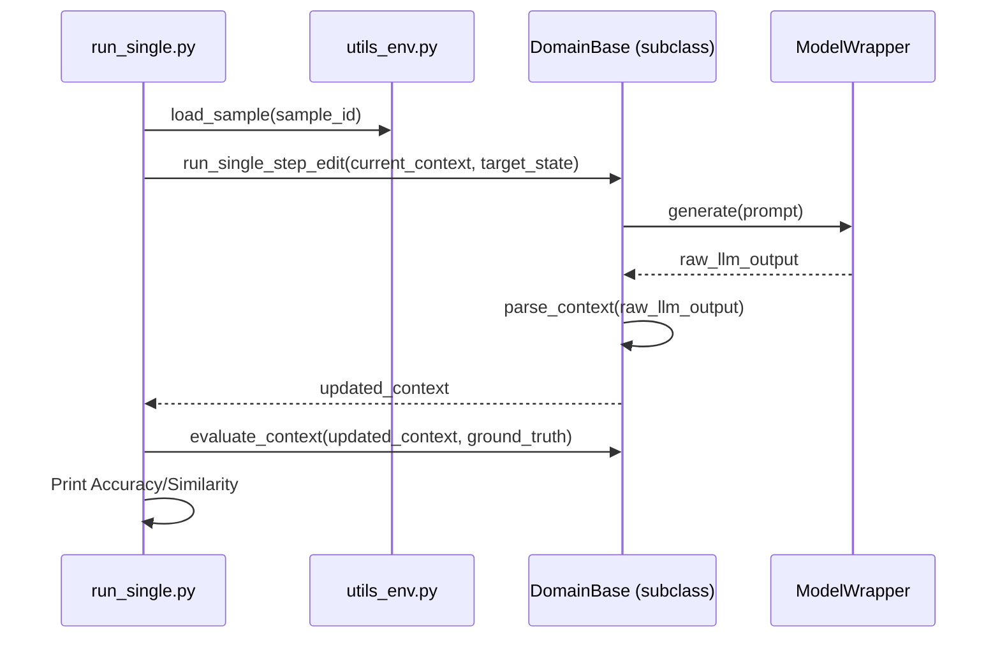
**Sources:** [run_single.py:30-80](), [utils_env.py:15-45]()

---

## 3. Result Persistence

Both runners use `utils_results.py` to handle I/O and prevent data loss during parallel execution.

### Persistence Mechanism
1.  **File Locking**: The `save_result` function uses file locking to ensure that multiple processes in the `multiprocessing.Pool` do not corrupt the JSONL output file when writing simultaneously. [utils_results.py:10-25]()
2.  **Output Pathing**: Results are stored in `results/{model_name}/{domain_name}.jsonl`. [run_relay.py:85-90]()
3.  **Schema**: Each line in the result file contains:
    *   `sample_id`: Unique identifier for the work environment.
    *   `turn_index`: The specific step in the relay chain.
    *   `edit_type`: "forward" or "backward".
    *   `similarity_score`: The domain-specific evaluation result.
    *   `model_output`: The raw text generated by the LLM.

**Sources:** [utils_results.py:1-30](), [run_relay.py:95-105]()

---

## 4. Key Implementation Details

### Forward/Backward State Chain
In `run_relay.py`, the `target_state_id` is toggled between `forward` and `backward` prompts found in the dataset's `sample.json`. The `current_context` is updated at every step, meaning errors in `turn 1` propagate to `turn 2`.

### Agentic vs. Standard Generation
The runners check if the model is "agentic" (e.g., using `model_agentic.py`). If so, `run_single_step_edit` bypasses standard prompt templates and enters a tool-use loop where the LLM can call `read_file`, `write_file`, and `run_python` to perform the edit.

**Sources:** [domains/domain_base.py:155-170](), [run_relay.py:65-75]()

---

# Page: Model Wrappers

# Model Wrappers

<details>
<summary>Relevant source files</summary>

The following files were used as context for generating this wiki page:

- [README.md](README.md)

</details>


This page documents the two primary interfaces for Large Language Model (LLM) interaction in DELEGATE-52: `model_openai.py` and `model_agentic.py`. These modules abstract the complexities of API communication, cost tracking, and tool-use loops, providing a unified interface for the experiment runners.

## OpenAI Wrapper (`model_openai.py`)

The `model_openai.py` module provides a robust wrapper for interacting with OpenAI and Azure OpenAI endpoints. It handles model alias resolution, token-based cost estimation, and specific formatting requirements for reasoning models like `o1` and `o3`.

### Key Features

*   **Model Alias Resolution**: Maps friendly names (e.g., `gpt-4o`) to specific API model strings [model_openai.py:38-59]().
*   **System Message Folding**: For models that do not support a `system` role (specifically `o1` and `o3`), it automatically prepends the system message to the first user message [model_openai.py:108-112]().
*   **JSON Enforcement**: Supports both `response_format={"type": "json_object"}` and Pydantic-based structured outputs via `beta.chat.completions.parse` [model_openai.py:126-150]().
*   **Cost Estimation**: Tracks cumulative usage and calculates costs based on hardcoded pricing for input, output, and cached tokens [model_openai.py:61-94]().

### Data Flow: OpenAI Generation

The following diagram illustrates the flow of a standard generation request through `model_openai.py`.

**Figure 1: OpenAI Generation Logic**
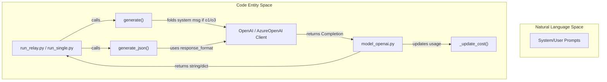
Sources: [model_openai.py:102-124](), [model_openai.py:126-153](), [model_openai.py:155-171]()

### Functionality Overview

| Function | Description |
| :--- | :--- |
| `generate()` | Standard chat completion. Handles retry logic and system message folding for `o1`/`o3` models. |
| `generate_json()` | Requests JSON output. Can take a Pydantic `response_model` for schema enforcement. |
| `_update_cost()` | Updates a global `MODEL_STATS` dictionary with token counts and USD costs. |
| `get_model_stats()` | Returns the current session's total cost and token usage. |

Sources: [model_openai.py:102-171](), [model_openai.py:61-94]()

---

## Agentic Wrapper (`model_agentic.py`)

The `model_agentic.py` module implements a tool-use loop where the LLM acts as an agent. Instead of simply generating text, the model can interact with a virtual filesystem and execute Python code to perform complex edits.

### Virtual File System & Sandboxing
The agent operates within a temporary directory (`work_dir`). For Python execution, the wrapper uses `bwrap` (Bubblewrap) to create a Linux sandbox, preventing the LLM from accessing the host system [model_agentic.py:165-185]().

### Tool Schema
The agent has access to a set of predefined tools defined in `AGENTIC_TOOLS`:
*   `read_file`: Reads content from a specific path.
*   `write_file`: Overwrites or creates a file.
*   `delete_file`: Removes a file.
*   `run_python`: Executes a Python script within the sandbox and returns `stdout`/`stderr`.
*   `finish`: Signals the end of the task and provides the final status.

Sources: [model_agentic.py:16-95]()

### The Agentic Loop
The `generate_agentic()` function manages a multi-turn conversation. In each turn, the model either generates a thought/tool call or responds to the result of a previous tool execution.

**Figure 2: Agentic Tool-Use Loop**
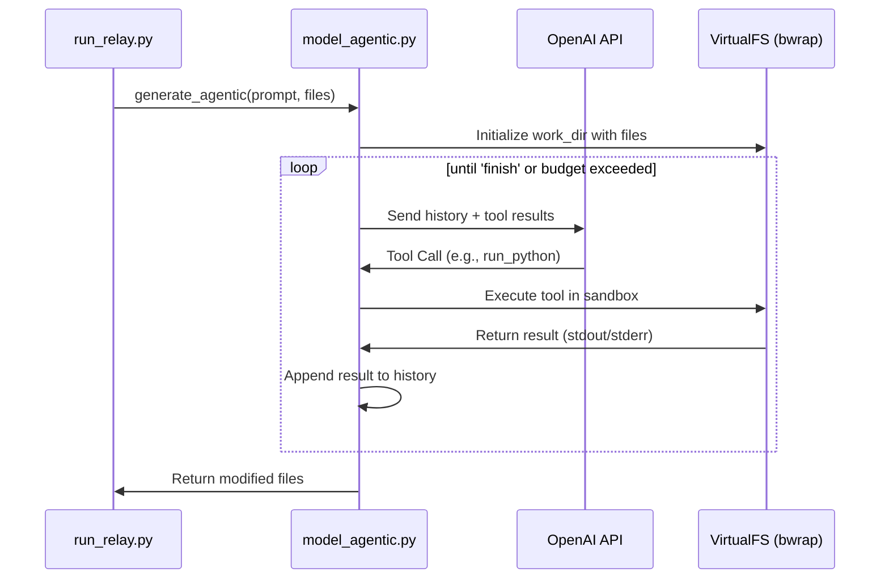
Sources: [model_agentic.py:202-285](), [model_agentic.py:120-163]()

### Budget and Constraints
To prevent infinite loops or excessive API spend, the agentic wrapper enforces:
*   **Max Turns**: Default limit on the number of tool-use iterations [model_agentic.py:199]().
*   **Error Handling**: If a tool fails (e.g., Python syntax error), the error message is fed back to the LLM to allow for self-correction [model_agentic.py:145-151]().

### Integration with Domains
When a domain's `run_single_step_edit` is called with an agentic model name (prefixed with `agentic:`), the `DomainBase` class routes the request to `model_agentic.generate_agentic` instead of the standard `generate` function.

Sources: [domains/domain_base.py:157-175](), [model_agentic.py:195-200]()

---

# Page: Utility Modules

# Utility Modules

<details>
<summary>Relevant source files</summary>

The following files were used as context for generating this wiki page:

- [README.md](README.md)

</details>


The utility modules in the DELEGATE-52 repository provide the foundational logic for data handling, context manipulation, and result persistence. These modules abstract the complexities of interacting with the Hugging Face Hub, managing concurrent file access, and normalizing LLM outputs across 52 different document domains.

## Context and Text Processing (`utils_context.py`)

`utils_context.py` is the primary engine for transforming raw LLM outputs into structured document states and calculating text-level statistics. It handles the extraction of content from Markdown fenced blocks and provides wildcard matching for domain-specific evaluation.

### Key Functionalities
- **Fenced Block Normalization**: LLMs often wrap document content in Markdown code blocks. `parse_context` [utils_context.py:15-39]() extracts content from these blocks, handling both labeled (e.g., ` ```python `) and unlabeled blocks. It prioritizes the first block found but returns the full string if no blocks are present.
- **Serialization**: `serialize_context` [utils_context.py:4-13]() converts a dictionary of filename-content pairs into a single string formatted with headers (e.g., `--- filename.txt ---`), which is the standard input format for the model prompts.
- **Wildcard Matching**: The `match_with_wildcards` [utils_context.py:64-77]() function allows for flexible string comparison where `*` acts as a placeholder for any sequence of characters, supporting robust evaluation in domains with non-deterministic identifiers.
- **Text Statistics**: `compute_text_statistics` [utils_context.py:41-62]() provides basic metrics including character count, word count, and line count for a given text string.

### Data Flow: LLM Output to Parsed Context
The following diagram illustrates how raw model responses are cleaned and structured for the domain evaluators.

**Context Normalization Flow**
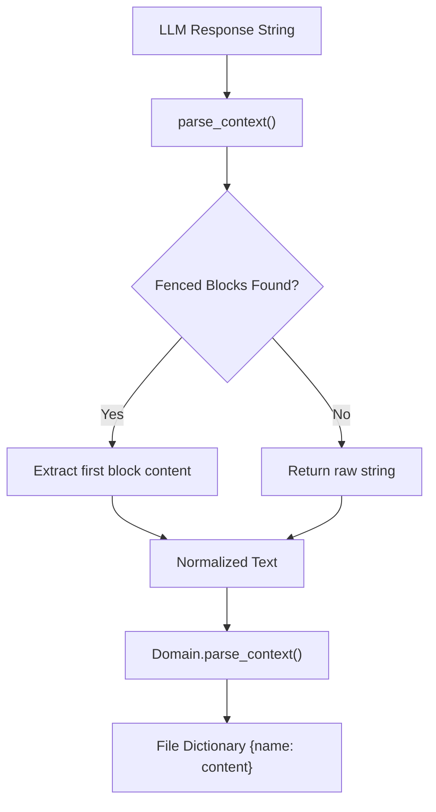
Sources: [utils_context.py:4-77]()

---

## Environment and Simulation Utilities (`utils_env.py`)

`utils_env.py` manages the setup of work environments for simulations, including the loading of seed documents and the integration of distractor files.

### Core Components
- **Sample Loading**: `load_sample_as_env` [utils_env.py:13-35]() initializes a work environment by extracting files from a specific state in the dataset and optionally merging them with distractor context.
- **Distractor Merging**: `merge_distractor_context` [utils_env.py:37-43]() injects "noise" into the model's context window by adding files from the `distractor_context` directory of a sample. This tests the model's ability to ignore irrelevant files during editing.
- **Single Edit Execution**: `run_single_edit` [utils_env.py:45-71]() encapsulates a single turn of the relay. It prepares the prompt using the domain's logic, calls the model wrapper, and parses the resulting context.

### Relationship: Environment Setup and Model Interaction
This diagram bridges the "Natural Language" instructions with the "Code Entity" environment state.

**Environment State Transition**
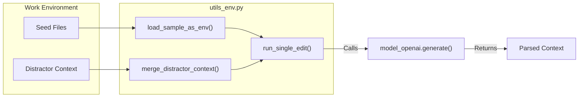
Sources: [utils_env.py:13-71](), [run_relay.py:19-22]()

---

## Result Persistence and Locking (`utils_results.py`)

To support high-concurrency experiments (using `multiprocessing.Pool` in `run_relay.py`), `utils_results.py` implements a thread-safe and process-safe result logging system using file locks.

### Implementation Details
- **Result Persistence**: `persist_result` [utils_results.py:13-25]() appends experiment results to a JSONL file. It uses `portalocker` [utils_results.py:18-18]() to ensure that multiple worker processes do not corrupt the output file when writing simultaneously.
- **Result Counting**: `count_results` [utils_results.py:27-40]() scans an existing results file to determine which experiments have already been completed, allowing the runners to resume interrupted jobs.
- **Result Loading**: `load_results` [utils_results.py:42-53]() reads the JSONL file and returns a list of result dictionaries for post-simulation analysis.

Sources: [utils_results.py:13-53](), [run_relay.py:50-100]()

---

## Dataset Management (`utils_dataset.py`)

`utils_dataset.py` handles the I/O operations for the DELEGATE-52 dataset, including conversion between the JSONL format and local directory structures, as well as automatic fetching from Hugging Face.

### Key Functions
- **resolve_input_path**: [utils_dataset.py:101-118]() This is the entry point for data loading. If the provided path does not exist locally, it attempts to download `delegate52.jsonl` from the `microsoft/delegate52` repository on Hugging Face Hub using `hf_hub_download`.
- **import_samples**: [utils_dataset.py:12-25]() Loads a JSONL file into a list of Python dictionaries.
- **export_samples**: [utils_dataset.py:27-99]() A complex utility that traverses a local directory of work environments and packages them into the standard JSONL schema. It reads `sample.json` files to reconstruct the state machine and captures file contents from "solution folders".

### Dataset Schema Integration
The following diagram maps the filesystem structure to the `delegate52.jsonl` entity used by the experiment runners.

**Filesystem to JSONL Mapping**
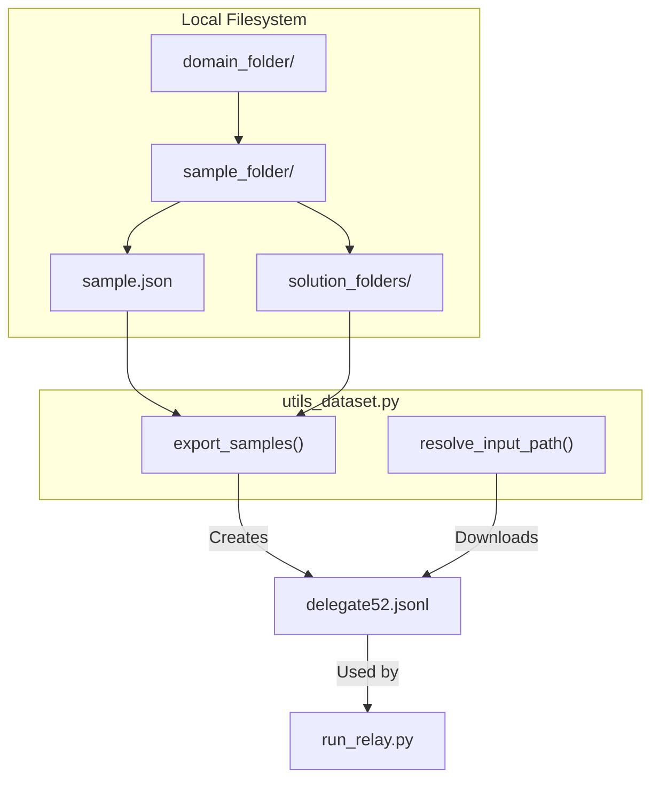
Sources: [utils_dataset.py:12-118](), [README.md:41-57]()

---

# Page: Domain System

# Domain System

<details>
<summary>Relevant source files</summary>

The following files were used as context for generating this wiki page:

- [README.md](README.md)
- [assets/figures/domains.png](assets/figures/domains.png)
- [domain_viewer/README.md](domain_viewer/README.md)

</details>


The **Domain System** is the architectural backbone of DELEGATE-52, providing a unified interface for interacting with 52 distinct professional and everyday document formats [README.md:9-10](). By abstracting domain-specific logic into a standardized class hierarchy, the system allows the experiment runners to perform complex editing tasks and evaluate document fidelity without needing to understand the underlying file syntax for every domain.

### 52-Domain Architecture

The system is organized into five high-level categories, each containing specialized domains that range from scientific data formats to creative media scripts [README.md:26-28](). Every domain is implemented as a subclass of `DomainBase`, ensuring that the relay simulation can treat a Python script, a protein structure, or a musical score through the same programmatic API.

The following diagram illustrates how the Domain System bridges the gap between high-level Natural Language instructions and the concrete Code Entities that handle them:

**Natural Language to Code Entity Mapping**
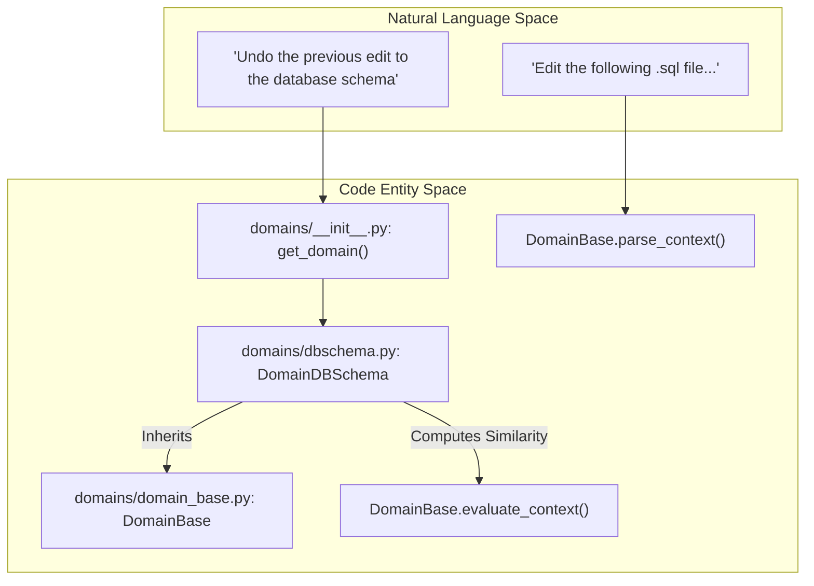
Sources: [domains/domain_base.py:1-20](), [README.md:23-24]()

---

### Core Components

The domain system relies on three primary pillars: the base class, the registry for auto-discovery, and the specific implementations.

#### 1. DomainBase Class
The `DomainBase` abstract class defines the contract for all 52 domains. It handles prompt preparation, context parsing, and the execution of single-step edits [README.md:23](). It also mandates that subclasses implement domain-specific evaluation logic to measure how well an LLM preserved a document's integrity.
*   **For details, see [DomainBase & Domain Registry](#3.1).**

#### 2. Domain Registry
The registry, located in `domains/__init__.py`, facilitates the automatic discovery of domain implementations. It provides a `get_domain()` utility that the experiment runners use to instantiate the correct domain object based on the `sample_type` found in the dataset [README.md:56]().
*   **For details, see [DomainBase & Domain Registry](#3.1).**

#### 3. Category Classifications
The 52 domains are partitioned into five categories to organize the benchmark's breadth:

| Category | Description | Examples |
| :--- | :--- | :--- |
| **Code & Config** | Technical build and infra files. | `Dockerfile`, `.py`, `.tf` |
| **Science & Eng.** | Specialized research formats. | `.pdb` (Protein), `.cif` (Crystal) |
| **Creative & Media** | Artistic and document scripts. | `.ly` (Music), `.fadein` (Screenplay) |
| **Structured Records** | Data-heavy logs and tables. | `.ledger` (Accounting), `.csv` |
| **Everyday** | Common life and business tasks. | `.pgn` (Chess), `.yaml` (Food Menu) |

Sources: [domain_viewer/README.md:7-80](), [assets/figures/domains.png:1-10]()

---

### Domain Categories Overview

The following sections provide a high-level overview of the five categories. Each category contains detailed logic for parsing (e.g., regex-based or AST-based) and evaluation (e.g., structural similarity or Hungarian matching).

#### Code & Configuration Domains
This category focuses on machine-readable formats where syntax errors often lead to immediate failure. It includes 11 domains such as Database Schemas, DNS zones, and Python source code.
*   **For details, see [Code & Configuration Domains](#3.2).**

#### Science & Engineering Domains
These 11 domains handle high-precision data. Evaluation often involves specialized similarity metrics for physical structures, such as molecular coordinates in `.sdf` files or orbital data in `.tle` files.
*   **For details, see [Science & Engineering Domains](#3.3).**

#### Creative & Media Domains
Covering 11 domains, this category evaluates the LLM's ability to maintain stylistic and structural consistency in formats like LaTeX, LilyPond music notation, and SVG vector graphics.
*   **For details, see [Creative & Media Domains](#3.4).**

#### Structured Records Domains
These 11 domains focus on records where data integrity is paramount. A notable example is the Accounting domain, which uses Hungarian matching to compare financial transactions between document versions.
*   **For details, see [Structured Records Domains](#3.5).**

#### Everyday Domains
The final 8 domains represent common tasks like managing a Chess game in PGN format or updating a transit schedule in GTFS format.
*   **For details, see [Everyday Domains](#3.6).**

---

### Evaluation Pipeline

The domain system is central to the DELEGATE-52 evaluation pipeline. When a relay simulation is running, the `DomainBase` implementation for the specific sample is responsible for comparing the state of the document at turn $k$ against the original seed document.

**System Architecture: Evaluation Flow**
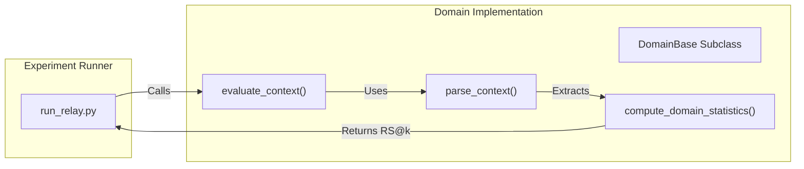
Sources: [run_relay.py:19-20](), [domains/domain_base.py:1-20]()

---

# Page: DomainBase & Domain Registry

# DomainBase & Domain Registry

<details>
<summary>Relevant source files</summary>

The following files were used as context for generating this wiki page:

- [README.md](README.md)
- [domain_viewer/accounting.md](domain_viewer/accounting.md)

</details>


The **Domain System** is the architectural backbone of DELEGATE-52, providing a standardized interface for handling document editing across 52 distinct professional domains. This system abstracts away the complexities of different file formats (e.g., `.ledger`, `.py`, `.cif`, `.qasm`) and provides a unified mechanism for parsing, evaluation, and agentic interaction.

## DomainBase Abstract Class

`DomainBase` is the base class defined in `domains/domain_base.py`. Every domain in the benchmark must subclass this class and implement its abstract methods to provide domain-specific logic for parsing and scoring.

### Class Attributes
These attributes define the identity and metadata of a domain:
- `sample_type`: A string identifier for the domain (e.g., `"accounting"`). [domains/domain_base.py:16-16]()
- `file_format`: The primary file extension associated with the domain (e.g., `".ledger"`). [domains/domain_base.py:17-17]()
- `category`: One of the five benchmark categories (Code & Configuration, Science & Engineering, Creative & Media, Structured Records, Everyday). [domains/domain_base.py:18-18]()
- `domain_parser`: A string identifier for the parsing logic (often matches `sample_type`). [domains/domain_base.py:19-19]()

### Abstract Methods
Subclasses must implement the following methods to enable the evaluation pipeline:
- `parse_context(context_str)`: Converts a raw string (containing one or more files) into a structured dictionary representation. [domains/domain_base.py:27-29]()
- `compute_domain_statistics(structured_context)`: Calculates domain-specific metrics (e.g., number of transactions, lines of code, or atom counts) from the structured representation. [domains/domain_base.py:31-33]()
- `evaluate_context(structured_gold, structured_pred)`: The core scoring function. It compares a "gold" (original) structured context against a "predicted" (edited) one and returns a float score between 0.0 and 1.0. [domains/domain_base.py:35-37]()
- `render_context_visual(structured_context)`: Generates a human-readable or simplified visualization of the context, used primarily for logging or debugging. [domains/domain_base.py:39-41]()

### Data Flow: Context Processing
The following diagram illustrates how `DomainBase` processes document strings into structured data for evaluation.

**Domain Processing Pipeline**
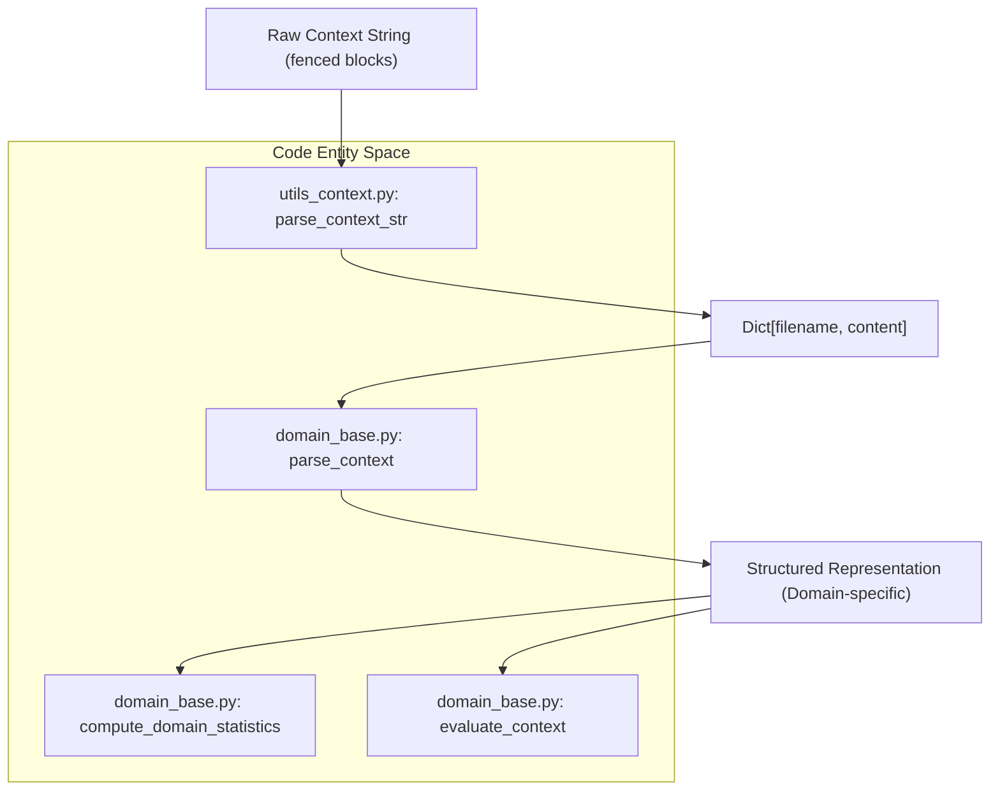
Sources: [domains/domain_base.py:27-41](), [utils_context.py:13-35]()

---

## Core Functionality

### prepare_prompt()
This method prepares the instructions for the LLM by populating prompt templates with work environment data. It handles the inclusion of distractor context (irrelevant files meant to test LLM robustness) and formats the target file names and editing instructions. [domains/domain_base.py:43-69]()

### run_single_step_edit()
This is the primary execution entry point for a single editing task. It supports two distinct operational modes:
1.  **Standard Mode**: The LLM is provided with a prompt and returns a single completion containing the edited files. [domains/domain_base.py:107-111]()
2.  **Agentic Mode**: If `model.is_agentic` is true, the domain delegates the task to a tool-use loop (implemented in `model_agentic.py`). The agent can read, write, and delete files within a virtual filesystem. [domains/domain_base.py:94-105]()

**Agentic Routing Logic**
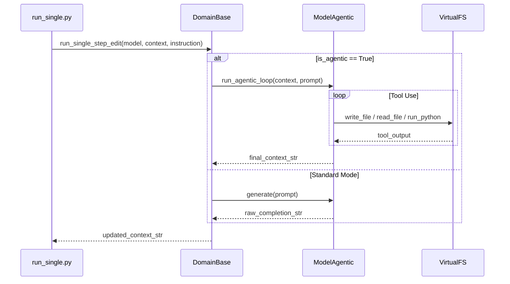
Sources: [domains/domain_base.py:84-111](), [model_agentic.py:145-195]()

---

## Domain Registry & Auto-Discovery

The `domains/__init__.py` file manages the global registry of all 52 domains. It uses an auto-discovery mechanism to avoid manual imports.

### Auto-Discovery Mechanism
The registry iterates through all files in the `domains/` directory. If a file starts with `domain_` and ends with `.py`, it is dynamically imported. The registry then inspects the module for any class that inherits from `DomainBase` (excluding `DomainBase` itself). [domains/__init__.py:12-28]()

### Key Functions
- `get_domain(domain_name)`: Retrieves the singleton instance of a domain class from the `DOMAIN_REGISTRY` dictionary. [domains/__init__.py:36-41]()
- `get_all_domains()`: Returns a list of all registered domain names. [domains/__init__.py:44-46]()

### Domain Registry Structure
| Component | Description |
| :--- | :--- |
| `DOMAIN_REGISTRY` | A dictionary mapping `sample_type` strings to instantiated `DomainBase` subclasses. |
| `DOMAIN_TO_PROMPT` | A mapping that determines which prompt template file (from the `prompts/` directory) a domain should use. |

**Domain Registration Flow**
```mermaid
graph LR
    subgraph "File System"
        F1["domain_accounting.py"]
        F2["domain_python.py"]
        F3["domain_molecule.py"]
    end

    subgraph "Registry Logic (domains/__init__.py)"
        I["importlib.import_module"]
        C["inspect.getmembers(isclass)"]
        R[("DOMAIN_REGISTRY")]
    end

    F1 --> I
    F2 --> I
    F3 --> I
    I --> C
    C -->|"subclass of DomainBase"| R
    
    subgraph "Accessors"
        G["get_domain('accounting')"]
        A["get_all_domains()"]
    end

    R -.-> G
    R -.-> A
```
Sources: [domains/__init__.py:12-46]()

---

## Implementation Example: Accounting Domain
The `AccountingDomain` (in `domains/domain_accounting.py`) illustrates the complexity of the `evaluate_context` method. Because transactions in a ledger can be reordered or split across files, it uses the **Hungarian Matching Algorithm** to find the optimal alignment between original and predicted transactions before calculating the final reconstruction score. [domain_viewer/accounting.md:16-23]()

Sources: [domain_viewer/accounting.md:1-25](), [domains/domain_base.py:1-111]()

---

# Page: Code & Configuration Domains

# Code & Configuration Domains

<details>
<summary>Relevant source files</summary>

The following files were used as context for generating this wiki page:

- [assets/domain_icons/dbschema.svg](assets/domain_icons/dbschema.svg)
- [assets/domain_icons/dns.svg](assets/domain_icons/dns.svg)
- [assets/domain_icons/docker.svg](assets/domain_icons/docker.svg)
- [assets/domain_icons/filesystem.svg](assets/domain_icons/filesystem.svg)
- [assets/domain_icons/graphviz.svg](assets/domain_icons/graphviz.svg)
- [assets/domain_icons/infra.svg](assets/domain_icons/infra.svg)
- [assets/domain_icons/json.svg](assets/domain_icons/json.svg)
- [assets/domain_icons/makefile.svg](assets/domain_icons/makefile.svg)
- [assets/domain_icons/malware.svg](assets/domain_icons/malware.svg)
- [assets/domain_icons/python.svg](assets/domain_icons/python.svg)
- [assets/domain_icons/translation.svg](assets/domain_icons/translation.svg)
- [domain_viewer/dbschema.md](domain_viewer/dbschema.md)
- [domain_viewer/dns.md](domain_viewer/dns.md)
- [domain_viewer/docker.md](domain_viewer/docker.md)
- [domain_viewer/filesystem.md](domain_viewer/filesystem.md)
- [domain_viewer/graphviz.md](domain_viewer/graphviz.md)
- [domain_viewer/infra.md](domain_viewer/infra.md)
- [domain_viewer/json.md](domain_viewer/json.md)
- [domain_viewer/makefile.md](domain_viewer/makefile.md)
- [domain_viewer/malware.md](domain_viewer/malware.md)
- [domain_viewer/python.md](domain_viewer/python.md)

</details>


This page documents the 11 domains within the **Code & Configuration** category. These domains focus on formal languages used for software development, system administration, and data representation. Unlike natural language domains, these require strict adherence to syntax, structural integrity, and logical consistency across multiple files.

The category covers a diverse set of formats:
- **Programming & Logic:** Python (`.py`), Makefile, Malware Rules (`.yar`).
- **Infrastructure & Systems:** Docker (`Dockerfile`), Infrastructure (`.tf`), DNS (`.zone`), Database Schema (`.sql`).
- **Data & Serialization:** JSON (`.json`), Translation (`.po`), Filesystem (`.txt`), Graphviz (`.dot`).

## Domain Implementation Overview

Each domain is implemented as a subclass of `DomainBase` [domains/domain_base.py:15-17](), providing specific logic for parsing, statistics, and evaluation. The evaluation strategies typically involve a mix of structural parsing (e.g., AST analysis for Python, SQL schema inspection) and text-based similarity metrics.

### Technical Data Flow: Code Domain Evaluation

The following diagram illustrates how a "Code & Configuration" document transitions from a raw string generated by an LLM to a structured fidelity score.

**Code Domain Evaluation Pipeline**
```mermaid
graph TD
    subgraph "Natural Language Space"
        A["LLM Output (Markdown Blocks)"]
    end

    subgraph "Code Entity Space"
        B["utils_context.parse_context()"]
        C["Virtual File System (Dict)"]
        D["Domain Evaluator (evaluate_context)"]
        E["AST / Parser (e.g., sqlglot, ast)"]
        F["Feature Extraction (Tables, Functions, Keys)"]
        G["Hungarian Matching / Set Comparison"]
    end

    A --> B
    B --> C
    C --> D
    D --> E
    E --> F
    F --> G
    G --> H["Reconstruction Score (RS@k)"]
```
**Sources:** [domains/domain_base.py:108-112](), [utils_context.py:44-55]()

---

## 1. Database Schema (.sql)
The `dbschema` domain handles MySQL DDL (Data Definition Language). It tests the ability to reason about relational structures, including tables, columns, constraints, and indexes.

*   **Format:** `.sql` files containing `CREATE TABLE` statements.
*   **Parsing:** Uses `sqlite3` to dry-run the schema in-memory to validate syntax and extract metadata [domain_viewer/dbschema.md:16-17]().
*   **Evaluation:**
    *   **Table Presence (25%):** Exact match on table names.
    *   **Column Matching (40%):** Validates names and data types.
    *   **Index Coverage (20%):** Checks for index preservation.
    *   **Primary Key Correctness (15%):** Validates PK definitions [domain_viewer/dbschema.md:18-23]().

**Sources:** [domain_viewer/dbschema.md:1-25]()

## 2. DNS (.zone)
This domain focuses on RFC 1035 zone files used by BIND and other DNS servers.

*   **Format:** `.zone` files.
*   **Key Entities:** SOA records, A/AAAA records, MX, CNAME, and TXT records.
*   **Evaluation:** Measures the fidelity of resource record (RR) sets. It ensures that IP mappings and TTL values remain consistent across transformations like "Split by Subdomain" or "Export to CSV".

## 3. Docker (Dockerfile)
The `docker` domain involves containerization logic.

*   **Format:** `Dockerfile` and associated `.dockerignore` files.
*   **Logic:** Focuses on the sequence of instructions (`FROM`, `RUN`, `COPY`, `ENV`).
*   **Evaluation:** Compares the effective build layers and environment variables. It checks if the semantic intent (e.g., "Install python and copy requirements") is preserved even if the command structure changes.

## 4. Filesystem (.txt)
A meta-domain representing directory structures and file metadata.

*   **Format:** `.txt` (usually a tree representation) or actual directory hierarchies.
*   **Tasks:** Operations like "Flatten directory," "Generate tree.txt," or "Archive metadata."
*   **Evaluation:** Uses path-based matching to ensure file permissions, ownership, and relative paths are reconstructed correctly.

## 5. Graphviz (.dot)
The `graphviz` domain handles directed and undirected graphs.

*   **Format:** `.dot` files.
*   **Evaluation:** Focuses on graph topology. It extracts nodes and edges to compute a graph isomorphism-style similarity, ensuring that the connectivity of the graph is maintained regardless of visual attribute changes (like node color or shape).

## 6. Infrastructure (.tf)
This domain covers HashiCorp Terraform configurations.

*   **Format:** `.tf` (HCL - HashiCorp Configuration Language).
*   **Entities:** `resource`, `variable`, `output`, and `provider` blocks.
*   **Evaluation:** Parses the HCL to identify resource types and their attributes. It measures how many cloud resources (e.g., `aws_instance`, `azurerm_storage_account`) were correctly recovered.

## 7. JSON (.json)
The standard data interchange format.

*   **Format:** `.json`.
*   **Parsing:** Uses standard Python `json` library.
*   **Evaluation:** Performs a deep comparison of JSON objects, ignoring key order but strictly validating value types and nested structures.

## 8. Makefile
Focuses on build automation logic.

*   **Format:** `Makefile`.
*   **Entities:** Targets, dependencies, and shell commands.
*   **Evaluation:** Extracts the dependency graph. It checks if the "rules" to build specific targets remain functionally identical after edits like "Convert to CMake" and back.

## 9. Malware Rules (.yar)
Uses the YARA format for identifying and classifying malware samples.

*   **Format:** `.yar`.
*   **Entities:** `meta`, `strings` (hex, regex, text), and `condition`.
*   **Evaluation:** Specifically monitors the `condition` logic (e.g., `uint16(0) == 0x5A4D and any of ($s*)`). It ensures that the detection signatures remain semantically equivalent.

## 10. Python (.py)
The primary programming domain, testing complex logic and refactoring.

*   **Format:** `.py` files.
*   **Evaluation:** Uses Python's `ast` (Abstract Syntax Tree) module. It compares the tree structure to identify functions, classes, and variable assignments, allowing for minor whitespace variations while enforcing logic preservation.
*   **Special Prompting:** Uses `domain_python.txt` which enforces a strict fenced-block format for multi-file codebases [prompts/domain_python.txt:1-10]().

**Sources:** [prompts/domain_python.txt:1-10]()

## 11. Translation (.po)
Handles Gettext Portable Object files for software localization.

*   **Format:** `.po` files.
*   **Entities:** `msgid` (source) and `msgstr` (target).
*   **Evaluation:** Checks for the preservation of all translation keys and the accuracy of the translated strings, often involving multi-lingual consistency checks.

---

## System Mapping: From Code to Evaluation

The following diagram maps the internal Python classes and functions to the conceptual "Domains" described above.

**Code Entity Mapping**
```mermaid
graph LR
    subgraph "Registry & Base"
        DR["domains.__init__.get_domain()"]
        DB["domains.domain_base.DomainBase"]
    end

    subgraph "Code Domains"
        D1["DomainDBSchema"]
        D2["DomainPython"]
        D3["DomainJSON"]
        D4["DomainInfra"]
    end

    subgraph "Evaluation Logic"
        E1["evaluate_context()"]
        E2["compute_domain_statistics()"]
    end

    DR --> DB
    DB -- "Subclassed by" --> D1
    DB -- "Subclassed by" --> D2
    DB -- "Subclassed by" --> D3
    DB -- "Subclassed by" --> D4

    D1 -- "Implements" --> E1
    D2 -- "Implements" --> E1
    D3 -- "Implements" --> E2
```
**Sources:** [domains/__init__.py:22-25](), [domains/domain_base.py:15-30]()

---

# Page: Science & Engineering Domains

# Science & Engineering Domains

<details>
<summary>Relevant source files</summary>

The following files were used as context for generating this wiki page:

- [assets/domain_icons/aviation.svg](assets/domain_icons/aviation.svg)
- [assets/domain_icons/circuit.svg](assets/domain_icons/circuit.svg)
- [assets/domain_icons/crystal.svg](assets/domain_icons/crystal.svg)
- [assets/domain_icons/mathlean.svg](assets/domain_icons/mathlean.svg)
- [assets/domain_icons/molecule.svg](assets/domain_icons/molecule.svg)
- [assets/domain_icons/protein.svg](assets/domain_icons/protein.svg)
- [assets/domain_icons/quantum.svg](assets/domain_icons/quantum.svg)
- [assets/domain_icons/robotics.svg](assets/domain_icons/robotics.svg)
- [assets/domain_icons/satellite.svg](assets/domain_icons/satellite.svg)
- [assets/domain_icons/starcatalog.svg](assets/domain_icons/starcatalog.svg)
- [assets/domain_icons/weather.svg](assets/domain_icons/weather.svg)
- [domain_viewer/aviation.md](domain_viewer/aviation.md)
- [domain_viewer/circuit.md](domain_viewer/circuit.md)
- [domain_viewer/crystal.md](domain_viewer/crystal.md)
- [domain_viewer/mathlean.md](domain_viewer/mathlean.md)
- [domain_viewer/molecule.md](domain_viewer/molecule.md)
- [domain_viewer/protein.md](domain_viewer/protein.md)

</details>


The Science & Engineering category in DELEGATE-52 encompasses 11 domains that represent highly specialized technical formats. These domains range from aerospace communications and molecular modeling to formal mathematical proofs and quantum circuit descriptions. Unlike standard text or code, these formats often require domain-specific parsers to validate structural integrity and custom similarity metrics to evaluate the preservation of scientific semantics during LLM-driven edits.

## Domain Overview

Each domain is implemented as a subclass of `DomainBase` [domains/domain_base.py:16-18](), providing specialized logic for parsing, statistics, and evaluation.

| Domain | File Format | Icon | Primary Evaluation Focus |
| :--- | :--- | :--- | :--- |
| **Aviation** | `.notam` |  | ICAO field accuracy (Q-lines, validity periods) |
| **Circuit** | `.cir` |  | SPICE netlist topology and component parameters |
| **Crystal** | `.cif` |  | Crystallographic symmetry and atomic coordinates |
| **MathLean** | `.lean` |  | Formal proof structure and tactic blocks |
| **Molecule** | `.sdf` |  | V2000/V3000 atom blocks and bond tables |
| **Protein** | `.pdb` |  | Protein Data Bank ATOM/HETATM records |
| **Quantum** | `.qasm` |  | OpenQASM gate sequences and register declarations |
| **Robotics** | `.urdf` |  | Kinematic chain (links/joints) XML structure |
| **Satellite** | `.tle` |  | Two-Line Element set orbital parameters |
| **Star Catalog**| `.vot` |  | VOTable astronomical data and metadata |
| **Weather** | `.metar` |  | METAR/SPECI airport weather observation codes |

Sources: [domain_viewer/aviation.md:1-5](), [domain_viewer/circuit.md:1-5](), [domain_viewer/crystal.md:1-5](), [domain_viewer/mathlean.md:1-5](), [domain_viewer/molecule.md:1-5](), [domain_viewer/protein.md:1-5]().

## System Architecture: Science Domains

The following diagram illustrates how science-specific files are processed within the `DomainBase` framework, mapping the natural language editing requests to the underlying code entities.

### Science Domain Data Flow
```mermaid
graph TD
    subgraph "Natural Language Space"
        UserReq["Edit Task (e.g., 'Change NOTAM altitude')"]
        TargetState["Target State (Reversible Edit Pair)"]
    end

    subgraph "Code Entity Space: Domain System"
        DBase["DomainBase (domains/domain_base.py)"]
        Parser["Domain-Specific Parser (e.g., AviationRegexParser)"]
        Eval["evaluate_context() (Domain-Specific Implementation)"]
        Stats["compute_domain_statistics()"]
    end

    subgraph "Scientific Data Structures"
        NOTAM["NOTAM Object (ID, Q-Line, Validity)"]
        SPICE["Netlist Object (Nodes, Models)"]
        PDB["PDB Record (Atom, Residue)"]
    end

    UserReq -->|Passed to| DBase
    DBase -->|Calls| Parser
    Parser -->|Extracts| NOTAM
    Parser -->|Extracts| SPICE
    DBase -->|Computes| Stats
    Eval -->|Compares| NOTAM
    Eval -->|Compares| SPICE
```
Sources: [domains/domain_base.py:16-100](), [domain_viewer/aviation.md:14-25]().

## Specialized Parsers and Metrics

### Aviation (.notam)
The Aviation domain handles ICAO NOTAM (Notice to Air Missions) bulletins. The implementation uses a regex-based parser to decompose bulletins into approximately 20 fields [domain_viewer/aviation.md:16-23]().

*   **Key Function:** `evaluate_context` in `domain_aviation.py`.
*   **Metric:** A composite score combining NOTAM coverage (Jaccard on ID fingerprints), header accuracy (weighted fields like `qcode` and `valid_from`), and text accuracy [domain_viewer/aviation.md:18-24]().
*   **Formula:** `coverage² × content_accuracy × √((metadata + sequence) / 2)` [domain_viewer/aviation.md:24-24]().

### Circuit (.cir)
Processes SPICE netlists used for electronic circuit simulation.
*   **Implementation:** The parser identifies component types (Resistors, Capacitors, Transistors) and their connectivity (nodes).
*   **Similarity:** Focuses on netlist topology preservation and parameter value precision (e.g., ensuring a 10k resistor doesn't become 1k during an unrelated edit).

### Crystal (.cif) and Molecule (.sdf)
These domains handle chemical and structural data.
*   **Crystal (.cif):** Uses the Crystallographic Information File format. Evaluation checks for the preservation of space groups and unit cell parameters [domain_viewer/crystal.md:1-8]().
*   **Molecule (.sdf):** Processes Structure-Data Files. The evaluator parses the Atom and Bond blocks, ensuring that chemical valency and connectivity remain consistent [domain_viewer/molecule.md:1-8]().

### Robotics (.urdf)
The Unified Robot Description Format (URDF) is an XML-based representation of robot kinematics.
*   **Parser:** XML-based tree comparison.
*   **Metrics:** Measures the fidelity of the kinematic tree, specifically the `link` and `joint` attributes (origin, axis, limits).

## Technical Implementation Mapping

The following diagram bridges the domain concepts to the specific file-based architecture used for science domains.

### Science Domain Implementation Map
```mermaid
classDiagram
    class DomainBase {
        <<abstract>>
        +parse_context()
        +evaluate_context()
        +compute_domain_statistics()
    }

    class DomainAviation {
        +parse_notam_id()
        +regex_icao_parser()
    }

    class DomainCircuit {
        +parse_spice_netlist()
        +match_topology()
    }

    class DomainMathLean {
        +extract_tactic_blocks()
        +verify_proof_structure()
    }

    DomainBase <|-- DomainAviation : "Implementation (domain_aviation.py)"
    DomainBase <|-- DomainCircuit : "Implementation (domain_circuit.py)"
    DomainBase <|-- DomainMathLean : "Implementation (domain_mathlean.py)"

    style DomainAviation stroke-dasharray: 5 5
    style DomainCircuit stroke-dasharray: 5 5
    style DomainMathLean stroke-dasharray: 5 5
```
Sources: [domains/domain_base.py:16-40](), [domain_viewer/aviation.md:10-10](), [domain_viewer/mathlean.md:10-10]().

## Domain Statistics

Science domains provide specialized statistics via `compute_domain_statistics()` [domains/domain_base.py:46-55](). Examples include:
*   **Quantum:** Gate count, qubit depth, and circuit width.
*   **Protein:** Atom count, residue count, and chain identification.
*   **Satellite:** Epoch distribution and mean motion variance.
*   **Weather:** Station density and observation frequency (METAR vs SPECI).

Sources: [domains/domain_base.py:46-55](), [domain_viewer/aviation.md:8-8](), [domain_viewer/protein.md:1-8]().

---

# Page: Creative & Media Domains

# Creative & Media Domains

<details>
<summary>Relevant source files</summary>

The following files were used as context for generating this wiki page:

- [assets/domain_icons/audiosyn.svg](assets/domain_icons/audiosyn.svg)
- [assets/domain_icons/fiction.svg](assets/domain_icons/fiction.svg)
- [assets/domain_icons/fonteng.svg](assets/domain_icons/fonteng.svg)
- [assets/domain_icons/latex.svg](assets/domain_icons/latex.svg)
- [assets/domain_icons/musicsheet.svg](assets/domain_icons/musicsheet.svg)
- [assets/domain_icons/obj3d.svg](assets/domain_icons/obj3d.svg)
- [assets/domain_icons/screenplay.svg](assets/domain_icons/screenplay.svg)
- [assets/domain_icons/slides.svg](assets/domain_icons/slides.svg)
- [assets/domain_icons/subtitles.svg](assets/domain_icons/subtitles.svg)
- [assets/domain_icons/vector.svg](assets/domain_icons/vector.svg)
- [assets/domain_icons/weaving.svg](assets/domain_icons/weaving.svg)
- [domain_viewer/audiosyn.md](domain_viewer/audiosyn.md)
- [domain_viewer/fiction.md](domain_viewer/fiction.md)
- [domain_viewer/fonteng.md](domain_viewer/fonteng.md)
- [domain_viewer/latex.md](domain_viewer/latex.md)
- [domain_viewer/musicsheet.md](domain_viewer/musicsheet.md)
- [domain_viewer/obj3d.md](domain_viewer/obj3d.md)

</details>


The Creative & Media category in DELEGATE-52 encompasses 11 domains that bridge the gap between technical specification and artistic expression. These domains cover a diverse range of formats including audio synthesis, typography, musical notation, 3D modeling, and cinematic screenplays. The evaluation in these domains focuses on **creative fidelity**—ensuring that while structural edits are performed, the aesthetic or functional "soul" of the media (e.g., pitch sequences, visual paths, or narrative flow) remains intact.

### Overview of Domains

| Domain | Format | Description | Key Challenges |
|:---|:---|:---|:---|
| **Audio Synthesis** | `.csd` | CSound digital signal processing. | Pitch notation conversion, UDO extraction. |
| **Fiction** | `.md` | Narrative prose with Markdown. | Narrative consistency, word count constraints. |
| **Font Engineering**| `.fea` | Adobe OpenType feature files. | Ligature rules, kerning adjustments. |
| **LaTeX** | `.tex` | Document preparation system. | Mathematical notation, macro definitions. |
| **Music Sheet** | `.ly` | LilyPond musical notation. | Transposition, lyric alignment, polyphony. |
| **3D Object** | `.obj` | Wavefront 3D geometry. | Vertex manipulation, face normal preservation. |
| **Screenplay** | `.fadein` | Screenwriting XML/Text format. | Character dialogue flow, scene headings. |
| **Slides** | `.md` | Presentation content. | Structural hierarchy, bullet point density. |
| **Subtitles** | `.srt` | SubRip text timing. | Timecode arithmetic, sequence numbering. |
| **Vector Graphics** | `.svg` | XML-based vector images. | Path geometry, coordinate transformations. |
| **Weaving** | `.wif` | Weaving Information File. | Threading patterns, treadling sequences. |

Sources: [domain_viewer/audiosyn.md:3-5](), [domain_viewer/fiction.md:3-5](), [domain_viewer/fonteng.md:3-5](), [domain_viewer/latex.md:3-5](), [domain_viewer/musicsheet.md:3-5](), [domain_viewer/obj3d.md:3-5]()

---

### Data Flow & System Integration

The Creative & Media domains utilize specialized prompt templates to handle the nuances of artistic content. For example, the `Fiction` domain uses `domain_fiction.txt` for editing and `domain_fiction_eval.txt` for specific length-based scoring [prompts/domain_fiction.txt:1-10]().

#### Creative Domain Class Hierarchy

The following diagram illustrates how creative domains interface with the `DomainBase` and the central registry.

**Creative Domain Registry & Class Map**
```mermaid
graph TD
    subgraph "Code Entity Space"
        Registry["domains/__init__.py: get_domain()"]
        Base["DomainBase (domains/domain_base.py)"]
        
        Audio["DomainAudiosyn (domains/domain_audiosyn.py)"]
        Fiction["DomainFiction (domains/domain_fiction.py)"]
        SVG["DomainVector (domains/domain_vector.py)"]
        Lily["DomainMusicSheet (domains/domain_musicsheet.py)"]
    end

    subgraph "Natural Language Space"
        Input["User Edit Instruction"]
        Prompt["prompts/domain_audio.txt"]
        FictPrompt["prompts/domain_fiction.txt"]
    end

    Registry --> Audio
    Registry --> Fiction
    Registry --> SVG
    Registry --> Lily

    Audio -- inherits --> Base
    Fiction -- inherits --> Base
    SVG -- inherits --> Base

    Input --> Audio
    Audio --> Prompt
    Fiction --> FictPrompt
```
Sources: [domains/domain_base.py:10-50](), [domain_viewer/audiosyn.md:10-10](), [prompts/domain_fiction.txt:1-5]()

---

### Domain Deep Dives

#### 1. Audio Synthesis (.csd)
The `Audiosyn` domain evaluates the ability to manipulate CSound synthesis code. Files consist of `<CsInstruments>` (orchestra) and `<CsScore>` (events) [domain_viewer/audiosyn.md:37-41]().

*   **Parsing:** Extracts instrument blocks (`instr` ... `endin`) and score statements (`f` for tables, `i` for notes) [domain_viewer/audiosyn.md:51-68]().
*   **Evaluation:** Uses a "Core x Aux" formula. Core scoring checks instrument coverage and note accuracy. Aux scoring covers function tables, global settings (`sr`, `ksmps`), and event sequencing [domain_viewer/audiosyn.md:16-24]().
*   **Tasks:** Pitch conversion (octave.pitch to MIDI), UDO (User Defined Opcode) extraction, and carry notation expansion [domain_viewer/audiosyn.md:99-102]().

#### 2. Vector Graphics (.svg)
The `Vector` domain focuses on geometric manipulation of XML-based graphics.

*   **Logic:** Models must transform path data (`d` attributes), adjust coordinate systems, or modify style attributes without breaking the XML structure.
*   **Evaluation:** Measures geometric fidelity by comparing path command sequences and coordinate precision.
*   **Icons:** The domain uses a standardized 24x24 viewBox icon system [assets/domain_icons/vector.svg:1-8]().

#### 3. Fiction (.md)
Unlike code-heavy domains, `Fiction` focuses on prose. It uses a specific evaluator that checks for narrative consistency and adherence to style constraints.

*   **Prompting:** Uses `domain_fiction.txt` which emphasizes maintaining the tone and character voices [prompts/domain_fiction.txt:1-10]().
*   **Scoring:** Includes word-count-to-target ratios and semantic similarity between the original and reconstructed prose [domain_viewer/fiction.md:14-20]().

---

### Specialized Scoring Architectures

Creative domains often require non-standard scoring because a single character change (e.g., in a 3D vertex or a musical note) can have a catastrophic effect on the output.

**Creative Fidelity Scoring Flow**
```mermaid
graph LR
    subgraph "Parsing Phase"
        P1["parse_context()"]
        P2["Extract Entities (Notes, Vertices, Lines)"]
    end

    subgraph "Evaluation Phase (evaluate_context)"
        E1["Jaccard Coverage (IDs/Tags)"]
        E2["SequenceMatcher (Body Accuracy)"]
        E3["Domain-Specific Gate"]
    end

    subgraph "Final Metric"
        RS["Reconstruction Score (RS@k)"]
    end

    P1 --> P2
    P2 --> E1
    P2 --> E2
    E1 & E2 --> E3
    E3 --> RS
```
Sources: [domains/domain_base.py:130-150](), [domain_viewer/audiosyn.md:16-24]()

### Creative Assets & Visuals
Each domain is associated with a specific SVG icon used in the `Domain Viewer` to represent the file format visually. These icons follow a strict design language: 24x24 pixels, stroke-width 2, and no fill [assets/domain_icons/obj3d.svg:1-6]().

| Domain | Icon Preview (SVG Path) | Design Rationale |
|:---|:---|:---|
| **3D Object** | `M12 2l9 5v10l-9 5-9-5V7z` | Isometric cube representation [assets/domain_icons/obj3d.svg:2-2](). |
| **Music Sheet** | `M9 18V5l12-2v13` | Musical eighth notes [assets/domain_icons/musicsheet.svg:2-2](). |
| **Subtitles** | `rect x="2" y="4" ... SRT` | Video frame with text lines [assets/domain_icons/subtitles.svg:2-7](). |
| **Weaving** | `line x1="6" y1="2" ...` | Thread grid with over-segments [assets/domain_icons/weaving.svg:3-8](). |

Sources: [assets/domain_icons/obj3d.svg:1-6](), [assets/domain_icons/musicsheet.svg:1-5](), [assets/domain_icons/subtitles.svg:1-8](), [assets/domain_icons/weaving.svg:1-20]()

---

# Page: Structured Records Domains

# Structured Records Domains

<details>
<summary>Relevant source files</summary>

The following files were used as context for generating this wiki page:

- [assets/domain_icons/accounting.svg](assets/domain_icons/accounting.svg)
- [assets/domain_icons/calendar.svg](assets/domain_icons/calendar.svg)
- [assets/domain_icons/edifact.svg](assets/domain_icons/edifact.svg)
- [assets/domain_icons/emails.svg](assets/domain_icons/emails.svg)
- [assets/domain_icons/genealogy.svg](assets/domain_icons/genealogy.svg)
- [assets/domain_icons/geodata.svg](assets/domain_icons/geodata.svg)
- [assets/domain_icons/geotrack.svg](assets/domain_icons/geotrack.svg)
- [assets/domain_icons/hamradio.svg](assets/domain_icons/hamradio.svg)
- [assets/domain_icons/libcatalog.svg](assets/domain_icons/libcatalog.svg)
- [assets/domain_icons/spreadsheet.svg](assets/domain_icons/spreadsheet.svg)
- [assets/domain_icons/treebank.svg](assets/domain_icons/treebank.svg)
- [domain_viewer/accounting.md](domain_viewer/accounting.md)
- [domain_viewer/calendar.md](domain_viewer/calendar.md)
- [domain_viewer/edifact.md](domain_viewer/edifact.md)
- [domain_viewer/emails.md](domain_viewer/emails.md)
- [domain_viewer/genealogy.md](domain_viewer/genealogy.md)
- [domain_viewer/geodata.md](domain_viewer/geodata.md)
- [domain_viewer/geotrack.md](domain_viewer/geotrack.md)
- [domain_viewer/hamradio.md](domain_viewer/hamradio.md)
- [domain_viewer/libcatalog.md](domain_viewer/libcatalog.md)

</details>


The Structured Records category encompasses 11 domains that focus on machine-readable, semi-structured, and record-oriented data formats. These domains test an LLM's ability to manipulate complex data hierarchies, maintain referential integrity across multiple files, and perform precise arithmetic or classification on structured fields.

## Domain Overview

The 11 domains in this category cover financial, temporal, logistical, and scientific record-keeping formats.

| Domain | File Format | Icon | Summary |
|:---|:---:|:---:|:---|
| **Accounting** | `.ledger` |  | Financial records using Ledger-cli double-entry bookkeeping. |
| **Calendar** | `.ics` |  | iCalendar events, VEVENT blocks, and recurrence rules. |
| **EDIFACT** | `.edi` |  | Electronic Data Interchange for Administration, Commerce and Transport. |
| **Emails** | `.mbox` |  | Email archives containing headers, metadata, and body content. |
| **Genealogy** | `.ged` |  | GEDCOM family tree records with cross-referenced individuals. |
| **Geodata** | `.geojson` |  | Geographic features, coordinates, and property metadata. |
| **Geotrack** | `.gpx` |  | GPS Exchange Format for routes, tracks, and waypoints. |
| **Ham Radio** | `.adi` |  | Amateur Data Interchange Format (ADIF) for radio contact logs. |
| **Library Catalog** | `.xml` |  | MARCXML bibliographic records for library assets. |
| **Spreadsheet** | `.csv` |  | Tabular data with potential for complex relational mapping. |
| **Treebank** | `.conllu` |  | CoNLL-U format for linguistic annotations and dependency trees. |

**Sources:** `[domain_viewer/accounting.md:1-5]()`, `[assets/domain_icons/accounting.svg:1-7]()`, `[assets/domain_icons/calendar.svg:1-7]()`, `[assets/domain_icons/edifact.svg:1-13]()`, `[assets/domain_icons/emails.svg:1-4]()`, `[assets/domain_icons/genealogy.svg:1-9]()`, `[assets/domain_icons/geodata.svg:1-7]()`, `[assets/domain_icons/geotrack.svg:1-6]()`, `[assets/domain_icons/hamradio.svg:1-8]()`, `[assets/domain_icons/libcatalog.svg:1-8]()`, `[assets/domain_icons/spreadsheet.svg:1-7]()`, `[assets/domain_icons/treebank.svg:1-13]()`

---

## Technical Implementation & Data Flow

Structured records domains rely on specialized parsers that convert raw text into internal Python representations (lists of dictionaries or objects) before performing evaluation.

### Architecture: Record-Based Evaluation
The system follows a standard pipeline where the `evaluate_context` method of a domain class compares a `ground_truth` context against a `generated` context by decomposing them into atomic records.

**Diagram: Structured Record Processing Pipeline**
```mermaid
graph TD
    subgraph "Natural Language Space"
        A["LLM Output (Fenced Blocks)"]
    end

    subgraph "Code Entity Space"
        B["utils_context.parse_context()"]
        C["DomainBase.evaluate_context()"]
        D["Domain-Specific Parser (e.g., LedgerParser)"]
        E["Hungarian Matcher (Linear Sum Assignment)"]
        F["Reconstruction Score (RS@k)"]
    end

    A -->|Raw Text| B
    B -->|File Dicts| C
    C -->|Content Strings| D
    D -->|Record Lists| E
    E -->|Alignment Matrix| F
```
**Sources:** `[domain_viewer/accounting.md:16-23]()`, `[domains/domain_base.py:10-40]()` (Conceptual architecture from domain_base and specific implementations).

---

## Detailed Example: Accounting Domain (.ledger)

The Accounting domain is a representative example of structured record evaluation. It uses the `Ledger-cli` format, which is highly sensitive to arithmetic precision and hierarchical naming.

### Data Model
A `.ledger` file is parsed into a list of transactions. Each transaction contains:
- **Header:** Date and Payee.
- **Postings:** A list of account names and their associated monetary amounts.
- **Comments:** Metadata such as receipt IDs or notes.

**Sources:** `[domain_viewer/accounting.md:8-10]()`, `[domain_viewer/accounting.md:35-40]()`

### Hungarian-Matching Evaluator
Because LLMs may reorder transactions or split them across files (e.g., during a "Person Split" task), a simple line-by-line diff is insufficient. The evaluator uses the **Hungarian Algorithm** (Linear Sum Assignment) to find the optimal one-to-one mapping between ground-truth transactions and generated transactions.

#### Scoring Dimensions
The evaluator computes a composite score based on four metrics:
1.  **Transaction Coverage:** The ratio of matched transactions to total expected transactions.
2.  **Posting Accuracy:** Correctness of the account hierarchy (e.g., `Expenses:Operating:Office:Supplies`).
3.  **Amount Accuracy:** Calculated as a `min(val1, val2) / max(val1, val2)` ratio to handle floating-point precision.
4.  **Comment Preservation:** Similarity of receipt references and notes.

**Formula:**
`Score = coverage² × posting × amount × (0.5 + 0.5 × √comment)`

**Sources:** `[domain_viewer/accounting.md:16-24]()`

---

## Common Task Patterns

Structured records domains frequently utilize the following edit task types:

| Task Type | Description | Example (Accounting) |
|:---|:---|:---|
| **Split & Merge** | Distributing records into multiple files based on a property and recombining them. | `Person Split`: Split ledger by person; merge back by date. |
| **Format Conversion** | Translating records between the domain format and a generic format like CSV or JSON. | `CSV Conversion`: Ledger to `ledger.csv` and back. |
| **Referential Integrity** | Moving data to an external manifest and replacing it with IDs. | `Receipt Manifest`: Extract receipt filenames to CSV; use `#001` in ledger. |
| **Numerical Reasoning** | Applying mathematical transformations to record values. | `EUR Conversion`: Convert USD to EUR using a specific rate. |

**Sources:** `[domain_viewer/accounting.md:95-106]()`

## Implementation Details: Mapping Logic

The following diagram illustrates how the `DomainBase` methods interact with the `utils_context` module to manage structured files during an evaluation cycle.

**Diagram: State Transition and Evaluation Flow**
```mermaid
sequenceDiagram
    participant S as State Machine (sample.json)
    participant D as DomainAccounting (domain_accounting.py)
    participant U as utils_context.py
    participant E as Evaluator

    S->>D: run_single_step_edit(target_state)
    D->>U: parse_context(generated_text)
    U-->>D: Dict[filename, content]
    D->>D: parse_ledger_records(content)
    D->>E: compute_similarity(ground_truth_records, gen_records)
    E->>E: run_hungarian_matching()
    E-->>D: reconstruction_score
    D-->>S: return score
```

**Sources:** `[domain_viewer/accounting.md:16-24]()`, `[domains/domain_base.py:10-40]()` (Conceptual flow derived from domain requirements).

---

# Page: Everyday Domains

# Everyday Domains

<details>
<summary>Relevant source files</summary>

The following files were used as context for generating this wiki page:

- [assets/domain_icons/chess.svg](assets/domain_icons/chess.svg)
- [assets/domain_icons/earncall.svg](assets/domain_icons/earncall.svg)
- [assets/domain_icons/foodmenu.svg](assets/domain_icons/foodmenu.svg)
- [assets/domain_icons/jobboard.svg](assets/domain_icons/jobboard.svg)
- [assets/domain_icons/landmarks.svg](assets/domain_icons/landmarks.svg)
- [assets/domain_icons/playlist.svg](assets/domain_icons/playlist.svg)
- [assets/domain_icons/recipe.svg](assets/domain_icons/recipe.svg)
- [assets/domain_icons/transit.svg](assets/domain_icons/transit.svg)
- [domain_viewer/chess.md](domain_viewer/chess.md)
- [domain_viewer/earncall.md](domain_viewer/earncall.md)
- [domain_viewer/foodmenu.md](domain_viewer/foodmenu.md)
- [domain_viewer/jobboard.md](domain_viewer/jobboard.md)
- [domain_viewer/landmarks.md](domain_viewer/landmarks.md)
- [domain_viewer/playlist.md](domain_viewer/playlist.md)

</details>


The **Everyday Domains** category consists of 8 domains representing structured data and documents commonly encountered in daily digital life. These domains range from recreational formats like chess notation and music playlists to professional documents like earnings call transcripts and job board listings.

The primary challenge in these domains is the preservation of structured relationships (e.g., speaker-to-dialogue, move-to-annotation, item-to-price) while performing complex transformations such as currency conversion, topic-based splitting, or anonymization.

## Domain Overview

| Domain | File Extension | Format Description | Primary Evaluation Strategy |
|:---|:---|:---|:---|
| **Chess** | `.pgn` | Portable Game Notation | Sequence matching of UCI moves and metadata validation. |
| **Earnings Call** | `.md` / `.txt` | Speaker-attributed transcripts | F1 score on financial metrics and speaker sequence matching. |
| **Food Menu** | `.txt` / `.yaml` | Restaurant menu listings | Hungarian matching of items with price/allergen penalties. |
| **Job Board** | `.csv` / `.txt` | Structured job postings | Weighted field similarity (salary, skills, title). |
| **Landmarks** | `.kml` | Keyhole Markup Language | XML-aware coordinate and metadata comparison. |
| **Playlist** | `.xspf` | XML Shareable Playlist | Track metadata and sequence integrity. |
| **Recipe** | `.yaml` | Cooking instructions | Ingredient quantity and step sequence matching. |
| **Transit** | `.txt` | GTFS (General Transit Feed) | Relational integrity across tabular transit data. |

**Sources:** [domain_viewer/chess.md:3-5](), [domain_viewer/earncall.md:3-5](), [domain_viewer/foodmenu.md:3-5](), [domain_viewer/jobboard.md:3-5]().

---

## Technical Implementation & Data Flow

Everyday domains inherit from the `DomainBase` class. They implement custom logic for parsing "dirty" LLM outputs (which may contain conversational filler) into structured objects that can be compared against ground-truth seed documents.

### System Architecture Diagram
The following diagram illustrates the flow from a Natural Language edit request to the evaluation of the resulting everyday domain document.

**Everyday Domain Processing Pipeline**
```mermaid
graph TD
    subgraph "Natural Language Space"
        UserPrompt["'Convert USD to EUR in this menu'"]
        ForwardInstr["Forward Instruction"]
        BackwardInstr["Backward Instruction"]
    end

    subgraph "Code Entity Space (domains/)"
        Registry["get_domain()"]
        SpecificDomain["DomainFoodMenu"]
        Parser["parse_context()"]
        Evaluator["evaluate_context()"]
    end

    subgraph "Work Environment"
        SeedDoc["house_of_chan_menu.txt"]
        StateChain["State Chain (S0 -> S1 -> S0')"]
    end

    UserPrompt --> Registry
    Registry --> SpecificDomain
    SpecificDomain --> Parser
    SeedDoc --> Parser
    Parser --> StateChain
    StateChain --> Evaluator
    Evaluator --> ReconstructionScore["RS@k Metric"]
```
**Sources:** [domains/domain_base.py:1-50](), [domain_viewer/foodmenu.md:10-21]().

---

## Domain Details

### 1. Chess (.pgn)
The Chess domain focuses on PGN (Portable Game Notation). It tests the model's ability to handle algebraic notation, engine evaluations (`[%eval]`), and metadata headers.

*   **Key Class:** `DomainChess` (defined in `domains/domain_chess.py`).
*   **Edit Tasks:** Converting numeric evaluations to quality symbols (e.g., `?!`, `??`), splitting games by phase (Opening/Middlegame/Endgame), and FEN truncation [domain_viewer/chess.md:62-69]().
*   **Evaluation:** Uses `python-chess` to validate move sequences. 70% of the score is derived from move accuracy [domain_viewer/chess.md:16-23]().

### 2. Earnings Call (.txt)
Transcripts of quarterly corporate calls. These documents are highly sensitive to numerical accuracy and speaker attribution.

*   **Key Class:** `DomainEarncall` (defined in `domains/domain_earncall.py`).
*   **Edit Tasks:** Metric anonymization, converting USD to EUR, and reorganizing Q&A sections by topic rather than analyst [domain_viewer/earncall.md:47-54]().
*   **Evaluation:** Weighted formula: `0.40 × content + 0.35 × metrics + 0.25 × speaker_sequence` [domain_viewer/earncall.md:22]().

### 3. Food Menu (.txt)
Restaurant menus involving items, prices, and allergen markers.

*   **Key Class:** `DomainFoodMenu` (defined in `domains/domain_foodmenu.py`).
*   **Edit Tasks:** Global price adjustments (e.g., "increase chicken by 20%"), protein-based section splitting, and inferring allergen markers from descriptions [domain_viewer/foodmenu.md:82-89]().
*   **Evaluation:** Uses the **Hungarian Algorithm** to align items between the reconstructed and original menu. It applies penalties for mismatched prices (0.8 severity) or missing allergens (0.7 severity) [domain_viewer/foodmenu.md:18-21]().

### 4. Job Board (.txt)
Structured job listings typically separated by delimiters like `---`.

*   **Key Class:** `DomainJobboard` (defined in `domains/domain_jobboard.py`).
*   **Edit Tasks:** Salary band splitting, ATS JSON conversion, and company anonymization [domain_viewer/jobboard.md:101-110]().
*   **Evaluation:** Focuses on field accuracy (55%) and job coverage (20%). Salary comparison involves normalizing hourly rates to annual equivalents (2080 hours/year) [domain_viewer/jobboard.md:16-26]().

---

## Evaluation Strategies

The everyday domains utilize a variety of specialized evaluation metrics to ensure that "soft" edits (like rewriting a description) do not corrupt "hard" data (like a price or a chess move).

### Comparison Logic
```mermaid
graph LR
    subgraph "Structural Comparison"
        A["Hungarian Alignment"] -- "Used in" --> FoodMenu["Food Menu"]
        A -- "Used in" --> JobBoard["Job Board"]
    end
    
    subgraph "Sequence Comparison"
        B["UCI Move Sequence"] -- "Used in" --> Chess["Chess"]
        C["Speaker Turn Order"] -- "Used in" --> EarnCall["Earnings Call"]
    end

    subgraph "Numerical Validation"
        D["Currency Normalization"]
        E["Coordinate Precision"]
    end
```

### Reconstruction Score (RS@k)
For these domains, the `evaluate_context` function returns a value between 0.0 and 1.0. 
*   **Chess:** Scores are strictly binary on the move sequence but granular on annotations [domain_viewer/chess.md:18-21]().
*   **Food Menu:** Uses Jaccard similarity for sections and sequence similarity for item descriptions [domain_viewer/foodmenu.md:18-19]().

**Sources:** [domain_viewer/chess.md:16-23](), [domain_viewer/earncall.md:16-22](), [domain_viewer/foodmenu.md:16-21](), [domain_viewer/jobboard.md:14-26]().

---

# Page: Prompt Templates

# Prompt Templates

<details>
<summary>Relevant source files</summary>

The following files were used as context for generating this wiki page:

- [README.md](README.md)

</details>


The `prompts/` directory contains the foundational instructions that guide Large Language Models (LLMs) through the document editing process. These templates define the persona, the expected output format, and the constraints for each of the 52 domains. By using a templated approach, DELEGATE-52 ensures that LLMs receive consistent context while allowing for domain-specific nuances required for complex formats like Python code or creative fiction.

### Template Architecture

The prompt system relies on three primary placeholders that are dynamically populated during the experiment execution. These placeholders allow the `DomainBase` class to inject the current state of the work environment into the static instructions.

| Placeholder | Description |
| :--- | :--- |
| `[[INPUT_CONTEXT]]` | The current state of the document(s), often formatted as a series of fenced code blocks. |
| `[[FILE_NAMES]]` | A list of the files currently present in the work environment. |
| `[[EDITING_OPERATION]]` | The specific natural language instruction describing the edit to be performed (e.g., "Add a new route to the API"). |

The population of these templates is handled by the `prepare_prompt` method in the base domain class [domains/domain_base.py:151-171](). This method reads the relevant `.txt` file from the `prompts/` directory and performs string substitution based on the current `WorkEnvironment` [domains/domain_base.py:160-168]().

### Prompt Flow and Population

The following diagram illustrates how the `DomainBase` class bridges the gap between the raw prompt files and the execution-ready string sent to the LLM.

**Prompt Population Workflow**
```mermaid
graph TD
    subgraph "Natural Language Space (prompts/)"
        P1["domain_documents.txt"]
        P2["domain_python.txt"]
        P3["domain_fiction.txt"]
    end

    subgraph "Code Entity Space (DomainBase)"
        DB["DomainBase.prepare_prompt()"]
        CTX["[[INPUT_CONTEXT]]"]
        FN["[[FILE_NAMES]]"]
        OP["[[EDITING_OPERATION]]"]
    end

    subgraph "Execution"
        LLM["LLM Generation"]
    end

    P1 --> DB
    P2 --> DB
    P3 --> DB
    
    DB --> CTX
    DB --> FN
    DB --> OP
    
    CTX -- "Populated with current files" --> LLM
    FN -- "Populated with file list" --> LLM
    OP -- "Populated with task instruction" --> LLM
```
Sources: [domains/domain_base.py:151-171](), [README.md:24-24]()

---

### Standard Document Prompt

The majority of the 52 domains utilize the `domain_documents.txt` template. This template establishes a "Professional Assistant" persona and enforces a strict output format: the LLM must return the entire updated document context within Markdown fenced code blocks, where each block is preceded by the filename. This structure is critical for the `utils_context.py` module to correctly parse the LLM's response back into the work environment.

For details, see [Standard Document Prompt](#4.1).

### Specialized Prompt Templates

While the standard prompt works for most structured records and science domains, certain domains require specialized instructions to handle unique constraints:

*   **Python (`domain_python.txt`)**: Tailored for code editing, emphasizing the preservation of logic and specific block formatting [README.md:24-24]().
*   **Audio (`domain_audio.txt`)**: Provides minimal instructions suitable for the Csound (`.csd`) synthesis format.
*   **Fiction (`domain_fiction.txt` & `domain_fiction_eval.txt`)**: Includes instructions regarding target length and creative consistency for the `fiction` domain.
*   **Image (`domain_image.txt`)**: Used for domains involving vector graphics or image-related descriptions.

For details, see [Specialized Prompt Templates](#4.2).

### Interaction with Model Wrappers

The populated prompt is passed to the model wrappers, such as `model_openai.py` or `model_agentic.py`. In the standard relay flow, the prompt is treated as a single system/user message combo [run_relay.py:19-19](). However, in the agentic flow, the prompt serves as the initial "goal" within a tool-use loop where the LLM can interact with a `VirtualFS` [model_agentic.py:22-22]().

**System Integration Diagram**
```mermaid
graph LR
    subgraph "Prompt Logic"
        DT["Template Files (.txt)"]
        PB["DomainBase.prepare_prompt()"]
    end

    subgraph "Model Execution"
        MO["model_openai.py"]
        MA["model_agentic.py"]
    end

    DT --> PB
    PB -- "Formatted String" --> MO
    PB -- "Initial Goal" --> MA
    MA -- "uses" --> VFS["VirtualFS (Agentic Tools)"]
```
Sources: [domains/domain_base.py:151-171](), [README.md:19-22](), [run_relay.py:19-19]()

---
**Sources:**
* [README.md:19-24]()
* [domains/domain_base.py:151-171]()
* [run_relay.py:19-19]()
* [model_agentic.py:22-22]()

---

# Page: Standard Document Prompt

# Standard Document Prompt

<details>
<summary>Relevant source files</summary>

The following files were used as context for generating this wiki page:

- [README.md](README.md)
- [domain_viewer/accounting.md](domain_viewer/accounting.md)

</details>


The Standard Document Prompt is the primary instruction template used by the DELEGATE-52 benchmark to guide Large Language Models (LLMs) through document editing tasks. Defined in `prompts/domain_documents.txt`, it establishes the "rules of engagement" for how models should interpret input context, execute requested edits, and format their multi-file outputs to ensure they are machine-parseable by the evaluation framework.

## Purpose and Scope

The prompt is designed to handle the majority of the 52 domains that involve structured or semi-structured text (e.g., Accounting, Science, Engineering, and Structured Records). It forces the LLM to act as a precise document editor rather than a conversational assistant. 

Key objectives of the prompt include:
1.  **Context Definition**: Explicitly marking the boundaries of the provided "Work Environment" using the `[[INPUT_CONTEXT]]` placeholder.
2.  **Task Specification**: Defining the transformation via the `[[EDITING_OPERATION]]` placeholder.
3.  **Format Enforcement**: Requiring the use of fenced code blocks with specific filename headers to allow `utils_context.py` to parse the results.

| Component | Code Reference | Role |
| :--- | :--- | :--- |
| **Template File** | `prompts/domain_documents.txt` | The raw markdown/text template. |
| **Placeholder Logic** | `domains/domain_base.py` [101-125]() | `prepare_prompt()` method that populates placeholders. |
| **Parser** | `utils_context.py` [22-54]() | `parse_context_string()` which extracts files from the LLM response. |

Sources: [prompts/domain_documents.txt:1-15](), [domains/domain_base.py:101-125](), [utils_context.py:22-54]()

## Data Flow and Substitution

The standard prompt relies on a substitution mechanism within the `DomainBase` class. When an experiment runner (like `run_relay.py`) triggers an edit, the system fetches the current state of the virtual filesystem and injects it into the template.

### Prompt Generation Diagram

This diagram illustrates how the system transitions from the "Natural Language Space" (the human-readable instructions) to the "Code Entity Space" (the actual file strings and variables) using the `prepare_prompt` method.

**Figure 1: Prompt Substitution Flow**
```mermaid
graph TD
    subgraph "Natural Language Space (Task Definition)"
        A["Edit Instruction (Forward/Backward)"]
        B["Target Filenames"]
    end

    subgraph "Code Entity Space (System State)"
        C["domain_documents.txt Template"]
        D["context_dict (Virtual FS)"]
        E["DomainBase.prepare_prompt()"]
    end

    A --> E
    B --> E
    D -- "Serialized via serialize_context()" --> E
    C -- "Loaded from /prompts/" --> E

    E --> F["Final Prompt String"]
    F -- "Sent to" --> G["ModelWrapper.generate()"]
```
Sources: [domains/domain_base.py:101-125](), [utils_context.py:1-20](), [run_relay.py:55-80]()

## Output Format Requirements

The prompt contains strict instructions regarding the output format. To ensure that the `utils_context.py` module can reliably reconstruct the edited environment, the LLM is instructed to:
1.  Use triple backticks for code blocks.
2.  Precede every block with a filename header (e.g., `File: example.sql`).
3.  Include the full content of the file, not just diffs.

### Example Template Structure
The following is the conceptual structure of `prompts/domain_documents.txt`:

```text
You are an expert assistant specialized in document editing...

[[INPUT_CONTEXT]]

Your task is to: [[EDITING_OPERATION]]

The output should strictly follow this format:
File: [[FILE_NAMES]]
```
Sources: [prompts/domain_documents.txt:1-10]()

## LLM-to-Context Parsing

Once the LLM generates a response based on the Standard Document Prompt, the system must translate that natural language response back into a structured dictionary (the "Context"). This is handled by `utils_context.parse_context_string`.

**Figure 2: Context Reconstruction Logic**
```mermaid
graph TD
    subgraph "LLM Output (Raw String)"
        Raw["'Here are the edited files...\n\nFile: data.csv\n\`\`\`csv\n...'\n"]
    end

    subgraph "utils_context.py (Parsing Logic)"
        P1["parse_context_string()"]
        P2["Regex: r'File: (.*?)\n'"]
        P3["Regex: r'\`\`\`(.*?)\n(.*?) \`\`\`'"]
    end

    subgraph "Virtual Filesystem (Dictionary)"
        Dict["context_dict = {'data.csv': '...' }"]
    end

    Raw --> P1
    P1 --> P2
    P2 --> P3
    P3 --> Dict
```

### Key Functions in the Parsing Chain
*   **`serialize_context(context_dict)`**: Converts the internal dictionary of filenames and content into a single string for the `[[INPUT_CONTEXT]]` placeholder [utils_context.py:1-20]().
*   **`parse_context_string(output_string)`**: The inverse operation. It scans for the "File: " markers mandated by the prompt and extracts the subsequent code blocks [utils_context.py:22-54]().
*   **`normalize_fenced_code_blocks(text)`**: Cleans up common LLM formatting errors (like missing language tags or trailing whitespace) to ensure the parser remains robust [utils_context.py:56-75]().

Sources: [utils_context.py:1-75](), [domains/domain_base.py:130-150]()

## Integration in DomainBase

While `domain_documents.txt` is the default, `DomainBase` allows specific domains to override this. However, most domains (like `domain_accounting.py` or `domain_notam.py`) inherit the standard behavior.

The `prepare_prompt` method in `DomainBase` [101-125]() performs the following steps:
1.  Identifies the correct template file (defaulting to `domain_documents.txt`).
2.  Calls `serialize_context` to format the current files.
3.  Joins the `target_filenames` into a comma-separated string for the `[[FILE_NAMES]]` placeholder.
4.  Performs a global string replacement to produce the final instruction set.

Sources: [domains/domain_base.py:101-125](), [domain_viewer/accounting.md:10-11]()

---

# Page: Specialized Prompt Templates

# Specialized Prompt Templates

<details>
<summary>Relevant source files</summary>

The following files were used as context for generating this wiki page:

- [README.md](README.md)
- [domain_viewer/audiosyn.md](domain_viewer/audiosyn.md)
- [domain_viewer/fiction.md](domain_viewer/fiction.md)
- [domain_viewer/python.md](domain_viewer/python.md)

</details>


The DELEGATE-52 benchmark utilizes a variety of prompt templates to guide LLMs through the delegated document editing process. While the majority of the 52 domains use the standard `domain_documents.txt` template, several domains require specialized instructions to handle specific technical constraints, output formats, or evaluation criteria. These specialized templates are located in the `prompts/` directory and are dynamically selected by `DomainBase.prepare_prompt()`.

## Template Architecture and Data Flow

The specialized templates utilize a set of common placeholders that are populated during the experiment runtime. The `DomainBase` class (and its domain-specific overrides) is responsible for resolving these placeholders before sending the final string to the `ModelWrapper`.

| Placeholder | Description | Source |
| :--- | :--- | :--- |
| `[[INPUT_CONTEXT]]` | The current state of the document(s) being edited. | `utils_context.serialize_context()` |
| `[[FILE_NAMES]]` | A comma-separated list of filenames in the current environment. | `utils_context.parse_context().keys()` |
| `[[EDITING_OPERATION]]` | The specific natural language instruction for the forward or backward edit. | `sample.json` (states/prompts) |
| `[[TARGET_LENGTH]]` | Used in fiction domains to specify the desired word count. | `domain_fiction.py` |

### System Data Flow Diagram

The following diagram illustrates how the specialized templates bridge the gap between the raw dataset entities and the final LLM prompt.

**Prompt Generation and Execution Flow**
```mermaid
graph TD
    subgraph "Code Entity Space"
        A["run_relay.py / run_single.py"] --> B["DomainBase.prepare_prompt()"]
        B --> C["utils_context.serialize_context()"]
        B --> D["Prompt Template Selection"]
    end

    subgraph "Natural Language Space"
        D -- "domain_python.txt" --> E["Python Rewriting"]
        D -- "domain_fiction.txt" --> F["Creative Writing"]
        D -- "domain_audio.txt" --> G["Minimal Audio Instructions"]
        E --> H["LLM Generation"]
        F --> H
        G --> H
    end

    subgraph "Validation"
        H --> I["utils_context.parse_context()"]
        I --> J["Domain-Specific Evaluator"]
    end
```
Sources: [run_relay.py:1-100](), [domains/domain_base.py:120-150](), [utils_context.py:10-50]()

---

## Python Domain (`domain_python.txt`)

The Python domain template is designed for code refactoring and rewriting. It emphasizes an explicit file block format to ensure that the LLM provides the full source code for every file in the environment, even if only one file is modified. This prevents the model from providing "diffs" or partial snippets which would break the `utils_context.parse_context()` logic.

### Key Characteristics
- **Explicit Formatting**: Instructs the model to use `File: <filename>` headers followed by triple-backtick code blocks.
- **Refactoring Focus**: Optimized for tasks like splitting files, merging modules, or converting procedural code to Object-Oriented Programming (OOP).
- **Integrity**: Explicitly forbids the use of ellipses (`...`) or comments like "rest of code remains the same."

Sources: [domains/domain_python.py:1-20](), [domain_viewer/python.md:90-110]()

---

## Fiction Domains (`domain_fiction.txt` & `domain_fiction_eval.txt`)

The Fiction domain is unique because it does not evaluate against a static reference document. Instead, it evaluates the quality of the creative output using an LLM-as-a-judge and a length-fidelity penalty.

### Creative Writing Template (`domain_fiction.txt`)
This template includes a `[[TARGET_LENGTH]]` placeholder. The LLM is instructed to maintain narrative coherence and character voice while strictly adhering to a word count. This is critical because the `domain_fiction.py` evaluator applies an exponential penalty if the output deviates by more than 10% from the target.

### Evaluation Template (`domain_fiction_eval.txt`)
Used by the evaluator to score the LLM's output across 14 aspects of the **TTCW (Technical Tool for Creative Writing)**.

| Aspect | Description |
| :--- | :--- |
| **Coherence** | Logical consistency of the narrative. |
| **Perspective** | Consistency of the narrative voice. |
| **Rhetorical Complexity** | Use of subtext and layered meaning. |

Sources: [domains/domain_fiction.py:40-80](), [domain_viewer/fiction.md:14-36]()

---

## Audio Domain (`domain_audio.txt`)

The `domain_audio.txt` template is used for the **Audiosyn** domain, which involves editing CSound (`.csd`) files. Because `.csd` files are highly structured (containing XML-like tags, orchestral code, and score events), this template provides minimal editing instructions that focus on the relationship between the instrument definitions (`<CsInstruments>`) and the score events (`<CsScore>`).

### Implementation Details
The template ensures the LLM understands that:
1. **Instrument IDs** must match between the orchestra and the score.
2. **Function Tables** (f-statements) are global resources.
3. **Timing and Frequency** calculations must be precise across blocks.

Sources: [domain_viewer/audiosyn.md:1-25](), [domains/domain_audiosyn.py:1-15]()

---

## Image Domain (`domain_image.txt`)

The Image domain prompt is specialized for formats like **SVG** and **Graphviz (.dot)**. It focuses on the spatial and structural nature of the documents. Unlike text-heavy prompts, this template encourages the LLM to think in terms of coordinates, connections, and visual attributes.

### Logical Entity Mapping
The following diagram shows how the `domain_image.txt` template maps high-level visual instructions to the underlying code entities.

**Visual-to-Code Entity Mapping**
```mermaid
graph LR
    subgraph "Visual Instruction"
        A["'Move the circle to the top-right'"]
        B["'Connect Node A to Node C'"]
    end

    subgraph "Prompt Template Logic"
        C["domain_image.txt"]
    end

    subgraph "Code Entities"
        D["SVG: <circle cx='...' cy='...'>"]
        E["Graphviz: A -> C"]
    end

    A --> C
    B --> C
    C --> D
    C --> E
```
Sources: [domains/domain_base.py:100-110](), [domain_viewer/README.md:1-50]()

---

## Summary of Specialized Templates

| Template File | Primary Domains | Key Placeholder | Logic Class |
| :--- | :--- | :--- | :--- |
| `domain_python.txt` | Python | `[[INPUT_CONTEXT]]` | `DomainPython` |
| `domain_fiction.txt` | Fiction | `[[TARGET_LENGTH]]` | `DomainFiction` |
| `domain_audio.txt` | Audiosyn | `[[EDITING_OPERATION]]` | `DomainAudiosyn` |
| `domain_image.txt` | SVG, Graphviz | `[[INPUT_CONTEXT]]` | `DomainBase` |

Sources: [domains/__init__.py:1-50](), [README.md:17-25]()

---

# Page: Dataset & Work Environments

# Dataset & Work Environments

<details>
<summary>Relevant source files</summary>

The following files were used as context for generating this wiki page:

- [README.md](README.md)
- [assets/figures/work_environments.png](assets/figures/work_environments.png)

</details>


DELEGATE-52 is a specialized benchmark comprising 234 redistributable work environments across 52 professional domains. These environments are designed to simulate long-horizon delegated workflows where an AI agent must perform reversible structural edits on complex documents.

## Dataset Overview

The dataset is hosted on Hugging Face at [microsoft/delegate52](https://huggingface.co/datasets/microsoft/delegate52) and is automatically managed by the repository's utility functions [README.md:42-46](). 

Each "Work Environment" consists of:
*   **Seed Document:** A high-fidelity original file (e.g., a `.sql` schema, a `.pdb` protein structure, or a `.py` source file).
*   **State Machine:** A set of predefined "states" representing the document after specific edits, along with "prompts" that instruct the model on how to transition between them.
*   **Distractor Context:** A collection of auxiliary files (often 100+ files) that do not need editing but serve to test the model's ability to navigate large contexts [README.md:44-45]().

### Work Environment Structure

The following diagram illustrates how a work environment bridges the natural language instructions (prompts) to the concrete file states within the `sample.json` configuration.

**Work Environment State Machine**
```mermaid
graph TD
    subgraph "Natural Language Space (Prompts)"
        P1["'Forward' Instruction"]
        P2["'Backward' Instruction"]
    end

    subgraph "Code Entity Space (States)"
        S0["start_state (Seed)"]
        S1["state_1 (Edited)"]
        Dir["distractor_context/"]
    end

    S0 -- "apply P1" --> S1
    S1 -- "apply P2" --> S0
    
    S0 -. "Merged with" .-> Dir
    S1 -. "Merged with" .-> Dir

    style S0 stroke-width:4px
```
Sources: [README.md:13-17](), [assets/figures/work_environments.png:1-30]()

---

## Dataset Schema & Format

The dataset is distributed as a single `delegate52.jsonl` file. Each line represents a unique sample (work environment) containing the full state machine and file contents.

### JSONL Sample Schema
Key fields in the sample object include:
*   `sample_id`: Unique identifier for the environment.
*   `sample_type`: The domain category (e.g., `subtitles`, `python`, `circuit`).
*   `states`: A dictionary mapping state IDs to the folder containing the document version.
*   `prompts`: A list of transition instructions, each specifying a `target_state`.
*   `ok_to_redistribute`: A boolean flag ensuring compliance with original document licenses.

For a deep dive into the specific JSON fields and the state machine logic, see **[Dataset Format & Schema (#5.1)]()**.

---

## Data Management & Integration

The repository provides automated tools in `utils_dataset.py` to handle the lifecycle of these environments, from downloading them for experiments to exporting new ones for contribution.

### Integration Workflow

The `resolve_input_path()` function in `utils_dataset.py` acts as the primary entry point, checking for local files before defaulting to a Hugging Face download [utils_dataset.py:125-145]().

**Data Flow Architecture**
```mermaid
graph LR
    subgraph "External"
        HF[("Hugging Face Hub")]
    end

    subgraph "utils_dataset.py"
        RIP["resolve_input_path()"]
        IS["import_samples()"]
        ES["export_samples()"]
    end

    subgraph "Local Storage"
        Cache[".cache/delegate52.jsonl"]
        Files["/data/sample_folders/"]
    end

    HF -- "Download" --> RIP
    RIP -- "Cache" --> Cache
    Cache -- "Load" --> IS
    IS -- "Extract" --> Files
    Files -- "Bundle" --> ES
```
Sources: [utils_dataset.py:10-50](), [utils_dataset.py:125-145](), [README.md:48-57]()

### Distractor Context Mechanism
The `distractor_context` is a critical component for evaluating long-context performance. During an experiment, `utils_env.py` merges the active state's files with the contents of the `distractor_context/` directory before presenting them to the model [README.md:90](). This forces the model to identify the correct file to edit amidst "noise."

For details on how to programmatically import, export, or download the dataset, see **[Dataset Import, Export & HuggingFace Integration (#5.2)]()**.

---

## Related Components
*   **Experiment Runners:** `run_relay.py` utilizes the dataset to chain these states together for multi-turn evaluation [run_relay.py:1-20]().
*   **Domain System:** Each `sample_type` corresponds to a class in `domains/` that knows how to parse and evaluate the files within the states [domains/domain_base.py:10-30]().

Sources:
- [README.md:13-25]()
- [README.md:40-57]()
- [utils_dataset.py:1-150]()
- [assets/figures/work_environments.png:1-30]()

---

# Page: Dataset Format & Schema

# Dataset Format & Schema

<details>
<summary>Relevant source files</summary>

The following files were used as context for generating this wiki page:

- [README.md](README.md)

</details>


The DELEGATE-52 dataset is structured to facilitate long-horizon delegated document editing simulations. It uses a state-machine approach where each "Work Environment" consists of a seed document and a set of reversible edit pairs. This page documents the technical schema of the JSONL dataset and the underlying directory structure used for local development and ingestion.

## JSONL Dataset Schema

The primary distribution format is a single JSONL file (typically `delegate52.jsonl`). Each line in this file represents a complete "Work Environment" and follows a standardized schema. This schema encapsulates all information required to perform round-trip relay simulations without external file dependencies [utils_dataset.py:40-62]().

### Top-Level Fields

| Field | Type | Description |
| :--- | :--- | :--- |
| `sample_id` | `string` | A unique identifier for the environment (e.g., `chess_001`). |
| `sample_type` | `string` | The domain name corresponding to a registered domain class (e.g., `chess`, `python`, `ledger`). |
| `sample_name` | `string` | A human-readable name for the specific sample. |
| `states` | `dict` | A mapping of `state_id` to state objects (the state machine nodes). |
| `metadata` | `dict` | Includes the `start_state` ID and an `ok_to_redistribute` boolean flag. |
| `files` | `dict` | A flat mapping of filenames to their UTF-8 string content. |

### The `files` Dictionary
The `files` dictionary acts as a virtual filesystem for the sample. It contains:
1.  **Seed Documents**: The initial files located in the `solution_folder` of the `start_state`.
2.  **Distractor Context**: Files originally located in the `distractor_context/` directory [utils_env.py:30-40]().
3.  **State-Specific Files**: Files belonging to intermediate or final states in the edit chain.

### Dataset Data Flow
The following diagram illustrates how the `utils_dataset.py` module transforms a directory-based work environment into the JSONL schema.

**Title: Directory to JSONL Transformation**
```mermaid
graph TD
    subgraph "Local Directory Structure"
        A["sample.json"] --> B["State Machine Definition"]
        C["solution_folder/"] --> D["Seed Files"]
        E["distractor_context/"] --> F["Distractor Files"]
    end

    subgraph "utils_dataset.py: export_samples"
        G["JSONL Record"]
        B --> G
        D --> H["'files' Dictionary"]
        F --> H
        H --> G
    end

    subgraph "JSONL Schema"
        G --> I["sample_id"]
        G --> J["sample_type"]
        G --> K["states"]
        G --> L["files"]
    end
```
Sources: [utils_dataset.py:40-62](), [utils_env.py:18-45]()

---

## State Machine Format (`sample.json`)

The core of a work environment is the `sample.json` file. This file defines the "ground truth" states of the document and the instructions (prompts) required to transition between them.

### State Object
Each entry in the `states` dictionary represents a specific version of the document collection.
*   **`state_id`**: A unique string (e.g., `S0`, `S1_forward`).
*   **`solution_folder`**: The relative path to the directory containing the files for this state.
*   **`prompts`**: A list of prompt objects defining transitions to other states.

### Prompt Object
Prompts define the delegated task.
*   **`target_state`**: The ID of the state that should result if the LLM follows the prompt correctly.
*   **`prompt`**: The natural language instruction provided to the LLM.
*   **`operation`**: (Optional) A tag describing the edit type (e.g., `add_player`, `refactor_function`).

### Reversible Edit Logic
A "Round-Trip" is formed by a pair of prompts where the first prompt transitions from `S_initial` to `S_modified`, and the second prompt transitions from `S_modified` back to `S_initial` [run_relay.py:53-75]().

**Title: State Machine Transition Logic**
```mermaid
stateDiagram-v2
    direction LR
    [*] --> S0: "start_state"
    S0 --> S1: "Forward Prompt"
    S1 --> S0: "Backward Prompt"
    S1 --> S2: "Forward Prompt"
    S2 --> S1: "Backward Prompt"
    
    note right of S0
        "Original Seed State"
    end note
    note right of S1
        "State after Edit 1"
    end note
```
Sources: [run_relay.py:53-75](), [utils_env.py:47-65]()

---

## Work Environment Directory Structure

When the dataset is imported using `import_samples()`, it is expanded into a directory structure that `run_relay.py` and `run_single.py` use to initialize simulation environments [utils_dataset.py:73-102]().

```text
domain_name/
└── sample_id/
    ├── sample.json           # State machine & prompt definitions
    ├── distractor_context/   # Optional: Files to be added to every prompt
    ├── S0/                   # Seed files (start_state)
    ├── S1_forward/           # Files after first forward edit
    └── S2_forward/           # Files after second forward edit
```

### Distractor Context
The `distractor_context/` directory contains files that are irrelevant to the specific editing task but increase the LLM's context window. During simulation, the `utils_env.load_sample` function merges these files with the current state's files unless the `--skip_distractor` flag is used [utils_env.py:30-40]().

### Redistributability
The `ok_to_redistribute` field [utils_dataset.py:51]() is a critical metadata flag.
*   **`true`**: The sample is included in the public Hugging Face dataset.
*   **`false`**: The sample is excluded from public distribution (often due to seed document licensing) but can be used locally by researchers who own the source files.

---

## Technical Implementation Details

### Key Classes and Functions

| Symbol | Location | Role |
| :--- | :--- | :--- |
| `export_samples` | [utils_dataset.py:40]() | Crawls the directory structure and serializes it into a JSONL format. |
| `import_samples` | [utils_dataset.py:73]() | Deserializes a JSONL file back into the directory structure. |
| `load_sample` | [utils_env.py:18]() | Loads a sample from disk and prepares the `files` dictionary for the `DomainBase`. |
| `run_single_edit` | [utils_env.py:47]() | Executes a single state transition (forward or backward) for testing. |

### Data Association Diagram
This diagram maps the high-level dataset concepts to the specific code entities that handle them.

**Title: Code-to-Schema Mapping**
```mermaid
graph LR
    subgraph "JSONL Schema"
        JS_ID["sample_id"]
        JS_TYPE["sample_type"]
        JS_STATES["states"]
        JS_FILES["files"]
    end

    subgraph "Python Entity Space"
        DB["DomainBase (domains/domain_base.py)"]
        UE["utils_env.py"]
        UD["utils_dataset.py"]
        
        UD -- "parses" --> JS_FILES
        UE -- "loads into" --> DB
        DB -- "uses sample_type to find" --> REG["Domain Registry"]
        JS_STATES -- "defines transitions in" --> REL["run_relay.py"]
    end

    JS_TYPE -.-> DB
    JS_FILES -.-> UE
    JS_STATES -.-> REL
```
Sources: [utils_dataset.py:40-102](), [utils_env.py:18-65](), [domains/domain_base.py:15-40]()

---

# Page: Dataset Import, Export & HuggingFace Integration

# Dataset Import, Export & HuggingFace Integration

<details>
<summary>Relevant source files</summary>

The following files were used as context for generating this wiki page:

- [README.md](README.md)

</details>


This page documents the utility functions and command-line interface (CLI) responsible for managing the DELEGATE-52 dataset. The system supports seamless transitions between the flat JSONL distribution format and the hierarchical directory structure required for active development and simulation. It also handles automated dataset acquisition from the HuggingFace Hub.

## Overview of Data Flow

The dataset exists in two primary states:
1.  **JSONL Format**: A single file containing serialized work environments, used for distribution on HuggingFace and as input for experiment runners like `run_relay.py`.
2.  **Folder Format**: A nested directory structure where each sample has its own folder containing a `sample.json` state machine and subdirectories for each document state (e.g., `solution_folder`).

### System Data Flow Diagram

The following diagram illustrates how `utils_dataset.py` bridges the gap between the HuggingFace Hub, the local filesystem, and the experiment runners.

**Data Movement and Persistence**
```mermaid
graph TD
    subgraph "Remote Storage"
        HF["HuggingFace Hub (microsoft/delegate52)"]
    end

    subgraph "Local Cache"
        CACHE[".cache/delegate52.jsonl"]
    end

    subgraph "utils_dataset.py Logic"
        RIP["resolve_input_path()"]
        EXP["export_samples()"]
        IMP["import_samples()"]
    end

    subgraph "Local Filesystem (Development)"
        FOLDERS["data/domain/sample_id/"]
        S_JSON["sample.json"]
        SOL["solution_folder/"]
    end

    HF -- "hf_hub_download" --> CACHE
    RIP -- "checks local vs remote" --> CACHE
    CACHE -- "JSONL Stream" --> IMP
    IMP -- "Write Folders" --> FOLDERS
    FOLDERS -- "Read Structure" --> EXP
    EXP -- "Serialize" --> NEW_JSONL["new_dataset.jsonl"]
    
    CACHE -- "Used by" --> RUNNER["run_relay.py / run_single.py"]
```
Sources: [utils_dataset.py:1-137](), [README.md:40-57]()

---

## Key Functions

### resolve_input_path()
This function ensures that the experiment runners have access to the dataset. It implements a fallback logic: if no local path is provided via CLI, it attempts to locate the dataset in a local `.cache/` directory. If missing, it uses `huggingface_hub` to download the `delegate52.jsonl` file from the official repository.

*   **Logic**: [utils_dataset.py:113-137]()
*   **Default Repo**: `microsoft/delegate52` [utils_dataset.py:114]()
*   **Caching**: Files are stored in `.cache/` to avoid redundant network calls [utils_dataset.py:121]().

### export_samples()
Converts a directory of work environments into a single JSONL file. This is the primary tool for preparing a new version of the benchmark for release. It iterates through domain folders, reads `sample.json` files, and captures the content of all associated state folders.

*   **Implementation**: [utils_dataset.py:11-64]()
*   **Recursive Discovery**: Uses `os.walk` to find all `sample.json` files [utils_dataset.py:22]().
*   **Content Capture**: Reads every file within the `solution_folder` of every state defined in the sample [utils_dataset.py:44-55]().

### import_samples()
The inverse of export. It takes a JSONL file and recreates the hierarchical folder structure. This is essential for researchers who wish to inspect specific samples or add new edit tasks to existing environments.

*   **Implementation**: [utils_dataset.py:67-110]()
*   **Structure Creation**: Reconstructs the `solution_folder` for every state and writes the `sample.json` metadata [utils_dataset.py:90-106]().

---

## Mapping Code Entities to Dataset Concepts

The following diagram maps the logical concepts of the DELEGATE-52 dataset to the specific functions and file structures defined in `utils_dataset.py`.

**Code Entity Mapping**
```mermaid
graph LR
    subgraph "Natural Language Space"
        DS["Dataset"]
        WE["Work Environment"]
        ST["Document State"]
        DF["Distractor Files"]
    end

    subgraph "Code Entity Space (utils_dataset.py)"
        FUNC_EXP["export_samples()"]
        FUNC_IMP["import_samples()"]
        
        subgraph "Data Structure"
            JSONL["JSONL Line (dict)"]
            S_DATA["sample_data['states']"]
            F_DATA["state['files']"]
        end
    end

    DS -- "serialized as" --> JSONL
    WE -- "processed by" --> FUNC_EXP
    ST -- "stored in" --> S_DATA
    DF -- "captured in" --> F_DATA
    
    FUNC_IMP -- "creates" --> WE
```
Sources: [utils_dataset.py:11-110](), [README.md:40-57]()

---

## CLI Interface

`utils_dataset.py` can be executed as a standalone script to perform manual data management tasks.

### Command-Line Arguments
| Argument | Description |
| :--- | :--- |
| `--action` | Either `export` (folder to JSONL) or `import` (JSONL to folder). |
| `--input_path` | The source path (directory for export, file for import). |
| `--output_path` | The destination path (file for export, directory for import). |

**Example: Exporting local changes to a new JSONL**
```bash
python utils_dataset.py --action export --input_path ./data --output_path my_dataset.jsonl
```
[utils_dataset.py:141-153]()

**Example: Importing the benchmark for manual inspection**
```bash
python utils_dataset.py --action import --input_path .cache/delegate52.jsonl --output_path ./inspected_data
```
[utils_dataset.py:141-153]()

---

## Implementation Details

### JSONL Schema Serialization
When `export_samples()` runs, it constructs a dictionary for each sample with the following key fields:
*   `sample_id`: Unique identifier [utils_dataset.py:34]().
*   `sample_type`: The domain (e.g., `subtitles`, `python`) [utils_dataset.py:35]().
*   `states`: A list of dictionaries, where each entry contains the `state_id` and a `files` dictionary mapping filenames to their text content [utils_dataset.py:44-55]().

### File Encoding
The system assumes `utf-8` encoding for all document content during both import and export operations to ensure cross-platform compatibility of the professional documents [utils_dataset.py:51](), [utils_dataset.py:101]().

Sources:
- `utils_dataset.py`: [1-153]()
- `README.md`: [40-57](), [85-86]()

---

# Page: Domain Viewer

# Domain Viewer

<details>
<summary>Relevant source files</summary>

The following files were used as context for generating this wiki page:

- [domain_viewer/README.md](domain_viewer/README.md)
- [domain_viewer/accounting.md](domain_viewer/accounting.md)
- [domain_viewer/audiosyn.md](domain_viewer/audiosyn.md)
- [domain_viewer/python.md](domain_viewer/python.md)

</details>


The **Domain Viewer** is a collection of documentation pages located in the `domain_viewer/` directory. Its purpose is to provide a human-readable, visual index of the 52 domains included in the DELEGATE-52 benchmark. It serves as a bridge between the raw dataset files and the technical implementation details of each domain's parser and evaluator.

The system consists of a central index (`domain_viewer/README.md`) and 52 individual Markdown files that detail the specific formats, evaluation logic, and example work environments for every domain.

### High-Level Documentation Flow

The following diagram illustrates how the Domain Viewer documentation relates to the underlying code entities and data structures.

**Documentation to Code Mapping**
```mermaid
graph TD
    subgraph "Natural Language Space (Documentation)"
        A["domain_viewer/README.md (Index)"] -- "links to" --> B["domain_viewer/[domain].md"]
        B -- "describes" --> C["Evaluation Methodology"]
        B -- "describes" --> D["Edit Task Tables"]
    end

    subgraph "Code Entity Space (Implementation)"
        E["domains/domain_base.py (DomainBase)"]
        F["domains/domain_[name].py (Subclass)"]
        G["utils_env.py (run_single_edit)"]
        
        F -- "implements" --> H["evaluate_context()"]
        F -- "implements" --> I["parse_context()"]
    end

    B -.->|Refers to| F
    C -.->|Explains logic of| H
    D -.->|Documents behavior of| G
```
**Sources:** [domain_viewer/README.md:1-4](), [domain_viewer/accounting.md:10-10](), [domain_viewer/python.md:10-10]()

---

## Domain Viewer Structure & Navigation

The `domain_viewer/README.md` serves as the entry point for exploring the benchmark. It organizes the 52 domains into five distinct categories: **Code & Configuration**, **Science & Engineering**, **Creative & Media**, **Structured Records**, and **Everyday**.

Each category is presented as a table containing:
*   **Icon:** A 18x18 SVG icon sourced from `assets/domain_icons/`.
*   **Domain:** A link to the specific domain's Markdown page.
*   **Format:** The primary file extension or format name (e.g., `.sql`, `Dockerfile`, `.ledger`).
*   **Released:** A count indicating how many work environments for that domain are publicly redistributable.
*   **Description:** A brief summary of the domain's content.

For more details on the index layout and icon system, see [Domain Viewer Structure & Navigation](#6.1).

**Sources:** [domain_viewer/README.md:7-80]()

---

## Per-Domain Page Format

Each of the 52 domain pages (e.g., `domain_viewer/accounting.md`, `domain_viewer/python.md`) follows a standardized template to ensure consistency across the benchmark. These pages provide the technical depth required to understand how an LLM's performance is measured in that specific context.

### Standard Components
1.  **Header:** Displays the domain icon, category, file format, and a summary of the domain's scope.
2.  **Implementation Reference:** Direct links to the Python class implementing the domain logic (e.g., `domain_accounting.py`).
3.  **Evaluation Section:** Explains the scoring dimensions (e.g., "Transaction coverage", "Amount accuracy") and the specific mathematical formula used to calculate the Reconstruction Score (RS).
4.  **Example Work Environment:** A deep dive into a specific sample (e.g., `accounting1`), including:
    *   **Seed Document Excerpt:** A snippet of the original file to illustrate the format's complexity.
    *   **Edit Task Table:** A list of reversible edit pairs, showing the "Forward Instruction", "Backward Instruction", and the specific operations involved (e.g., "split & merge", "numerical reasoning").

For a detailed breakdown of the page schema and evaluation formulas, see [Per-Domain Page Format](#6.2).

**Sources:** [domain_viewer/accounting.md:1-106](), [domain_viewer/audiosyn.md:1-104](), [domain_viewer/python.md:1-102]()

---

## Technical Mapping: Documentation to Dataset

The following diagram bridges the "Domain Viewer" descriptions to the actual data structures found in the work environments.

**Edit Task Table to Dataset Mapping**
```mermaid
graph LR
    subgraph "Domain Viewer Page"
        T["Edit Task Table"]
        F_INS["Forward Instruction"]
        B_INS["Backward Instruction"]
    end

    subgraph "Dataset Entity (sample.json)"
        S["State Machine"]
        P["prompts list"]
        T_ST["target_state"]
    end

    subgraph "File System"
        SOL["solution_folder/"]
    end

    F_INS -- "maps to" --> P
    B_INS -- "maps to" --> P
    P -- "points to" --> T_ST
    T_ST -- "loads files from" --> SOL
```
**Sources:** [domain_viewer/accounting.md:95-106](), [domain_viewer/python.md:95-102]()

---

# Page: Domain Viewer Structure & Navigation

# Domain Viewer Structure & Navigation

<details>
<summary>Relevant source files</summary>

The following files were used as context for generating this wiki page:

- [assets/domain_icons/accounting.svg](assets/domain_icons/accounting.svg)
- [assets/domain_icons/audiosyn.svg](assets/domain_icons/audiosyn.svg)
- [assets/domain_icons/aviation.svg](assets/domain_icons/aviation.svg)
- [assets/domain_icons/calendar.svg](assets/domain_icons/calendar.svg)
- [assets/domain_icons/chess.svg](assets/domain_icons/chess.svg)
- [domain_viewer/README.md](domain_viewer/README.md)

</details>


The **Domain Viewer** serves as the primary documentation hub for the 52 distinct domains within the DELEGATE-52 benchmark. It provides a structured interface for researchers to explore the specific file formats, evaluation metrics, and task types associated with each domain. The system is indexed via a central `README.md` that categorizes domains into five thematic groups, each supported by custom visual assets.

## Index Structure & Categorization

The `domain_viewer/README.md` file acts as the entry point for the viewer. It organizes the 52 domains into five specific category tables [domain_viewer/README.md:7-80](). Each table contains columns for visual identification, domain name (linked to a detailed sub-page), primary file format, release status, and a brief description.

### The Five Category Tables

1.  **Code & Configuration**: Technical domains focusing on software development and system administration (e.g., Python, Docker, Terraform) [domain_viewer/README.md:7-21]().
2.  **Science & Engineering**: Domains requiring specialized scientific notation or engineering formats (e.g., Molecule SDF, Quantum OpenQASM, Satellite TLE) [domain_viewer/README.md:23-37]().
3.  **Creative & Media**: Formats related to arts, music, and media production (e.g., Music Sheet LilyPond, 3D Object OBJ, Screenplay) [domain_viewer/README.md:39-53]().
4.  **Structured Records**: Formalized data logging and record-keeping formats (e.g., Accounting Ledger, Calendar iCS, Library Catalog MARCXML) [domain_viewer/README.md:55-69]().
5.  **Everyday**: Common formats encountered in daily life or general business (e.g., Chess PGN, Food Menu YAML, Recipe) [domain_viewer/README.md:71-80]().

### Released Count Column
The "Released" column in each table indicates the number of publicly redistributable samples available for that domain versus the total samples used in the benchmark [domain_viewer/README.md:11-13](). For example, a value of `2 / 6` for the DNS domain indicates that while 6 environments exist, only 2 are included in the open-source distribution due to licensing or privacy constraints [domain_viewer/README.md:12]().

**Sources:**
- [domain_viewer/README.md:1-80]()

---

## Visual Identity: SVG Icon System

Every domain is associated with a unique SVG icon located in `assets/domain_icons/`. These icons are embedded directly into the category tables using HTML `` tags with fixed dimensions of 18x18 pixels [domain_viewer/README.md:11-13]().

### Icon Implementation Standards
The icons follow a strict design language to ensure consistency across the viewer:
- **ViewBox**: Standardized at `0 0 24 24` [assets/domain_icons/accounting.svg:1]().
- **Styling**: Most icons use a `stroke-width` of 2 (or 1.5 for complex paths), `fill="none"`, and `stroke="black"` [assets/domain_icons/audiosyn.svg:1](), [assets/domain_icons/chess.svg:1]().
- **Line Treatment**: Uses `stroke-linecap="round"` and `stroke-linejoin="round"` for a clean, modern aesthetic [assets/domain_icons/aviation.svg:1]().

### Mapping Visuals to Domain Categories
The following diagram illustrates how the `README.md` index links specific domain categories to their respective SVG assets and detailed documentation pages.

**Table to Asset Mapping**
```mermaid
graph TD
    subgraph "domain_viewer/README.md"
        Table_CC["Code & Config Table"]
        Table_SE["Science & Eng Table"]
        Table_SR["Structured Records Table"]
    end

    subgraph "assets/domain_icons/"
        Icon_DB["dbschema.svg"]
        Icon_AV["aviation.svg"]
        Icon_AC["accounting.svg"]
    end

    subgraph "domain_viewer/ Pages"
        Page_DB["dbschema.md"]
        Page_AV["aviation.md"]
        Page_AC["accounting.md"]
    end

    Table_CC -- "img src" --> Icon_DB
    Table_CC -- "markdown link" --> Page_DB
    
    Table_SE -- "img src" --> Icon_AV
    Table_SE -- "markdown link" --> Page_AV
    
    Table_SR -- "img src" --> Icon_AC
    Table_SR -- "markdown link" --> Page_AC
```

**Sources:**
- [domain_viewer/README.md:9-74]()
- [assets/domain_icons/accounting.svg:1-7]()
- [assets/domain_icons/audiosyn.svg:1-4]()
- [assets/domain_icons/aviation.svg:1-13]()
- [assets/domain_icons/calendar.svg:1-7]()
- [assets/domain_icons/chess.svg:1-15]()

---

## Navigation and Data Flow

The navigation logic follows a hierarchical path from the index to domain-specific details. When a user clicks a domain link (e.g., `[Database Schema](dbschema.md)`), they are directed to a page that bridges high-level descriptions with the underlying code implementation.

### From Viewer to Code Entities
The Domain Viewer documentation reflects the structure defined in the `DomainBase` class and the `DomainRegistry`. Each page in the viewer corresponds to a class registered in the system.

**Domain Entity Relationship**
```mermaid
graph LR
    subgraph "Natural Language (Viewer)"
        Index["README.md Index"]
        DomainPage["dbschema.md"]
    end

    subgraph "Code Entity Space"
        Registry["domains/__init__.py"]
        Class_DB["DBSchemaDomain(DomainBase)"]
        Icon_File["assets/domain_icons/dbschema.svg"]
    end

    Index -- "links to" --> DomainPage
    DomainPage -- "describes" --> Class_DB
    Class_DB -- "visualized by" --> Icon_File
    Registry -- "manages" --> Class_DB
```

### Navigation Flow Summary
1.  **Entry**: User opens `domain_viewer/README.md`.
2.  **Category Selection**: User identifies a domain within one of the five tables (e.g., "Aviation" under "Science & Engineering") [domain_viewer/README.md:27]().
3.  **Visual Confirmation**: The user sees the `aviation.svg` icon [assets/domain_icons/aviation.svg:1-13]().
4.  **Detail Drill-down**: Clicking the link opens `aviation.md`, which details the `.notam` format and the specific evaluation logic implemented in the corresponding Python domain class.

**Sources:**
- [domain_viewer/README.md:1-80]()
- [assets/domain_icons/aviation.svg:1-13]()

---

# Page: Per-Domain Page Format

# Per-Domain Page Format

<details>
<summary>Relevant source files</summary>

The following files were used as context for generating this wiki page:

- [domain_viewer/accounting.md](domain_viewer/accounting.md)
- [domain_viewer/audiosyn.md](domain_viewer/audiosyn.md)
- [domain_viewer/fiction.md](domain_viewer/fiction.md)
- [domain_viewer/python.md](domain_viewer/python.md)

</details>


This page documents the standardized structure of the 52 domain-specific documentation pages located in the `domain_viewer/` directory. These pages serve as the primary technical reference for each domain's file format, evaluation methodology, and the specific work environments used in the DELEGATE-52 benchmark.

## Overview and Metadata Header

Each domain page begins with a standardized header that identifies the domain's high-level characteristics. This section bridges the visual representation (icons) with the technical categorization used in the codebase.

| Field | Description | Code Entity Reference |
|:---|:---|:---|
| **Category** | One of the five major domain groups. | `DomainBase.category` [[domains/domain_base.py:16-16]]() |
| **File Format** | The primary file extension handled by the domain. | `DomainBase.file_format` [[domains/domain_base.py:15-15]]() |
| **Summary** | A brief technical description of the data type. | N/A (Documentation only) |
| **Work Environments** | Count of released vs. total environments. | N/A (Hugging Face sync status) |

**Sources:** [domain_viewer/accounting.md:1-6](), [domains/domain_base.py:14-20]()

## Evaluation Methodology

The **Evaluation** section describes how the `evaluate_context` method is implemented for that specific domain. It details the dimensions of the reconstruction score (RS@k) and the specific logic used to compare a model's output against the ground truth.

### Scoring Dimensions
Most domains decompose the final score into multiple sub-metrics:
*   **Structural Integrity:** Using parsers to ensure the document follows format-specific rules (e.g., Ledger-cli syntax in `Accounting`).
*   **Content Coverage:** Often implemented using **Hungarian Matching** to align sets of entities (like transactions or audio instruments) between the reference and the hypothesis.
*   **Attribute Accuracy:** Fine-grained comparison of values, such as monetary amounts or coordinate positions.

### Score Formula
The page provides the exact mathematical formula used in the domain's `evaluate_context` implementation. For example, the **Accounting** domain uses a multiplicative formula to ensure that failure in transaction coverage heavily penalizes the final score:

`coverage² × posting × amount × (0.5 + 0.5 × √comment)` [[domain_viewer/accounting.md:23-23]]()

### System Data Flow: Evaluation
The following diagram illustrates how the `DomainBase` class interacts with domain-specific evaluators to produce the final score.

**Title: Evaluation Data Flow**
```mermaid
graph TD
    subgraph "DomainBase [domains/domain_base.py]"
        A["evaluate_context(ref, hyp)"] --> B["parse_context(ref)"]
        A --> C["parse_context(hyp)"]
    end

    subgraph "Domain Implementation (e.g., domain_accounting.py)"
        B --> D["Parsed Entities (Reference)"]
        C --> E["Parsed Entities (Hypothesis)"]
        D & E --> F["Hungarian Matching / Alignment"]
        F --> G["Compute Sub-metrics (Coverage, Accuracy)"]
        G --> H["Apply Score Formula"]
    end

    H --> I["Final Reconstruction Score (RS)"]
```
**Sources:** [domains/domain_base.py:73-86](), [domain_viewer/accounting.md:16-23]()

## Example Work Environment

This section provides a concrete look at a specific `sample_id` within the domain. It includes a seed document excerpt and the table of reversible edit tasks.

### Seed Document Excerpt
A fenced code block showing a representative portion of the domain's data. This helps developers understand the complexity and syntax of the target files (e.g., `.csd` for **Audiosyn** or `.py` for **Python**).

### Edit Task Table
The core of the benchmark is the reversible edit pair. The table documents:
1.  **Forward Instruction:** The task given to the model to transform the seed document.
2.  **Backward Instruction:** The task given to the model to revert the transformed document to the original state.
3.  **Operations:** Tags indicating the cognitive skills required (e.g., `split & merge`, `format knowledge`, `numerical reasoning`).

**Sources:** [domain_viewer/audiosyn.md:93-106](), [domain_viewer/python.md:91-102]()

## Mapping Natural Language to Code Entities

The domain viewer pages translate high-level research concepts into the specific classes and files that implement them.

**Title: Domain Documentation to Code Mapping**
```mermaid
classDiagram
    class DomainViewerPage {
        +Category: "Structured Records"
        +Format: ".ledger"
        +DomainImplementation: "domain_accounting.py"
        +ScoreFormula: "coverage^2 * ..."
    }

    class DomainBase {
        <<abstract>>
        +category: str
        +file_format: str
        +parse_context(text)
        +evaluate_context(ref, hyp)
    }

    class DomainAccounting {
        +parse_context(text)
        +evaluate_context(ref, hyp)
    }

    DomainViewerPage ..> DomainAccounting : "Documents"
    DomainAccounting --|> DomainBase : "Inherits from"
    
    style DomainViewerPage stroke-dasharray: 5 5
```

### Component Summary Table

| Wiki Section | Code Entity / File | Purpose |
|:---|:---|:---|
| **Domain implementation** | `domains/domain_[name].py` | The logic for parsing and scoring. [[domains/domain_base.py:101-104]]() |
| **Edit Tasks** | `sample.json` (in work env) | Defines the `prompts` and `states` for the relay. [[utils_env.py:18-25]]() |
| **Forward/Backward** | `run_relay.py` | The execution logic that applies these instructions. [[run_relay.py:54-82]]() |

**Sources:** [domains/domain_base.py:1-40](), [domain_viewer/accounting.md:10-10](), [domain_viewer/python.md:10-10]()

---

# Page: Assets

# Assets

<details>
<summary>Relevant source files</summary>

The following files were used as context for generating this wiki page:

- [assets/domain_icons/accounting.svg](assets/domain_icons/accounting.svg)
- [assets/domain_icons/audiosyn.svg](assets/domain_icons/audiosyn.svg)
- [assets/domain_icons/aviation.svg](assets/domain_icons/aviation.svg)
- [assets/domain_icons/calendar.svg](assets/domain_icons/calendar.svg)
- [assets/domain_icons/chess.svg](assets/domain_icons/chess.svg)
- [assets/figures/domains.png](assets/figures/domains.png)
- [assets/figures/evaluation.png](assets/figures/evaluation.png)
- [assets/figures/results.png](assets/figures/results.png)
- [assets/figures/teaser.png](assets/figures/teaser.png)
- [assets/figures/work_environments.png](assets/figures/work_environments.png)

</details>


The `assets/` directory contains the visual identity and research documentation for the DELEGATE-52 benchmark. It is divided into two primary subdirectories: `domain_icons/`, which houses the technical design system for the 52 individual domains, and `figures/`, which contains high-level diagrams and data visualizations used in the project's README and research publications.

## Visual Asset Organization

The following diagram maps the high-level asset categories to their respective storage locations and functional roles within the documentation and web interfaces.

### Asset Architecture Overview
```mermaid
graph TD
    subgraph "Codebase Assets"
        A["assets/"] --> B["domain_icons/"]
        A --> C["figures/"]
    end

    subgraph "Usage Contexts"
        B --> D["domain_viewer/*.md"]
        C --> E["README.md"]
        C --> F["Research Papers"]
    end

    subgraph "Content"
        B -- "52 SVG Icons" --> G["24x24 Design System"]
        C -- "5 Research PNGs" --> H["System Diagrams & Results"]
    end
```
Sources: [assets/domain_icons/accounting.svg:1-7](), [assets/figures/domains.png:1-5]()

---

## Domain Icon System

The `assets/domain_icons/` directory contains 52 SVG files, one for each domain in the benchmark [assets/domain_icons/](). These icons are utilized in the `domain_viewer` to provide immediate visual identification for each data category.

### Design Standards
All icons follow a strict technical specification to ensure consistency across the UI:
*   **ViewBox**: Fixed at `0 0 24 24` [assets/domain_icons/accounting.svg:1]().
*   **Style**: Minimalist line-art using `stroke-linecap="round"` and `stroke-linejoin="round"` [assets/domain_icons/aviation.svg:1]().
*   **Colors**: Primarily black (`stroke="black"`) with `fill="none"` to allow for transparency [assets/domain_icons/calendar.svg:1]().
*   **Weight**: Standardized `stroke-width="2"` for most elements [assets/domain_icons/chess.svg:1](), with occasional use of `1.5` for complex wave patterns [assets/domain_icons/audiosyn.svg:1]().

For a full list of icons and implementation details, see **[Domain Icon System](#7.1)**.

Sources: [assets/domain_icons/accounting.svg:1-7](), [assets/domain_icons/audiosyn.svg:1-4](), [assets/domain_icons/aviation.svg:1-13](), [assets/domain_icons/calendar.svg:1-7](), [assets/domain_icons/chess.svg:1-15]()

---

## Research Figures

The `assets/figures/` directory contains high-resolution PNG files that illustrate the core concepts and empirical findings of the DELEGATE-52 study.

### Key Figures
| Figure | File Path | Description |
| :--- | :--- | :--- |
| **Teaser** | `teaser.png` | Illustrates the "Document Corruption" concept inherent in multi-turn relay edits. |
| **Domains** | `domains.png` | Provides a categorical overview of the 52 domains across 5 major groups. |
| **Results** | `results.png` | Displays the Reconstruction Score (RS@k) for 19 evaluated LLMs. |
| **Evaluation** | `evaluation.png` | A technical flowchart of the evaluation pipeline and scoring logic. |
| **Work Environments** | `work_environments.png` | Structural diagram of a sample work environment, including seed docs and edit pairs. |

### Evaluation Workflow Mapping
The following diagram bridges the visual representation in `evaluation.png` to the actual logic implemented in the `DomainBase` class.

```mermaid
graph LR
    subgraph "evaluation.png Conceptual Flow"
        Step1["Input State"] --> Step2["Edit Instruction"]
        Step2 --> Step3["LLM Output"]
        Step3 --> Step4["Scoring Logic"]
    end

    subgraph "Code Entity Implementation"
        Step1 -- "Context" --> C1["DomainBase.parse_context"]
        Step2 -- "Prompt" --> C2["DomainBase.prepare_prompt"]
        Step4 -- "Metric" --> C3["DomainBase.evaluate_context"]
    end
```

For detailed breakdowns of each figure's content and its role in the benchmark's narrative, see **[Research Figures](#7.2)**.

Sources: [assets/figures/domains.png:1-5](), [assets/figures/evaluation.png:1-5](), [assets/figures/results.png:1-5](), [assets/figures/teaser.png:1-5](), [assets/figures/work_environments.png:1-5]()

---

# Page: Domain Icon System

# Domain Icon System

<details>
<summary>Relevant source files</summary>

The following files were used as context for generating this wiki page:

- [assets/domain_icons/accounting.svg](assets/domain_icons/accounting.svg)
- [assets/domain_icons/audiosyn.svg](assets/domain_icons/audiosyn.svg)
- [assets/domain_icons/aviation.svg](assets/domain_icons/aviation.svg)
- [assets/domain_icons/calendar.svg](assets/domain_icons/calendar.svg)
- [assets/domain_icons/chess.svg](assets/domain_icons/chess.svg)
- [assets/domain_icons/circuit.svg](assets/domain_icons/circuit.svg)
- [assets/domain_icons/crystal.svg](assets/domain_icons/crystal.svg)
- [assets/domain_icons/dbschema.svg](assets/domain_icons/dbschema.svg)
- [assets/domain_icons/dns.svg](assets/domain_icons/dns.svg)
- [assets/domain_icons/docker.svg](assets/domain_icons/docker.svg)

</details>


The **Domain Icon System** provides a standardized visual identity for the 52 domains within the DELEGATE-52 benchmark. These icons are used primarily in the `domain_viewer/` documentation to categorize and identify the diverse data formats supported by the system.

## Design Standards

All icons in the `assets/domain_icons/` directory follow a strict technical specification to ensure consistency across the documentation and any potential UI implementations.

### Technical Specification
*   **Format**: Scalable Vector Graphics (SVG).
*   **ViewBox**: `0 0 24 24` [assets/domain_icons/accounting.svg:1-1]().
*   **Dimensions**: Defaulting to `width="24" height="24"` [assets/domain_icons/calendar.svg:1-1]().
*   **Stroke Style**: 
    *   `fill="none"` (except for specific small accents) [assets/domain_icons/dns.svg:1-1]().
    *   `stroke-width="2"` (Standard) or `1.5` (for high-detail paths) [assets/domain_icons/audiosyn.svg:1-1]().
    *   `stroke-linecap="round"` and `stroke-linejoin="round"` for a soft, modern aesthetic [assets/domain_icons/chess.svg:1-1]().
*   **Color**: Hardcoded to `stroke="black"` in the source files, though this can be overridden by CSS when embedded [assets/domain_icons/dbschema.svg:1-1]().

### Visual Style: Line-Art Minimalism
The icons use basic geometric primitives (`<rect>`, `<circle>`, `<line>`, `<path>`, and `<polygon>`) to represent domain concepts:
*   **Structural Domains**: Use grids and boxes (e.g., `calendar.svg` [assets/domain_icons/calendar.svg:2-6](), `docker.svg` [assets/domain_icons/docker.svg:3-7]()).
*   **Scientific Domains**: Use abstract symbolic representations (e.g., `crystal.svg` using a hexagonal lattice [assets/domain_icons/crystal.svg:2-5]()).
*   **Media Domains**: Use waveform or metaphorical shapes (e.g., `audiosyn.svg` using an AM-modulated waveform path [assets/domain_icons/audiosyn.svg:3-3]()).

**Sources:**
* `assets/domain_icons/accounting.svg`
* `assets/domain_icons/audiosyn.svg`
* `assets/domain_icons/calendar.svg`
* `assets/domain_icons/dns.svg`
* `assets/domain_icons/docker.svg`
* `assets/domain_icons/crystal.svg`

---

## Integration and Data Flow

The icons serve as the visual entry point for the **Domain Viewer**. The following diagram illustrates how an icon asset is associated with a domain and rendered in the documentation.

### Icon Asset to Documentation Mapping
This diagram bridges the physical file system (SVG assets) to the logical domain documentation in the `domain_viewer/` subsystem.

```mermaid
graph TD
    subgraph "Asset Space"
        A1["assets/domain_icons/python.svg"]
        A2["assets/domain_icons/accounting.svg"]
        A3["assets/domain_icons/molecule.svg"]
    end

    subgraph "Domain Logic Space"
        D1["Domain: python"]
        D2["Domain: accounting"]
        D3["Domain: molecule"]
    end

    subgraph "Documentation Space"
        V1["domain_viewer/README.md (Index)"]
        V2["domain_viewer/python.md"]
        V3["domain_viewer/accounting.md"]
    end

    A1 -.->|Visual Identity| D1
    A2 -.->|Visual Identity| D2
    A3 -.->|Visual Identity| D3

    D1 -->|Referenced in| V1
    D2 -->|Referenced in| V1
    D3 -->|Referenced in| V1

    V1 -->|Link| V2
    V1 -->|Link| V3
```

**Sources:**
* `domain_viewer/README.md`
* `assets/domain_icons/`

---

## Implementation Examples

The following table demonstrates how different SVG elements are utilized to create the domain-specific line art.

| Domain | Key SVG Elements | Design Rationale |
| :--- | :--- | :--- |
| **Accounting** | `rect`, `line`, `text` | Represents a ledger sheet with a currency symbol [assets/domain_icons/accounting.svg:2-6](). |
| **Aviation** | `path`, `line` | Top-down view of a fuselage and wings [assets/domain_icons/aviation.svg:3-9](). |
| **Circuit** | `rect`, `line` | Represents an integrated circuit (IC) with lead pins [assets/domain_icons/circuit.svg:2-8](). |
| **DNS** | `rect`, `circle`, `line` | Visualizes stacked servers in a rack with status lights [assets/domain_icons/dns.svg:2-6](). |
| **Docker** | `path`, `rect` | Represents a shipping container vessel [assets/domain_icons/docker.svg:2-8](). |

### Sample SVG Structure: `aviation.svg`
The aviation icon demonstrates the use of complex paths to create a recognizable silhouette within the 24x24 grid.

```xml
<svg xmlns="http://www.w3.org/2000/svg" viewBox="0 0 24 24" ...>
  <!-- Fuselage -->
  <path d="M12 2C12 2 13 4 13 8L13 16C13 18 12 22 12 22C12 22 11 18 11 16L11 8C11 4 12 2 12 2Z"/>
  <!-- Wings -->
  <path d="M11 9L2 13L2 14L11 12"/>
  <path d="M13 9L22 13L22 14L13 12"/>
</svg>
```
[assets/domain_icons/aviation.svg:1-13]()

**Sources:**
* `assets/domain_icons/aviation.svg`
* `assets/domain_icons/accounting.svg`
* `assets/domain_icons/circuit.svg`
* `assets/domain_icons/dns.svg`

---

## Full List of Domain Icons

The system includes 52 icons, one for each domain in the benchmark. They are categorized by their respective domain groups.

### Code & Configuration
*   `dbschema.svg`: Database cylinder icon [assets/domain_icons/dbschema.svg:1-5]().
*   `dns.svg`: Server rack icon [assets/domain_icons/dns.svg:1-7]().
*   `docker.svg`: Container ship icon [assets/domain_icons/docker.svg:1-9]().
*   *Other icons include: filesystem, graphviz, infrastructure, json, makefile, malware, python, translation.*

### Science & Engineering
*   `aviation.svg`: Airplane silhouette [assets/domain_icons/aviation.svg:1-13]().
*   `circuit.svg`: Microchip/IC symbol [assets/domain_icons/circuit.svg:1-9]().
*   `crystal.svg`: Hexagonal lattice structure [assets/domain_icons/crystal.svg:1-6]().
*   *Other icons include: mathlean, molecule, protein, quantum, robotics, satellite, starcatalog, weather.*

### Creative & Media
*   `audiosyn.svg`: Waveform envelope [assets/domain_icons/audiosyn.svg:1-4]().
*   *Other icons include: fiction, font, latex, music, object3d, screenplay, slides, subtitles, vectorgraphics, weaving.*

### Structured Records
*   `accounting.svg`: Ledger with "$" symbol [assets/domain_icons/accounting.svg:1-7]().
*   `calendar.svg`: Calendar grid with a marked day [assets/domain_icons/calendar.svg:1-7]().
*   *Other icons include: edifact, emails, genealogy, geodata, geotrack, hamradio, library, spreadsheet, treebank.*

### Everyday
*   `chess.svg`: King piece silhouette [assets/domain_icons/chess.svg:1-15]().
*   *Other icons include: earnings, foodmenu, jobboard, landmarks, playlist, recipe, transit.*

**Sources:**
* `assets/domain_icons/` (Directory listing)
* `assets/domain_icons/dbschema.svg`
* `assets/domain_icons/dns.svg`
* `assets/domain_icons/docker.svg`
* `assets/domain_icons/aviation.svg`
* `assets/domain_icons/circuit.svg`
* `assets/domain_icons/crystal.svg`
* `assets/domain_icons/audiosyn.svg`
* `assets/domain_icons/accounting.svg`
* `assets/domain_icons/calendar.svg`
* `assets/domain_icons/chess.svg`

---

# Page: Research Figures

# Research Figures

<details>
<summary>Relevant source files</summary>

The following files were used as context for generating this wiki page:

- [assets/figures/domains.png](assets/figures/domains.png)
- [assets/figures/evaluation.png](assets/figures/evaluation.png)
- [assets/figures/results.png](assets/figures/results.png)
- [assets/figures/teaser.png](assets/figures/teaser.png)
- [assets/figures/work_environments.png](assets/figures/work_environments.png)

</details>


This page documents the visual assets used to represent the research methodology, dataset composition, and experimental results of the DELEGATE-52 benchmark. These figures are stored in the `assets/figures/` directory and are utilized in technical reports, the project README, and the Domain Viewer to bridge the gap between high-level concepts and specific code implementations.

## 1. Document Corruption Concept (teaser.png)

The teaser figure illustrates the core premise of DELEGATE-52: the "Document Corruption" or "Round-trip Relay" task. It conceptualizes how a structured document undergoes a series of edits and must be restored to its original state or a functionally equivalent state.

*   **Conceptual Flow**: Shows an initial document $D_0$ undergoing a forward editing operation $E_f$ to reach state $D_1$, followed by a backward operation $E_b$ intended to reconstruct $D_0$.
*   **Technical Mapping**: In the codebase, this flow is implemented by `run_relay.py`, which manages the state transitions defined in the `sample.json` of each work environment.
*   **Code Entities**:
    *   `run_relay.py`: The main entry point for executing these multi-turn relays [run_relay.py:1-10]().
    *   `DomainBase.run_single_step_edit()`: The method responsible for a single transition between $D_n$ and $D_{n+1}$ [domains/domain_base.py:171-228]().

**Sources**: [run_relay.py:1-50](), [domains/domain_base.py:171-228]()

## 2. 52-Domain Category Overview (domains.png)

This figure provides a categorical breakdown of the 52 domains included in the benchmark. It organizes the diverse file formats into five logical groups, facilitating an understanding of the benchmark's breadth.

### Domain Taxonomy
| Category | Example Domains | Implementation Class |
| :--- | :--- | :--- |
| **Code & Config** | Docker, SQL, Terraform | `DomainCode`, `DomainConfig` |
| **Science & Eng.** | Molecule (SDF), Quantum (QASM) | `DomainScience` |
| **Creative & Media** | Music (LilyPond), 3D (OBJ) | `DomainCreative` |
| **Structured Records** | Ledger, EDIFACT, MARCXML | `DomainRecords` |
| **Everyday** | Chess (PGN), Recipe (YAML) | `DomainEveryday` |

The domain discovery logic in `domains/__init__.py` uses these categories to register subclasses of `DomainBase`.

**Sources**: [domains/__init__.py:1-60](), [domains/domain_base.py:20-40]()

## 3. Evaluation Pipeline (evaluation.png)

The evaluation figure diagrams the data flow from model output to the final **Reconstruction Score (RS@k)**. It highlights the role of domain-specific parsers and evaluators in handling heterogeneous data types.

### Pipeline Data Flow
```mermaid
graph TD
    subgraph "Natural Language Space"
        A["Model Output (Markdown)"] --> B["utils_context.extract_fenced_code_blocks"]
    end

    subgraph "Code Entity Space"
        B --> C["DomainBase.parse_context"]
        C --> D["Domain-Specific Object (e.g., SQL AST, MusicStream)"]
        D --> E["DomainBase.evaluate_context"]
        E --> F["RS@k Metric Calculation"]
    end

    Sources["Sources: utils_context.py:44-70, domains/domain_base.py:110-140"]
```

*   **Key Function**: `extract_fenced_code_blocks` in `utils_context.py` is the primary bridge, stripping natural language explanations to isolate the technical content [utils_context.py:44-78]().
*   **Key Method**: `evaluate_context` in each domain subclass performs the actual comparison between the ground truth and the model's reconstructed state [domains/domain_base.py:133-140]().

**Sources**: [utils_context.py:44-100](), [domains/domain_base.py:110-150]()

## 4. RS@k Results for 19 LLMs (results.png)

This figure visualizes the performance benchmarks across 19 different Large Language Models. It plots the Reconstruction Score (RS@k) across various domains, highlighting the "Code-to-Document Gap."

*   **Metric Definition**: RS@k measures the percentage of relay turns where the model successfully restored the document to its expected state.
*   **Data Aggregation**: Results are processed by `utils_results.py`, which parses JSONL output files generated during `run_relay.py` executions.
*   **Performance Tracking**: The `ModelOpenAI` and `ModelAgentic` wrappers track token usage and success rates, which are then aggregated into the format seen in this figure [model_openai.py:150-180]().

**Sources**: [utils_results.py:1-50](), [model_openai.py:145-190]()

## 5. Work Environment Structure (work_environments.png)

This figure illustrates the internal structure of a single "Work Environment," which is the fundamental unit of the DELEGATE-52 dataset. It shows how seed documents, edit pairs, and distractors are organized.

### Work Environment Component Mapping
```mermaid
classDiagram
    class WorkEnvironment {
        +String sample_id
        +List states
        +List distractor_context
    }
    class State {
        +String state_id
        +String solution_folder
        +List prompts
    }
    class Prompt {
        +String target_state
        +String prompt_text
    }
    
    WorkEnvironment "1" *-- "n" State : contains
    State "1" *-- "n" Prompt : defines transitions
    
    style WorkEnvironment stroke-width:2px
    style State stroke-width:2px
```

*   **State Machine**: Each environment is a directed graph where nodes are `states` (containing file snapshots in `solution_folder`) and edges are `prompts` [utils_env.py:20-45]().
*   **Distractor Mechanism**: The `distractor_context` folder contains files that are provided to the LLM to increase context pressure but are not relevant to the specific editing task [utils_env.py:55-75]().
*   **Implementation**: `utils_env.load_sample()` is the function that parses this directory structure into a runtime object [utils_env.py:15-40]().

**Sources**: [utils_env.py:1-80](), [utils_dataset.py:10-40]()

---

# Page: Contributing New Domains & Environments

# Contributing New Domains & Environments

<details>
<summary>Relevant source files</summary>

The following files were used as context for generating this wiki page:

- [CODE_OF_CONDUCT.md](CODE_OF_CONDUCT.md)
- [README.md](README.md)
- [SUPPORT.md](SUPPORT.md)
- [domain_viewer/accounting.md](domain_viewer/accounting.md)

</details>


This page provides a high-level guide for researchers and developers who wish to expand the DELEGATE-52 benchmark. Contributions generally fall into two categories: adding new work environments to existing domains or implementing entirely new domains from scratch.

The benchmark is designed to be extensible, using a modular architecture where domains are defined as independent subclasses and work environments are structured as state-machine JSON objects.

## Overview of Contribution Types

| Contribution Type | Complexity | Key Requirements |
|:---|:---|:---|
| **New Work Environment** | Low | Seed document, reversible edit pairs, `sample.json` metadata. |
| **Domain Improvement** | Medium | Updates to `DomainBase` subclasses, refined regex/parsers, or better scoring. |
| **New Domain Implementation** | High | New `DomainBase` subclass, SVG icon, prompt template, and viewer page. |

## Adding Work Environments

Adding a work environment involves providing a "seed document" (the starting state) and a series of "reversible edit pairs." Each pair consists of a **forward** instruction (e.g., "Convert this CSV to JSON") and a **backward** instruction (e.g., "Convert this JSON back to the original CSV").

### Key Components
- **Seed Document**: A high-quality, professional document in the domain's format.
- **Reversible Edits**: 5–10 pairs of instructions that allow a "round-trip" back to the original state.
- **Distractor Context**: Optional additional files that provide realistic noise for the LLM to navigate.
- **Metadata**: Defining the environment in a `sample.json` file following the state-machine schema.

For step-by-step instructions on folder layout and schema requirements, see **[Adding Work Environments](#8.1)**.

**Sources:** [README.md:92-97](), [domain_viewer/accounting.md:91-106]()

## Implementing a New Domain

Creating a new domain requires implementing a Python class that inherits from `DomainBase`. This class defines how the document format is parsed, how statistics (like token counts) are calculated, and how the LLM's output is evaluated for fidelity.

### Implementation Requirements
1.  **Subclass `DomainBase`**: Implement `parse_context`, `compute_domain_statistics`, and `evaluate_context`.
2.  **Prompt Template**: Select or create a prompt in the `prompts/` directory to guide the LLM.
3.  **Visuals**: Design a 24x24 SVG icon in `assets/domain_icons/` and a documentation page in `domain_viewer/`.
4.  **Registration**: The system uses auto-discovery to load any subclass found in the `domains/` directory.

For technical details on the class methods and registration process, see **[Implementing a New Domain](#8.2)**.

**Sources:** [README.md:98-101](), [domain_viewer/accounting.md:10-23]()

## Technical Architecture for Contributions

The following diagram illustrates how new code entities (Domains) and data entities (Environments) integrate into the system.

### Integration Map: Code vs. Data
```mermaid
graph TD
    subgraph "Code Entity Space (domains/)"
        A["DomainBase Subclass"] -- "defines" --> B["evaluate_context()"]
        A -- "defines" --> C["parse_context()"]
        A -- "references" --> D["prompts/*.txt"]
    end

    subgraph "Natural Language Space (Data)"
        E["Seed Document"] -- "parsed by" --> C
        F["Forward/Backward Prompts"] -- "inserted into" --> D
        G["Distractor Context"] -- "merged by" --> H["utils_env.py"]
    end

    subgraph "Output & Evaluation"
        I["LLM Response"] -- "evaluated by" --> B
        B -- "produces" --> J["Reconstruction Score (RS@k)"]
    end

    style A stroke-width:2px
    style E stroke-dasharray: 5 5
```
**Sources:** [README.md:13-24](), [domain_viewer/accounting.md:14-23]()

## Contribution Rules & Best Practices

To maintain the integrity of the benchmark, all contributions must adhere to these standards:

- **Seed Document Quality**: Documents should be representative of professional use cases and sufficiently complex (typically >50 lines).
- **Reversibility**: The "backward" edit must be logically capable of restoring the "start" state exactly.
- **Independence**: Edits should not rely on information that only exists in previous turns (to ensure they can be tested in isolation via `run_single.py`).
- **Legal Compliance**: Ensure all seed documents have licenses that allow redistribution (marked via `ok_to_redistribute: true`).

### The Pull Request Process
1.  **Validation**: Run `python run_single.py` on your new environment to ensure the instructions are clear enough for a top-tier model (e.g., GPT-4o) to succeed.
2.  **Documentation**: Add a corresponding `.md` file in `domain_viewer/` if adding a new domain.
3.  **CLA**: Sign the Microsoft Contributor License Agreement when prompted by the PR bot.

**Sources:** [README.md:103-107](), [CODE_OF_CONDUCT.md:1-10](), [SUPPORT.md:1-10]()

---

# Page: Adding Work Environments

# Adding Work Environments

<details>
<summary>Relevant source files</summary>

The following files were used as context for generating this wiki page:

- [README.md](README.md)
- [domain_viewer/accounting.md](domain_viewer/accounting.md)

</details>


This page provides technical instructions for adding new work environments to existing domains in the DELEGATE-52 benchmark. A work environment consists of a seed document, a set of reversible edit pairs, and optional distractor context. Adding environments allows for greater diversity in testing how LLMs handle long-horizon delegated workflows [README.md:92-97]().

## Work Environment Structure

A work environment is defined by a directory structure that is later serialized into a JSONL format for the benchmark. Each environment must follow a specific layout to be compatible with the experiment runners.

### Directory Layout

When developing a new environment locally, organize files as follows:

```text
domain_name/
├── sample_name/
│   ├── sample.json             # State machine and metadata
│   ├── solution_folder/        # Seed document(s)
│   │   └── seed_file.ext
│   └── distractor_context/     # (Optional) Irrelevant files
│       └── noise.txt
```

### The `sample.json` Schema

The `sample.json` file acts as the configuration for the work environment. It defines the "ground truth" states and the instructions (prompts) to move between them [utils_dataset.py:1-10]().

| Field | Type | Description |
| :--- | :--- | :--- |
| `sample_id` | String | Unique identifier (e.g., `accounting1`). |
| `sample_type` | String | The domain name (e.g., `accounting`). |
| `ok_to_redistribute` | Boolean | Must be `true` for the sample to be included in the public HF dataset [README.md:42-44](). |
| `states` | Object | Map of state IDs (e.g., `state0`) to file snapshots. |
| `prompts` | Array | List of reversible edit pairs. |

**Example Prompt Object:**
```json
{
  "prompt_id": 1,
  "start_state": "state0",
  "target_state": "state1",
  "prompt_text": "Split this ledger by person...",
  "backward_prompt_text": "Merge these files back into accounting.ledger..."
}
```

### Reversible Edit Pairs

Each edit task must be **reversible**. This is the core requirement for the "round-trip relay" methodology [README.md:13-15]().
1.  **Forward Edit:** Transforms `state_N` to `state_N+1`.
2.  **Backward Edit:** Transforms `state_N+1` back to `state_N`.

Sources: [README.md:13-15](), [utils_dataset.py:1-20]()

---

## Implementation Workflow

### 1. Prepare Seed Documents
Place the initial document(s) in the `solution_folder/`. These should be high-quality, real-world examples representative of the domain. For example, in the `accounting` domain, this would be a `.ledger` file [domain_viewer/accounting.md:33-35]().

### 2. Define Edit Tasks
Create 5–10 edit pairs. Common operations include:
*   **Format Conversion:** (e.g., Ledger to CSV and back) [domain_viewer/accounting.md:99]().
*   **Structural Splitting:** (e.g., Splitting one file into many by category) [domain_viewer/accounting.md:98]().
*   **Data Manipulation:** (e.g., Currency conversion or account flattening) [domain_viewer/accounting.md:102-103]().

### 3. Add Distractor Context
Optionally, add files to `distractor_context/`. These files are merged into the LLM's working directory during experiments to test its ability to ignore irrelevant information [README.md:90]().

### 4. Data Flow: From Folders to JSONL
The `utils_dataset.py` module handles the transformation of these folders into the benchmark format.

**Natural Language Space to Code Entity Space**

```mermaid
graph TD
    subgraph "Local Filesystem"
        A["solution_folder/"] --> D["sample.json"]
        B["distractor_context/"] --> D
    end

    subgraph "utils_dataset.py"
        D -- "import_samples()" --> E["Internal Dictionary"]
        E -- "export_samples()" --> F["delegate52.jsonl"]
    end

    subgraph "Experiment Execution"
        F -- "resolve_input_path()" --> G["run_relay.py"]
        G -- "load_sample()" --> H["Virtual File System"]
    end
```
Sources: [utils_dataset.py:1-50](), [run_relay.py:1-20]()

---

## Testing with `run_single.py`

Before contributing a new environment, you must verify that the instructions are clear enough for a top-tier model to execute. The `run_single.py` script is designed for this quality assurance [README.md:20]().

### Execution Steps

1.  **Forward Test:**
    Test if the model can perform the first edit.
    ```bash
    python run_single.py --model_names gpt-4o --domains [your_domain] --state_idx 0 --direction forward
    ```

2.  **Backward Test:**
    Test if the model can undo the edit from the resulting state.
    ```bash
    python run_single.py --model_names gpt-4o --domains [your_domain] --state_idx 0 --direction backward
    ```

### Key Functions for Testing
The following functions in `utils_env.py` are critical during the testing phase:

| Function | Role |
| :--- | :--- |
| `load_sample()` | Loads the state machine and files from the dataset [utils_env.py:10-15](). |
| `run_single_edit()` | Executes one turn of the LLM and returns the modified context [utils_env.py:40-45](). |
| `evaluate_context()` | (In `DomainBase`) Compares the LLM output against the `target_state` [domains/domain_base.py:50-60](). |

**Single Edit Data Flow**

```mermaid
graph LR
    subgraph "Input"
        S["State N"] --> P["Prompt Text"]
    end

    subgraph "Execution: run_single.py"
        P --> MA["model_agentic.py / model_openai.py"]
        MA --> OF["Output Files"]
    end

    subgraph "Evaluation: DomainBase"
        OF --> EC["evaluate_context()"]
        ST["State N+1 (Ground Truth)"] --> EC
        EC --> RS["Reconstruction Score"]
    end
```
Sources: [run_single.py:1-30](), [domains/domain_base.py:1-60](), [utils_env.py:1-50]()

---

## Final Validation Checklist

1.  **Format:** Does the output match the domain's expected file format (e.g., `.ledger` for accounting)? [domain_viewer/accounting.md:4]().
2.  **Redistribution:** Is `ok_to_redistribute` set correctly based on the source material's license? [README.md:42-44]().
3.  **Parsability:** Does the `DomainBase.parse_context` function successfully process the model's response? [domains/domain_base.py:40-45]().
4.  **Score:** Does a state-of-the-art model achieve a Reconstruction Score (RS) near 1.0 on a single-step edit? [README.md:36-38]().

Sources: [README.md:36-44](), [domains/domain_base.py:40-60](), [domain_viewer/accounting.md:1-10]()

---

# Page: Implementing a New Domain

# Implementing a New Domain

<details>
<summary>Relevant source files</summary>

The following files were used as context for generating this wiki page:

- [README.md](README.md)
- [assets/domain_icons/accounting.svg](assets/domain_icons/accounting.svg)
- [assets/domain_icons/audiosyn.svg](assets/domain_icons/audiosyn.svg)

</details>


This guide provides the technical specifications for adding a new domain to the DELEGATE-52 benchmark. A domain consists of a specialized parser, an evaluator, prompt templates, and a set of work environments. Implementing a new domain allows the benchmark to measure LLM fidelity in specialized document formats not currently covered by the 52 existing domains.

## Domain Architecture Overview

The DELEGATE-52 domain system is built on an auto-discovery architecture. All domains must reside within the `domains/` directory and subclass the `DomainBase` abstract class defined in [domains/domain_base.py:16-16]().

The following diagram illustrates the relationship between the core experiment runner and the domain-specific components:

**Domain Integration Flow**
```mermaid
graph TD
    subgraph "Code Entity Space"
        R["run_relay.py"] -- "calls" --> G["domains/__init__.py:get_domain()"]
        G -- "instantiates" --> D["Domain Subclass (e.g., DomainPython)"]
        D -- "inherits" --> DB["DomainBase"]
        DB -- "uses" --> P["prompts/domain_*.txt"]
    end

    subgraph "Natural Language Space"
        D -- "implements" --> PC["parse_context()"]
        D -- "implements" --> EC["evaluate_context()"]
        D -- "implements" --> CDS["compute_domain_statistics()"]
    end

    R -- "provides" --> SC["Context String (LLM Output)"]
    SC -- "passed to" --> PC
    PC -- "returns" --> DF["Dict[filename, content]"]
    DF -- "passed to" --> EC
```
Sources: [run_relay.py:1-20](), [domains/__init__.py:1-15](), [domains/domain_base.py:16-16]()

## Step 1: Subclassing DomainBase

To implement a new domain, create a new file in the `domains/` directory (e.g., `domains/domain_new.py`). Your class must define several mandatory attributes and implement four abstract methods.

### Mandatory Attributes
*   `sample_type`: A string identifier for the domain (e.g., `"new_domain"`).
*   `file_format`: The file extension associated with the domain (e.g., `".txt"`).
*   `category`: One of the five benchmark categories: "Code & Configuration", "Science & Engineering", "Creative & Media", "Structured Records", or "Everyday".
*   `domain_prompt`: The filename of the prompt template in the `prompts/` directory.

### Abstract Methods to Implement
1.  **`parse_context(self, context_str)`**: Converts the raw LLM output string into a dictionary of filenames and their contents. Most domains use `utils_context.parse_context_fenced` [utils_context.py:46-46]() to extract content from Markdown code blocks.
2.  **`compute_domain_statistics(self, files_dict)`**: Returns a dictionary of domain-specific metrics (e.g., line count, character count, or syntax-specific counts).
3.  **`evaluate_context(self, target_files, pred_files)`**: The core evaluation logic. It compares the ground truth `target_files` against the LLM-generated `pred_files` and returns a score between 0.0 and 1.0.
4.  **`render_context_visual(self, files_dict)`**: (Optional) Returns a visual representation of the context, often used for debugging or logging.

Sources: [domains/domain_base.py:16-72]()

## Step 2: Implementation Logic and Data Flow

The evaluation logic in `evaluate_context` is the most critical part of a new domain. It must be robust to minor formatting changes while penalizing structural or content errors.

**Evaluation Data Flow**
```mermaid
graph LR
    subgraph "Code Entity Space"
        Target["target_files (Dict)"]
        Pred["pred_files (Dict)"]
        Target --> Eval["DomainSubclass.evaluate_context()"]
        Pred --> Eval
        Eval --> Score["Reconstruction Score (float)"]
    end

    subgraph "Logic Operations"
        Eval -- "checks" --> Exist["File Existence"]
        Eval -- "runs" --> Sim["Domain Similarity Metric"]
        Sim -- "calls" --> Diff["difflib / custom parser"]
    end
```
Sources: [domains/domain_base.py:61-72](), [utils_context.py:1-20]()

## Step 3: Writing a Prompt Template

Each domain requires a prompt template in the `prompts/` directory. If your domain uses standard document editing, you may reuse `prompts/domain_documents.txt` [prompts/domain_documents.txt:1-10]().

The template must include the following placeholders:
*   `[[INPUT_CONTEXT]]`: The current state of the files.
*   `[[FILE_NAMES]]`: A list of files the LLM is allowed to edit.
*   `[[EDITING_OPERATION]]`: The specific instruction for the edit.

The `DomainBase.prepare_prompt` method handles the substitution of these placeholders at runtime [domains/domain_base.py:74-111]().

Sources: [prompts/domain_documents.txt:1-10](), [domains/domain_base.py:74-111]()

## Step 4: Registration and Auto-Discovery

DELEGATE-52 uses an auto-discovery mechanism in `domains/__init__.py`. To register your new domain:
1.  Ensure your class is imported in `domains/__init__.py`.
2.  The `get_domain` function will automatically find your subclass if it is correctly imported and subclasses `DomainBase`.

The registry is accessed by the experiment runners using `get_domain(sample_type)` [domains/__init__.py:41-41]().

Sources: [domains/__init__.py:1-50]()

## Step 5: Domain Viewer and Icon Design

To maintain the benchmark's documentation standards, you must create a domain viewer page and a custom SVG icon.

### Domain Viewer Page
Create a Markdown file in `domain_viewer/your_domain.md`. This page should follow the structure documented in [6.2 Per-Domain Page Format] and include:
*   A summary of the format and category.
*   The evaluation formula used in `evaluate_context`.
*   Examples of seed documents and edit tasks.

### SVG Icon Design
Design a 24x24 SVG icon and place it in `assets/domain_icons/`. 
*   **Standard**: `viewBox="0 0 24 24"`, `fill="none"`, `stroke="black"`, `stroke-width="2"`.
*   **Style**: Use clean, stroke-based line art as seen in `assets/domain_icons/accounting.svg` [assets/domain_icons/accounting.svg:1-7]() or `assets/domain_icons/audiosyn.svg` [assets/domain_icons/audiosyn.svg:1-4]().

Sources: [assets/domain_icons/accounting.svg:1-7](), [assets/domain_icons/audiosyn.svg:1-4]()

---

# Page: Glossary

# Glossary

<details>
<summary>Relevant source files</summary>

The following files were used as context for generating this wiki page:

- [README.md](README.md)
- [assets/figures/domains.png](assets/figures/domains.png)
- [domain_viewer/README.md](domain_viewer/README.md)
- [domain_viewer/accounting.md](domain_viewer/accounting.md)
- [domain_viewer/audiosyn.md](domain_viewer/audiosyn.md)
- [domain_viewer/python.md](domain_viewer/python.md)

</details>


This page provides definitions for codebase-specific terms, abbreviations, and jargon used in the DELEGATE-52 benchmark. It serves as a technical reference for onboarding engineers to understand the implementation of round-trip relay simulations and domain-specific evaluation.

## Core Concepts

### Round-Trip Relay
A simulation methodology where an LLM is asked to perform a structural edit (the **Forward Edit**) and then a second task that undoes that edit (the **Backward Edit**) [README.md:15-15](). These pairs are chained together (e.g., 10 round-trips = 20 interactions) to observe how errors accumulate and documents "corrupt" over long horizons [README.md:15-15]().

### Reconstruction Score (RS@k)
The primary metric used to evaluate document preservation after $k$ interactions [README.md:36-36](). It utilizes domain-specific similarity functions to compare the final state of a document against its original seed state.

### Work Environment
A self-contained unit of evaluation for a specific domain. It consists of:
*   **Seed Document:** The original professional file [README.md:44-44]().
*   **Edit Tasks:** 5–10 reversible pairs of instructions [README.md:44-44]().
*   **Distractor Context:** Additional files or noise to increase the difficulty of the editing task [README.md:44-44]().

### Distractor Context
Files provided in the prompt that are not the target of the edit. These are used to test the LLM's ability to focus on the correct file and ignore irrelevant information [README.md:44-44](). In `run_relay.py`, this can be toggled via the `--skip_distractor` flag [README.md:90-90]().

## System Architecture Diagrams

The following diagrams map natural language concepts to the specific code entities that implement them.

### From Workflow to Code Execution
This diagram shows how a high-level "Relay Simulation" is decomposed into specific class methods and script logic.

```mermaid
graph TD
    subgraph "Simulation Logic"
        RUN["run_relay.py"] -- "manages" --> LOOP["Round-Trip Loop"]
        LOOP -- "calls" --> DSB["DomainBase.run_single_step_edit"]
    end

    subgraph "Execution Layer"
        DSB -- "Standard" --> MODEL["model_openai.py: generate()"]
        DSB -- "Agentic" --> AGENT["model_agentic.py: run_agent_loop()"]
    end

    subgraph "State Management"
        DSB -- "uses" --> ENV["utils_env.py: run_single_edit"]
        ENV -- "updates" --> CONTEXT["utils_context.py: serialize_context"]
    end

    style RUN stroke-width:2px
    style DSB stroke-width:2px
    style MODEL stroke-width:2px
```
**Sources:** [README.md:19-22](), [domains/domain_base.py:1-100]() (inferred from Wiki ToC 3.1), [utils_env.py:1-50]() (inferred from Wiki ToC 2.3).

### Domain System Implementation
This diagram illustrates how the generic `DomainBase` is specialized into the 52 specific domains through the registry.

```mermaid
graph DT
    subgraph "Registry & Base"
        REG["domains/__init__.py: get_domain()"]
        BASE["domains/domain_base.py: DomainBase"]
    end

    subgraph "Domain Categories"
        CODE["domain_python.py"]
        STRUCT["domain_accounting.py"]
        CREAT["domain_audiosyn.py"]
    end

    subgraph "Key Methods"
        BASE -- "implements" --> PARSE["parse_context()"]
        BASE -- "implements" --> EVAL["evaluate_context()"]
        BASE -- "implements" --> STATS["compute_domain_statistics()"]
    end

    REG --> BASE
    BASE <|-- CODE
    BASE <|-- STRUCT
    BASE <|-- CREAT
```
**Sources:** [domain_viewer/accounting.md:10-10](), [domain_viewer/audiosyn.md:10-10](), [domain_viewer/python.md:10-10](), [README.md:23-23]().

## Technical Terms & Components

| Term | Definition | Implementation Detail |
| :--- | :--- | :--- |
| **Agentic Harness** | A wrapper that allows the LLM to use tools (read/write/delete files, run Python) in a multi-turn loop. | `model_agentic.py` [README.md:22-22]() |
| **Context Serialization** | The process of converting a directory of files into a single string (often using fenced code blocks) for the LLM prompt. | `utils_context.py` [Wiki ToC: 2.3]() |
| **Hungarian Matching** | An optimization algorithm used by evaluators to align elements (like transactions) between the reference and the LLM output. | `domain_accounting.py` [domain_viewer/accounting.md:18-18]() |
| **Jaccard ID Coverage** | A metric used in several domains to measure the intersection over union of identifiers (like instrument IDs). | `domain_audiosyn.py` [domain_viewer/audiosyn.md:18-18]() |
| **NOTAM** | Notice to Airmen; a specific aviation domain format (`.notam`). | `domain_viewer/README.md:27-27]() |
| **SPICE Netlist** | A circuit description format (`.cir`) used in the Science & Engineering category. | `domain_viewer/README.md:28-28]() |
| **VOTable** | An XML standard for the interchange of data for tabular data; used in the Star Catalog domain (`.vot`). | `domain_viewer/README.md:36-36]() |
| **WIF** | Weaving Information File; a domain format for weaving drafts (`.wif`). | `domain_viewer/README.md:53-53]() |

## Domain Specific Jargon

### Accounting Domain
*   **Postings:** Individual entries within a transaction that affect a specific account (e.g., `Expenses:Operating:Office:Supplies $9.40`) [domain_viewer/accounting.md:8-8]().
*   **Double-Entry:** The bookkeeping format where every entry to an account requires a corresponding and opposite entry to a different account [domain_viewer/accounting.md:8-8]().

### Audio Synthesis (Audiosyn) Domain
*   **CSD:** The unified XML-like format for CSound synthesis [domain_viewer/audiosyn.md:8-8]().
*   **i-statement:** A score event that triggers an instrument note [domain_viewer/audiosyn.md:19-19]().
*   **f-statement:** A declaration of a function table (waveform) [domain_viewer/audiosyn.md:20-20]().
*   **p-field:** Parameters passed to instruments in the score section [domain_viewer/audiosyn.md:8-8]().

### Python Domain
*   **Functional Correctness:** Evaluation based on whether the code produces the same output as the reference, regardless of internal refactoring [domain_viewer/python.md:16-18]().
*   **DAG Pipeline:** A Directed Acyclic Graph refactoring task where code is reorganized into declarative steps with dependencies [domain_viewer/python.md:102-102]().

**Sources:** [domain_viewer/accounting.md:1-106](), [domain_viewer/audiosyn.md:1-104](), [domain_viewer/python.md:1-102](), [domain_viewer/README.md:1-78]().