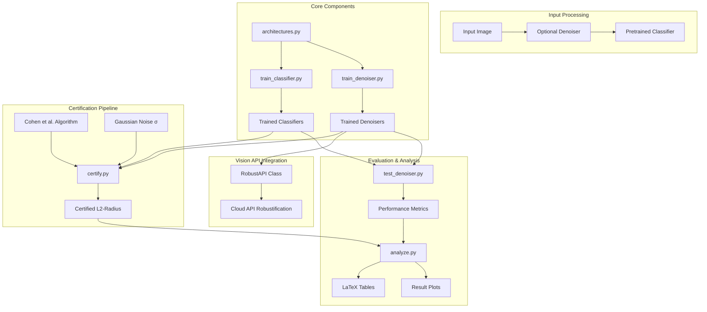
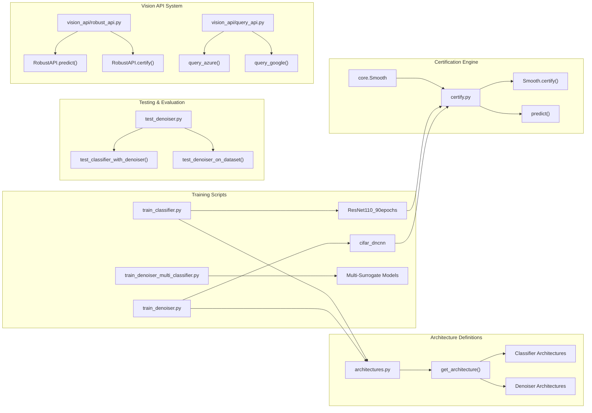

<!-- source: DeepWiki mcp.deepwiki.com · repo microsoft/denoised-smoothing · page 1 Overview · fetched 2026-10-26 -->

# Overview

<details>
<summary>Relevant source files</summary>

The following files were used as context for generating this wiki page:

- [README.md](README.md)

</details>


## Purpose and Scope

This document provides an overview of the Microsoft denoised-smoothing repository, which implements a provable defense method for protecting pretrained image classifiers against adversarial attacks. The system combines denoising preprocessing with randomized smoothing to provide certified L2-robustness guarantees for any pretrained classifier without requiring retraining.

This overview covers the core methodology, system architecture, and primary code components. For detailed information about the theoretical foundations, see [Denoised Smoothing Methodology](#1.1). For implementation details of specific subsystems, see [System Components](#2). For experimental results and performance analysis, see [Experimental Results](#3).

## Core Methodology

Denoised smoothing enhances the certified robustness of pretrained classifiers through a two-stage process: denoising followed by randomized smoothing. The methodology converts any pretrained classifier into a provably robust version by preprocessing inputs through a trained denoiser before applying Monte Carlo sampling with Gaussian noise to compute certified L2-radii.

### System Architecture Overview



**System Architecture Overview**
This diagram shows the primary workflow from input processing through certification to analysis, highlighting the key Python scripts and their relationships.

Sources: [README.md:21-49]()

### Code Component Mapping



**Code Component to Functionality Mapping**
This diagram maps specific Python files and classes to their primary functions, showing how code entities implement the denoised smoothing methodology.

Sources: [README.md:40-49]()

## Key Workflows

### Training Workflow

The system supports training both classifiers and denoisers independently:

1. **Classifier Training**: `train_classifier.py` trains standard or Gaussian-augmented classifiers on CIFAR-10 or ImageNet datasets
2. **Denoiser Training**: `train_denoiser.py` trains denoising models using MSE or adversarial objectives to handle Gaussian noise
3. **Architecture Selection**: `architectures.py` provides a unified interface for specifying model architectures

### Certification Workflow  

The certification process combines trained components to provide robustness guarantees:

1. **Input**: Pretrained classifier and optional denoiser
2. **Processing**: `certify.py` applies randomized smoothing with specified noise level σ
3. **Output**: Certified L2-radius for each test sample using Cohen et al. algorithm

### Vision API Integration

The `RobustAPI` class enables robustification of commercial vision APIs:

```python
# Online API robustification
majority_class, radius, logs = RobustAPI(api_name, denoiser=denoiser, online=True).certify(img, ...)

# Offline log analysis  
majority_class, radius = RobustAPI(api_name, online=False).certify(logs, ...)
```

Sources: [README.md:27-35]()

## Repository Structure

| Directory | Purpose | Key Files |
|-----------|---------|-----------|
| `code/` | Core implementation | `train_classifier.py`, `train_denoiser.py`, `certify.py` |
| `vision_api/` | Cloud API integration | `robust_api.py`, `query_api.py` |
| `analysis/` | Result processing | `analyze.py`, plotting scripts |
| `pretrained_models/` | Trained models | Classifiers and denoisers for CIFAR-10/ImageNet |
| `data/` | Certification logs | Experimental results and performance data |

Sources: [README.md:21-38]()

## Usage Examples

### Basic Certification Example

```bash
# Certify CIFAR-10 model with MSE-trained denoiser
pretrained_classifier="pretrained_models/cifar10_classifiers/ResNet110_90epochs/noise_0.00/checkpoint.pth.tar"
denoiser="pretrained_models/trained_denoisers/cifar10/mse_obj/dncnn/epochs_90/noise_0.25/checkpoint.pth.tar"
python code/certify.py --dataset cifar10 --base_classifier $pretrained_classifier --sigma 0.25 --outfile certification_output/sigma_0.25 --denoiser $denoiser
```

### Training Custom Denoiser

```bash
# Train denoiser for noise level 0.25
python code/train_denoiser.py --dataset cifar10 --arch cifar_dncnn --outdir denoiser_output_dir --noise 0.25
```

Sources: [README.md:73-79](), [README.md:96-104]()

This overview establishes the foundation for understanding the denoised-smoothing system. The following sections provide detailed documentation of each subsystem and comprehensive experimental results.

---

