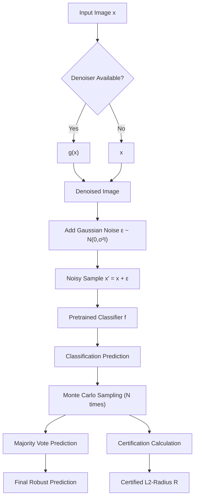
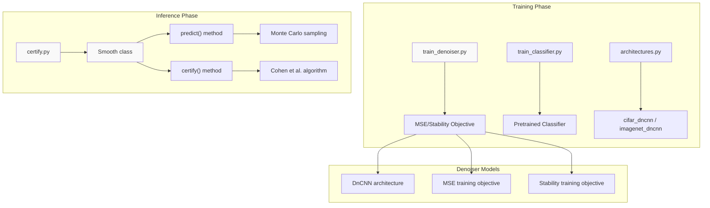
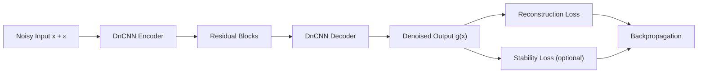
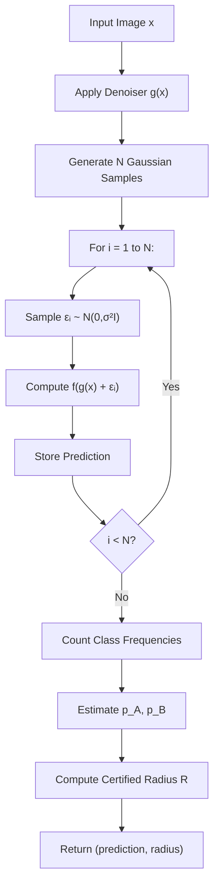
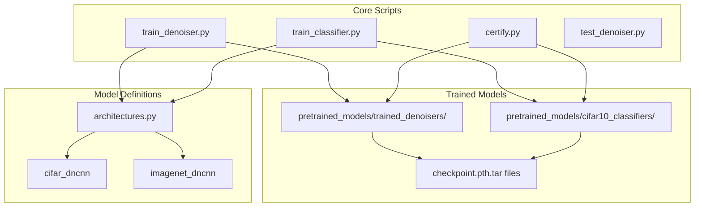

<!-- source: DeepWiki mcp.deepwiki.com · repo microsoft/denoised-smoothing · page 1.1 Denoised Smoothing Methodology · fetched 2026-10-26 -->

# Denoised Smoothing Methodology

<details>
<summary>Relevant source files</summary>

The following files were used as context for generating this wiki page:

- [README.md](README.md)

</details>


## Purpose and Scope

This document explains the theoretical foundation and algorithmic approach of denoised smoothing for certified robustness. The methodology provides provable defense guarantees for pretrained image classifiers against L2 adversarial attacks by combining learned denoisers with randomized smoothing techniques.

For information about the practical implementation of training pipelines, see [Training Pipeline](#2.1). For details about the certification process implementation, see [Certification Engine](#2.2). For experimental evaluation results, see [Experimental Results](#3).

## Theoretical Foundation

Denoised smoothing extends the randomized smoothing framework of Cohen et al. (2019) by introducing a learned denoising component. The core insight is that applying a denoiser before classification can significantly improve the certified robustness radius while maintaining competitive clean accuracy.

### Mathematical Formulation

The denoised smoothing methodology operates on the following principle:

Given:
- A pretrained classifier `f: R^d → Y`  
- A learned denoiser `g: R^d → R^d`
- Gaussian noise `ε ~ N(0, σ²I)`

The smoothed classifier `F` is defined as:
```
F(x) = argmax_y P(f(g(x + ε)) = y)
```

Where the probability is taken over the random noise `ε`.

**Certification Framework**

The methodology provides certified L2-radius guarantees: for any input `x`, if `F(x) = y` with probability `≥ p_A` and the next most likely class has probability `≤ p_B`, then `F` is guaranteed to output `y` for all inputs within L2-distance `R` from `x`, where:

```
R = σ · (Φ^(-1)(p_A) - Φ^(-1)(p_B)) / 2
```

Sources: [README.md:1-178]()

## Algorithmic Workflow

### Core Denoised Smoothing Pipeline



Sources: [README.md:27-35](), [README.md:46-47]()

### Code Entity Mapping



Sources: [README.md:42-48](), [README.md:98-103]()

## Denoiser Training Process

### Training Objectives

The methodology supports multiple training objectives for the denoiser component:

| Objective | Description | Implementation |
|-----------|-------------|----------------|
| MSE | Mean Squared Error reconstruction loss | `train_denoiser.py` with default settings |
| Stability | Adversarial training objective for robustness | `train_denoiser.py` with stability flag |
| Multi-classifier | Training with multiple surrogate models | `train_denoiser_multi_classifier.py` |

### Denoiser Architecture Flow



**Key Training Parameters:**
- Noise level: `--noise 0.25` (standard deviation)
- Architecture: `--arch cifar_dncnn` or `imagenet_dncnn`
- Training epochs: 90 (typical)
- Dataset: `--dataset cifar10` or `imagenet`

Sources: [README.md:98-103](), [README.md:42-44]()

## Certification Process

### Monte Carlo Estimation

The certification algorithm implements the Cohen et al. (2019) approach with denoiser preprocessing:



### Implementation Details

**Core Certification Function:**
- Entry point: `certify.py` script
- Main class: `Smooth` (implements smoothed classifier)
- Key methods:
  - `predict(x, n, alpha, batch_size)`: Returns smoothed prediction
  - `certify(x, n0, n, alpha, batch_size)`: Returns certified radius

**Certification Parameters:**
- `n0`: Number of samples for initial prediction (typically 100)
- `n`: Number of samples for certification (typically 10,000)  
- `alpha`: Confidence level (typically 0.001)
- `sigma`: Gaussian noise standard deviation

Sources: [README.md:46-47](), [README.md:114-117]()

## Implementation Architecture

### File Organization and Data Flow



### Command Line Interface

**Typical Usage Pattern:**
1. Train denoiser: `python code/train_denoiser.py --dataset cifar10 --arch cifar_dncnn --noise 0.25`
2. Test denoiser: `python code/test_denoiser.py --denoiser <path> --clf <path> --noise 0.25`
3. Certify robustness: `python code/certify.py --dataset cifar10 --base_classifier <path> --denoiser <path> --sigma 0.25`

**Key Directory Structure:**
- `pretrained_models/trained_denoisers/`: Stored denoiser checkpoints
- `pretrained_models/cifar10_classifiers/`: Pretrained classifier models  
- `certification_output/`: Certification result logs
- `data/certify/`: Experimental certification logs

Sources: [README.md:74-78](), [README.md:98-103](), [README.md:114-117]()

---

