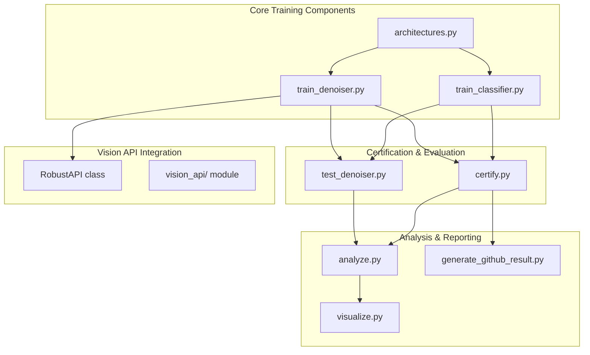
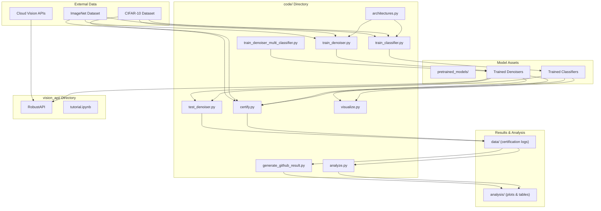
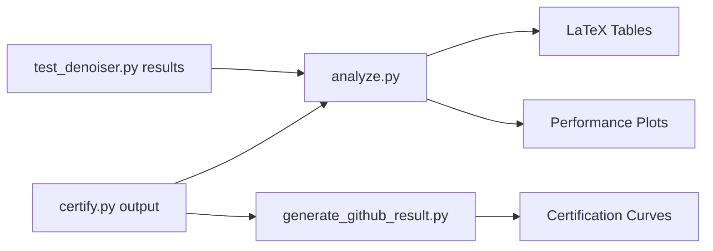
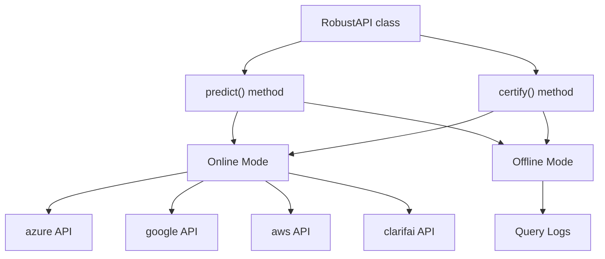

<!-- source: DeepWiki mcp.deepwiki.com · repo microsoft/denoised-smoothing · page 2 System Components · fetched 2026-10-26 -->

# System Components

Relevant source files

The following files were used as context for generating this wiki page:

- [README.md](README.md)

## Purpose and Scope

This document provides an overview of the core system components that implement the denoised smoothing pipeline in the Microsoft denoised-smoothing repository. It describes the high-level architecture and interaction between major subsystems that enable provable adversarial robustness for pretrained image classifiers.

For detailed information about specific subsystems, see:
- Training pipeline implementation details: [Training Pipeline](#2.1)
- Certification process and algorithms: [Certification Engine](#2.2)  
- Cloud vision API integration: [Vision API Integration](#2.3)

## Core Architecture Overview

The denoised-smoothing system consists of four primary components that work together to provide certified robustness guarantees:

**Component Interaction Flow**

Sources: [README.md:40-48](), [README.md:23-38]()

## File Organization and Data Flow

**System Data Flow Architecture**

Sources: [README.md:40-48](), [README.md:25-38]()

## Component Responsibilities

### Training Infrastructure

| Component | File Path | Primary Function |
|-----------|-----------|------------------|
| **Classifier Training** | `code/train_classifier.py` | Train ImageNet/CIFAR-10 classifiers with optional Gaussian augmentation |
| **Denoiser Training** | `code/train_denoiser.py` | Train denoisers using MSE or stability objectives |
| **Multi-Classifier Training** | `code/train_denoiser_multi_classifier.py` | Train denoisers using multiple surrogate models |
| **Architecture Registry** | `code/architectures.py` | Define and specify model architectures for classifiers and denoisers |

Sources: [README.md:42-48]()

### Certification and Evaluation

| Component | File Path | Primary Function |
|-----------|-----------|------------------|
| **Certification Engine** | `code/certify.py` | Compute certified L2-radius using Cohen et al. algorithm |
| **Denoiser Testing** | `code/test_denoiser.py` | Evaluate denoiser reconstruction and classification performance |
| **Visualization** | `code/visualize.py` | Generate visual comparisons of noisy and denoised images |

Sources: [README.md:45-47]()

### Analysis and Reporting

**Analysis Pipeline Components**

| Component | File Path | Primary Function |
|-----------|-----------|------------------|
| **Result Analysis** | `code/analyze.py` | Generate paper tables and figures from certification logs |
| **GitHub Results** | `code/generate_github_result.py` | Create certification curve visualizations |

Sources: [README.md:146-151](), [README.md:137-143]()

### Vision API Integration

The `vision_api/` module provides a unified interface for robustifying cloud-based vision services:

**RobustAPI Architecture**

Key methods and usage patterns:
- `RobustAPI(api_name, denoiser=denoiser, online=True).predict(img, ...)` - Online prediction
- `RobustAPI(api_name, denoiser=denoiser, online=True).certify(img, ...)` - Online certification  
- `RobustAPI(api_name, online=False).predict(logs, ...)` - Offline prediction from logs
- `RobustAPI(api_name, online=False).certify(logs, ...)` - Offline certification from logs

Sources: [README.md:25-35]()

## System Integration Points

The components integrate through several key interfaces:

1. **Model Loading**: `architectures.py` provides factory functions for instantiating classifiers and denoisers
2. **Checkpoint Management**: Training scripts save models to `pretrained_models/` directory structure
3. **Certification Pipeline**: `certify.py` loads both classifiers and denoisers to compute robustness certificates
4. **Result Aggregation**: Analysis scripts read from standardized `data/` directory structure containing certification logs

This modular design enables independent development and testing of each component while maintaining clear data flow and integration points throughout the system.

Sources: [README.md:69-83](), [README.md:92-124]()

---

