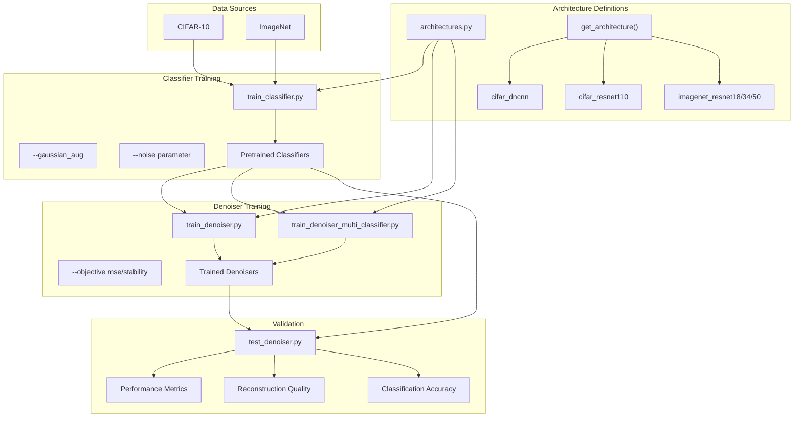
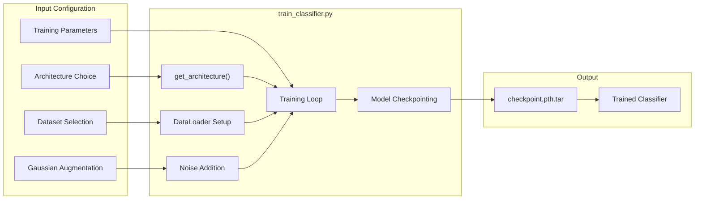
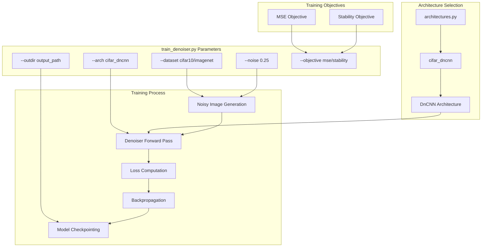
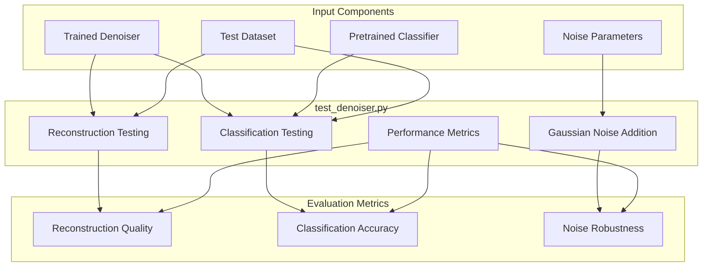
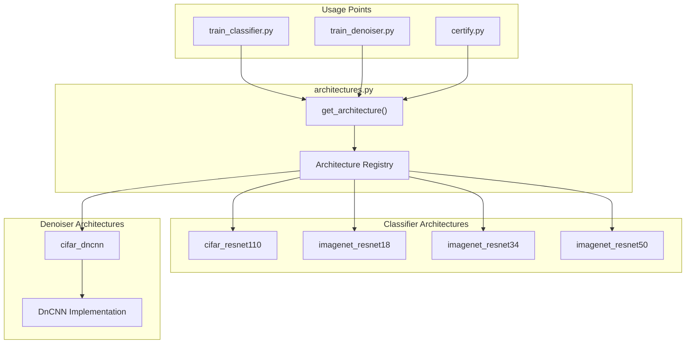
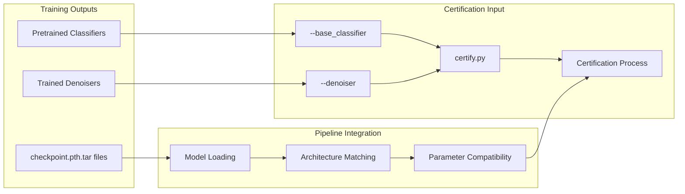

<!-- source: DeepWiki mcp.deepwiki.com · repo microsoft/denoised-smoothing · page 2.1 Training Pipeline · fetched 2026-10-26 -->

# Training Pipeline

<details>
<summary>Relevant source files</summary>

The following files were used as context for generating this wiki page:

- [README.md](README.md)

</details>


## Purpose and Scope

This document covers the training infrastructure for building the core components of the denoised smoothing system: classifiers and denoisers. The training pipeline consists of scripts for training image classifiers with optional Gaussian augmentation, training various types of denoisers, and validating their performance. For information about using these trained models for certification, see [Certification Engine](#2.2). For details about integrating with cloud vision APIs, see [Vision API Integration](#2.3).

## Training Pipeline Overview

The training pipeline implements a two-stage approach where classifiers and denoisers are trained independently, then combined for robust inference and certification.

### Training Pipeline Architecture



Sources: [README.md:42-48](), [README.md:96-117]()

## Classifier Training

The `train_classifier.py` script provides functionality for training base image classifiers on CIFAR-10 and ImageNet datasets. These classifiers serve as the foundation for the denoised smoothing pipeline.

### Key Training Features

| Feature | Parameter | Description |
|---------|-----------|-------------|
| Gaussian Augmentation | `--gaussian_aug` | Adds Gaussian noise during training for improved robustness |
| Noise Level | `--noise` | Controls the standard deviation of training noise |
| Architecture Selection | `--arch` | Specifies model architecture via `architectures.py` |
| Dataset | `--dataset` | Supports `cifar10` and `imagenet` |

### Classifier Training Flow



Sources: [README.md:42](), [README.md:75-76](), [README.md:93-94]()

## Denoiser Training

The denoiser training system provides two main scripts for training denoisers that can be attached to pretrained classifiers to improve their certified robustness.

### Single Classifier Denoiser Training

The `train_denoiser.py` script trains denoisers using a single surrogate classifier. This is the primary training method described in the paper.

#### Training Configuration



Sources: [README.md:43](), [README.md:97-103]()

### Multi-Classifier Denoiser Training

The `train_denoiser_multi_classifier.py` script allows training denoisers using multiple surrogate models, potentially improving generalization across different classifier architectures.

### Training Example

Based on the README example, a typical denoiser training command:

```bash
python code/train_denoiser.py --dataset cifar10 --arch cifar_dncnn --outdir denoiser_output_dir --noise 0.25
```

This trains a DnCNN denoiser on CIFAR-10 to denoise Gaussian noise with standard deviation 0.25.

Sources: [README.md:44](), [README.md:98-99]()

## Testing and Validation

The `test_denoiser.py` script provides comprehensive evaluation of trained denoisers across multiple metrics.

### Denoiser Testing Capabilities



### Testing Command Example

```bash
python code/test_denoiser.py --dataset cifar10 --denoiser $denoiser_output_dir/checkpoint.pth.tar --clf $pretrained_classifier --noise 0.25
```

This evaluates the denoiser's reconstruction capability and its impact on classification accuracy when attached to a pretrained classifier under Gaussian noise.

Sources: [README.md:45](), [README.md:107-110]()

## Architecture Definitions

The `architectures.py` file serves as the central registry for all model architectures used in the training pipeline.

### Architecture System



The `get_architecture()` function provides a unified interface for instantiating both classifier and denoiser architectures across the entire pipeline.

Sources: [README.md:48]()

## Integration with Certification Pipeline

The training pipeline outputs are designed to integrate seamlessly with the certification system.

### Training Output Integration



### Example Integration Command

```bash
pretrained_classifier="pretrained_models/cifar10_classifiers/ResNet110_90epochs/noise_0.00/checkpoint.pth.tar"
denoiser="pretrained_models/trained_denoisers/cifar10/mse_obj/dncnn/epochs_90/noise_0.25/checkpoint.pth.tar"
python code/certify.py --dataset cifar10 --base_classifier $pretrained_classifier --sigma 0.25 --denoiser $denoiser
```

This demonstrates how trained components from the training pipeline are combined for certification, where the `--base_classifier` parameter loads a trained classifier and `--denoiser` loads a trained denoiser for robust inference.

Sources: [README.md:73-83](), [README.md:112-117]()

---

