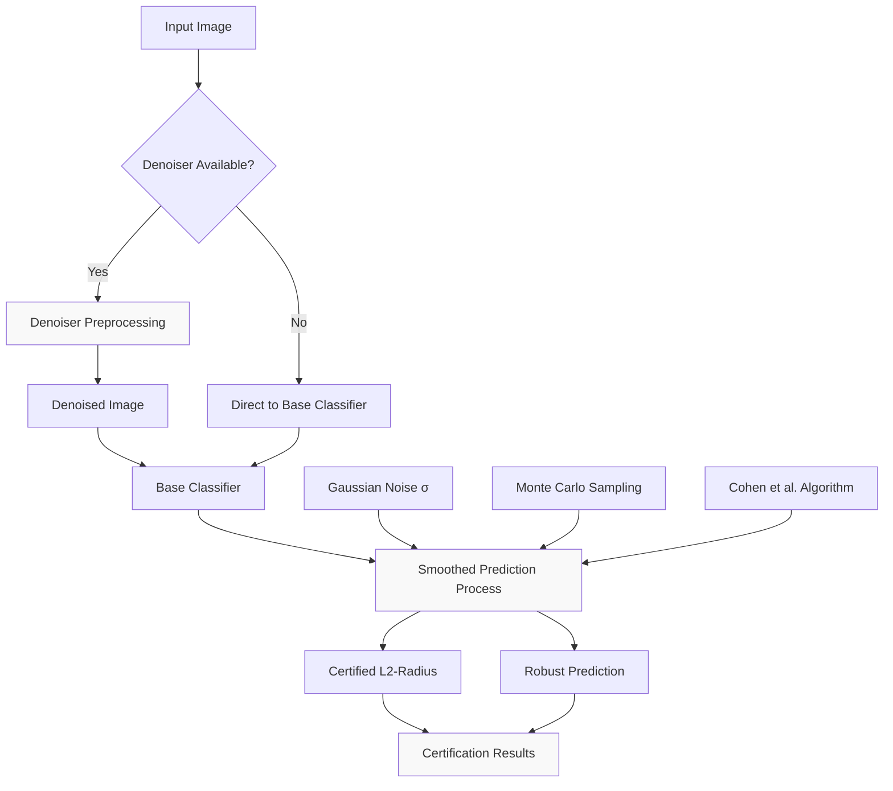
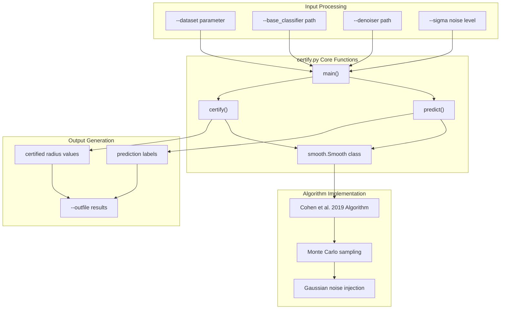
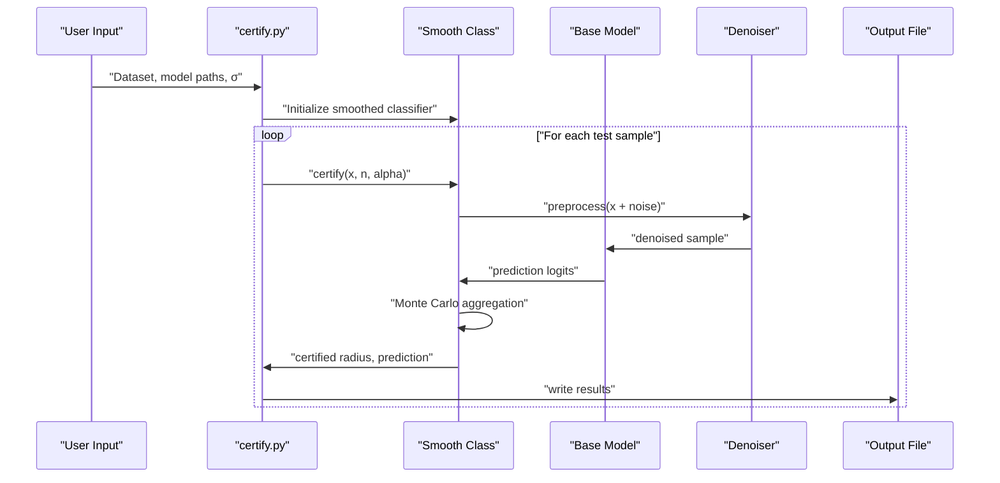
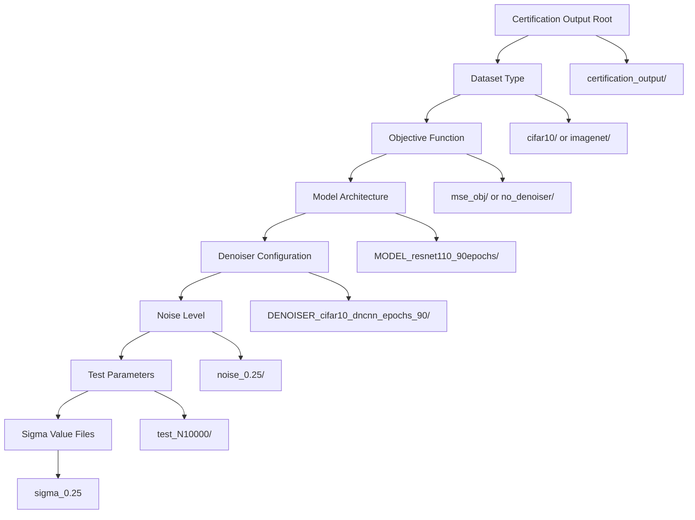
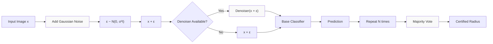
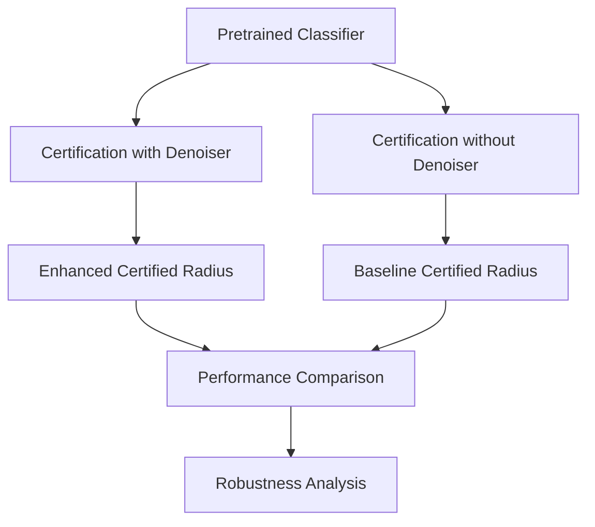

<!-- source: DeepWiki mcp.deepwiki.com · repo microsoft/denoised-smoothing · page 2.2 Certification Engine · fetched 2026-10-26 -->

# Certification Engine

<details>
<summary>Relevant source files</summary>

The following files were used as context for generating this wiki page:

- [README.md](README.md)

</details>


## Purpose and Scope

The Certification Engine is the core component responsible for providing mathematical guarantees of adversarial robustness for pretrained image classifiers. This system implements the certified defense methodology using randomized smoothing to compute provable L2-radius bounds for input images. The engine processes pretrained classifiers (with optional denoisers) and generates certification results that quantify the maximum perturbation radius within which predictions remain constant.

For information about training the classifiers and denoisers that feed into this engine, see [Training Pipeline](#2.1). For details about analyzing and visualizing the certification results, see [Experimental Results](#3).

## Certification Workflow Overview

The certification process follows a systematic pipeline that transforms pretrained models into certified robust classifiers through randomized smoothing.

### High-Level Certification Process



**Sources**: [README.md:46-47](), [README.md:113-118]()

### Code Entity Mapping



**Sources**: [README.md:46-47](), [README.md:74-78](), [README.md:113-118]()

## Core Architecture Components

The certification engine is implemented primarily in the `certify.py` script, which coordinates multiple components to produce certified robustness guarantees.

### Primary Script Structure

| Component | Purpose | Key Parameters |
|-----------|---------|----------------|
| `certify.py` main function | Entry point and argument parsing | `--dataset`, `--base_classifier`, `--sigma`, `--outfile` |
| Smooth class | Randomized smoothing implementation | `--denoiser`, noise level σ |
| Prediction pipeline | Monte Carlo sampling and certification | `--skip`, `--N` (sample count) |
| Output formatting | Results serialization and storage | File path structuring |

### Certification Algorithm Flow



**Sources**: [README.md:46-47](), [README.md:74-78]()

## Input and Output Specifications

### Required Input Parameters

The certification engine accepts several key parameters that control the certification process:

| Parameter | Type | Description | Example |
|-----------|------|-------------|---------|
| `--dataset` | string | Target dataset (cifar10/imagenet) | `cifar10` |
| `--base_classifier` | path | Pretrained classifier checkpoint | `pretrained_models/cifar10_classifiers/ResNet110_90epochs/noise_0.00/checkpoint.pth.tar` |
| `--sigma` | float | Gaussian noise standard deviation | `0.25` |
| `--outfile` | path | Output file for certification results | `certification_output/sigma_0.25` |
| `--denoiser` | path | Optional denoiser checkpoint | `pretrained_models/trained_denoisers/cifar10/mse_obj/dncnn/epochs_90/noise_0.25/checkpoint.pth.tar` |
| `--skip` | int | Number of samples to skip between certifications | `20` |

### Output Data Structure

The certification results are structured in a hierarchical directory format that preserves experimental metadata:



**Sources**: [README.md:80-83](), [README.md:121-123](), [README.md:133-135]()

## Certification Algorithm Implementation

The certification engine implements the Cohen et al. (2019) randomized smoothing algorithm to provide mathematical guarantees of robustness.

### Monte Carlo Smoothing Process



The algorithm performs the following key steps:

1. **Noise Injection**: Adds Gaussian noise with standard deviation σ to input images
2. **Denoising** (optional): Applies trained denoiser to noisy samples
3. **Classification**: Passes processed samples through base classifier
4. **Aggregation**: Performs majority voting across N samples
5. **Certification**: Computes certified L2-radius using statistical guarantees

### Configuration Modes

The certification engine supports multiple operational modes:

| Mode | Denoiser | Use Case | Certification Strength |
|------|----------|----------|----------------------|
| Standard Smoothing | None | Baseline certification | Lower certified radius |
| Denoised Smoothing | MSE-trained | Enhanced robustness | Higher certified radius |
| Multi-noise Training | Stability-trained | Optimal performance | Highest certified radius |

**Sources**: [README.md:46-47](), [README.md:113-118](), [README.md:127-135]()

## Usage Patterns and Examples

### Basic Certification Command

The most common usage pattern involves certifying a pretrained classifier with an attached denoiser:

```bash
python code/certify.py --dataset cifar10 \
    --base_classifier pretrained_models/cifar10_classifiers/ResNet110_90epochs/noise_0.00/checkpoint.pth.tar \
    --sigma 0.25 \
    --outfile certification_output/sigma_0.25 \
    --skip 20 \
    --denoiser pretrained_models/trained_denoisers/cifar10/mse_obj/dncnn/epochs_90/noise_0.25/checkpoint.pth.tar
```

### Comparison Workflow

To evaluate the impact of denoisers, users typically run certification with and without denoisers:



This comparison demonstrates the effectiveness of the denoised smoothing approach in improving certified robustness guarantees.

**Sources**: [README.md:74-78](), [README.md:113-118](), [README.md:127-135](), [README.md:137-144]()

---

