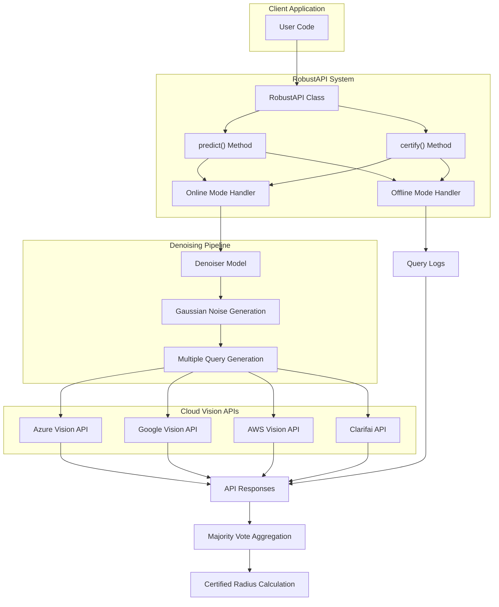
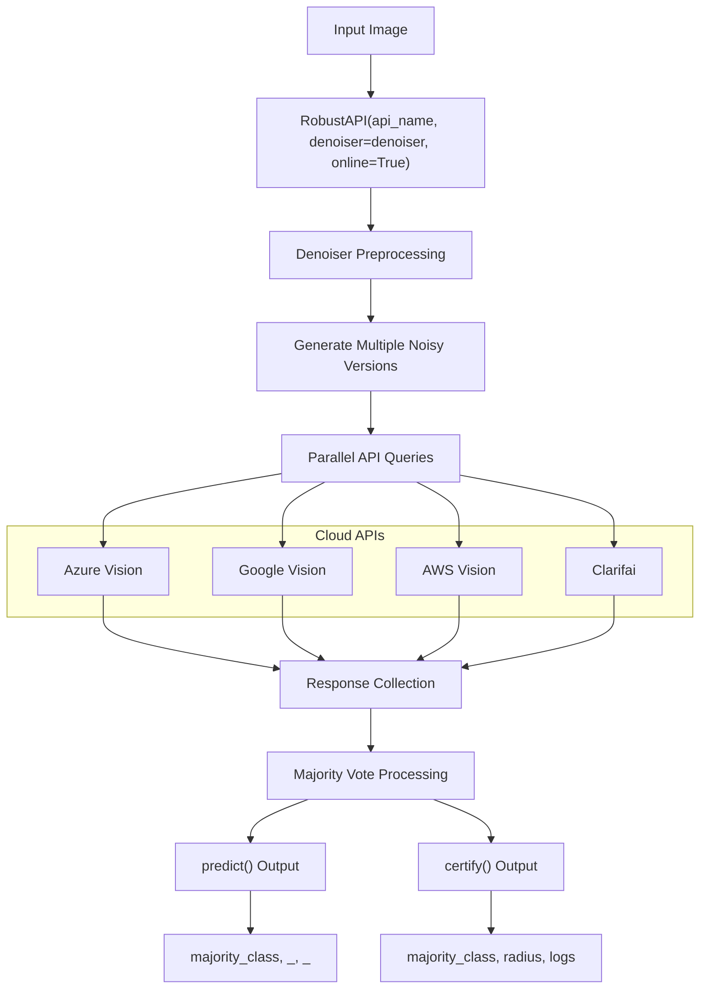
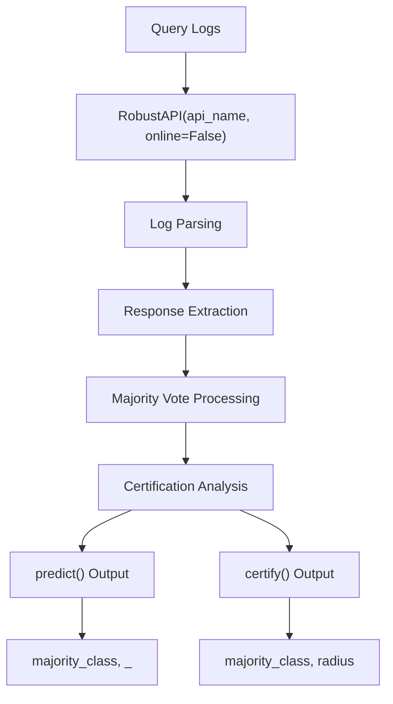
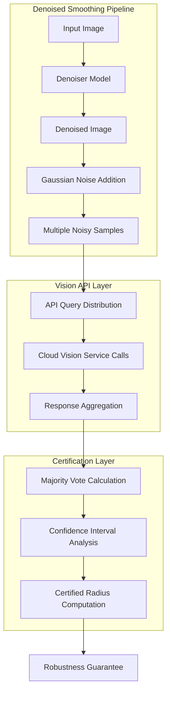

<!-- source: DeepWiki mcp.deepwiki.com · repo microsoft/denoised-smoothing · page 2.3 Vision API Integration · fetched 2026-10-26 -->

# Vision API Integration

<details>
<summary>Relevant source files</summary>

The following files were used as context for generating this wiki page:

- [README.md](README.md)

</details>


## Purpose and Scope

This document covers the Vision API Integration component of the denoised-smoothing system, which provides certified adversarial robustness for cloud-based vision services. The integration allows users to apply denoised smoothing methodology to commercial vision APIs through the `RobustAPI` class, enabling provable robustness guarantees for real-world vision services.

For information about the core denoised smoothing methodology, see [Denoised Smoothing Methodology](#1.1). For details about the certification process, see [Certification Engine](#2.2).

## System Overview

### RobustAPI Architecture

The Vision API integration centers around the `RobustAPI` class, which serves as a unified interface for applying denoised smoothing to multiple cloud vision services. This system bridges the gap between research-grade certified robustness techniques and production vision APIs.



**RobustAPI Integration Architecture**

Sources: [README.md:25-35]()

### Supported Cloud Vision Services

The system supports four major cloud vision API providers through a standardized interface:

| API Provider | Identifier | Service |
|--------------|------------|---------|
| Microsoft Azure | `"azure"` | Azure Computer Vision API |
| Google Cloud | `"google"` | Google Cloud Vision API |
| Amazon Web Services | `"aws"` | AWS Rekognition |
| Clarifai | `"clarifai"` | Clarifai Vision API |

Sources: [README.md:28-34]()

## Operating Modes

### Online Mode

In online mode, the `RobustAPI` performs live queries to cloud vision services with denoised smoothing applied in real-time.



**Online Mode Data Flow**

Sources: [README.md:28-30]()

### Offline Mode

In offline mode, the system analyzes previously collected query logs without making new API calls, useful for batch analysis and research scenarios.



**Offline Mode Data Flow**

Sources: [README.md:32-34]()

## Core Methods

### predict() Method

The `predict()` method provides robust predictions by aggregating multiple API responses through majority voting.

**Online Mode Usage:**
```python
majority_class, _, _ = RobustAPI(api_name, denoiser=denoiser, online=True).predict(img, ...)
```

**Offline Mode Usage:**
```python
majority_class, _ = RobustAPI(api_name, online=False).predict(logs, ...)
```

### certify() Method

The `certify()` method extends `predict()` to provide certified robustness guarantees, computing the L2-radius within which the prediction is guaranteed to remain constant.

**Online Mode Usage:**
```python
majority_class, radius, logs = RobustAPI(api_name, denoiser=denoiser, online=True).certify(img, ...)
```

**Offline Mode Usage:**
```python
majority_class, radius = RobustAPI(api_name, online=False).certify(logs, ...)
```

Sources: [README.md:28-34]()

## Implementation Details

### Directory Structure

The Vision API integration is implemented in the `vision_api/` directory with the following key components:

- **Tutorial Interface**: Interactive notebook at `vision_api/tutorial.ipynb` demonstrating usage patterns
- **RobustAPI Implementation**: Core class providing the unified API interface
- **API Adapters**: Service-specific implementations for each cloud provider

### Integration with Denoised Smoothing



**Denoised Smoothing Integration with Vision APIs**

The system applies the core denoised smoothing methodology to commercial vision APIs by:

1. **Preprocessing**: Applying a trained denoiser to input images
2. **Noise Injection**: Adding calibrated Gaussian noise to create multiple query variants
3. **Distributed Querying**: Sending multiple noisy versions to cloud APIs
4. **Response Aggregation**: Computing majority votes across API responses
5. **Certification**: Calculating certified robustness radii using statistical guarantees

Sources: [README.md:25-35]()

## Tutorial and Examples

The system includes a comprehensive tutorial notebook for hands-on learning:

- **Location**: `vision_api/tutorial.ipynb`
- **Purpose**: Interactive demonstration of `RobustAPI` usage patterns
- **Coverage**: Both online and offline modes with practical examples

This tutorial provides step-by-step guidance for integrating certified robustness into existing computer vision workflows using cloud APIs.

Sources: [README.md:25]()

---

