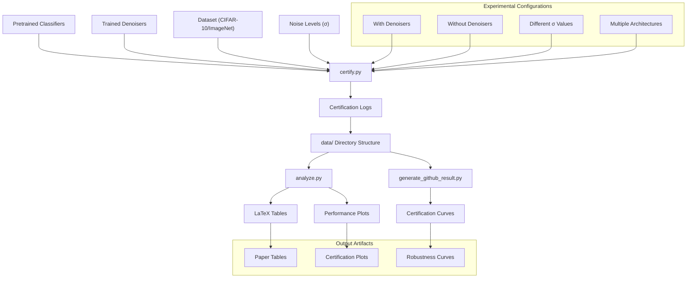
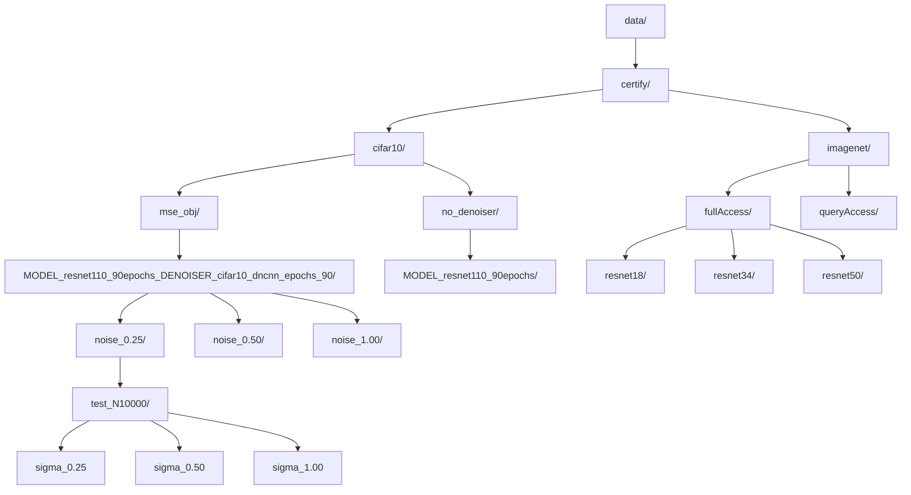
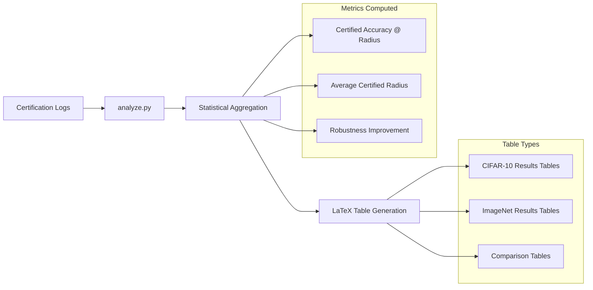
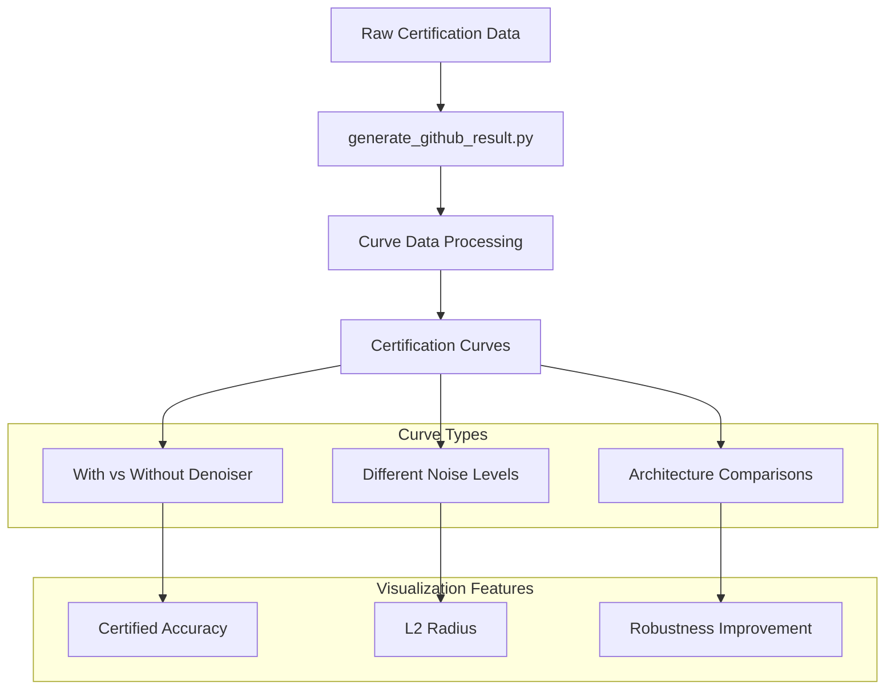

<!-- source: DeepWiki mcp.deepwiki.com · repo microsoft/denoised-smoothing · page 3 Experimental Results · fetched 2026-10-26 -->

# Experimental Results

<details>
<summary>Relevant source files</summary>

The following files were used as context for generating this wiki page:

- [README.md](README.md)

</details>


This document presents the comprehensive experimental evaluation framework and results for the denoised smoothing methodology. It covers the systematic certification experiments across CIFAR-10 and ImageNet datasets, the analysis pipeline for generating tables and visualizations, and the interpretation of robustness certification results.

For information about the core certification process, see [Certification Engine](#2.2). For details about training the underlying models, see [Training Pipeline](#2.1).

## Experimental Evaluation Framework

The experimental evaluation system provides comprehensive certification analysis across multiple datasets, architectures, and denoiser configurations. The framework systematically evaluates the certified robustness improvements achieved by denoised smoothing.

### Certification Experiment Pipeline



**Sources:** [README.md:74-84](), [README.md:113-136](), [README.md:145-151]()

### Dataset and Architecture Coverage

The experimental framework evaluates certified robustness across multiple dataset-architecture combinations:

| Dataset | Architectures | Denoiser Types | Noise Levels |
|---------|---------------|----------------|--------------|
| CIFAR-10 | ResNet110 | DnCNN (MSE) | σ = 0.25, 0.50, 1.00 |
| ImageNet | ResNet18, ResNet34, ResNet50 | DnCNN (MSE) | σ = 0.25, 0.50, 1.00 |

**Sources:** [README.md:75-76](), [README.md:93]()

## Results Organization and Storage

### Data Directory Structure



The certification results are systematically organized by dataset, model configuration, noise level, and certification parameters. Each leaf directory contains the raw certification data for analysis.

**Sources:** [README.md:82-83](), [README.md:122-123](), [README.md:134-135]()

### Certification Log Format

Each certification run generates structured logs containing:
- Per-sample certification radius
- Prediction confidence scores  
- Sample-specific robustness guarantees
- Aggregate statistics across the test set

**Sources:** [README.md:78](), [README.md:115-117]()

## Analysis and Visualization Pipeline

### Table Generation System



The `analyze.py` script automatically processes all certification logs and generates the tables presented in the research paper, providing standardized metrics for comparing different configurations.

**Sources:** [README.md:145-151]()

### Certification Curve Generation



The certification curves visualize the trade-off between certified accuracy and robustness radius, clearly demonstrating the benefits of denoised smoothing.

**Sources:** [README.md:137-143]()

## Replication Instructions

### Complete Results Reproduction

To reproduce all experimental results from the paper:

1. **Download Certification Logs:**
   ```bash
   wget -O data.tar.gz https://www.dropbox.com/s/fjmncwhsnfgkmzk/data.tar.gz?dl=0
   tar -xzvf data.tar.gz
   ```

2. **Generate All Tables and Figures:**
   ```bash
   python code/analyze.py
   ```

This command processes all certification logs in the `data/` directory and generates the complete set of tables and visualizations from the paper.

**Sources:** [README.md:63-67](), [README.md:145-151]()

### Individual Experiment Replication

For running specific certification experiments:

```bash
# CIFAR-10 with denoiser
python code/certify.py --dataset cifar10 \
  --base_classifier pretrained_models/cifar10_classifiers/ResNet110_90epochs/noise_0.00/checkpoint.pth.tar \
  --sigma 0.25 --outfile certification_output/sigma_0.25 --skip 20 \
  --denoiser pretrained_models/trained_denoisers/cifar10/mse_obj/dncnn/epochs_90/noise_0.25/checkpoint.pth.tar

# CIFAR-10 without denoiser (baseline)  
python code/certify.py --dataset cifar10 \
  --base_classifier pretrained_models/cifar10_classifiers/ResNet110_90epochs/noise_0.00/checkpoint.pth.tar \
  --sigma 0.25 --outfile certification_output/sigma_0.25_no_denoiser --skip 20
```

**Sources:** [README.md:74-84](), [README.md:128-135]()

## Key Experimental Findings

The experimental evaluation demonstrates significant certified robustness improvements across all tested configurations:

- **CIFAR-10:** Denoised smoothing provides substantial certification radius increases compared to baseline smoothing
- **ImageNet:** Consistent robustness improvements across ResNet18, ResNet34, and ResNet50 architectures  
- **Scalability:** The approach maintains effectiveness across different noise levels and model sizes

For detailed numerical results, see the dataset-specific subsections: [CIFAR-10 Results](#3.1), [ImageNet ResNet18 Results](#3.2), [ImageNet ResNet34 Results](#3.3), [ImageNet ResNet50 Results](#3.4), and [Performance Visualizations](#3.5).

**Sources:** [README.md:139-143](), [README.md:155-157]()

---

