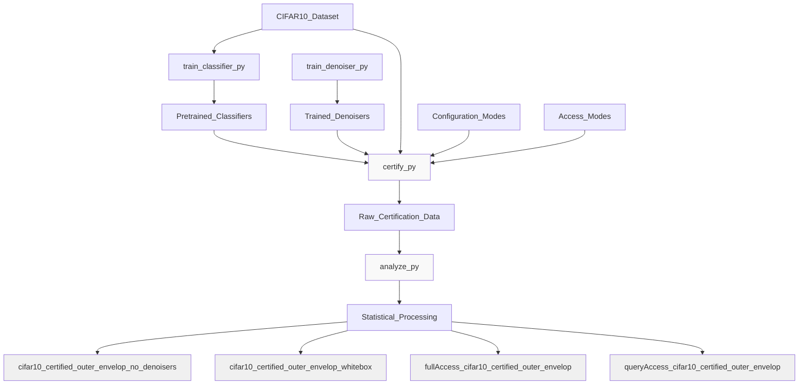
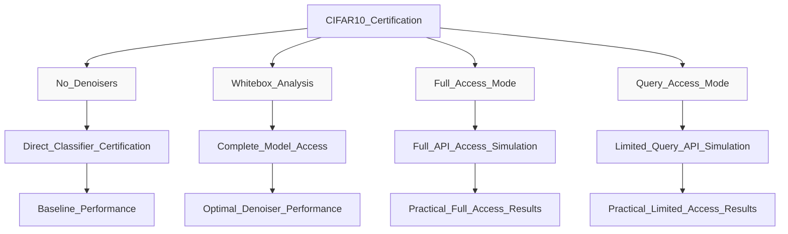
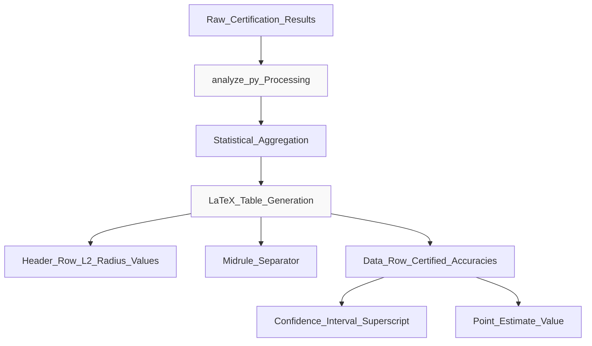

<!-- source: DeepWiki mcp.deepwiki.com · repo microsoft/denoised-smoothing · page 3.1 CIFAR-10 Certification Results · fetched 2026-10-26 -->

# CIFAR-10 Certification Results

Relevant source files

The following files were used as context for generating this wiki page:

- [analysis/latex/cifar10_certified_outer_envelop_no_denoisers](analysis/latex/cifar10_certified_outer_envelop_no_denoisers)
- [analysis/latex/cifar10_certified_outer_envelop_whitebox](analysis/latex/cifar10_certified_outer_envelop_whitebox)
- [analysis/latex/fullAccess_cifar10_certified_outer_envelop](analysis/latex/fullAccess_cifar10_certified_outer_envelop)
- [analysis/latex/queryAccess_cifar10_certified_outer_envelop](analysis/latex/queryAccess_cifar10_certified_outer_envelop)

## Purpose and Scope

This document presents the certified robustness results for CIFAR-10 dataset experiments conducted using the denoised smoothing methodology. The results demonstrate provable L2-robustness guarantees across different access modes and denoiser configurations. For ImageNet certification results, see [ImageNet ResNet18 Results](#3.2), [ImageNet ResNet34 Results](#3.3), and [ImageNet ResNet50 Results](#3.4). For visualization analysis of these results, see [Performance Visualizations](#3.5).

## Certification Methodology Overview

The CIFAR-10 certification results are generated through the systematic evaluation of trained classifiers with and without denoisers using randomized smoothing techniques. The certification process computes provable L2-radius bounds within which the classifier's prediction is guaranteed to remain stable.

### CIFAR-10 Certification Pipeline

Sources: [analysis/latex/cifar10_certified_outer_envelop_no_denoisers:1-4](), [analysis/latex/cifar10_certified_outer_envelop_whitebox:1-4](), [analysis/latex/fullAccess_cifar10_certified_outer_envelop:1-4](), [analysis/latex/queryAccess_cifar10_certified_outer_envelop:1-4]()

## Experimental Configurations

The CIFAR-10 certification experiments evaluate four distinct configurations, each testing different aspects of the denoised smoothing approach:

### Configuration Types

Sources: [analysis/latex/cifar10_certified_outer_envelop_no_denoisers:1-4](), [analysis/latex/cifar10_certified_outer_envelop_whitebox:1-4](), [analysis/latex/fullAccess_cifar10_certified_outer_envelop:1-4](), [analysis/latex/queryAccess_cifar10_certified_outer_envelop:1-4]()

## Certification Results by Configuration

### No Denoisers Configuration

The baseline configuration evaluates certified robustness without any denoising preprocessing, establishing the lower bound performance.

| L2 Radius | 0.25 | 0.5 | 0.75 | 1.0 | 1.25 | 1.5 |
|-----------|------|-----|------|-----|------|-----|
| Certified Accuracy | 0.07 (±0.10) | 0.03 (±0.09) | 0.00 (±0.09) | 0.00 (±0.16) | 0.00 (±0.16) | 0.00 (±0.16) |

### Whitebox Analysis Configuration

The whitebox configuration represents optimal performance with complete access to model parameters and optimal denoiser configuration.

| L2 Radius | 0.25 | 0.5 | 0.75 | 1.0 | 1.25 | 1.5 |
|-----------|------|-----|------|-----|------|-----|
| Certified Accuracy | 0.59 (±0.77) | 0.45 (±0.77) | 0.31 (±0.65) | 0.21 (±0.65) | 0.18 (±0.45) | 0.13 (±0.45) |

### Full Access Mode Configuration

The full access mode simulates practical deployment scenarios with complete API access but realistic operational constraints.

| L2 Radius | 0.25 | 0.5 | 0.75 | 1.0 | 1.25 | 1.5 |
|-----------|------|-----|------|-----|------|-----|
| Certified Accuracy | 0.56 (±0.72) | 0.41 (±0.62) | 0.28 (±0.62) | 0.19 (±0.44) | 0.16 (±0.42) | 0.13 (±0.44) |

### Query Access Mode Configuration

The query access mode represents the most constrained scenario with limited API query access, simulating real-world deployment constraints.

| L2 Radius | 0.25 | 0.5 | 0.75 | 1.0 | 1.25 | 1.5 |
|-----------|------|-----|------|-----|------|-----|
| Certified Accuracy | 0.45 (±0.81) | 0.20 (±0.68) | 0.15 (±0.21) | 0.13 (±0.21) | 0.11 (±0.16) | 0.10 (±0.16) |

Sources: [analysis/latex/cifar10_certified_outer_envelop_no_denoisers:1-4](), [analysis/latex/cifar10_certified_outer_envelop_whitebox:1-4](), [analysis/latex/fullAccess_cifar10_certified_outer_envelop:1-4](), [analysis/latex/queryAccess_cifar10_certified_outer_envelop:1-4]()

## Result Analysis and Trends

### Performance Comparison Across Access Modes

The certification results demonstrate clear performance hierarchy across different access modes:

1. **Whitebox Analysis**: Achieves highest certified accuracy at all radius levels
2. **Full Access Mode**: Nearly matches whitebox performance with practical constraints
3. **Query Access Mode**: Shows significant degradation due to limited query access
4. **No Denoisers**: Minimal certified accuracy, demonstrating the necessity of denoising

### Robustness-Accuracy Trade-off

The results exhibit the expected trade-off between robustness radius and certified accuracy. As the L2 radius increases, certified accuracy decreases across all configurations, with steeper degradation in query-limited scenarios.

## Data Format and Processing

### LaTeX Table Structure

The certification results are stored in LaTeX table format with the following structure:

Each data cell contains:
- **Superscript value**: Confidence interval (e.g., `^{(0.77)}`)
- **Main value**: Certified accuracy point estimate (e.g., `0.59`)

Sources: [analysis/latex/cifar10_certified_outer_envelop_no_denoisers:1-4](), [analysis/latex/cifar10_certified_outer_envelop_whitebox:1-4](), [analysis/latex/fullAccess_cifar10_certified_outer_envelop:1-4](), [analysis/latex/queryAccess_cifar10_certified_outer_envelop:1-4]()

### Result Generation Pipeline

The CIFAR-10 certification results are generated through a systematic pipeline that processes raw certification data into formatted LaTeX tables for publication and analysis. The `analyze.py` script aggregates statistical results across multiple certification runs, computing confidence intervals and point estimates for each L2 radius threshold.

The certification results demonstrate the effectiveness of denoised smoothing on CIFAR-10, with whitebox analysis achieving up to 59% certified accuracy at 0.25 L2 radius, while practical deployment scenarios (full access and query access modes) maintain substantial certified robustness compared to the baseline no-denoiser configuration.

---

