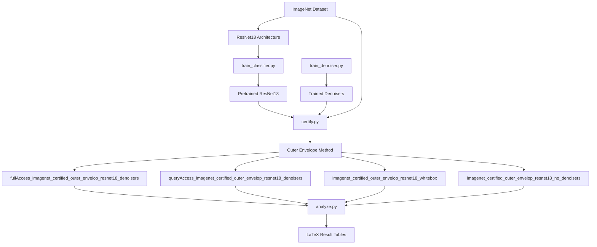
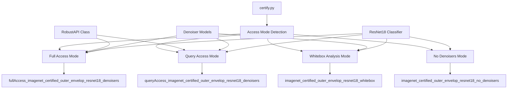

<!-- source: DeepWiki mcp.deepwiki.com · repo microsoft/denoised-smoothing · page 3.2 ImageNet ResNet18 Results · fetched 2026-10-26 -->

# ImageNet ResNet18 Results

Relevant source files

The following files were used as context for generating this wiki page:

- [analysis/latex/fullAccess_imagenet_certified_outer_envelop_resnet18_denoisers](analysis/latex/fullAccess_imagenet_certified_outer_envelop_resnet18_denoisers)
- [analysis/latex/imagenet_certified_outer_envelop_resnet18_no_denoisers](analysis/latex/imagenet_certified_outer_envelop_resnet18_no_denoisers)
- [analysis/latex/imagenet_certified_outer_envelop_resnet18_whitebox](analysis/latex/imagenet_certified_outer_envelop_resnet18_whitebox)
- [analysis/latex/queryAccess_imagenet_certified_outer_envelop_resnet18_denoisers](analysis/latex/queryAccess_imagenet_certified_outer_envelop_resnet18_denoisers)

## Purpose and Scope

This document presents the certified robustness results for ResNet18 models evaluated on the ImageNet dataset using the denoised smoothing methodology. The results demonstrate the effectiveness of combining denoising with randomized smoothing for achieving provable adversarial robustness guarantees.

For CIFAR-10 certification results, see [CIFAR-10 Certification Results](#3.1). For larger ResNet architectures on ImageNet, see [ImageNet ResNet34 Results](#3.3) and [ImageNet ResNet50 Results](#3.4). For visualization analysis of these results, see [Performance Visualizations](#3.5).

## Certification Results Overview

The ImageNet ResNet18 results evaluate certified L2 robustness across multiple access modes and denoiser configurations. Each result shows the certified accuracy (fraction of test samples with certified robustness guarantees) at different L2 radius values, along with the base classification accuracy in superscript.

The certification process uses the outer envelope method for computing provable robustness guarantees, as implemented in the certification engine documented in [Certification Engine](#2.2).

## Results by Configuration

### Consolidated Results Table

| Configuration | L2 Radius | 0.25 | 0.5 | 0.75 | 1.0 | 1.25 | 1.5 |
|---------------|-----------|------|-----|------|-----|------|-----|
| **Full Access + Denoisers** | Certified Acc. | 0.42 | 0.29 | 0.16 | 0.10 | 0.06 | 0.04 |
| | Base Acc. | (0.61) | (0.52) | (0.52) | (0.35) | (0.35) | (0.35) |
| **Query Access + Denoisers** | Certified Acc. | 0.42 | 0.26 | 0.14 | 0.07 | 0.05 | 0.03 |
| | Base Acc. | (0.60) | (0.50) | (0.50) | (0.28) | (0.28) | (0.28) |
| **Whitebox Analysis** | Certified Acc. | 0.47 | 0.36 | 0.31 | 0.26 | 0.22 | 0.19 |
| | Base Acc. | (0.56) | (0.48) | (0.48) | (0.48) | (0.35) | (0.35) |
| **No Denoisers** | Certified Acc. | 0.18 | 0.01 | 0.01 | 0.00 | 0.00 | 0.00 |
| | Base Acc. | (0.37) | (0.05) | (0.05) | (0.00) | (0.00) | (0.00) |

Sources: [analysis/latex/fullAccess_imagenet_certified_outer_envelop_resnet18_denoisers](), [analysis/latex/queryAccess_imagenet_certified_outer_envelop_resnet18_denoisers](), [analysis/latex/imagenet_certified_outer_envelop_resnet18_whitebox](), [analysis/latex/imagenet_certified_outer_envelop_resnet18_no_denoisers]()

## Configuration Analysis

### Full Access Mode with Denoisers
The full access configuration achieves the highest practical certified accuracy at smaller radii (0.42 at radius 0.25), demonstrating strong performance when the denoiser has complete access to model parameters. Performance degrades significantly at larger radii, with certified accuracy dropping to 0.04 at radius 1.5.

### Query Access Mode with Denoisers  
Query access mode shows similar performance to full access at small radii but degrades more rapidly at larger radii. This reflects the limitations of having only query-based access to the underlying model, resulting in slightly lower certified accuracy across most radius values.

### Whitebox Analysis Mode
Whitebox analysis provides the most optimistic results, maintaining relatively high certified accuracy even at larger radii (0.19 at radius 1.5). This represents an upper bound on performance when the attacker model is known, useful for theoretical analysis.

### No Denoisers Baseline
The baseline without denoisers shows dramatically poor performance, with virtually no certified robustness beyond radius 0.25. This demonstrates the critical importance of denoising preprocessing for achieving meaningful certified robustness guarantees.

## Certification Pipeline Architecture

Sources: [analysis/latex/fullAccess_imagenet_certified_outer_envelop_resnet18_denoisers](), [analysis/latex/queryAccess_imagenet_certified_outer_envelop_resnet18_denoisers](), [analysis/latex/imagenet_certified_outer_envelop_resnet18_whitebox](), [analysis/latex/imagenet_certified_outer_envelop_resnet18_no_denoisers]()

## Access Mode Configuration Mapping

Sources: [analysis/latex/fullAccess_imagenet_certified_outer_envelop_resnet18_denoisers](), [analysis/latex/queryAccess_imagenet_certified_outer_envelop_resnet18_denoisers](), [analysis/latex/imagenet_certified_outer_envelop_resnet18_whitebox](), [analysis/latex/imagenet_certified_outer_envelop_resnet18_no_denoisers]()

## Performance Characteristics

The ResNet18 results on ImageNet demonstrate several key characteristics:

1. **Denoiser Effectiveness**: The dramatic difference between configurations with and without denoisers (0.42 vs 0.18 certified accuracy at radius 0.25) highlights the critical role of denoising preprocessing.

2. **Access Mode Impact**: Full access and query access modes show similar performance, indicating that the denoising approach is robust to different levels of model access.

3. **Radius-Accuracy Tradeoff**: All configurations show the expected tradeoff between certified radius and accuracy, with exponential degradation at larger radii.

4. **Base Accuracy Correlation**: The base classification accuracy (shown in parentheses) generally correlates with certified accuracy, though the relationship varies across configurations.

Sources: [analysis/latex/fullAccess_imagenet_certified_outer_envelop_resnet18_denoisers](), [analysis/latex/queryAccess_imagenet_certified_outer_envelop_resnet18_denoisers](), [analysis/latex/imagenet_certified_outer_envelop_resnet18_whitebox](), [analysis/latex/imagenet_certified_outer_envelop_resnet18_no_denoisers]()

---

