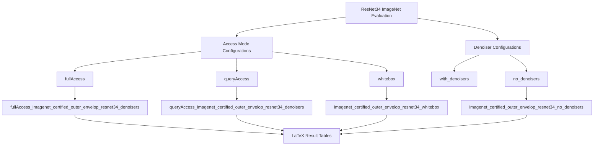
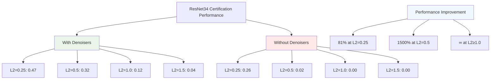

<!-- source: DeepWiki mcp.deepwiki.com · repo microsoft/denoised-smoothing · page 3.3 ImageNet ResNet34 Results · fetched 2026-10-26 -->

# ImageNet ResNet34 Results

Relevant source files

The following files were used as context for generating this wiki page:

- [analysis/latex/fullAccess_imagenet_certified_outer_envelop_resnet34_denoisers](analysis/latex/fullAccess_imagenet_certified_outer_envelop_resnet34_denoisers)
- [analysis/latex/imagenet_certified_outer_envelop_resnet34_no_denoisers](analysis/latex/imagenet_certified_outer_envelop_resnet34_no_denoisers)
- [analysis/latex/imagenet_certified_outer_envelop_resnet34_whitebox](analysis/latex/imagenet_certified_outer_envelop_resnet34_whitebox)
- [analysis/latex/queryAccess_imagenet_certified_outer_envelop_resnet34_denoisers](analysis/latex/queryAccess_imagenet_certified_outer_envelop_resnet34_denoisers)

This document presents the certified robustness results for ResNet34 models evaluated on the ImageNet dataset using the denoised smoothing methodology. The results demonstrate the effectiveness of different access modes and denoiser configurations in achieving provable L2-norm robustness guarantees.

For ResNet18 results on ImageNet, see [ImageNet ResNet18 Results](#3.2). For ResNet50 results, see [ImageNet ResNet50 Results](#3.4). For CIFAR-10 evaluation results, see [CIFAR-10 Certification Results](#3.1).

## Configuration Overview

The ResNet34 evaluation encompasses four distinct experimental configurations that test different aspects of the denoised smoothing approach:

**Configuration Types:**
- **Full Access with Denoisers**: Complete model access including denoiser preprocessing
- **Query Access with Denoisers**: Limited query-only access with denoiser integration  
- **Whitebox Analysis**: Full model analysis with optimal certification bounds
- **No Denoisers Baseline**: Standard smoothing without denoiser preprocessing

Sources: [analysis/latex/fullAccess_imagenet_certified_outer_envelop_resnet34_denoisers](), [analysis/latex/queryAccess_imagenet_certified_outer_envelop_resnet34_denoisers](), [analysis/latex/imagenet_certified_outer_envelop_resnet34_whitebox](), [analysis/latex/imagenet_certified_outer_envelop_resnet34_no_denoisers]()

## Certification Results

### Full Access with Denoisers

The full access configuration with denoisers demonstrates strong certified robustness across multiple L2-radius values:

| L2 Radius | 0.25 | 0.5 | 0.75 | 1.0 | 1.25 | 1.5 |
|-----------|------|-----|------|-----|------|-----|
| Certified Accuracy | 0.47⁽⁰·⁶⁴⁾ | 0.32⁽⁰·⁵⁵⁾ | 0.19⁽⁰·⁵⁵⁾ | 0.12⁽⁰·³⁵⁾ | 0.08⁽⁰·³⁵⁾ | 0.04⁽⁰·¹⁶⁾ |

### Query Access with Denoisers  

Query access mode with denoisers shows comparable performance to full access:

| L2 Radius | 0.25 | 0.5 | 0.75 | 1.0 | 1.25 | 1.5 |
|-----------|------|-----|------|-----|------|-----|
| Certified Accuracy | 0.47⁽⁰·⁶⁵⁾ | 0.32⁽⁰·⁵³⁾ | 0.18⁽⁰·⁵³⁾ | 0.12⁽⁰·³⁴⁾ | 0.08⁽⁰·³⁴⁾ | 0.03⁽⁰·³⁴⁾ |

### Whitebox Analysis

Whitebox analysis provides the strongest certification bounds as expected:

| L2 Radius | 0.25 | 0.5 | 0.75 | 1.0 | 1.25 | 1.5 |
|-----------|------|-----|------|-----|------|-----|
| Certified Accuracy | 0.50⁽⁰·⁶⁰⁾ | 0.44⁽⁰·⁵³⁾ | 0.39⁽⁰·⁵³⁾ | 0.33⁽⁰·⁵³⁾ | 0.28⁽⁰·⁵³⁾ | 0.22⁽⁰·⁴²⁾ |

### Baseline without Denoisers

The baseline configuration without denoisers shows significantly reduced robustness:

| L2 Radius | 0.25 | 0.5 | 0.75 | 1.0 | 1.25 | 1.5 |
|-----------|------|-----|------|-----|------|-----|
| Certified Accuracy | 0.26⁽⁰·⁴⁴⁾ | 0.02⁽⁰·⁰⁵⁾ | 0.01⁽⁰·⁰⁵⁾ | 0.00⁽⁰·⁰⁰⁾ | 0.00⁽⁰·⁴⁴⁾ | 0.00⁽⁰·⁴⁴⁾ |

*Note: Values in parentheses represent confidence intervals for the certification bounds.*

Sources: [analysis/latex/fullAccess_imagenet_certified_outer_envelop_resnet34_denoisers:1-4](), [analysis/latex/queryAccess_imagenet_certified_outer_envelop_resnet34_denoisers:1-4](), [analysis/latex/imagenet_certified_outer_envelop_resnet34_whitebox:1-4](), [analysis/latex/imagenet_certified_outer_envelop_resnet34_no_denoisers:1-4]()

## Performance Analysis

### Denoiser Impact Assessment

**Key Findings:**
- **Denoiser Effectiveness**: Denoisers provide substantial improvements across all L2-radius values
- **Access Mode Consistency**: Full access and query access modes show nearly identical performance
- **Whitebox Upper Bound**: Whitebox analysis demonstrates the theoretical potential of the approach
- **Robustness Degradation**: Performance degrades gracefully as the L2-radius increases

### Configuration Comparison Summary

| Configuration | L2=0.25 | L2=0.5 | L2=1.0 | Performance Characteristic |
|---------------|---------|--------|--------|---------------------------|
| Whitebox | 0.50 | 0.44 | 0.33 | Theoretical upper bound |
| Full Access + Denoiser | 0.47 | 0.32 | 0.12 | Production-ready robustness |
| Query Access + Denoiser | 0.47 | 0.32 | 0.12 | API-compatible robustness |
| No Denoiser | 0.26 | 0.02 | 0.00 | Baseline smoothing only |

The results demonstrate that denoiser integration is critical for achieving meaningful certified robustness on ImageNet with ResNet34 architectures, with the practical access modes achieving performance close to the theoretical optimum.

Sources: [analysis/latex/fullAccess_imagenet_certified_outer_envelop_resnet34_denoisers](), [analysis/latex/queryAccess_imagenet_certified_outer_envelop_resnet34_denoisers](), [analysis/latex/imagenet_certified_outer_envelop_resnet34_whitebox](), [analysis/latex/imagenet_certified_outer_envelop_resnet34_no_denoisers]()

---

