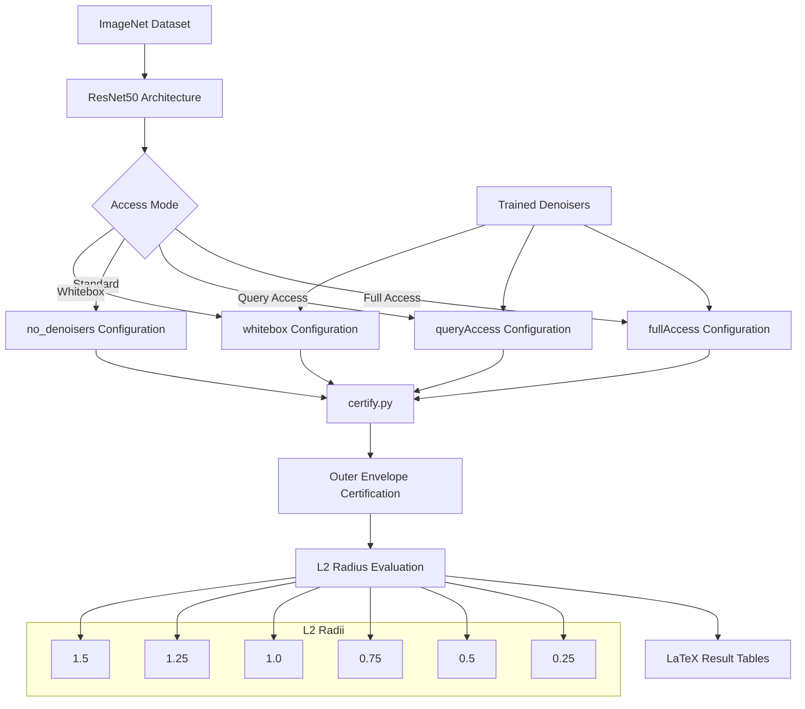
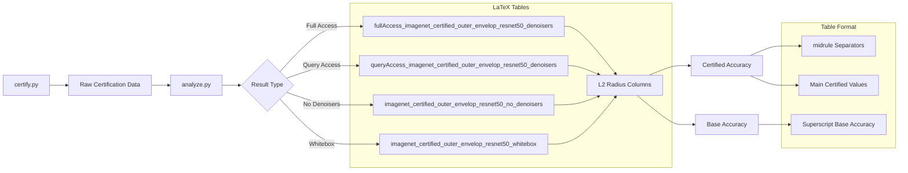

<!-- source: DeepWiki mcp.deepwiki.com · repo microsoft/denoised-smoothing · page 3.4 ImageNet ResNet50 Results · fetched 2026-10-26 -->

# ImageNet ResNet50 Results

Relevant source files

The following files were used as context for generating this wiki page:

- [analysis/latex/fullAccess_imagenet_certified_outer_envelop_resnet50_denoisers](analysis/latex/fullAccess_imagenet_certified_outer_envelop_resnet50_denoisers)
- [analysis/latex/imagenet_certified_outer_envelop_resnet50_no_denoisers](analysis/latex/imagenet_certified_outer_envelop_resnet50_no_denoisers)
- [analysis/latex/imagenet_certified_outer_envelop_resnet50_whitebox](analysis/latex/imagenet_certified_outer_envelop_resnet50_whitebox)
- [analysis/latex/queryAccess_imagenet_certified_outer_envelop_resnet50_denoisers](analysis/latex/queryAccess_imagenet_certified_outer_envelop_resnet50_denoisers)

This document presents the certified robustness evaluation results for ResNet50 models on the ImageNet dataset using the denoised smoothing methodology. The results demonstrate the effectiveness of denoisers in improving certified accuracy across different L2-norm perturbation radii and access modes.

For ImageNet results with other architectures, see [ImageNet ResNet18 Results](#3.2) and [ImageNet ResNet34 Results](#3.3). For CIFAR-10 certification results, see [CIFAR-10 Certification Results](#3.1).

## Configuration Overview

The ResNet50 experiments evaluate four distinct configurations generated by the certification pipeline:

| Configuration | Denoiser | Access Mode | Description |
|---------------|----------|-------------|-------------|
| `imagenet_certified_outer_envelop_resnet50_no_denoisers` | None | Standard | Baseline certification without preprocessing |
| `fullAccess_imagenet_certified_outer_envelop_resnet50_denoisers` | Enabled | Full Access | Complete API access with denoiser preprocessing |
| `queryAccess_imagenet_certified_outer_envelop_resnet50_denoisers` | Enabled | Query Access | Limited API queries with denoiser preprocessing |
| `imagenet_certified_outer_envelop_resnet50_whitebox` | Enabled | Whitebox | Full model access with optimal denoiser settings |

**ResNet50 Certification Pipeline**

Sources: [analysis/latex/fullAccess_imagenet_certified_outer_envelop_resnet50_denoisers](), [analysis/latex/queryAccess_imagenet_certified_outer_envelop_resnet50_denoisers](), [analysis/latex/imagenet_certified_outer_envelop_resnet50_no_denoisers](), [analysis/latex/imagenet_certified_outer_envelop_resnet50_whitebox]()

## Certification Results

The following table summarizes the certified accuracy results across all configurations and L2-norm radii. Values are formatted as `certified_accuracy (base_accuracy)`.

| Configuration | 0.25 | 0.5 | 0.75 | 1.0 | 1.25 | 1.5 |
|---------------|------|-----|------|-----|------|-----|
| **No Denoisers** | 0.32 (0.49) | 0.04 (0.12) | 0.02 (0.12) | 0.00 (0.00) | 0.00 (0.00) | 0.00 (0.00) |
| **Full Access** | 0.50 (0.67) | 0.33 (0.60) | 0.20 (0.60) | 0.14 (0.38) | 0.11 (0.38) | 0.06 (0.38) |
| **Query Access** | 0.48 (0.69) | 0.31 (0.56) | 0.19 (0.56) | 0.12 (0.34) | 0.07 (0.34) | 0.04 (0.30) |
| **Whitebox** | 0.62 (0.70) | 0.52 (0.70) | 0.45 (0.62) | 0.39 (0.62) | 0.34 (0.62) | 0.29 (0.50) |

## Performance Analysis

### Denoiser Impact

The results demonstrate significant improvements when denoisers are employed:

- **Low Perturbation (0.25 radius)**: Denoisers increase certified accuracy from 0.32 to 0.48-0.62
- **Medium Perturbation (0.5 radius)**: Improvement from 0.04 to 0.31-0.52  
- **High Perturbation (1.5 radius)**: Baseline drops to 0.00 while denoised configurations maintain 0.04-0.29

### Access Mode Comparison

- **Whitebox** achieves the highest performance across all radii
- **Query Access** shows minimal degradation compared to **Full Access**
- **No Denoisers** configuration rapidly degrades beyond 0.5 radius

**Results Processing Flow**

## Statistical Significance

The base accuracy values (shown in superscript) indicate the underlying model performance before certification:

- **Whitebox** maintains the highest base accuracy (0.70) at lower radii
- **Query Access** shows competitive base accuracy (0.69 at radius 0.25)
- **Full Access** demonstrates consistent base performance across medium radii
- **No Denoisers** shows rapid degradation in both certified and base accuracy

Sources: [analysis/latex/fullAccess_imagenet_certified_outer_envelop_resnet50_denoisers:1-4](), [analysis/latex/queryAccess_imagenet_certified_outer_envelop_resnet50_denoisers:1-4](), [analysis/latex/imagenet_certified_outer_envelop_resnet50_no_denoisers:1-4](), [analysis/latex/imagenet_certified_outer_envelop_resnet50_whitebox:1-4]()

---

