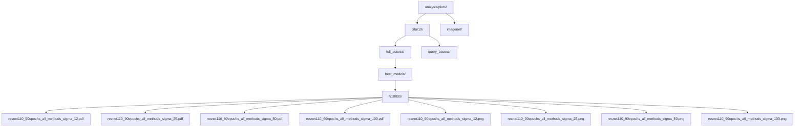
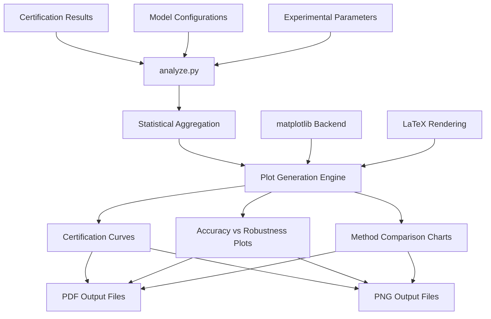
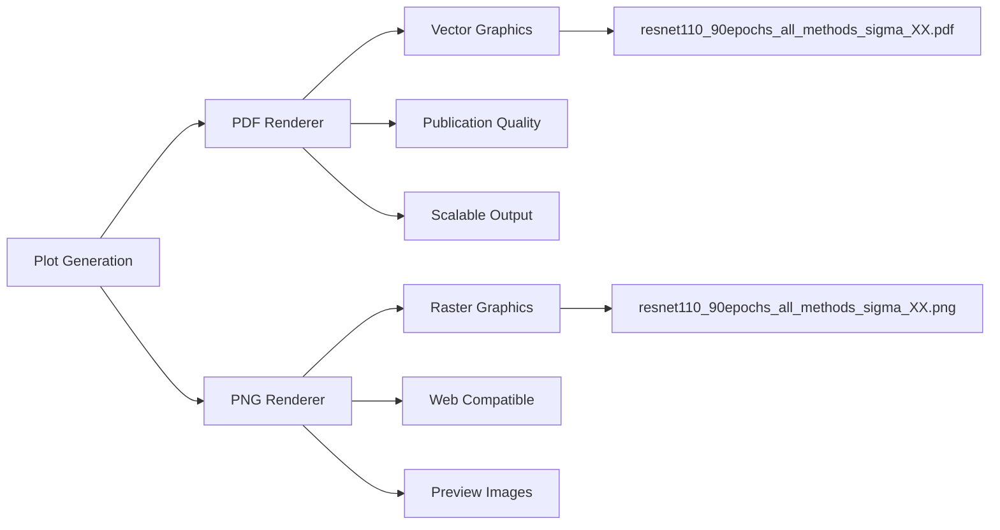
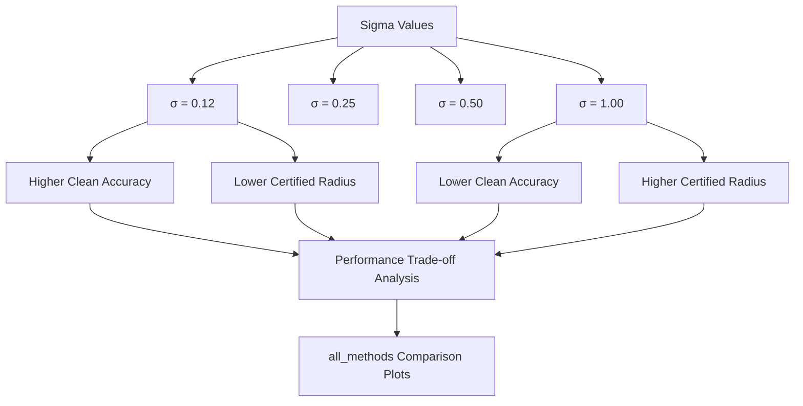

<!-- source: DeepWiki mcp.deepwiki.com · repo microsoft/denoised-smoothing · page 3.5 Performance Visualizations · fetched 2026-10-26 -->

# Performance Visualizations

Relevant source files

The following files were used as context for generating this wiki page:

- [analysis/plots/cifar10/full_access/best_models/N10000/resnet110_90epochs_all_methods_sigma_100.pdf](analysis/plots/cifar10/full_access/best_models/N10000/resnet110_90epochs_all_methods_sigma_100.pdf)
- [analysis/plots/cifar10/full_access/best_models/N10000/resnet110_90epochs_all_methods_sigma_100.png](analysis/plots/cifar10/full_access/best_models/N10000/resnet110_90epochs_all_methods_sigma_100.png)
- [analysis/plots/cifar10/full_access/best_models/N10000/resnet110_90epochs_all_methods_sigma_12.pdf](analysis/plots/cifar10/full_access/best_models/N10000/resnet110_90epochs_all_methods_sigma_12.pdf)
- [analysis/plots/cifar10/full_access/best_models/N10000/resnet110_90epochs_all_methods_sigma_12.png](analysis/plots/cifar10/full_access/best_models/N10000/resnet110_90epochs_all_methods_sigma_12.png)
- [analysis/plots/cifar10/full_access/best_models/N10000/resnet110_90epochs_all_methods_sigma_25.pdf](analysis/plots/cifar10/full_access/best_models/N10000/resnet110_90epochs_all_methods_sigma_25.pdf)
- [analysis/plots/cifar10/full_access/best_models/N10000/resnet110_90epochs_all_methods_sigma_25.png](analysis/plots/cifar10/full_access/best_models/N10000/resnet110_90epochs_all_methods_sigma_25.png)
- [analysis/plots/cifar10/full_access/best_models/N10000/resnet110_90epochs_all_methods_sigma_50.pdf](analysis/plots/cifar10/full_access/best_models/N10000/resnet110_90epochs_all_methods_sigma_50.pdf)
- [analysis/plots/cifar10/full_access/best_models/N10000/resnet110_90epochs_all_methods_sigma_50.png](analysis/plots/cifar10/full_access/best_models/N10000/resnet110_90epochs_all_methods_sigma_50.png)
- [analysis/plots/cifar10/full_access/best_models/N10000/resnet110_90epochs_stab_vs_clf.pdf](analysis/plots/cifar10/full_access/best_models/N10000/resnet110_90epochs_stab_vs_clf.pdf)

This document covers the performance visualization system within the denoised-smoothing repository, focusing on the generation and organization of certification performance plots and stability analysis charts. For tabular certification results data, see [CIFAR-10 Certification Results](#3.1), [ImageNet ResNet18 Results](#3.2), [ImageNet ResNet34 Results](#3.3), and [ImageNet ResNet50 Results](#3.4).

## Overview

The performance visualization system generates comparative plots showing certified robustness performance across different experimental configurations. These visualizations complement the tabular results by providing intuitive graphical representations of certification curves, accuracy trade-offs, and stability analysis for various denoising and smoothing methods.

## Visualization Types and Organization

### File Structure and Naming Conventions

The visualization system organizes plots in a hierarchical directory structure under `analysis/plots/`:

Sources: [analysis/plots/cifar10/full_access/best_models/N10000/resnet110_90epochs_all_methods_sigma_100.pdf](), [analysis/plots/cifar10/full_access/best_models/N10000/resnet110_90epochs_all_methods_sigma_12.pdf]()

### Plot Generation Parameters

The visualization system generates plots with systematic parameter variations:

| Parameter | Description | Example Values |
|-----------|-------------|----------------|
| Dataset | Target dataset for evaluation | `cifar10`, `imagenet` |
| Access Mode | API access pattern | `full_access`, `query_access` |
| Model Type | Architecture configuration | `best_models` |
| Sample Size | Number of certification samples | `N10000` |
| Architecture | Neural network model | `resnet110` |
| Training Config | Epochs and training setup | `90epochs` |
| Method Scope | Comparison across methods | `all_methods` |
| Noise Level | Gaussian noise standard deviation | `sigma_12`, `sigma_25`, `sigma_50`, `sigma_100` |

Sources: [analysis/plots/cifar10/full_access/best_models/N10000/resnet110_90epochs_all_methods_sigma_25.pdf](), [analysis/plots/cifar10/full_access/best_models/N10000/resnet110_90epochs_all_methods_sigma_50.pdf]()

## Certification Performance Visualization System

### Plot Generation Architecture

The visualization system processes raw certification data through statistical aggregation before generating comparative performance charts across different methods and noise levels.

Sources: [analysis/plots/cifar10/full_access/best_models/N10000/resnet110_90epochs_all_methods_sigma_100.png]()

### Multi-Format Output Generation

The system generates both PDF and PNG versions of each plot to support different use cases - PDF for publication-quality vector graphics and PNG for web display and quick preview.

Sources: [analysis/plots/cifar10/full_access/best_models/N10000/resnet110_90epochs_all_methods_sigma_25.png]()

## Noise Level Analysis Framework

### Systematic Sigma Variation

The visualization system evaluates performance across multiple noise levels to demonstrate the trade-off between certified robustness and clean accuracy:

Each sigma value represents a different point on the accuracy-robustness trade-off curve, allowing comprehensive evaluation of method performance across the entire spectrum.

Sources: [analysis/plots/cifar10/full_access/best_models/N10000/resnet110_90epochs_all_methods_sigma_12.pdf](), [analysis/plots/cifar10/full_access/best_models/N10000/resnet110_90epochs_all_methods_sigma_50.pdf]()

## Technical Implementation Details

### File Format and Resolution Specifications

The visualization system generates high-quality outputs with standardized dimensions and formatting:

| Property | PDF Output | PNG Output |
|----------|------------|------------|
| Resolution | Vector-based | High DPI |
| Dimensions | 460.8 × 345.6 points | Equivalent pixel dimensions |
| Text Rendering | LaTeX/matplotlib | Anti-aliased |
| Compression | Minimal | Optimized |
| Color Space | DeviceRGB | RGB |

### Font and Typography System

The plots utilize a sophisticated typography system for scientific publication:

- **Primary Font**: `DejaVuSans` for main text and labels
- **Oblique Font**: `DejaVuSans-Oblique` for emphasis and variables
- **Character Encoding**: Unicode support with mathematical symbols
- **Font Subsetting**: Embedded fonts for portability

Sources: [analysis/plots/cifar10/full_access/best_models/N10000/resnet110_90epochs_all_methods_sigma_100.pdf]()

---

