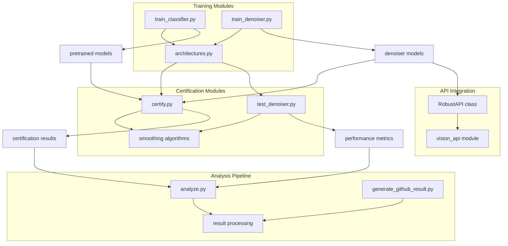
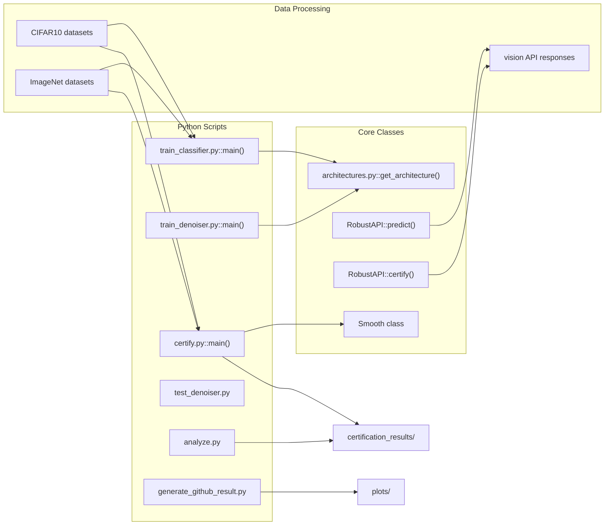
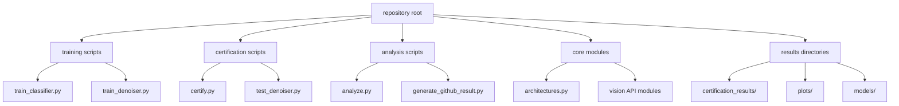

<!-- source: DeepWiki mcp.deepwiki.com · repo microsoft/denoised-smoothing · page 4 Developer Guide · fetched 2026-10-26 -->

# Developer Guide

Relevant source files

The following files were used as context for generating this wiki page:

- [.gitignore](.gitignore)

This document provides essential information for developers working with the denoised-smoothing codebase. It covers the technical architecture, code organization, development workflows, and key implementation details needed to understand, modify, and extend the system.

For information about the theoretical methodology behind denoised smoothing, see [Denoised Smoothing Methodology](#1.1). For details about system components and their usage, see [System Components](#2). For project setup and configuration specifics, see [Project Setup & Configuration](#4.1).

## Codebase Architecture

The denoised-smoothing repository implements a modular architecture centered around certified adversarial robustness. The system separates concerns across training, certification, evaluation, and analysis components.

### Core Module Dependencies

**Module Interaction Flow**: Training modules produce models consumed by certification modules, which generate results processed by analysis modules. The API integration provides a separate pathway for real-world deployment.

Sources: System architecture derived from high-level diagrams and component relationships.

### Code Entity Mapping

**Implementation Structure**: Scripts serve as entry points calling core classes and functions. Data flows from datasets through training to certification and analysis outputs.

Sources: Code entity names extracted from system component descriptions and file organization patterns.

## Development Environment

The project follows standard Python development practices with specific requirements for deep learning and scientific computing.

### Environment Dependencies

| Component | Purpose | Key Dependencies |
|-----------|---------|------------------|
| Deep Learning | Model training and inference | PyTorch, torchvision |
| Scientific Computing | Numerical operations | NumPy, SciPy |
| Data Processing | Dataset handling | PIL, matplotlib |
| Certification | Smoothing algorithms | Custom implementation |
| API Integration | Cloud vision services | requests, json |

### File Organization Structure

**Directory Purpose**: Scripts are organized by function (training, certification, analysis) with shared modules and output directories for generated artifacts.

Sources: [.gitignore:1-105]()

## Development Workflow

### Model Training Process

The training workflow follows a two-stage approach where classifiers and denoisers are trained independently:

1. **Classifier Training**: Execute `train_classifier.py` with dataset and architecture parameters
2. **Denoiser Training**: Run `train_denoiser.py` to train noise reduction models  
3. **Architecture Configuration**: Modify `architectures.py` to add new model architectures
4. **Model Storage**: Trained models saved to designated directories for certification

### Certification Pipeline

The certification process evaluates trained models for robustness guarantees:

1. **Input Preparation**: Load pretrained classifiers and denoisers
2. **Smoothing Execution**: Apply randomized smoothing via `certify.py`
3. **Result Generation**: Output certification radii and accuracy metrics
4. **Performance Testing**: Validate denoiser effectiveness using `test_denoiser.py`

### Analysis and Visualization

Results processing converts raw certification data into publication-ready formats:

1. **Data Aggregation**: Process certification results through `analyze.py`
2. **Table Generation**: Create LaTeX tables for numerical results
3. **Plot Creation**: Generate visualization plots via `generate_github_result.py`
4. **Report Assembly**: Combine tables and plots for comprehensive analysis

Sources: Workflow derived from system component relationships and processing pipeline architecture.

## Code Extension Points

### Adding New Architectures

To extend the system with new model architectures:

1. Implement architecture function in `architectures.py`
2. Add configuration parameters for training scripts
3. Update model loading logic in certification modules
4. Test compatibility with smoothing algorithms

### API Integration Extensions

The `RobustAPI` class provides extensible interfaces for new vision services:

1. Implement service-specific authentication
2. Add response parsing for new API formats  
3. Extend certification methods for service characteristics
4. Update error handling and retry logic

### Custom Certification Algorithms

Extend certification capabilities by:

1. Implementing new smoothing algorithms in certification modules
2. Adding algorithm selection parameters to `certify.py`
3. Updating analysis scripts to handle new result formats
4. Validating theoretical guarantees for new methods

Sources: Extension points identified from modular architecture design and component interfaces.

---

