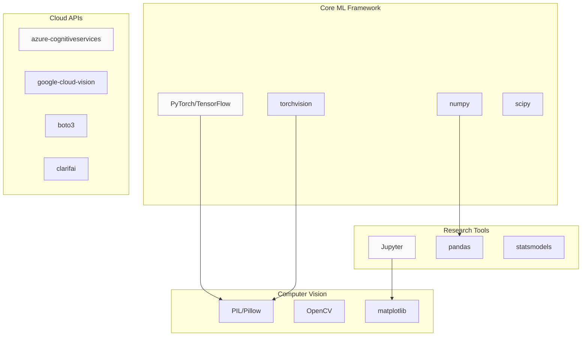
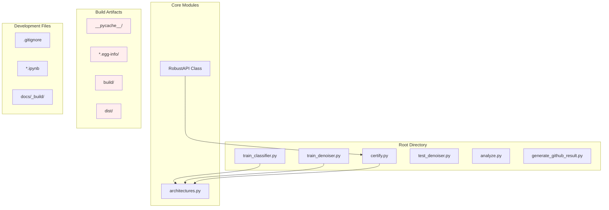
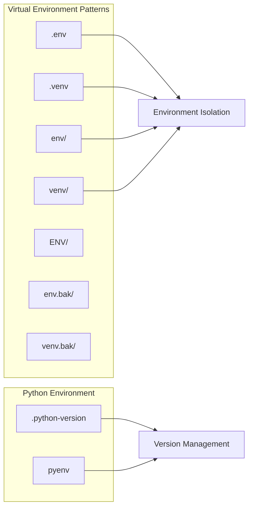
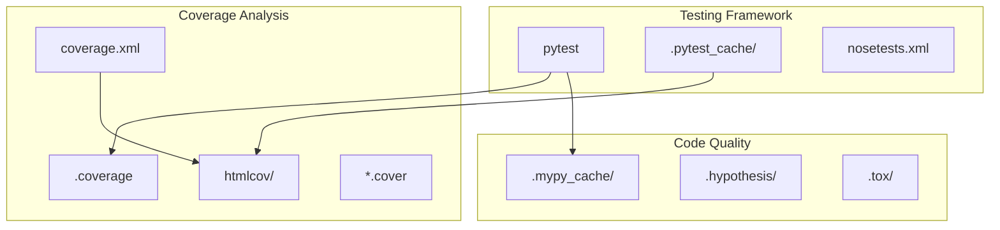
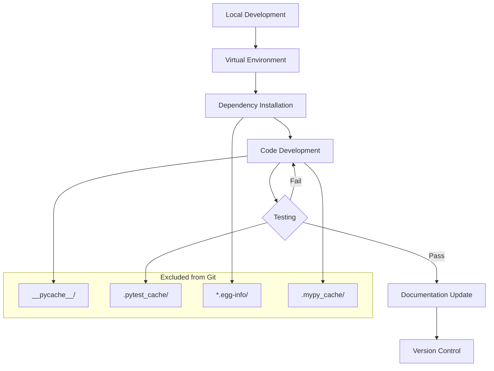

<!-- source: DeepWiki mcp.deepwiki.com · repo microsoft/denoised-smoothing · page 4.1 Project Setup & Configuration · fetched 2026-10-26 -->

# Project Setup & Configuration

Relevant source files

The following files were used as context for generating this wiki page:

- [.gitignore](.gitignore)

This document covers the development environment setup, dependency management, and build configuration for the denoised-smoothing repository. It provides guidance for developers setting up the codebase locally and understanding the project structure.

For information about the core methodology and algorithms, see [Denoised Smoothing Methodology](#1.1). For details about training models and running experiments, see [Training Pipeline](#2.1) and [Certification Engine](#2.2).

## Development Environment Requirements

The denoised-smoothing project is a Python-based research codebase that requires specific environment configuration for machine learning workflows involving image classification and adversarial robustness.

### Python Environment

The project follows standard Python development practices with support for virtual environments and package management:

| Environment Component | Purpose | Configuration |
|----------------------|---------|---------------|
| Python Version | Core interpreter | Python 3.x (inferred from modern ML stack) |
| Virtual Environment | Dependency isolation | `.venv/`, `venv/`, `env/` directories |
| Package Management | Dependency installation | Standard pip with `*.egg-info/` |
| Development Tools | Code quality and testing | pytest, coverage, mypy support |

### Machine Learning Dependencies

Based on the system architecture, the project requires several categories of dependencies:

**Development Environment Dependencies**

Sources: [.gitignore:84-91]()

## Project Structure Overview

The repository follows a modular architecture with clear separation between training, certification, analysis, and API integration components:

**Project Structure and Build Artifacts**

Sources: [.gitignore:1-26](), [.gitignore:67-68]()

## Build Configuration

### Ignored Files and Directories

The project maintains a comprehensive `.gitignore` configuration that excludes common Python development artifacts:

| Category | Files/Directories | Purpose |
|----------|------------------|---------|
| Python Bytecode | `__pycache__/`, `*.py[cod]`, `*$py.class` | Compiled Python files |
| Distribution | `build/`, `dist/`, `*.egg-info/` | Package build artifacts |
| Testing | `.pytest_cache/`, `.coverage`, `htmlcov/` | Test execution results |
| Documentation | `docs/_build/`, `/site` | Generated documentation |
| Development | `.ipynb_checkpoints`, `.mypy_cache/` | IDE and tool caches |

### Virtual Environment Support

The configuration supports multiple virtual environment patterns:

**Virtual Environment and Version Management**

Sources: [.gitignore:75-91]()

## Testing and Quality Assurance

### Test Framework Configuration

The project supports comprehensive testing and code quality tools:

**Testing and Code Quality Infrastructure**

Sources: [.gitignore:38-48](), [.gitignore:103-104]()

## Documentation and Development Tools

### Documentation Generation

The project supports multiple documentation formats:

| Tool | Output Directory | Purpose |
|------|-----------------|---------|
| Sphinx | `docs/_build/` | API documentation |
| MkDocs | `/site` | User documentation |
| Jupyter | `.ipynb_checkpoints` | Interactive notebooks |

### Development Workflow Integration

**Development Workflow and Artifact Management**

Sources: [.gitignore:1-105]()

## Installation and Setup Process

### Basic Setup Steps

1. **Environment Preparation**
   - Create virtual environment using supported patterns
   - Activate environment isolation

2. **Dependency Installation**
   - Install core ML frameworks (PyTorch/TensorFlow)
   - Install computer vision libraries
   - Install cloud API client libraries
   - Install development and testing tools

3. **Configuration Verification**
   - Verify dataset access (CIFAR-10, ImageNet)
   - Test cloud API credentials
   - Validate GPU/CUDA availability for training

4. **Development Tool Setup**
   - Configure IDE integration
   - Enable code quality checks
   - Setup documentation building

### Build and Test Execution

The project structure supports standard Python development commands for building, testing, and packaging the research codebase while maintaining clean separation of source code from generated artifacts.

Sources: [.gitignore:1-105]()

---

