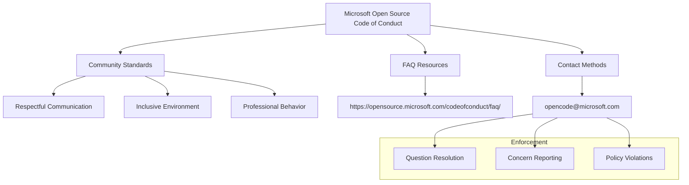
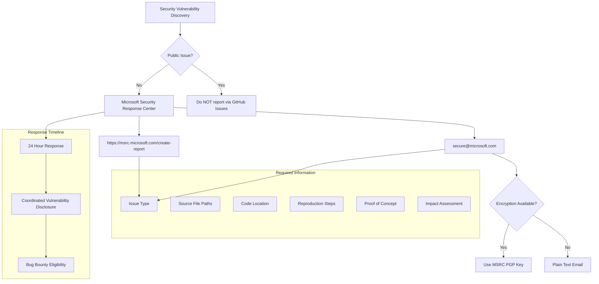
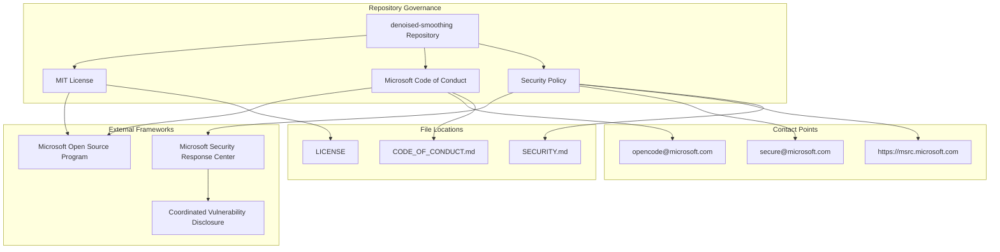

<!-- source: DeepWiki mcp.deepwiki.com · repo microsoft/denoised-smoothing · page 4.2 Legal & Security Policies · fetched 2026-10-26 -->

# Legal & Security Policies

Relevant source files

The following files were used as context for generating this wiki page:

- [CODE_OF_CONDUCT.md](CODE_OF_CONDUCT.md)
- [LICENSE](LICENSE)
- [SECURITY.md](SECURITY.md)

This document covers the legal and security policies governing the denoised-smoothing repository, including software licensing terms, community conduct standards, and security vulnerability reporting procedures. For technical setup and development environment configuration, see [Project Setup & Configuration](#4.1).

## Software License

The denoised-smoothing repository is distributed under the MIT License with Microsoft Corporation as the copyright holder. The license grants broad permissions for use, modification, and distribution while maintaining attribution requirements.

### License Terms

| Permission | Restriction | Condition |
|------------|-------------|-----------|
| Commercial use | No warranty provided | Include copyright notice |
| Distribution | No liability | Include license text |
| Modification | - | - |
| Private use | - | - |

The complete license text specifies that the software is provided "AS IS" without warranties of any kind, and limits Microsoft's liability for any claims or damages arising from software use [LICENSE:15-21]().

**Sources:** [LICENSE:1-22]()

## Code of Conduct

The repository adopts the Microsoft Open Source Code of Conduct, which establishes community standards for respectful and inclusive participation.

### Conduct Framework

### Contact Information

For questions or concerns regarding the code of conduct:
- **Email:** `opencode@microsoft.com`
- **Web Resource:** Microsoft Open Source Code of Conduct FAQ

**Sources:** [CODE_OF_CONDUCT.md:1-10]()

## Security Policy

Microsoft maintains a comprehensive security vulnerability disclosure process for all repositories under its GitHub organizations, including this denoised-smoothing project.

### Security Vulnerability Reporting

### Reporting Requirements

Security vulnerability reports should include:

- **Issue Classification:** Type of vulnerability (buffer overflow, injection, XSS, etc.)
- **Source Locations:** Full file paths and code locations [SECURITY.md:22-23]()
- **Reproduction:** Step-by-step instructions and special configuration requirements [SECURITY.md:24-25]()
- **Evidence:** Proof-of-concept or exploit code when possible [SECURITY.md:26]()
- **Impact Analysis:** Description of potential exploitation scenarios [SECURITY.md:27]()

### Communication Channels

| Method | Contact | Features |
|--------|---------|----------|
| Web Portal | `https://msrc.microsoft.com/create-report` | Structured reporting |
| Email | `secure@microsoft.com` | Direct communication |
| Encrypted Email | PGP key from MSRC | Secure transmission |

### Policy Framework

Microsoft follows the **Coordinated Vulnerability Disclosure** (CVD) principle, ensuring responsible disclosure timing and coordination between researchers and Microsoft's security team [SECURITY.md:39]().

**Sources:** [SECURITY.md:1-42]()

## Legal and Security Architecture

This architecture demonstrates how the repository's legal and security policies integrate with Microsoft's broader open source governance framework, providing clear channels for community engagement and security issue resolution.

**Sources:** [LICENSE:1-22](), [CODE_OF_CONDUCT.md:1-10](), [SECURITY.md:1-42]()