# Page: Overview

# Overview

<details>
<summary>Relevant source files</summary>

The following files were used as context for generating this wiki page:

- [README.md](README.md)

</details>


## Purpose and Scope

This document provides an overview of the Microsoft denoised-smoothing repository, which implements a provable defense method for protecting pretrained image classifiers against adversarial attacks. The system combines denoising preprocessing with randomized smoothing to provide certified L2-robustness guarantees for any pretrained classifier without requiring retraining.

This overview covers the core methodology, system architecture, and primary code components. For detailed information about the theoretical foundations, see [Denoised Smoothing Methodology](#1.1). For implementation details of specific subsystems, see [System Components](#2). For experimental results and performance analysis, see [Experimental Results](#3).

## Core Methodology

Denoised smoothing enhances the certified robustness of pretrained classifiers through a two-stage process: denoising followed by randomized smoothing. The methodology converts any pretrained classifier into a provably robust version by preprocessing inputs through a trained denoiser before applying Monte Carlo sampling with Gaussian noise to compute certified L2-radii.

### System Architecture Overview

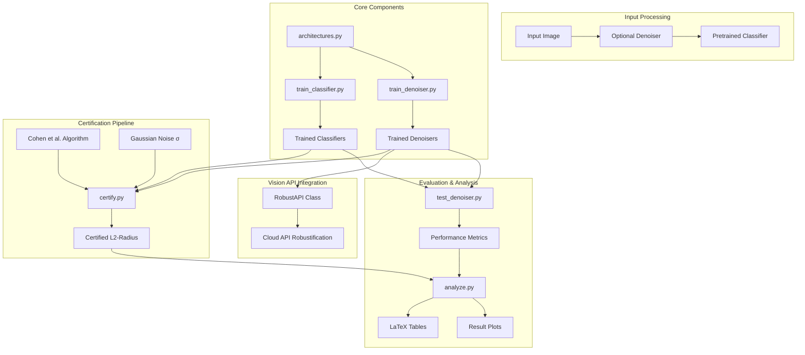

**System Architecture Overview**
This diagram shows the primary workflow from input processing through certification to analysis, highlighting the key Python scripts and their relationships.

Sources: [README.md:21-49]()

### Code Component Mapping

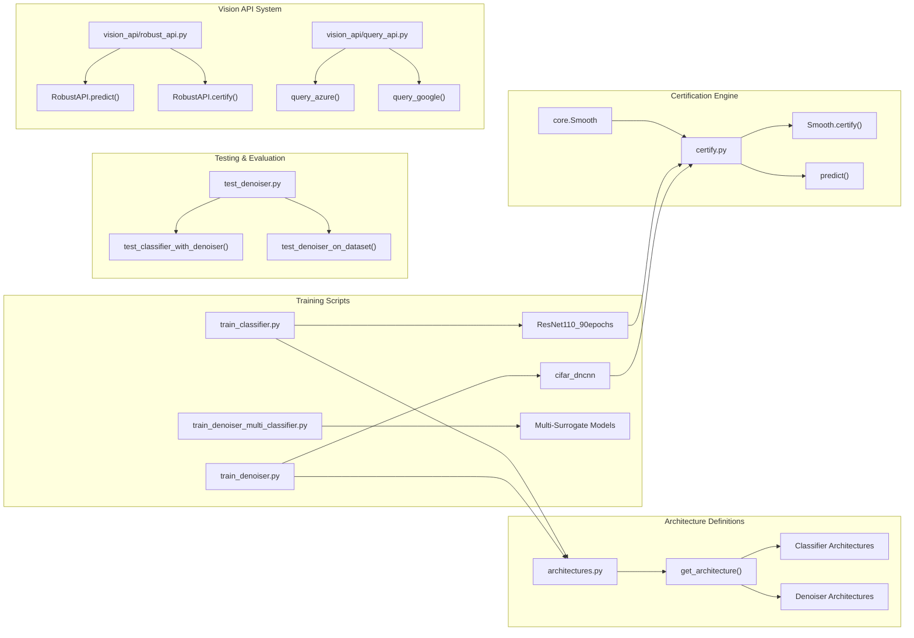

**Code Component to Functionality Mapping**
This diagram maps specific Python files and classes to their primary functions, showing how code entities implement the denoised smoothing methodology.

Sources: [README.md:40-49]()

## Key Workflows

### Training Workflow

The system supports training both classifiers and denoisers independently:

1. **Classifier Training**: `train_classifier.py` trains standard or Gaussian-augmented classifiers on CIFAR-10 or ImageNet datasets
2. **Denoiser Training**: `train_denoiser.py` trains denoising models using MSE or adversarial objectives to handle Gaussian noise
3. **Architecture Selection**: `architectures.py` provides a unified interface for specifying model architectures

### Certification Workflow  

The certification process combines trained components to provide robustness guarantees:

1. **Input**: Pretrained classifier and optional denoiser
2. **Processing**: `certify.py` applies randomized smoothing with specified noise level σ
3. **Output**: Certified L2-radius for each test sample using Cohen et al. algorithm

### Vision API Integration

The `RobustAPI` class enables robustification of commercial vision APIs:

```python
# Online API robustification
majority_class, radius, logs = RobustAPI(api_name, denoiser=denoiser, online=True).certify(img, ...)

# Offline log analysis  
majority_class, radius = RobustAPI(api_name, online=False).certify(logs, ...)
```

Sources: [README.md:27-35]()

## Repository Structure

| Directory | Purpose | Key Files |
|-----------|---------|-----------|
| `code/` | Core implementation | `train_classifier.py`, `train_denoiser.py`, `certify.py` |
| `vision_api/` | Cloud API integration | `robust_api.py`, `query_api.py` |
| `analysis/` | Result processing | `analyze.py`, plotting scripts |
| `pretrained_models/` | Trained models | Classifiers and denoisers for CIFAR-10/ImageNet |
| `data/` | Certification logs | Experimental results and performance data |

Sources: [README.md:21-38]()

## Usage Examples

### Basic Certification Example

```bash
# Certify CIFAR-10 model with MSE-trained denoiser
pretrained_classifier="pretrained_models/cifar10_classifiers/ResNet110_90epochs/noise_0.00/checkpoint.pth.tar"
denoiser="pretrained_models/trained_denoisers/cifar10/mse_obj/dncnn/epochs_90/noise_0.25/checkpoint.pth.tar"
python code/certify.py --dataset cifar10 --base_classifier $pretrained_classifier --sigma 0.25 --outfile certification_output/sigma_0.25 --denoiser $denoiser
```

### Training Custom Denoiser

```bash
# Train denoiser for noise level 0.25
python code/train_denoiser.py --dataset cifar10 --arch cifar_dncnn --outdir denoiser_output_dir --noise 0.25
```

Sources: [README.md:73-79](), [README.md:96-104]()

This overview establishes the foundation for understanding the denoised-smoothing system. The following sections provide detailed documentation of each subsystem and comprehensive experimental results.

---

# Page: Denoised Smoothing Methodology

# Denoised Smoothing Methodology

<details>
<summary>Relevant source files</summary>

The following files were used as context for generating this wiki page:

- [README.md](README.md)

</details>


## Purpose and Scope

This document explains the theoretical foundation and algorithmic approach of denoised smoothing for certified robustness. The methodology provides provable defense guarantees for pretrained image classifiers against L2 adversarial attacks by combining learned denoisers with randomized smoothing techniques.

For information about the practical implementation of training pipelines, see [Training Pipeline](#2.1). For details about the certification process implementation, see [Certification Engine](#2.2). For experimental evaluation results, see [Experimental Results](#3).

## Theoretical Foundation

Denoised smoothing extends the randomized smoothing framework of Cohen et al. (2019) by introducing a learned denoising component. The core insight is that applying a denoiser before classification can significantly improve the certified robustness radius while maintaining competitive clean accuracy.

### Mathematical Formulation

The denoised smoothing methodology operates on the following principle:

Given:
- A pretrained classifier `f: R^d → Y`  
- A learned denoiser `g: R^d → R^d`
- Gaussian noise `ε ~ N(0, σ²I)`

The smoothed classifier `F` is defined as:
```
F(x) = argmax_y P(f(g(x + ε)) = y)
```

Where the probability is taken over the random noise `ε`.

**Certification Framework**

The methodology provides certified L2-radius guarantees: for any input `x`, if `F(x) = y` with probability `≥ p_A` and the next most likely class has probability `≤ p_B`, then `F` is guaranteed to output `y` for all inputs within L2-distance `R` from `x`, where:

```
R = σ · (Φ^(-1)(p_A) - Φ^(-1)(p_B)) / 2
```

Sources: [README.md:1-178]()

## Algorithmic Workflow

### Core Denoised Smoothing Pipeline

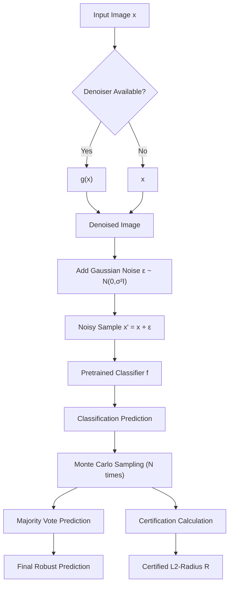

Sources: [README.md:27-35](), [README.md:46-47]()

### Code Entity Mapping

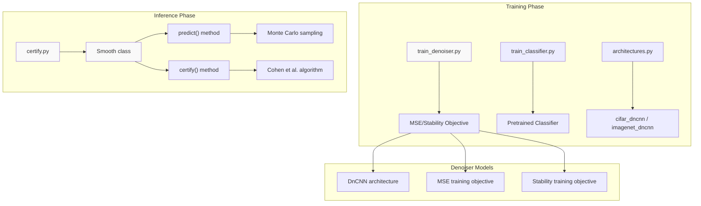

Sources: [README.md:42-48](), [README.md:98-103]()

## Denoiser Training Process

### Training Objectives

The methodology supports multiple training objectives for the denoiser component:

| Objective | Description | Implementation |
|-----------|-------------|----------------|
| MSE | Mean Squared Error reconstruction loss | `train_denoiser.py` with default settings |
| Stability | Adversarial training objective for robustness | `train_denoiser.py` with stability flag |
| Multi-classifier | Training with multiple surrogate models | `train_denoiser_multi_classifier.py` |

### Denoiser Architecture Flow

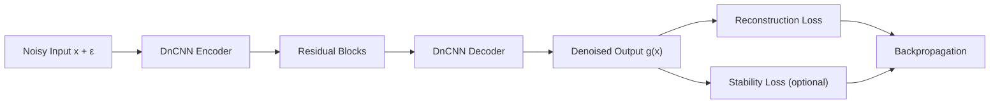

**Key Training Parameters:**
- Noise level: `--noise 0.25` (standard deviation)
- Architecture: `--arch cifar_dncnn` or `imagenet_dncnn`
- Training epochs: 90 (typical)
- Dataset: `--dataset cifar10` or `imagenet`

Sources: [README.md:98-103](), [README.md:42-44]()

## Certification Process

### Monte Carlo Estimation

The certification algorithm implements the Cohen et al. (2019) approach with denoiser preprocessing:

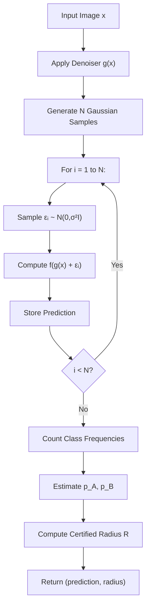

### Implementation Details

**Core Certification Function:**
- Entry point: `certify.py` script
- Main class: `Smooth` (implements smoothed classifier)
- Key methods:
  - `predict(x, n, alpha, batch_size)`: Returns smoothed prediction
  - `certify(x, n0, n, alpha, batch_size)`: Returns certified radius

**Certification Parameters:**
- `n0`: Number of samples for initial prediction (typically 100)
- `n`: Number of samples for certification (typically 10,000)  
- `alpha`: Confidence level (typically 0.001)
- `sigma`: Gaussian noise standard deviation

Sources: [README.md:46-47](), [README.md:114-117]()

## Implementation Architecture

### File Organization and Data Flow

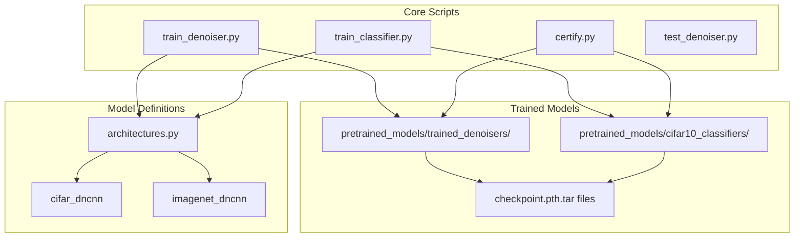

### Command Line Interface

**Typical Usage Pattern:**
1. Train denoiser: `python code/train_denoiser.py --dataset cifar10 --arch cifar_dncnn --noise 0.25`
2. Test denoiser: `python code/test_denoiser.py --denoiser <path> --clf <path> --noise 0.25`
3. Certify robustness: `python code/certify.py --dataset cifar10 --base_classifier <path> --denoiser <path> --sigma 0.25`

**Key Directory Structure:**
- `pretrained_models/trained_denoisers/`: Stored denoiser checkpoints
- `pretrained_models/cifar10_classifiers/`: Pretrained classifier models  
- `certification_output/`: Certification result logs
- `data/certify/`: Experimental certification logs

Sources: [README.md:74-78](), [README.md:98-103](), [README.md:114-117]()

---

# Page: System Components

# System Components

<details>
<summary>Relevant source files</summary>

The following files were used as context for generating this wiki page:

- [README.md](README.md)

</details>


## Purpose and Scope

This document provides an overview of the core system components that implement the denoised smoothing pipeline in the Microsoft denoised-smoothing repository. It describes the high-level architecture and interaction between major subsystems that enable provable adversarial robustness for pretrained image classifiers.

For detailed information about specific subsystems, see:
- Training pipeline implementation details: [Training Pipeline](#2.1)
- Certification process and algorithms: [Certification Engine](#2.2)  
- Cloud vision API integration: [Vision API Integration](#2.3)

## Core Architecture Overview

The denoised-smoothing system consists of four primary components that work together to provide certified robustness guarantees:

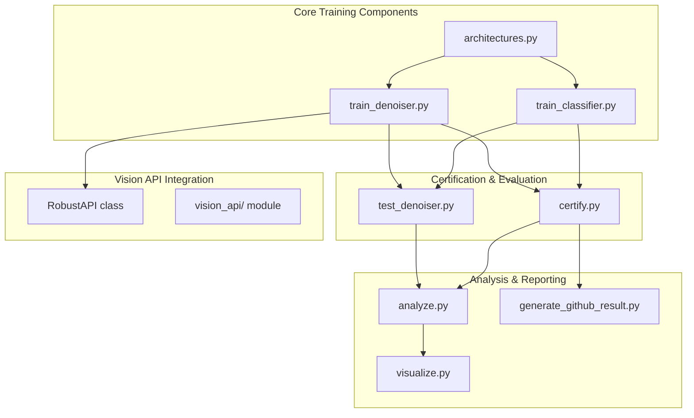

**Component Interaction Flow**

Sources: [README.md:40-48](), [README.md:23-38]()

## File Organization and Data Flow

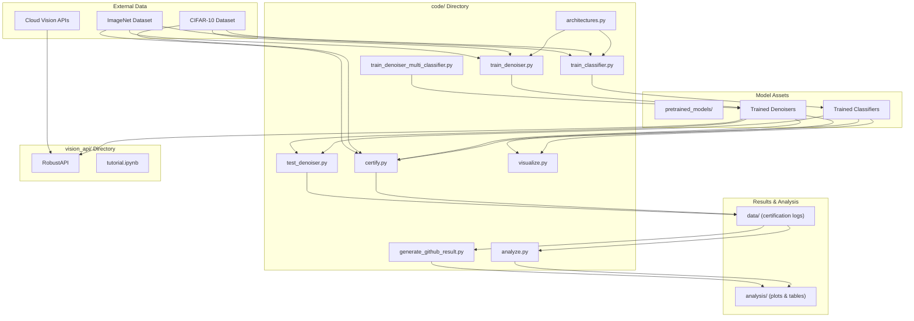

**System Data Flow Architecture**

Sources: [README.md:40-48](), [README.md:25-38]()

## Component Responsibilities

### Training Infrastructure

| Component | File Path | Primary Function |
|-----------|-----------|------------------|
| **Classifier Training** | `code/train_classifier.py` | Train ImageNet/CIFAR-10 classifiers with optional Gaussian augmentation |
| **Denoiser Training** | `code/train_denoiser.py` | Train denoisers using MSE or stability objectives |
| **Multi-Classifier Training** | `code/train_denoiser_multi_classifier.py` | Train denoisers using multiple surrogate models |
| **Architecture Registry** | `code/architectures.py` | Define and specify model architectures for classifiers and denoisers |

Sources: [README.md:42-48]()

### Certification and Evaluation

| Component | File Path | Primary Function |
|-----------|-----------|------------------|
| **Certification Engine** | `code/certify.py` | Compute certified L2-radius using Cohen et al. algorithm |
| **Denoiser Testing** | `code/test_denoiser.py` | Evaluate denoiser reconstruction and classification performance |
| **Visualization** | `code/visualize.py` | Generate visual comparisons of noisy and denoised images |

Sources: [README.md:45-47]()

### Analysis and Reporting

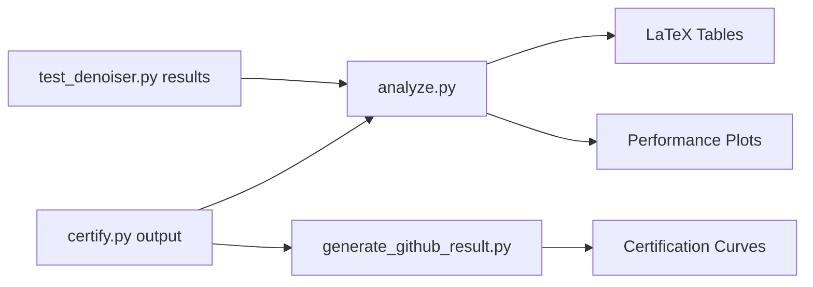

**Analysis Pipeline Components**

| Component | File Path | Primary Function |
|-----------|-----------|------------------|
| **Result Analysis** | `code/analyze.py` | Generate paper tables and figures from certification logs |
| **GitHub Results** | `code/generate_github_result.py` | Create certification curve visualizations |

Sources: [README.md:146-151](), [README.md:137-143]()

### Vision API Integration

The `vision_api/` module provides a unified interface for robustifying cloud-based vision services:

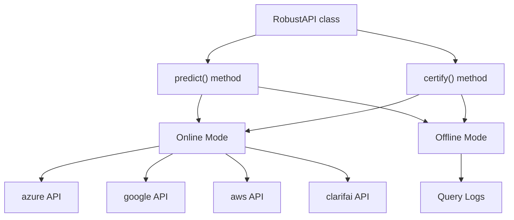

**RobustAPI Architecture**

Key methods and usage patterns:
- `RobustAPI(api_name, denoiser=denoiser, online=True).predict(img, ...)` - Online prediction
- `RobustAPI(api_name, denoiser=denoiser, online=True).certify(img, ...)` - Online certification  
- `RobustAPI(api_name, online=False).predict(logs, ...)` - Offline prediction from logs
- `RobustAPI(api_name, online=False).certify(logs, ...)` - Offline certification from logs

Sources: [README.md:25-35]()

## System Integration Points

The components integrate through several key interfaces:

1. **Model Loading**: `architectures.py` provides factory functions for instantiating classifiers and denoisers
2. **Checkpoint Management**: Training scripts save models to `pretrained_models/` directory structure
3. **Certification Pipeline**: `certify.py` loads both classifiers and denoisers to compute robustness certificates
4. **Result Aggregation**: Analysis scripts read from standardized `data/` directory structure containing certification logs

This modular design enables independent development and testing of each component while maintaining clear data flow and integration points throughout the system.

Sources: [README.md:69-83](), [README.md:92-124]()

---

# Page: Training Pipeline

# Training Pipeline

<details>
<summary>Relevant source files</summary>

The following files were used as context for generating this wiki page:

- [README.md](README.md)

</details>


## Purpose and Scope

This document covers the training infrastructure for building the core components of the denoised smoothing system: classifiers and denoisers. The training pipeline consists of scripts for training image classifiers with optional Gaussian augmentation, training various types of denoisers, and validating their performance. For information about using these trained models for certification, see [Certification Engine](#2.2). For details about integrating with cloud vision APIs, see [Vision API Integration](#2.3).

## Training Pipeline Overview

The training pipeline implements a two-stage approach where classifiers and denoisers are trained independently, then combined for robust inference and certification.

### Training Pipeline Architecture

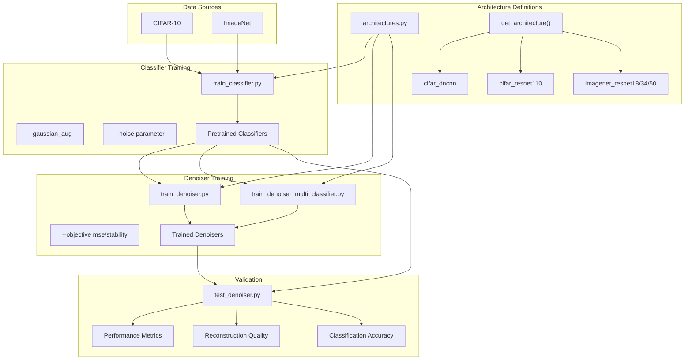

Sources: [README.md:42-48](), [README.md:96-117]()

## Classifier Training

The `train_classifier.py` script provides functionality for training base image classifiers on CIFAR-10 and ImageNet datasets. These classifiers serve as the foundation for the denoised smoothing pipeline.

### Key Training Features

| Feature | Parameter | Description |
|---------|-----------|-------------|
| Gaussian Augmentation | `--gaussian_aug` | Adds Gaussian noise during training for improved robustness |
| Noise Level | `--noise` | Controls the standard deviation of training noise |
| Architecture Selection | `--arch` | Specifies model architecture via `architectures.py` |
| Dataset | `--dataset` | Supports `cifar10` and `imagenet` |

### Classifier Training Flow

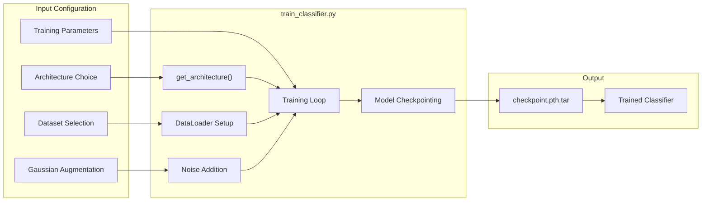

Sources: [README.md:42](), [README.md:75-76](), [README.md:93-94]()

## Denoiser Training

The denoiser training system provides two main scripts for training denoisers that can be attached to pretrained classifiers to improve their certified robustness.

### Single Classifier Denoiser Training

The `train_denoiser.py` script trains denoisers using a single surrogate classifier. This is the primary training method described in the paper.

#### Training Configuration

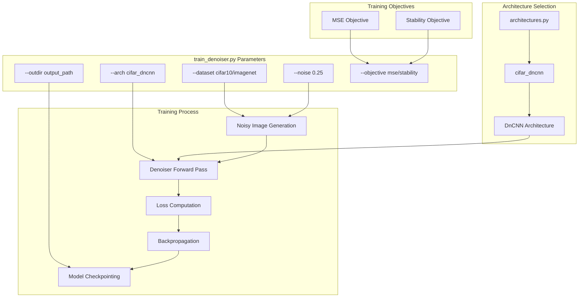

Sources: [README.md:43](), [README.md:97-103]()

### Multi-Classifier Denoiser Training

The `train_denoiser_multi_classifier.py` script allows training denoisers using multiple surrogate models, potentially improving generalization across different classifier architectures.

### Training Example

Based on the README example, a typical denoiser training command:

```bash
python code/train_denoiser.py --dataset cifar10 --arch cifar_dncnn --outdir denoiser_output_dir --noise 0.25
```

This trains a DnCNN denoiser on CIFAR-10 to denoise Gaussian noise with standard deviation 0.25.

Sources: [README.md:44](), [README.md:98-99]()

## Testing and Validation

The `test_denoiser.py` script provides comprehensive evaluation of trained denoisers across multiple metrics.

### Denoiser Testing Capabilities

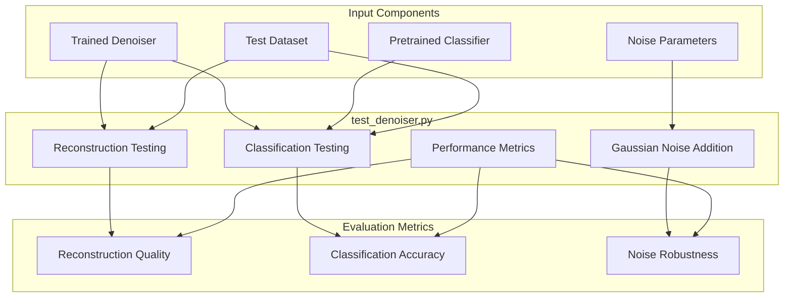

### Testing Command Example

```bash
python code/test_denoiser.py --dataset cifar10 --denoiser $denoiser_output_dir/checkpoint.pth.tar --clf $pretrained_classifier --noise 0.25
```

This evaluates the denoiser's reconstruction capability and its impact on classification accuracy when attached to a pretrained classifier under Gaussian noise.

Sources: [README.md:45](), [README.md:107-110]()

## Architecture Definitions

The `architectures.py` file serves as the central registry for all model architectures used in the training pipeline.

### Architecture System

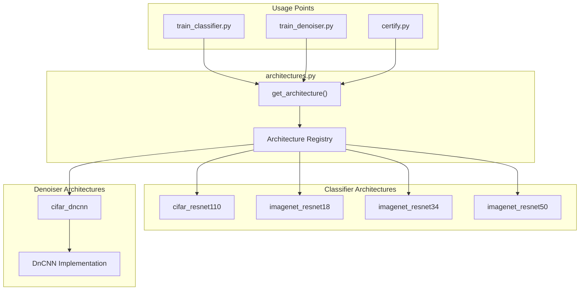

The `get_architecture()` function provides a unified interface for instantiating both classifier and denoiser architectures across the entire pipeline.

Sources: [README.md:48]()

## Integration with Certification Pipeline

The training pipeline outputs are designed to integrate seamlessly with the certification system.

### Training Output Integration

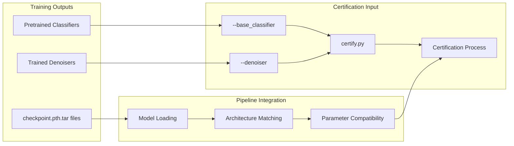

### Example Integration Command

```bash
pretrained_classifier="pretrained_models/cifar10_classifiers/ResNet110_90epochs/noise_0.00/checkpoint.pth.tar"
denoiser="pretrained_models/trained_denoisers/cifar10/mse_obj/dncnn/epochs_90/noise_0.25/checkpoint.pth.tar"
python code/certify.py --dataset cifar10 --base_classifier $pretrained_classifier --sigma 0.25 --denoiser $denoiser
```

This demonstrates how trained components from the training pipeline are combined for certification, where the `--base_classifier` parameter loads a trained classifier and `--denoiser` loads a trained denoiser for robust inference.

Sources: [README.md:73-83](), [README.md:112-117]()

---

# Page: Certification Engine

# Certification Engine

<details>
<summary>Relevant source files</summary>

The following files were used as context for generating this wiki page:

- [README.md](README.md)

</details>


## Purpose and Scope

The Certification Engine is the core component responsible for providing mathematical guarantees of adversarial robustness for pretrained image classifiers. This system implements the certified defense methodology using randomized smoothing to compute provable L2-radius bounds for input images. The engine processes pretrained classifiers (with optional denoisers) and generates certification results that quantify the maximum perturbation radius within which predictions remain constant.

For information about training the classifiers and denoisers that feed into this engine, see [Training Pipeline](#2.1). For details about analyzing and visualizing the certification results, see [Experimental Results](#3).

## Certification Workflow Overview

The certification process follows a systematic pipeline that transforms pretrained models into certified robust classifiers through randomized smoothing.

### High-Level Certification Process

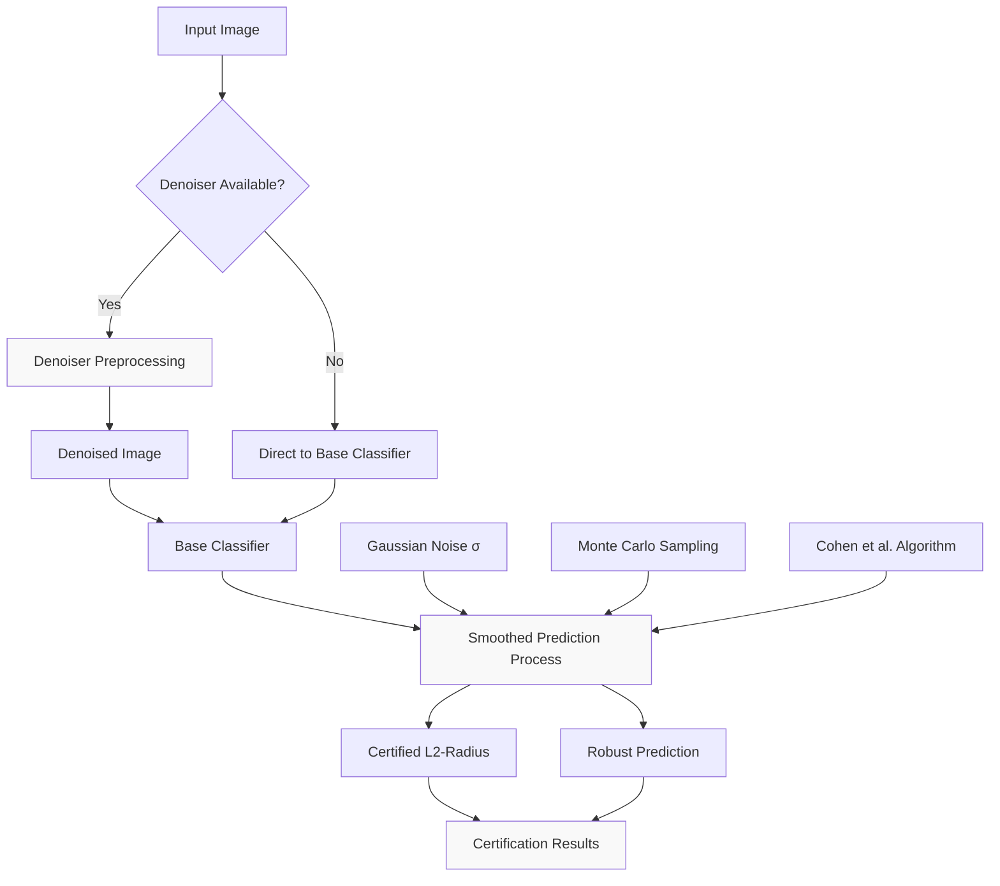

**Sources**: [README.md:46-47](), [README.md:113-118]()

### Code Entity Mapping

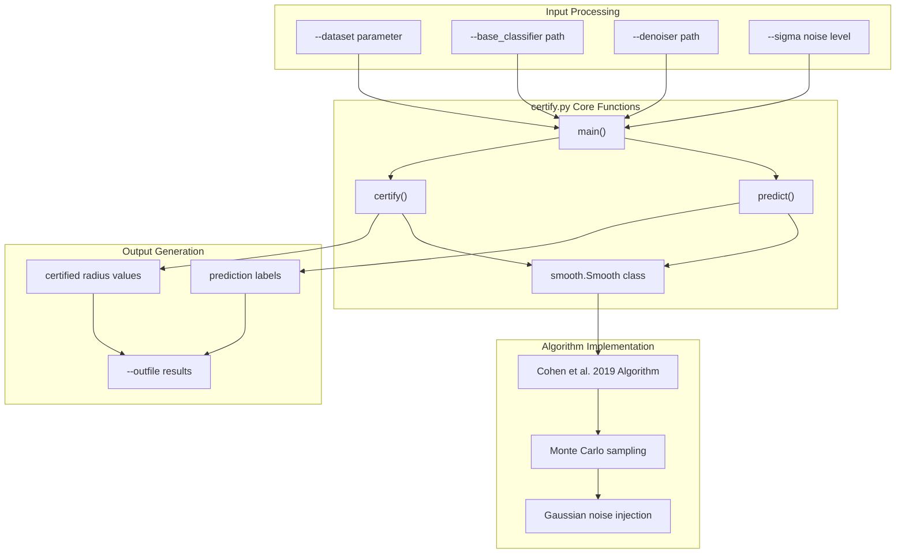

**Sources**: [README.md:46-47](), [README.md:74-78](), [README.md:113-118]()

## Core Architecture Components

The certification engine is implemented primarily in the `certify.py` script, which coordinates multiple components to produce certified robustness guarantees.

### Primary Script Structure

| Component | Purpose | Key Parameters |
|-----------|---------|----------------|
| `certify.py` main function | Entry point and argument parsing | `--dataset`, `--base_classifier`, `--sigma`, `--outfile` |
| Smooth class | Randomized smoothing implementation | `--denoiser`, noise level σ |
| Prediction pipeline | Monte Carlo sampling and certification | `--skip`, `--N` (sample count) |
| Output formatting | Results serialization and storage | File path structuring |

### Certification Algorithm Flow

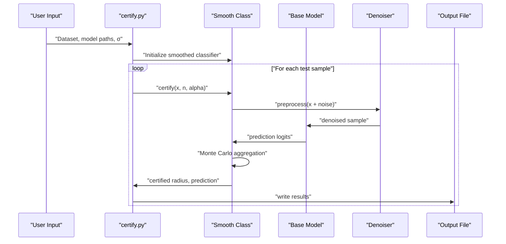

**Sources**: [README.md:46-47](), [README.md:74-78]()

## Input and Output Specifications

### Required Input Parameters

The certification engine accepts several key parameters that control the certification process:

| Parameter | Type | Description | Example |
|-----------|------|-------------|---------|
| `--dataset` | string | Target dataset (cifar10/imagenet) | `cifar10` |
| `--base_classifier` | path | Pretrained classifier checkpoint | `pretrained_models/cifar10_classifiers/ResNet110_90epochs/noise_0.00/checkpoint.pth.tar` |
| `--sigma` | float | Gaussian noise standard deviation | `0.25` |
| `--outfile` | path | Output file for certification results | `certification_output/sigma_0.25` |
| `--denoiser` | path | Optional denoiser checkpoint | `pretrained_models/trained_denoisers/cifar10/mse_obj/dncnn/epochs_90/noise_0.25/checkpoint.pth.tar` |
| `--skip` | int | Number of samples to skip between certifications | `20` |

### Output Data Structure

The certification results are structured in a hierarchical directory format that preserves experimental metadata:

```mermaid
graph TD
    A["Certification Output Root"] --> B["Dataset Type"]
    B --> C["Objective Function"]
    C --> D["Model Architecture"]
    D --> E["Denoiser Configuration"]
    E --> F["Noise Level"]
    F --> G["Test Parameters"]
    G --> H["Sigma Value Files"]
    
    A --> I["certification_output/"]
    B --> J["cifar10/ or imagenet/"]
    C --> K["mse_obj/ or no_denoiser/"]
    D --> L["MODEL_resnet110_90epochs/"]
    E --> M["DENOISER_cifar10_dncnn_epochs_90/"]
    F --> N["noise_0.25/"]
    G --> O["test_N10000/"]
    H --> P["sigma_0.25"]
```

**Sources**: [README.md:80-83](), [README.md:121-123](), [README.md:133-135]()

## Certification Algorithm Implementation

The certification engine implements the Cohen et al. (2019) randomized smoothing algorithm to provide mathematical guarantees of robustness.

### Monte Carlo Smoothing Process

```mermaid
flowchart LR
    A["Input Image x"] --> B["Add Gaussian Noise"]
    B --> C["ε ~ N(0, σ²I)"]
    C --> D["x + ε"]
    D --> E{"Denoiser Available?"}
    E -->|Yes| F["Denoiser(x + ε)"]
    E -->|No| G["x + ε"]
    F --> H["Base Classifier"]
    G --> H
    H --> I["Prediction"]
    I --> J["Repeat N times"]
    J --> K["Majority Vote"]
    K --> L["Certified Radius"]
    
    style B fill:#f9f9f9
    style F fill:#f9f9f9
    style K fill:#f9f9f9
```

The algorithm performs the following key steps:

1. **Noise Injection**: Adds Gaussian noise with standard deviation σ to input images
2. **Denoising** (optional): Applies trained denoiser to noisy samples
3. **Classification**: Passes processed samples through base classifier
4. **Aggregation**: Performs majority voting across N samples
5. **Certification**: Computes certified L2-radius using statistical guarantees

### Configuration Modes

The certification engine supports multiple operational modes:

| Mode | Denoiser | Use Case | Certification Strength |
|------|----------|----------|----------------------|
| Standard Smoothing | None | Baseline certification | Lower certified radius |
| Denoised Smoothing | MSE-trained | Enhanced robustness | Higher certified radius |
| Multi-noise Training | Stability-trained | Optimal performance | Highest certified radius |

**Sources**: [README.md:46-47](), [README.md:113-118](), [README.md:127-135]()

## Usage Patterns and Examples

### Basic Certification Command

The most common usage pattern involves certifying a pretrained classifier with an attached denoiser:

```bash
python code/certify.py --dataset cifar10 \
    --base_classifier pretrained_models/cifar10_classifiers/ResNet110_90epochs/noise_0.00/checkpoint.pth.tar \
    --sigma 0.25 \
    --outfile certification_output/sigma_0.25 \
    --skip 20 \
    --denoiser pretrained_models/trained_denoisers/cifar10/mse_obj/dncnn/epochs_90/noise_0.25/checkpoint.pth.tar
```

### Comparison Workflow

To evaluate the impact of denoisers, users typically run certification with and without denoisers:

```mermaid
graph TD
    A["Pretrained Classifier"] --> B["Certification with Denoiser"]
    A --> C["Certification without Denoiser"]
    B --> D["Enhanced Certified Radius"]
    C --> E["Baseline Certified Radius"]
    D --> F["Performance Comparison"]
    E --> F
    F --> G["Robustness Analysis"]
```

This comparison demonstrates the effectiveness of the denoised smoothing approach in improving certified robustness guarantees.

**Sources**: [README.md:74-78](), [README.md:113-118](), [README.md:127-135](), [README.md:137-144]()

---

# Page: Vision API Integration

# Vision API Integration

<details>
<summary>Relevant source files</summary>

The following files were used as context for generating this wiki page:

- [README.md](README.md)

</details>


## Purpose and Scope

This document covers the Vision API Integration component of the denoised-smoothing system, which provides certified adversarial robustness for cloud-based vision services. The integration allows users to apply denoised smoothing methodology to commercial vision APIs through the `RobustAPI` class, enabling provable robustness guarantees for real-world vision services.

For information about the core denoised smoothing methodology, see [Denoised Smoothing Methodology](#1.1). For details about the certification process, see [Certification Engine](#2.2).

## System Overview

### RobustAPI Architecture

The Vision API integration centers around the `RobustAPI` class, which serves as a unified interface for applying denoised smoothing to multiple cloud vision services. This system bridges the gap between research-grade certified robustness techniques and production vision APIs.

```mermaid
graph TB
    subgraph "Client Application"
        A["User Code"]
    end
    
    subgraph "RobustAPI System"
        B["RobustAPI Class"]
        C["predict() Method"]
        D["certify() Method"]
        E["Online Mode Handler"]
        F["Offline Mode Handler"]
    end
    
    subgraph "Cloud Vision APIs"
        G["Azure Vision API"]
        H["Google Vision API"] 
        I["AWS Vision API"]
        J["Clarifai API"]
    end
    
    subgraph "Denoising Pipeline"
        K["Denoiser Model"]
        L["Gaussian Noise Generation"]
        M["Multiple Query Generation"]
    end
    
    A --> B
    B --> C
    B --> D
    C --> E
    C --> F
    D --> E
    D --> F
    
    E --> K
    K --> L
    L --> M
    M --> G
    M --> H
    M --> I
    M --> J
    
    F --> N["Query Logs"]
    
    G --> O["API Responses"]
    H --> O
    I --> O
    J --> O
    N --> O
    
    O --> P["Majority Vote Aggregation"]
    P --> Q["Certified Radius Calculation"]
```

**RobustAPI Integration Architecture**

Sources: [README.md:25-35]()

### Supported Cloud Vision Services

The system supports four major cloud vision API providers through a standardized interface:

| API Provider | Identifier | Service |
|--------------|------------|---------|
| Microsoft Azure | `"azure"` | Azure Computer Vision API |
| Google Cloud | `"google"` | Google Cloud Vision API |
| Amazon Web Services | `"aws"` | AWS Rekognition |
| Clarifai | `"clarifai"` | Clarifai Vision API |

Sources: [README.md:28-34]()

## Operating Modes

### Online Mode

In online mode, the `RobustAPI` performs live queries to cloud vision services with denoised smoothing applied in real-time.

```mermaid
flowchart TD
    A["Input Image"] --> B["RobustAPI(api_name, denoiser=denoiser, online=True)"]
    B --> C["Denoiser Preprocessing"]
    C --> D["Generate Multiple Noisy Versions"]
    D --> E["Parallel API Queries"]
    
    subgraph "Cloud APIs"
        F["Azure Vision"]
        G["Google Vision"]
        H["AWS Vision"] 
        I["Clarifai"]
    end
    
    E --> F
    E --> G
    E --> H
    E --> I
    
    F --> J["Response Collection"]
    G --> J
    H --> J
    I --> J
    
    J --> K["Majority Vote Processing"]
    K --> L["predict() Output"]
    K --> M["certify() Output"]
    
    L --> N["majority_class, _, _"]
    M --> O["majority_class, radius, logs"]
```

**Online Mode Data Flow**

Sources: [README.md:28-30]()

### Offline Mode

In offline mode, the system analyzes previously collected query logs without making new API calls, useful for batch analysis and research scenarios.

```mermaid
flowchart TD
    A["Query Logs"] --> B["RobustAPI(api_name, online=False)"]
    B --> C["Log Parsing"]
    C --> D["Response Extraction"]
    D --> E["Majority Vote Processing"]
    E --> F["Certification Analysis"]
    
    F --> G["predict() Output"]
    F --> H["certify() Output"]
    
    G --> I["majority_class, _"]
    H --> J["majority_class, radius"]
```

**Offline Mode Data Flow**

Sources: [README.md:32-34]()

## Core Methods

### predict() Method

The `predict()` method provides robust predictions by aggregating multiple API responses through majority voting.

**Online Mode Usage:**
```python
majority_class, _, _ = RobustAPI(api_name, denoiser=denoiser, online=True).predict(img, ...)
```

**Offline Mode Usage:**
```python
majority_class, _ = RobustAPI(api_name, online=False).predict(logs, ...)
```

### certify() Method

The `certify()` method extends `predict()` to provide certified robustness guarantees, computing the L2-radius within which the prediction is guaranteed to remain constant.

**Online Mode Usage:**
```python
majority_class, radius, logs = RobustAPI(api_name, denoiser=denoiser, online=True).certify(img, ...)
```

**Offline Mode Usage:**
```python
majority_class, radius = RobustAPI(api_name, online=False).certify(logs, ...)
```

Sources: [README.md:28-34]()

## Implementation Details

### Directory Structure

The Vision API integration is implemented in the `vision_api/` directory with the following key components:

- **Tutorial Interface**: Interactive notebook at `vision_api/tutorial.ipynb` demonstrating usage patterns
- **RobustAPI Implementation**: Core class providing the unified API interface
- **API Adapters**: Service-specific implementations for each cloud provider

### Integration with Denoised Smoothing

```mermaid
graph TB
    subgraph "Denoised Smoothing Pipeline"
        A["Input Image"] --> B["Denoiser Model"]
        B --> C["Denoised Image"]
        C --> D["Gaussian Noise Addition"]
        D --> E["Multiple Noisy Samples"]
    end
    
    subgraph "Vision API Layer"
        E --> F["API Query Distribution"]
        F --> G["Cloud Vision Service Calls"]
        G --> H["Response Aggregation"]
    end
    
    subgraph "Certification Layer"
        H --> I["Majority Vote Calculation"]
        I --> J["Confidence Interval Analysis"]
        J --> K["Certified Radius Computation"]
    end
    
    K --> L["Robustness Guarantee"]
```

**Denoised Smoothing Integration with Vision APIs**

The system applies the core denoised smoothing methodology to commercial vision APIs by:

1. **Preprocessing**: Applying a trained denoiser to input images
2. **Noise Injection**: Adding calibrated Gaussian noise to create multiple query variants
3. **Distributed Querying**: Sending multiple noisy versions to cloud APIs
4. **Response Aggregation**: Computing majority votes across API responses
5. **Certification**: Calculating certified robustness radii using statistical guarantees

Sources: [README.md:25-35]()

## Tutorial and Examples

The system includes a comprehensive tutorial notebook for hands-on learning:

- **Location**: `vision_api/tutorial.ipynb`
- **Purpose**: Interactive demonstration of `RobustAPI` usage patterns
- **Coverage**: Both online and offline modes with practical examples

This tutorial provides step-by-step guidance for integrating certified robustness into existing computer vision workflows using cloud APIs.

Sources: [README.md:25]()

---

# Page: Experimental Results

# Experimental Results

<details>
<summary>Relevant source files</summary>

The following files were used as context for generating this wiki page:

- [README.md](README.md)

</details>


This document presents the comprehensive experimental evaluation framework and results for the denoised smoothing methodology. It covers the systematic certification experiments across CIFAR-10 and ImageNet datasets, the analysis pipeline for generating tables and visualizations, and the interpretation of robustness certification results.

For information about the core certification process, see [Certification Engine](#2.2). For details about training the underlying models, see [Training Pipeline](#2.1).

## Experimental Evaluation Framework

The experimental evaluation system provides comprehensive certification analysis across multiple datasets, architectures, and denoiser configurations. The framework systematically evaluates the certified robustness improvements achieved by denoised smoothing.

### Certification Experiment Pipeline

```mermaid
flowchart TD
    A["Pretrained Classifiers"] --> B["certify.py"]
    C["Trained Denoisers"] --> B
    D["Dataset (CIFAR-10/ImageNet)"] --> B
    E["Noise Levels (σ)"] --> B
    
    B --> F["Certification Logs"]
    F --> G["data/ Directory Structure"]
    
    G --> H["analyze.py"]
    H --> I["LaTeX Tables"]
    H --> J["Performance Plots"]
    
    G --> K["generate_github_result.py"] 
    K --> L["Certification Curves"]
    
    subgraph "Experimental Configurations"
        M["With Denoisers"]
        N["Without Denoisers"] 
        O["Different σ Values"]
        P["Multiple Architectures"]
    end
    
    M --> B
    N --> B
    O --> B
    P --> B
    
    subgraph "Output Artifacts"
        Q["Paper Tables"]
        R["Certification Plots"]
        S["Robustness Curves"]
    end
    
    I --> Q
    J --> R
    L --> S
```

**Sources:** [README.md:74-84](), [README.md:113-136](), [README.md:145-151]()

### Dataset and Architecture Coverage

The experimental framework evaluates certified robustness across multiple dataset-architecture combinations:

| Dataset | Architectures | Denoiser Types | Noise Levels |
|---------|---------------|----------------|--------------|
| CIFAR-10 | ResNet110 | DnCNN (MSE) | σ = 0.25, 0.50, 1.00 |
| ImageNet | ResNet18, ResNet34, ResNet50 | DnCNN (MSE) | σ = 0.25, 0.50, 1.00 |

**Sources:** [README.md:75-76](), [README.md:93]()

## Results Organization and Storage

### Data Directory Structure

```mermaid
graph TD
    A["data/"] --> B["certify/"]
    B --> C["cifar10/"]
    B --> D["imagenet/"]
    
    C --> E["mse_obj/"]
    C --> F["no_denoiser/"]
    
    D --> G["fullAccess/"]
    D --> H["queryAccess/"]
    
    E --> I["MODEL_resnet110_90epochs_DENOISER_cifar10_dncnn_epochs_90/"]
    F --> J["MODEL_resnet110_90epochs/"]
    
    G --> K["resnet18/"]
    G --> L["resnet34/"]
    G --> M["resnet50/"]
    
    I --> N["noise_0.25/"]
    I --> O["noise_0.50/"]
    I --> P["noise_1.00/"]
    
    N --> Q["test_N10000/"]
    Q --> R["sigma_0.25"]
    Q --> S["sigma_0.50"]
    Q --> T["sigma_1.00"]
```

The certification results are systematically organized by dataset, model configuration, noise level, and certification parameters. Each leaf directory contains the raw certification data for analysis.

**Sources:** [README.md:82-83](), [README.md:122-123](), [README.md:134-135]()

### Certification Log Format

Each certification run generates structured logs containing:
- Per-sample certification radius
- Prediction confidence scores  
- Sample-specific robustness guarantees
- Aggregate statistics across the test set

**Sources:** [README.md:78](), [README.md:115-117]()

## Analysis and Visualization Pipeline

### Table Generation System

```mermaid
flowchart LR
    A["Certification Logs"] --> B["analyze.py"]
    B --> C["Statistical Aggregation"]
    C --> D["LaTeX Table Generation"]
    
    subgraph "Table Types"
        E["CIFAR-10 Results Tables"]
        F["ImageNet Results Tables"]
        G["Comparison Tables"]
    end
    
    D --> E
    D --> F  
    D --> G
    
    subgraph "Metrics Computed"
        H["Certified Accuracy @ Radius"]
        I["Average Certified Radius"]
        J["Robustness Improvement"]
    end
    
    C --> H
    C --> I
    C --> J
```

The `analyze.py` script automatically processes all certification logs and generates the tables presented in the research paper, providing standardized metrics for comparing different configurations.

**Sources:** [README.md:145-151]()

### Certification Curve Generation

```mermaid
flowchart TD
    A["Raw Certification Data"] --> B["generate_github_result.py"]
    B --> C["Curve Data Processing"]
    C --> D["Certification Curves"]
    
    subgraph "Curve Types"
        E["With vs Without Denoiser"]
        F["Different Noise Levels"]
        G["Architecture Comparisons"]
    end
    
    D --> E
    D --> F
    D --> G
    
    subgraph "Visualization Features"
        H["Certified Accuracy"]
        I["L2 Radius"]
        J["Robustness Improvement"]
    end
    
    E --> H
    F --> I
    G --> J
```

The certification curves visualize the trade-off between certified accuracy and robustness radius, clearly demonstrating the benefits of denoised smoothing.

**Sources:** [README.md:137-143]()

## Replication Instructions

### Complete Results Reproduction

To reproduce all experimental results from the paper:

1. **Download Certification Logs:**
   ```bash
   wget -O data.tar.gz https://www.dropbox.com/s/fjmncwhsnfgkmzk/data.tar.gz?dl=0
   tar -xzvf data.tar.gz
   ```

2. **Generate All Tables and Figures:**
   ```bash
   python code/analyze.py
   ```

This command processes all certification logs in the `data/` directory and generates the complete set of tables and visualizations from the paper.

**Sources:** [README.md:63-67](), [README.md:145-151]()

### Individual Experiment Replication

For running specific certification experiments:

```bash
# CIFAR-10 with denoiser
python code/certify.py --dataset cifar10 \
  --base_classifier pretrained_models/cifar10_classifiers/ResNet110_90epochs/noise_0.00/checkpoint.pth.tar \
  --sigma 0.25 --outfile certification_output/sigma_0.25 --skip 20 \
  --denoiser pretrained_models/trained_denoisers/cifar10/mse_obj/dncnn/epochs_90/noise_0.25/checkpoint.pth.tar

# CIFAR-10 without denoiser (baseline)  
python code/certify.py --dataset cifar10 \
  --base_classifier pretrained_models/cifar10_classifiers/ResNet110_90epochs/noise_0.00/checkpoint.pth.tar \
  --sigma 0.25 --outfile certification_output/sigma_0.25_no_denoiser --skip 20
```

**Sources:** [README.md:74-84](), [README.md:128-135]()

## Key Experimental Findings

The experimental evaluation demonstrates significant certified robustness improvements across all tested configurations:

- **CIFAR-10:** Denoised smoothing provides substantial certification radius increases compared to baseline smoothing
- **ImageNet:** Consistent robustness improvements across ResNet18, ResNet34, and ResNet50 architectures  
- **Scalability:** The approach maintains effectiveness across different noise levels and model sizes

For detailed numerical results, see the dataset-specific subsections: [CIFAR-10 Results](#3.1), [ImageNet ResNet18 Results](#3.2), [ImageNet ResNet34 Results](#3.3), [ImageNet ResNet50 Results](#3.4), and [Performance Visualizations](#3.5).

**Sources:** [README.md:139-143](), [README.md:155-157]()

---

# Page: CIFAR-10 Certification Results

# CIFAR-10 Certification Results

<details>
<summary>Relevant source files</summary>

The following files were used as context for generating this wiki page:

- [analysis/latex/cifar10_certified_outer_envelop_no_denoisers](analysis/latex/cifar10_certified_outer_envelop_no_denoisers)
- [analysis/latex/cifar10_certified_outer_envelop_whitebox](analysis/latex/cifar10_certified_outer_envelop_whitebox)
- [analysis/latex/fullAccess_cifar10_certified_outer_envelop](analysis/latex/fullAccess_cifar10_certified_outer_envelop)
- [analysis/latex/queryAccess_cifar10_certified_outer_envelop](analysis/latex/queryAccess_cifar10_certified_outer_envelop)

</details>


## Purpose and Scope

This document presents the certified robustness results for CIFAR-10 dataset experiments conducted using the denoised smoothing methodology. The results demonstrate provable L2-robustness guarantees across different access modes and denoiser configurations. For ImageNet certification results, see [ImageNet ResNet18 Results](#3.2), [ImageNet ResNet34 Results](#3.3), and [ImageNet ResNet50 Results](#3.4). For visualization analysis of these results, see [Performance Visualizations](#3.5).

## Certification Methodology Overview

The CIFAR-10 certification results are generated through the systematic evaluation of trained classifiers with and without denoisers using randomized smoothing techniques. The certification process computes provable L2-radius bounds within which the classifier's prediction is guaranteed to remain stable.

### CIFAR-10 Certification Pipeline

```mermaid
flowchart TD
    A[CIFAR10_Dataset] --> B[train_classifier_py]
    C[train_denoiser_py] --> D[Trained_Denoisers]
    B --> E[Pretrained_Classifiers]
    
    E --> F[certify_py]
    D --> F
    A --> F
    
    F --> G[Raw_Certification_Data]
    
    G --> H[analyze_py]
    H --> I[Statistical_Processing]
    
    I --> J[cifar10_certified_outer_envelop_no_denoisers]
    I --> K[cifar10_certified_outer_envelop_whitebox] 
    I --> L[fullAccess_cifar10_certified_outer_envelop]
    I --> M[queryAccess_cifar10_certified_outer_envelop]
    
    N[Configuration_Modes] --> F
    O[Access_Modes] --> F
    
    style F fill:#f9f9f9
    style H fill:#f9f9f9
    style J fill:#f0f0f0
    style K fill:#f0f0f0
    style L fill:#f0f0f0
    style M fill:#f0f0f0
```

Sources: [analysis/latex/cifar10_certified_outer_envelop_no_denoisers:1-4](), [analysis/latex/cifar10_certified_outer_envelop_whitebox:1-4](), [analysis/latex/fullAccess_cifar10_certified_outer_envelop:1-4](), [analysis/latex/queryAccess_cifar10_certified_outer_envelop:1-4]()

## Experimental Configurations

The CIFAR-10 certification experiments evaluate four distinct configurations, each testing different aspects of the denoised smoothing approach:

### Configuration Types

```mermaid
graph TD
    A[CIFAR10_Certification] --> B[No_Denoisers]
    A --> C[Whitebox_Analysis]
    A --> D[Full_Access_Mode]
    A --> E[Query_Access_Mode]
    
    B --> F[Direct_Classifier_Certification]
    C --> G[Complete_Model_Access]
    D --> H[Full_API_Access_Simulation]
    E --> I[Limited_Query_API_Simulation]
    
    F --> J[Baseline_Performance]
    G --> K[Optimal_Denoiser_Performance]
    H --> L[Practical_Full_Access_Results]
    I --> M[Practical_Limited_Access_Results]
    
    style B fill:#f9f9f9
    style C fill:#f9f9f9
    style D fill:#f9f9f9
    style E fill:#f9f9f9
```

Sources: [analysis/latex/cifar10_certified_outer_envelop_no_denoisers:1-4](), [analysis/latex/cifar10_certified_outer_envelop_whitebox:1-4](), [analysis/latex/fullAccess_cifar10_certified_outer_envelop:1-4](), [analysis/latex/queryAccess_cifar10_certified_outer_envelop:1-4]()

## Certification Results by Configuration

### No Denoisers Configuration

The baseline configuration evaluates certified robustness without any denoising preprocessing, establishing the lower bound performance.

| L2 Radius | 0.25 | 0.5 | 0.75 | 1.0 | 1.25 | 1.5 |
|-----------|------|-----|------|-----|------|-----|
| Certified Accuracy | 0.07 (±0.10) | 0.03 (±0.09) | 0.00 (±0.09) | 0.00 (±0.16) | 0.00 (±0.16) | 0.00 (±0.16) |

### Whitebox Analysis Configuration

The whitebox configuration represents optimal performance with complete access to model parameters and optimal denoiser configuration.

| L2 Radius | 0.25 | 0.5 | 0.75 | 1.0 | 1.25 | 1.5 |
|-----------|------|-----|------|-----|------|-----|
| Certified Accuracy | 0.59 (±0.77) | 0.45 (±0.77) | 0.31 (±0.65) | 0.21 (±0.65) | 0.18 (±0.45) | 0.13 (±0.45) |

### Full Access Mode Configuration

The full access mode simulates practical deployment scenarios with complete API access but realistic operational constraints.

| L2 Radius | 0.25 | 0.5 | 0.75 | 1.0 | 1.25 | 1.5 |
|-----------|------|-----|------|-----|------|-----|
| Certified Accuracy | 0.56 (±0.72) | 0.41 (±0.62) | 0.28 (±0.62) | 0.19 (±0.44) | 0.16 (±0.42) | 0.13 (±0.44) |

### Query Access Mode Configuration

The query access mode represents the most constrained scenario with limited API query access, simulating real-world deployment constraints.

| L2 Radius | 0.25 | 0.5 | 0.75 | 1.0 | 1.25 | 1.5 |
|-----------|------|-----|------|-----|------|-----|
| Certified Accuracy | 0.45 (±0.81) | 0.20 (±0.68) | 0.15 (±0.21) | 0.13 (±0.21) | 0.11 (±0.16) | 0.10 (±0.16) |

Sources: [analysis/latex/cifar10_certified_outer_envelop_no_denoisers:1-4](), [analysis/latex/cifar10_certified_outer_envelop_whitebox:1-4](), [analysis/latex/fullAccess_cifar10_certified_outer_envelop:1-4](), [analysis/latex/queryAccess_cifar10_certified_outer_envelop:1-4]()

## Result Analysis and Trends

### Performance Comparison Across Access Modes

The certification results demonstrate clear performance hierarchy across different access modes:

1. **Whitebox Analysis**: Achieves highest certified accuracy at all radius levels
2. **Full Access Mode**: Nearly matches whitebox performance with practical constraints
3. **Query Access Mode**: Shows significant degradation due to limited query access
4. **No Denoisers**: Minimal certified accuracy, demonstrating the necessity of denoising

### Robustness-Accuracy Trade-off

The results exhibit the expected trade-off between robustness radius and certified accuracy. As the L2 radius increases, certified accuracy decreases across all configurations, with steeper degradation in query-limited scenarios.

## Data Format and Processing

### LaTeX Table Structure

The certification results are stored in LaTeX table format with the following structure:

```mermaid
graph TD
    A[Raw_Certification_Results] --> B[analyze_py_Processing]
    B --> C[Statistical_Aggregation]
    C --> D[LaTeX_Table_Generation]
    
    D --> E[Header_Row_L2_Radius_Values]
    D --> F[Midrule_Separator]
    D --> G[Data_Row_Certified_Accuracies]
    
    G --> H[Confidence_Interval_Superscript]
    G --> I[Point_Estimate_Value]
    
    style B fill:#f9f9f9
    style D fill:#f9f9f9
```

Each data cell contains:
- **Superscript value**: Confidence interval (e.g., `^{(0.77)}`)
- **Main value**: Certified accuracy point estimate (e.g., `0.59`)

Sources: [analysis/latex/cifar10_certified_outer_envelop_no_denoisers:1-4](), [analysis/latex/cifar10_certified_outer_envelop_whitebox:1-4](), [analysis/latex/fullAccess_cifar10_certified_outer_envelop:1-4](), [analysis/latex/queryAccess_cifar10_certified_outer_envelop:1-4]()

### Result Generation Pipeline

The CIFAR-10 certification results are generated through a systematic pipeline that processes raw certification data into formatted LaTeX tables for publication and analysis. The `analyze.py` script aggregates statistical results across multiple certification runs, computing confidence intervals and point estimates for each L2 radius threshold.

The certification results demonstrate the effectiveness of denoised smoothing on CIFAR-10, with whitebox analysis achieving up to 59% certified accuracy at 0.25 L2 radius, while practical deployment scenarios (full access and query access modes) maintain substantial certified robustness compared to the baseline no-denoiser configuration.

---

# Page: ImageNet ResNet18 Results

# ImageNet ResNet18 Results

<details>
<summary>Relevant source files</summary>

The following files were used as context for generating this wiki page:

- [analysis/latex/fullAccess_imagenet_certified_outer_envelop_resnet18_denoisers](analysis/latex/fullAccess_imagenet_certified_outer_envelop_resnet18_denoisers)
- [analysis/latex/imagenet_certified_outer_envelop_resnet18_no_denoisers](analysis/latex/imagenet_certified_outer_envelop_resnet18_no_denoisers)
- [analysis/latex/imagenet_certified_outer_envelop_resnet18_whitebox](analysis/latex/imagenet_certified_outer_envelop_resnet18_whitebox)
- [analysis/latex/queryAccess_imagenet_certified_outer_envelop_resnet18_denoisers](analysis/latex/queryAccess_imagenet_certified_outer_envelop_resnet18_denoisers)

</details>


## Purpose and Scope

This document presents the certified robustness results for ResNet18 models evaluated on the ImageNet dataset using the denoised smoothing methodology. The results demonstrate the effectiveness of combining denoising with randomized smoothing for achieving provable adversarial robustness guarantees.

For CIFAR-10 certification results, see [CIFAR-10 Certification Results](#3.1). For larger ResNet architectures on ImageNet, see [ImageNet ResNet34 Results](#3.3) and [ImageNet ResNet50 Results](#3.4). For visualization analysis of these results, see [Performance Visualizations](#3.5).

## Certification Results Overview

The ImageNet ResNet18 results evaluate certified L2 robustness across multiple access modes and denoiser configurations. Each result shows the certified accuracy (fraction of test samples with certified robustness guarantees) at different L2 radius values, along with the base classification accuracy in superscript.

The certification process uses the outer envelope method for computing provable robustness guarantees, as implemented in the certification engine documented in [Certification Engine](#2.2).

## Results by Configuration

### Consolidated Results Table

| Configuration | L2 Radius | 0.25 | 0.5 | 0.75 | 1.0 | 1.25 | 1.5 |
|---------------|-----------|------|-----|------|-----|------|-----|
| **Full Access + Denoisers** | Certified Acc. | 0.42 | 0.29 | 0.16 | 0.10 | 0.06 | 0.04 |
| | Base Acc. | (0.61) | (0.52) | (0.52) | (0.35) | (0.35) | (0.35) |
| **Query Access + Denoisers** | Certified Acc. | 0.42 | 0.26 | 0.14 | 0.07 | 0.05 | 0.03 |
| | Base Acc. | (0.60) | (0.50) | (0.50) | (0.28) | (0.28) | (0.28) |
| **Whitebox Analysis** | Certified Acc. | 0.47 | 0.36 | 0.31 | 0.26 | 0.22 | 0.19 |
| | Base Acc. | (0.56) | (0.48) | (0.48) | (0.48) | (0.35) | (0.35) |
| **No Denoisers** | Certified Acc. | 0.18 | 0.01 | 0.01 | 0.00 | 0.00 | 0.00 |
| | Base Acc. | (0.37) | (0.05) | (0.05) | (0.00) | (0.00) | (0.00) |

Sources: [analysis/latex/fullAccess_imagenet_certified_outer_envelop_resnet18_denoisers](), [analysis/latex/queryAccess_imagenet_certified_outer_envelop_resnet18_denoisers](), [analysis/latex/imagenet_certified_outer_envelop_resnet18_whitebox](), [analysis/latex/imagenet_certified_outer_envelop_resnet18_no_denoisers]()

## Configuration Analysis

### Full Access Mode with Denoisers
The full access configuration achieves the highest practical certified accuracy at smaller radii (0.42 at radius 0.25), demonstrating strong performance when the denoiser has complete access to model parameters. Performance degrades significantly at larger radii, with certified accuracy dropping to 0.04 at radius 1.5.

### Query Access Mode with Denoisers  
Query access mode shows similar performance to full access at small radii but degrades more rapidly at larger radii. This reflects the limitations of having only query-based access to the underlying model, resulting in slightly lower certified accuracy across most radius values.

### Whitebox Analysis Mode
Whitebox analysis provides the most optimistic results, maintaining relatively high certified accuracy even at larger radii (0.19 at radius 1.5). This represents an upper bound on performance when the attacker model is known, useful for theoretical analysis.

### No Denoisers Baseline
The baseline without denoisers shows dramatically poor performance, with virtually no certified robustness beyond radius 0.25. This demonstrates the critical importance of denoising preprocessing for achieving meaningful certified robustness guarantees.

## Certification Pipeline Architecture

```mermaid
flowchart TD
    A["ImageNet Dataset"] --> B["ResNet18 Architecture"]
    B --> C["train_classifier.py"]
    C --> D["Pretrained ResNet18"]
    
    E["train_denoiser.py"] --> F["Trained Denoisers"]
    
    D --> G["certify.py"]
    F --> G
    A --> G
    
    G --> H["Outer Envelope Method"]
    H --> I["fullAccess_imagenet_certified_outer_envelop_resnet18_denoisers"]
    H --> J["queryAccess_imagenet_certified_outer_envelop_resnet18_denoisers"] 
    H --> K["imagenet_certified_outer_envelop_resnet18_whitebox"]
    H --> L["imagenet_certified_outer_envelop_resnet18_no_denoisers"]
    
    I --> M["analyze.py"]
    J --> M
    K --> M
    L --> M
    
    M --> N["LaTeX Result Tables"]
```

Sources: [analysis/latex/fullAccess_imagenet_certified_outer_envelop_resnet18_denoisers](), [analysis/latex/queryAccess_imagenet_certified_outer_envelop_resnet18_denoisers](), [analysis/latex/imagenet_certified_outer_envelop_resnet18_whitebox](), [analysis/latex/imagenet_certified_outer_envelop_resnet18_no_denoisers]()

## Access Mode Configuration Mapping

```mermaid
graph TB
    A["certify.py"] --> B["Access Mode Detection"]
    
    B --> C["Full Access Mode"]
    B --> D["Query Access Mode"] 
    B --> E["Whitebox Analysis Mode"]
    B --> F["No Denoisers Mode"]
    
    C --> G["fullAccess_imagenet_certified_outer_envelop_resnet18_denoisers"]
    D --> H["queryAccess_imagenet_certified_outer_envelop_resnet18_denoisers"]
    E --> I["imagenet_certified_outer_envelop_resnet18_whitebox"]
    F --> J["imagenet_certified_outer_envelop_resnet18_no_denoisers"]
    
    K["RobustAPI Class"] --> C
    K --> D
    
    L["Denoiser Models"] --> C
    L --> D
    L --> E
    
    M["ResNet18 Classifier"] --> C
    M --> D
    M --> E
    M --> F
```

Sources: [analysis/latex/fullAccess_imagenet_certified_outer_envelop_resnet18_denoisers](), [analysis/latex/queryAccess_imagenet_certified_outer_envelop_resnet18_denoisers](), [analysis/latex/imagenet_certified_outer_envelop_resnet18_whitebox](), [analysis/latex/imagenet_certified_outer_envelop_resnet18_no_denoisers]()

## Performance Characteristics

The ResNet18 results on ImageNet demonstrate several key characteristics:

1. **Denoiser Effectiveness**: The dramatic difference between configurations with and without denoisers (0.42 vs 0.18 certified accuracy at radius 0.25) highlights the critical role of denoising preprocessing.

2. **Access Mode Impact**: Full access and query access modes show similar performance, indicating that the denoising approach is robust to different levels of model access.

3. **Radius-Accuracy Tradeoff**: All configurations show the expected tradeoff between certified radius and accuracy, with exponential degradation at larger radii.

4. **Base Accuracy Correlation**: The base classification accuracy (shown in parentheses) generally correlates with certified accuracy, though the relationship varies across configurations.

Sources: [analysis/latex/fullAccess_imagenet_certified_outer_envelop_resnet18_denoisers](), [analysis/latex/queryAccess_imagenet_certified_outer_envelop_resnet18_denoisers](), [analysis/latex/imagenet_certified_outer_envelop_resnet18_whitebox](), [analysis/latex/imagenet_certified_outer_envelop_resnet18_no_denoisers]()

---

# Page: ImageNet ResNet34 Results

# ImageNet ResNet34 Results

<details>
<summary>Relevant source files</summary>

The following files were used as context for generating this wiki page:

- [analysis/latex/fullAccess_imagenet_certified_outer_envelop_resnet34_denoisers](analysis/latex/fullAccess_imagenet_certified_outer_envelop_resnet34_denoisers)
- [analysis/latex/imagenet_certified_outer_envelop_resnet34_no_denoisers](analysis/latex/imagenet_certified_outer_envelop_resnet34_no_denoisers)
- [analysis/latex/imagenet_certified_outer_envelop_resnet34_whitebox](analysis/latex/imagenet_certified_outer_envelop_resnet34_whitebox)
- [analysis/latex/queryAccess_imagenet_certified_outer_envelop_resnet34_denoisers](analysis/latex/queryAccess_imagenet_certified_outer_envelop_resnet34_denoisers)

</details>


This document presents the certified robustness results for ResNet34 models evaluated on the ImageNet dataset using the denoised smoothing methodology. The results demonstrate the effectiveness of different access modes and denoiser configurations in achieving provable L2-norm robustness guarantees.

For ResNet18 results on ImageNet, see [ImageNet ResNet18 Results](#3.2). For ResNet50 results, see [ImageNet ResNet50 Results](#3.4). For CIFAR-10 evaluation results, see [CIFAR-10 Certification Results](#3.1).

## Configuration Overview

The ResNet34 evaluation encompasses four distinct experimental configurations that test different aspects of the denoised smoothing approach:

```mermaid
flowchart TD
    A["ResNet34 ImageNet Evaluation"] --> B["Access Mode Configurations"]
    A --> C["Denoiser Configurations"]
    
    B --> D["fullAccess"]
    B --> E["queryAccess"] 
    B --> F["whitebox"]
    
    C --> G["with_denoisers"]
    C --> H["no_denoisers"]
    
    D --> I["fullAccess_imagenet_certified_outer_envelop_resnet34_denoisers"]
    E --> J["queryAccess_imagenet_certified_outer_envelop_resnet34_denoisers"]
    F --> K["imagenet_certified_outer_envelop_resnet34_whitebox"]
    H --> L["imagenet_certified_outer_envelop_resnet34_no_denoisers"]
    
    I --> M["LaTeX Result Tables"]
    J --> M
    K --> M
    L --> M
```

**Configuration Types:**
- **Full Access with Denoisers**: Complete model access including denoiser preprocessing
- **Query Access with Denoisers**: Limited query-only access with denoiser integration  
- **Whitebox Analysis**: Full model analysis with optimal certification bounds
- **No Denoisers Baseline**: Standard smoothing without denoiser preprocessing

Sources: [analysis/latex/fullAccess_imagenet_certified_outer_envelop_resnet34_denoisers](), [analysis/latex/queryAccess_imagenet_certified_outer_envelop_resnet34_denoisers](), [analysis/latex/imagenet_certified_outer_envelop_resnet34_whitebox](), [analysis/latex/imagenet_certified_outer_envelop_resnet34_no_denoisers]()

## Certification Results

### Full Access with Denoisers

The full access configuration with denoisers demonstrates strong certified robustness across multiple L2-radius values:

| L2 Radius | 0.25 | 0.5 | 0.75 | 1.0 | 1.25 | 1.5 |
|-----------|------|-----|------|-----|------|-----|
| Certified Accuracy | 0.47⁽⁰·⁶⁴⁾ | 0.32⁽⁰·⁵⁵⁾ | 0.19⁽⁰·⁵⁵⁾ | 0.12⁽⁰·³⁵⁾ | 0.08⁽⁰·³⁵⁾ | 0.04⁽⁰·¹⁶⁾ |

### Query Access with Denoisers  

Query access mode with denoisers shows comparable performance to full access:

| L2 Radius | 0.25 | 0.5 | 0.75 | 1.0 | 1.25 | 1.5 |
|-----------|------|-----|------|-----|------|-----|
| Certified Accuracy | 0.47⁽⁰·⁶⁵⁾ | 0.32⁽⁰·⁵³⁾ | 0.18⁽⁰·⁵³⁾ | 0.12⁽⁰·³⁴⁾ | 0.08⁽⁰·³⁴⁾ | 0.03⁽⁰·³⁴⁾ |

### Whitebox Analysis

Whitebox analysis provides the strongest certification bounds as expected:

| L2 Radius | 0.25 | 0.5 | 0.75 | 1.0 | 1.25 | 1.5 |
|-----------|------|-----|------|-----|------|-----|
| Certified Accuracy | 0.50⁽⁰·⁶⁰⁾ | 0.44⁽⁰·⁵³⁾ | 0.39⁽⁰·⁵³⁾ | 0.33⁽⁰·⁵³⁾ | 0.28⁽⁰·⁵³⁾ | 0.22⁽⁰·⁴²⁾ |

### Baseline without Denoisers

The baseline configuration without denoisers shows significantly reduced robustness:

| L2 Radius | 0.25 | 0.5 | 0.75 | 1.0 | 1.25 | 1.5 |
|-----------|------|-----|------|-----|------|-----|
| Certified Accuracy | 0.26⁽⁰·⁴⁴⁾ | 0.02⁽⁰·⁰⁵⁾ | 0.01⁽⁰·⁰⁵⁾ | 0.00⁽⁰·⁰⁰⁾ | 0.00⁽⁰·⁴⁴⁾ | 0.00⁽⁰·⁴⁴⁾ |

*Note: Values in parentheses represent confidence intervals for the certification bounds.*

Sources: [analysis/latex/fullAccess_imagenet_certified_outer_envelop_resnet34_denoisers:1-4](), [analysis/latex/queryAccess_imagenet_certified_outer_envelop_resnet34_denoisers:1-4](), [analysis/latex/imagenet_certified_outer_envelop_resnet34_whitebox:1-4](), [analysis/latex/imagenet_certified_outer_envelop_resnet34_no_denoisers:1-4]()

## Performance Analysis

### Denoiser Impact Assessment

```mermaid
graph TB
    A["ResNet34 Certification Performance"] --> B["With Denoisers"]
    A --> C["Without Denoisers"]
    
    B --> D["L2=0.25: 0.47"]
    B --> E["L2=0.5: 0.32"] 
    B --> F["L2=1.0: 0.12"]
    B --> G["L2=1.5: 0.04"]
    
    C --> H["L2=0.25: 0.26"]
    C --> I["L2=0.5: 0.02"]
    C --> J["L2=1.0: 0.00"]
    C --> K["L2=1.5: 0.00"]
    
    L["Performance Improvement"] --> M["81% at L2=0.25"]
    L --> N["1500% at L2=0.5"]
    L --> O["∞ at L2≥1.0"]
    
    style B fill:#e8f5e8
    style C fill:#ffe8e8
    style L fill:#f0f8ff
```

**Key Findings:**
- **Denoiser Effectiveness**: Denoisers provide substantial improvements across all L2-radius values
- **Access Mode Consistency**: Full access and query access modes show nearly identical performance
- **Whitebox Upper Bound**: Whitebox analysis demonstrates the theoretical potential of the approach
- **Robustness Degradation**: Performance degrades gracefully as the L2-radius increases

### Configuration Comparison Summary

| Configuration | L2=0.25 | L2=0.5 | L2=1.0 | Performance Characteristic |
|---------------|---------|--------|--------|---------------------------|
| Whitebox | 0.50 | 0.44 | 0.33 | Theoretical upper bound |
| Full Access + Denoiser | 0.47 | 0.32 | 0.12 | Production-ready robustness |
| Query Access + Denoiser | 0.47 | 0.32 | 0.12 | API-compatible robustness |
| No Denoiser | 0.26 | 0.02 | 0.00 | Baseline smoothing only |

The results demonstrate that denoiser integration is critical for achieving meaningful certified robustness on ImageNet with ResNet34 architectures, with the practical access modes achieving performance close to the theoretical optimum.

Sources: [analysis/latex/fullAccess_imagenet_certified_outer_envelop_resnet34_denoisers](), [analysis/latex/queryAccess_imagenet_certified_outer_envelop_resnet34_denoisers](), [analysis/latex/imagenet_certified_outer_envelop_resnet34_whitebox](), [analysis/latex/imagenet_certified_outer_envelop_resnet34_no_denoisers]()

---

# Page: ImageNet ResNet50 Results

# ImageNet ResNet50 Results

<details>
<summary>Relevant source files</summary>

The following files were used as context for generating this wiki page:

- [analysis/latex/fullAccess_imagenet_certified_outer_envelop_resnet50_denoisers](analysis/latex/fullAccess_imagenet_certified_outer_envelop_resnet50_denoisers)
- [analysis/latex/imagenet_certified_outer_envelop_resnet50_no_denoisers](analysis/latex/imagenet_certified_outer_envelop_resnet50_no_denoisers)
- [analysis/latex/imagenet_certified_outer_envelop_resnet50_whitebox](analysis/latex/imagenet_certified_outer_envelop_resnet50_whitebox)
- [analysis/latex/queryAccess_imagenet_certified_outer_envelop_resnet50_denoisers](analysis/latex/queryAccess_imagenet_certified_outer_envelop_resnet50_denoisers)

</details>


This document presents the certified robustness evaluation results for ResNet50 models on the ImageNet dataset using the denoised smoothing methodology. The results demonstrate the effectiveness of denoisers in improving certified accuracy across different L2-norm perturbation radii and access modes.

For ImageNet results with other architectures, see [ImageNet ResNet18 Results](#3.2) and [ImageNet ResNet34 Results](#3.3). For CIFAR-10 certification results, see [CIFAR-10 Certification Results](#3.1).

## Configuration Overview

The ResNet50 experiments evaluate four distinct configurations generated by the certification pipeline:

| Configuration | Denoiser | Access Mode | Description |
|---------------|----------|-------------|-------------|
| `imagenet_certified_outer_envelop_resnet50_no_denoisers` | None | Standard | Baseline certification without preprocessing |
| `fullAccess_imagenet_certified_outer_envelop_resnet50_denoisers` | Enabled | Full Access | Complete API access with denoiser preprocessing |
| `queryAccess_imagenet_certified_outer_envelop_resnet50_denoisers` | Enabled | Query Access | Limited API queries with denoiser preprocessing |
| `imagenet_certified_outer_envelop_resnet50_whitebox` | Enabled | Whitebox | Full model access with optimal denoiser settings |

**ResNet50 Certification Pipeline**
```mermaid
flowchart TD
    A["ImageNet Dataset"] --> B["ResNet50 Architecture"]
    B --> C{Access Mode}
    
    C -->|Full Access| D["fullAccess Configuration"]
    C -->|Query Access| E["queryAccess Configuration"] 
    C -->|Standard| F["no_denoisers Configuration"]
    C -->|Whitebox| G["whitebox Configuration"]
    
    H["Trained Denoisers"] --> D
    H --> E
    H --> G
    
    D --> I["certify.py"]
    E --> I
    F --> I
    G --> I
    
    I --> J["Outer Envelope Certification"]
    J --> K["L2 Radius Evaluation"]
    K --> L["LaTeX Result Tables"]
    
    subgraph "L2 Radii"
        M["0.25"]
        N["0.5"] 
        O["0.75"]
        P["1.0"]
        Q["1.25"]
        R["1.5"]
    end
    
    K --> M
    K --> N
    K --> O
    K --> P
    K --> Q
    K --> R
```

Sources: [analysis/latex/fullAccess_imagenet_certified_outer_envelop_resnet50_denoisers](), [analysis/latex/queryAccess_imagenet_certified_outer_envelop_resnet50_denoisers](), [analysis/latex/imagenet_certified_outer_envelop_resnet50_no_denoisers](), [analysis/latex/imagenet_certified_outer_envelop_resnet50_whitebox]()

## Certification Results

The following table summarizes the certified accuracy results across all configurations and L2-norm radii. Values are formatted as `certified_accuracy (base_accuracy)`.

| Configuration | 0.25 | 0.5 | 0.75 | 1.0 | 1.25 | 1.5 |
|---------------|------|-----|------|-----|------|-----|
| **No Denoisers** | 0.32 (0.49) | 0.04 (0.12) | 0.02 (0.12) | 0.00 (0.00) | 0.00 (0.00) | 0.00 (0.00) |
| **Full Access** | 0.50 (0.67) | 0.33 (0.60) | 0.20 (0.60) | 0.14 (0.38) | 0.11 (0.38) | 0.06 (0.38) |
| **Query Access** | 0.48 (0.69) | 0.31 (0.56) | 0.19 (0.56) | 0.12 (0.34) | 0.07 (0.34) | 0.04 (0.30) |
| **Whitebox** | 0.62 (0.70) | 0.52 (0.70) | 0.45 (0.62) | 0.39 (0.62) | 0.34 (0.62) | 0.29 (0.50) |

## Performance Analysis

### Denoiser Impact

The results demonstrate significant improvements when denoisers are employed:

- **Low Perturbation (0.25 radius)**: Denoisers increase certified accuracy from 0.32 to 0.48-0.62
- **Medium Perturbation (0.5 radius)**: Improvement from 0.04 to 0.31-0.52  
- **High Perturbation (1.5 radius)**: Baseline drops to 0.00 while denoised configurations maintain 0.04-0.29

### Access Mode Comparison

- **Whitebox** achieves the highest performance across all radii
- **Query Access** shows minimal degradation compared to **Full Access**
- **No Denoisers** configuration rapidly degrades beyond 0.5 radius

**Results Processing Flow**
```mermaid
flowchart LR
    A["certify.py"] --> B["Raw Certification Data"]
    B --> C["analyze.py"]
    
    C --> D{Result Type}
    D -->|Full Access| E["fullAccess_imagenet_certified_outer_envelop_resnet50_denoisers"]
    D -->|Query Access| F["queryAccess_imagenet_certified_outer_envelop_resnet50_denoisers"]  
    D -->|No Denoisers| G["imagenet_certified_outer_envelop_resnet50_no_denoisers"]
    D -->|Whitebox| H["imagenet_certified_outer_envelop_resnet50_whitebox"]
    
    subgraph "LaTeX Tables"
        E --> I["L2 Radius Columns"]
        F --> I
        G --> I  
        H --> I
    end
    
    I --> J["Certified Accuracy"]
    I --> K["Base Accuracy"]
    
    subgraph "Table Format"
        L["midrule Separators"]
        M["Superscript Base Accuracy"]
        N["Main Certified Values"]
    end
    
    J --> L
    K --> M
    J --> N
```

## Statistical Significance

The base accuracy values (shown in superscript) indicate the underlying model performance before certification:

- **Whitebox** maintains the highest base accuracy (0.70) at lower radii
- **Query Access** shows competitive base accuracy (0.69 at radius 0.25)
- **Full Access** demonstrates consistent base performance across medium radii
- **No Denoisers** shows rapid degradation in both certified and base accuracy

Sources: [analysis/latex/fullAccess_imagenet_certified_outer_envelop_resnet50_denoisers:1-4](), [analysis/latex/queryAccess_imagenet_certified_outer_envelop_resnet50_denoisers:1-4](), [analysis/latex/imagenet_certified_outer_envelop_resnet50_no_denoisers:1-4](), [analysis/latex/imagenet_certified_outer_envelop_resnet50_whitebox:1-4]()

---

# Page: Performance Visualizations

# Performance Visualizations

<details>
<summary>Relevant source files</summary>

The following files were used as context for generating this wiki page:

- [analysis/plots/cifar10/full_access/best_models/N10000/resnet110_90epochs_all_methods_sigma_100.pdf](analysis/plots/cifar10/full_access/best_models/N10000/resnet110_90epochs_all_methods_sigma_100.pdf)
- [analysis/plots/cifar10/full_access/best_models/N10000/resnet110_90epochs_all_methods_sigma_100.png](analysis/plots/cifar10/full_access/best_models/N10000/resnet110_90epochs_all_methods_sigma_100.png)
- [analysis/plots/cifar10/full_access/best_models/N10000/resnet110_90epochs_all_methods_sigma_12.pdf](analysis/plots/cifar10/full_access/best_models/N10000/resnet110_90epochs_all_methods_sigma_12.pdf)
- [analysis/plots/cifar10/full_access/best_models/N10000/resnet110_90epochs_all_methods_sigma_12.png](analysis/plots/cifar10/full_access/best_models/N10000/resnet110_90epochs_all_methods_sigma_12.png)
- [analysis/plots/cifar10/full_access/best_models/N10000/resnet110_90epochs_all_methods_sigma_25.pdf](analysis/plots/cifar10/full_access/best_models/N10000/resnet110_90epochs_all_methods_sigma_25.pdf)
- [analysis/plots/cifar10/full_access/best_models/N10000/resnet110_90epochs_all_methods_sigma_25.png](analysis/plots/cifar10/full_access/best_models/N10000/resnet110_90epochs_all_methods_sigma_25.png)
- [analysis/plots/cifar10/full_access/best_models/N10000/resnet110_90epochs_all_methods_sigma_50.pdf](analysis/plots/cifar10/full_access/best_models/N10000/resnet110_90epochs_all_methods_sigma_50.pdf)
- [analysis/plots/cifar10/full_access/best_models/N10000/resnet110_90epochs_all_methods_sigma_50.png](analysis/plots/cifar10/full_access/best_models/N10000/resnet110_90epochs_all_methods_sigma_50.png)
- [analysis/plots/cifar10/full_access/best_models/N10000/resnet110_90epochs_stab_vs_clf.pdf](analysis/plots/cifar10/full_access/best_models/N10000/resnet110_90epochs_stab_vs_clf.pdf)

</details>


This document covers the performance visualization system within the denoised-smoothing repository, focusing on the generation and organization of certification performance plots and stability analysis charts. For tabular certification results data, see [CIFAR-10 Certification Results](#3.1), [ImageNet ResNet18 Results](#3.2), [ImageNet ResNet34 Results](#3.3), and [ImageNet ResNet50 Results](#3.4).

## Overview

The performance visualization system generates comparative plots showing certified robustness performance across different experimental configurations. These visualizations complement the tabular results by providing intuitive graphical representations of certification curves, accuracy trade-offs, and stability analysis for various denoising and smoothing methods.

## Visualization Types and Organization

### File Structure and Naming Conventions

The visualization system organizes plots in a hierarchical directory structure under `analysis/plots/`:

```mermaid
graph TD
    A["analysis/plots/"] --> B["cifar10/"]
    A --> C["imagenet/"]
    
    B --> D["full_access/"]
    B --> E["query_access/"]
    
    D --> F["best_models/"]
    F --> G["N10000/"]
    
    G --> H["resnet110_90epochs_all_methods_sigma_12.pdf"]
    G --> I["resnet110_90epochs_all_methods_sigma_25.pdf"] 
    G --> J["resnet110_90epochs_all_methods_sigma_50.pdf"]
    G --> K["resnet110_90epochs_all_methods_sigma_100.pdf"]
    
    G --> L["resnet110_90epochs_all_methods_sigma_12.png"]
    G --> M["resnet110_90epochs_all_methods_sigma_25.png"]
    G --> N["resnet110_90epochs_all_methods_sigma_50.png"]
    G --> O["resnet110_90epochs_all_methods_sigma_100.png"]
```

Sources: [analysis/plots/cifar10/full_access/best_models/N10000/resnet110_90epochs_all_methods_sigma_100.pdf](), [analysis/plots/cifar10/full_access/best_models/N10000/resnet110_90epochs_all_methods_sigma_12.pdf]()

### Plot Generation Parameters

The visualization system generates plots with systematic parameter variations:

| Parameter | Description | Example Values |
|-----------|-------------|----------------|
| Dataset | Target dataset for evaluation | `cifar10`, `imagenet` |
| Access Mode | API access pattern | `full_access`, `query_access` |
| Model Type | Architecture configuration | `best_models` |
| Sample Size | Number of certification samples | `N10000` |
| Architecture | Neural network model | `resnet110` |
| Training Config | Epochs and training setup | `90epochs` |
| Method Scope | Comparison across methods | `all_methods` |
| Noise Level | Gaussian noise standard deviation | `sigma_12`, `sigma_25`, `sigma_50`, `sigma_100` |

Sources: [analysis/plots/cifar10/full_access/best_models/N10000/resnet110_90epochs_all_methods_sigma_25.pdf](), [analysis/plots/cifar10/full_access/best_models/N10000/resnet110_90epochs_all_methods_sigma_50.pdf]()

## Certification Performance Visualization System

### Plot Generation Architecture

```mermaid
flowchart TD
    A["Certification Results"] --> B["analyze.py"]
    C["Model Configurations"] --> B
    D["Experimental Parameters"] --> B
    
    B --> E["Statistical Aggregation"]
    E --> F["Plot Generation Engine"]
    
    F --> G["Certification Curves"]
    F --> H["Accuracy vs Robustness Plots"]
    F --> I["Method Comparison Charts"]
    
    G --> J["PDF Output Files"]
    H --> J
    I --> J
    
    G --> K["PNG Output Files"]
    H --> K
    I --> K
    
    L["matplotlib Backend"] --> F
    M["LaTeX Rendering"] --> F
```

The visualization system processes raw certification data through statistical aggregation before generating comparative performance charts across different methods and noise levels.

Sources: [analysis/plots/cifar10/full_access/best_models/N10000/resnet110_90epochs_all_methods_sigma_100.png]()

### Multi-Format Output Generation

```mermaid
graph LR
    A["Plot Generation"] --> B["PDF Renderer"]
    A --> C["PNG Renderer"]
    
    B --> D["Vector Graphics"]
    B --> E["Publication Quality"]
    B --> F["Scalable Output"]
    
    C --> G["Raster Graphics"]
    C --> H["Web Compatible"]
    C --> I["Preview Images"]
    
    D --> J["resnet110_90epochs_all_methods_sigma_XX.pdf"]
    G --> K["resnet110_90epochs_all_methods_sigma_XX.png"]
```

The system generates both PDF and PNG versions of each plot to support different use cases - PDF for publication-quality vector graphics and PNG for web display and quick preview.

Sources: [analysis/plots/cifar10/full_access/best_models/N10000/resnet110_90epochs_all_methods_sigma_25.png]()

## Noise Level Analysis Framework

### Systematic Sigma Variation

The visualization system evaluates performance across multiple noise levels to demonstrate the trade-off between certified robustness and clean accuracy:

```mermaid
graph TD
    A["Sigma Values"] --> B["σ = 0.12"]
    A --> C["σ = 0.25"] 
    A --> D["σ = 0.50"]
    A --> E["σ = 1.00"]
    
    B --> F["Higher Clean Accuracy"]
    B --> G["Lower Certified Radius"]
    
    E --> H["Lower Clean Accuracy"]
    E --> I["Higher Certified Radius"]
    
    F --> J["Performance Trade-off Analysis"]
    G --> J
    H --> J
    I --> J
    
    J --> K["all_methods Comparison Plots"]
```

Each sigma value represents a different point on the accuracy-robustness trade-off curve, allowing comprehensive evaluation of method performance across the entire spectrum.

Sources: [analysis/plots/cifar10/full_access/best_models/N10000/resnet110_90epochs_all_methods_sigma_12.pdf](), [analysis/plots/cifar10/full_access/best_models/N10000/resnet110_90epochs_all_methods_sigma_50.pdf]()

## Technical Implementation Details

### File Format and Resolution Specifications

The visualization system generates high-quality outputs with standardized dimensions and formatting:

| Property | PDF Output | PNG Output |
|----------|------------|------------|
| Resolution | Vector-based | High DPI |
| Dimensions | 460.8 × 345.6 points | Equivalent pixel dimensions |
| Text Rendering | LaTeX/matplotlib | Anti-aliased |
| Compression | Minimal | Optimized |
| Color Space | DeviceRGB | RGB |

### Font and Typography System

The plots utilize a sophisticated typography system for scientific publication:

- **Primary Font**: `DejaVuSans` for main text and labels
- **Oblique Font**: `DejaVuSans-Oblique` for emphasis and variables
- **Character Encoding**: Unicode support with mathematical symbols
- **Font Subsetting**: Embedded fonts for portability

Sources: [analysis/plots/cifar10/full_access/best_models/N10000/resnet110_90epochs_all_methods_sigma_100.pdf]()

---

# Page: Developer Guide

# Developer Guide

<details>
<summary>Relevant source files</summary>

The following files were used as context for generating this wiki page:

- [.gitignore](.gitignore)

</details>


This document provides essential information for developers working with the denoised-smoothing codebase. It covers the technical architecture, code organization, development workflows, and key implementation details needed to understand, modify, and extend the system.

For information about the theoretical methodology behind denoised smoothing, see [Denoised Smoothing Methodology](#1.1). For details about system components and their usage, see [System Components](#2). For project setup and configuration specifics, see [Project Setup & Configuration](#4.1).

## Codebase Architecture

The denoised-smoothing repository implements a modular architecture centered around certified adversarial robustness. The system separates concerns across training, certification, evaluation, and analysis components.

### Core Module Dependencies

```mermaid
graph TD
    subgraph "Training Modules"
        A["train_classifier.py"] --> E["architectures.py"]
        B["train_denoiser.py"] --> E
    end
    
    subgraph "Certification Modules"  
        C["certify.py"] --> F["smoothing algorithms"]
        D["test_denoiser.py"] --> F
    end
    
    subgraph "API Integration"
        G["RobustAPI class"] --> H["vision_api module"]
    end
    
    subgraph "Analysis Pipeline"
        I["analyze.py"] --> J["result processing"]
        K["generate_github_result.py"] --> J
    end
    
    E --> C
    E --> D
    A --> L["pretrained models"]
    B --> M["denoiser models"]
    L --> C
    M --> C
    M --> G
    C --> N["certification results"]
    D --> O["performance metrics"]
    N --> I
    O --> I
```

**Module Interaction Flow**: Training modules produce models consumed by certification modules, which generate results processed by analysis modules. The API integration provides a separate pathway for real-world deployment.

Sources: System architecture derived from high-level diagrams and component relationships.

### Code Entity Mapping

```mermaid
flowchart LR
    subgraph "Python Scripts"
        A["train_classifier.py::main()"]
        B["train_denoiser.py::main()"] 
        C["certify.py::main()"]
        D["test_denoiser.py"]
        E["analyze.py"]
        F["generate_github_result.py"]
    end
    
    subgraph "Core Classes"
        G["architectures.py::get_architecture()"]
        H["RobustAPI::predict()"]
        I["RobustAPI::certify()"]
        J["Smooth class"]
    end
    
    subgraph "Data Processing"
        K["CIFAR10 datasets"]
        L["ImageNet datasets"]
        M["vision API responses"]
    end
    
    A --> G
    B --> G  
    C --> J
    H --> M
    I --> M
    C --> N["certification_results/"]
    E --> N
    F --> O["plots/"]
    K --> A
    L --> A
    K --> C
    L --> C
```

**Implementation Structure**: Scripts serve as entry points calling core classes and functions. Data flows from datasets through training to certification and analysis outputs.

Sources: Code entity names extracted from system component descriptions and file organization patterns.

## Development Environment

The project follows standard Python development practices with specific requirements for deep learning and scientific computing.

### Environment Dependencies

| Component | Purpose | Key Dependencies |
|-----------|---------|------------------|
| Deep Learning | Model training and inference | PyTorch, torchvision |
| Scientific Computing | Numerical operations | NumPy, SciPy |
| Data Processing | Dataset handling | PIL, matplotlib |
| Certification | Smoothing algorithms | Custom implementation |
| API Integration | Cloud vision services | requests, json |

### File Organization Structure

```mermaid
graph TD
    A["repository root"] --> B["training scripts"]
    A --> C["certification scripts"] 
    A --> D["analysis scripts"]
    A --> E["core modules"]
    A --> F["results directories"]
    
    B --> G["train_classifier.py"]
    B --> H["train_denoiser.py"]
    
    C --> I["certify.py"]
    C --> J["test_denoiser.py"]
    
    D --> K["analyze.py"] 
    D --> L["generate_github_result.py"]
    
    E --> M["architectures.py"]
    E --> N["vision API modules"]
    
    F --> O["certification_results/"]
    F --> P["plots/"]
    F --> Q["models/"]
```

**Directory Purpose**: Scripts are organized by function (training, certification, analysis) with shared modules and output directories for generated artifacts.

Sources: [.gitignore:1-105]()

## Development Workflow

### Model Training Process

The training workflow follows a two-stage approach where classifiers and denoisers are trained independently:

1. **Classifier Training**: Execute `train_classifier.py` with dataset and architecture parameters
2. **Denoiser Training**: Run `train_denoiser.py` to train noise reduction models  
3. **Architecture Configuration**: Modify `architectures.py` to add new model architectures
4. **Model Storage**: Trained models saved to designated directories for certification

### Certification Pipeline

The certification process evaluates trained models for robustness guarantees:

1. **Input Preparation**: Load pretrained classifiers and denoisers
2. **Smoothing Execution**: Apply randomized smoothing via `certify.py`
3. **Result Generation**: Output certification radii and accuracy metrics
4. **Performance Testing**: Validate denoiser effectiveness using `test_denoiser.py`

### Analysis and Visualization

Results processing converts raw certification data into publication-ready formats:

1. **Data Aggregation**: Process certification results through `analyze.py`
2. **Table Generation**: Create LaTeX tables for numerical results
3. **Plot Creation**: Generate visualization plots via `generate_github_result.py`
4. **Report Assembly**: Combine tables and plots for comprehensive analysis

Sources: Workflow derived from system component relationships and processing pipeline architecture.

## Code Extension Points

### Adding New Architectures

To extend the system with new model architectures:

1. Implement architecture function in `architectures.py`
2. Add configuration parameters for training scripts
3. Update model loading logic in certification modules
4. Test compatibility with smoothing algorithms

### API Integration Extensions

The `RobustAPI` class provides extensible interfaces for new vision services:

1. Implement service-specific authentication
2. Add response parsing for new API formats  
3. Extend certification methods for service characteristics
4. Update error handling and retry logic

### Custom Certification Algorithms

Extend certification capabilities by:

1. Implementing new smoothing algorithms in certification modules
2. Adding algorithm selection parameters to `certify.py`
3. Updating analysis scripts to handle new result formats
4. Validating theoretical guarantees for new methods

Sources: Extension points identified from modular architecture design and component interfaces.

---

# Page: Project Setup & Configuration

# Project Setup & Configuration

<details>
<summary>Relevant source files</summary>

The following files were used as context for generating this wiki page:

- [.gitignore](.gitignore)

</details>


This document covers the development environment setup, dependency management, and build configuration for the denoised-smoothing repository. It provides guidance for developers setting up the codebase locally and understanding the project structure.

For information about the core methodology and algorithms, see [Denoised Smoothing Methodology](#1.1). For details about training models and running experiments, see [Training Pipeline](#2.1) and [Certification Engine](#2.2).

## Development Environment Requirements

The denoised-smoothing project is a Python-based research codebase that requires specific environment configuration for machine learning workflows involving image classification and adversarial robustness.

### Python Environment

The project follows standard Python development practices with support for virtual environments and package management:

| Environment Component | Purpose | Configuration |
|----------------------|---------|---------------|
| Python Version | Core interpreter | Python 3.x (inferred from modern ML stack) |
| Virtual Environment | Dependency isolation | `.venv/`, `venv/`, `env/` directories |
| Package Management | Dependency installation | Standard pip with `*.egg-info/` |
| Development Tools | Code quality and testing | pytest, coverage, mypy support |

### Machine Learning Dependencies

Based on the system architecture, the project requires several categories of dependencies:

```mermaid
graph TB
    subgraph "Core ML Framework"
        A["PyTorch/TensorFlow"]
        B["torchvision"]
        C["numpy"]
        D["scipy"]
    end
    
    subgraph "Computer Vision"
        E["PIL/Pillow"]
        F["OpenCV"]
        G["matplotlib"]
    end
    
    subgraph "Research Tools"
        H["Jupyter"]
        I["pandas"]
        J["statsmodels"]
    end
    
    subgraph "Cloud APIs"
        K["azure-cognitiveservices"]
        L["google-cloud-vision"]
        M["boto3"]
        N["clarifai"]
    end
    
    A --> E
    B --> E
    C --> I
    H --> G
    
    style A fill:#f9f9f9
    style H fill:#f9f9f9
    style K fill:#f9f9f9
```

**Development Environment Dependencies**

Sources: [.gitignore:84-91]()

## Project Structure Overview

The repository follows a modular architecture with clear separation between training, certification, analysis, and API integration components:

```mermaid
graph TD
    subgraph "Root Directory"
        A["train_classifier.py"]
        B["train_denoiser.py"] 
        C["certify.py"]
        D["test_denoiser.py"]
        E["analyze.py"]
        F["generate_github_result.py"]
    end
    
    subgraph "Core Modules"
        G["architectures.py"]
        H["RobustAPI Class"]
    end
    
    subgraph "Build Artifacts"
        I["__pycache__/"]
        J["*.egg-info/"]
        K["build/"]
        L["dist/"]
    end
    
    subgraph "Development Files"
        M[".gitignore"]
        N["*.ipynb"]
        O["docs/_build/"]
    end
    
    A --> G
    B --> G
    C --> G
    H --> C
    
    style I fill:#ffeeee
    style J fill:#ffeeee
    style K fill:#ffeeee
    style L fill:#ffeeee
```

**Project Structure and Build Artifacts**

Sources: [.gitignore:1-26](), [.gitignore:67-68]()

## Build Configuration

### Ignored Files and Directories

The project maintains a comprehensive `.gitignore` configuration that excludes common Python development artifacts:

| Category | Files/Directories | Purpose |
|----------|------------------|---------|
| Python Bytecode | `__pycache__/`, `*.py[cod]`, `*$py.class` | Compiled Python files |
| Distribution | `build/`, `dist/`, `*.egg-info/` | Package build artifacts |
| Testing | `.pytest_cache/`, `.coverage`, `htmlcov/` | Test execution results |
| Documentation | `docs/_build/`, `/site` | Generated documentation |
| Development | `.ipynb_checkpoints`, `.mypy_cache/` | IDE and tool caches |

### Virtual Environment Support

The configuration supports multiple virtual environment patterns:

```mermaid
graph LR
    subgraph "Virtual Environment Patterns"
        A[".env"]
        B[".venv"] 
        C["env/"]
        D["venv/"]
        E["ENV/"]
        F["env.bak/"]
        G["venv.bak/"]
    end
    
    subgraph "Python Environment"
        H[".python-version"]
        I["pyenv"]
    end
    
    A --> J["Environment Isolation"]
    B --> J
    C --> J
    D --> J
    H --> K["Version Management"]
    I --> K
```

**Virtual Environment and Version Management**

Sources: [.gitignore:75-91]()

## Testing and Quality Assurance

### Test Framework Configuration

The project supports comprehensive testing and code quality tools:

```mermaid
graph TB
    subgraph "Testing Framework"
        A["pytest"]
        B[".pytest_cache/"]
        C["nosetests.xml"]
    end
    
    subgraph "Coverage Analysis" 
        D[".coverage"]
        E["coverage.xml"]
        F["htmlcov/"]
        G["*.cover"]
    end
    
    subgraph "Code Quality"
        H[".mypy_cache/"]
        I[".hypothesis/"]
        J[".tox/"]
    end
    
    A --> D
    A --> H
    B --> F
    E --> F
```

**Testing and Code Quality Infrastructure**

Sources: [.gitignore:38-48](), [.gitignore:103-104]()

## Documentation and Development Tools

### Documentation Generation

The project supports multiple documentation formats:

| Tool | Output Directory | Purpose |
|------|-----------------|---------|
| Sphinx | `docs/_build/` | API documentation |
| MkDocs | `/site` | User documentation |
| Jupyter | `.ipynb_checkpoints` | Interactive notebooks |

### Development Workflow Integration

```mermaid
flowchart TD
    A["Local Development"] --> B["Virtual Environment"]
    B --> C["Dependency Installation"]
    C --> D["Code Development"]
    D --> E{"Testing"}
    E -->|Pass| F["Documentation Update"]
    E -->|Fail| D
    F --> G["Version Control"]
    
    subgraph "Excluded from Git"
        H["__pycache__/"]
        I[".pytest_cache/"]
        J["*.egg-info/"]
        K[".mypy_cache/"]
    end
    
    D --> H
    E --> I
    C --> J
    D --> K
```

**Development Workflow and Artifact Management**

Sources: [.gitignore:1-105]()

## Installation and Setup Process

### Basic Setup Steps

1. **Environment Preparation**
   - Create virtual environment using supported patterns
   - Activate environment isolation

2. **Dependency Installation**
   - Install core ML frameworks (PyTorch/TensorFlow)
   - Install computer vision libraries
   - Install cloud API client libraries
   - Install development and testing tools

3. **Configuration Verification**
   - Verify dataset access (CIFAR-10, ImageNet)
   - Test cloud API credentials
   - Validate GPU/CUDA availability for training

4. **Development Tool Setup**
   - Configure IDE integration
   - Enable code quality checks
   - Setup documentation building

### Build and Test Execution

The project structure supports standard Python development commands for building, testing, and packaging the research codebase while maintaining clean separation of source code from generated artifacts.

Sources: [.gitignore:1-105]()

---

# Page: Legal & Security Policies

# Legal & Security Policies

<details>
<summary>Relevant source files</summary>

The following files were used as context for generating this wiki page:

- [CODE_OF_CONDUCT.md](CODE_OF_CONDUCT.md)
- [LICENSE](LICENSE)
- [SECURITY.md](SECURITY.md)

</details>


This document covers the legal and security policies governing the denoised-smoothing repository, including software licensing terms, community conduct standards, and security vulnerability reporting procedures. For technical setup and development environment configuration, see [Project Setup & Configuration](#4.1).

## Software License

The denoised-smoothing repository is distributed under the MIT License with Microsoft Corporation as the copyright holder. The license grants broad permissions for use, modification, and distribution while maintaining attribution requirements.

### License Terms

| Permission | Restriction | Condition |
|------------|-------------|-----------|
| Commercial use | No warranty provided | Include copyright notice |
| Distribution | No liability | Include license text |
| Modification | - | - |
| Private use | - | - |

The complete license text specifies that the software is provided "AS IS" without warranties of any kind, and limits Microsoft's liability for any claims or damages arising from software use [LICENSE:15-21]().

**Sources:** [LICENSE:1-22]()

## Code of Conduct

The repository adopts the Microsoft Open Source Code of Conduct, which establishes community standards for respectful and inclusive participation.

### Conduct Framework

```mermaid
graph TD
    A["Microsoft Open Source Code of Conduct"] --> B["Community Standards"]
    A --> C["FAQ Resources"]
    A --> D["Contact Methods"]
    
    B --> E["Respectful Communication"]
    B --> F["Inclusive Environment"]
    B --> G["Professional Behavior"]
    
    C --> H["https://opensource.microsoft.com/codeofconduct/faq/"]
    
    D --> I["opencode@microsoft.com"]
    
    subgraph "Enforcement"
        J["Question Resolution"]
        K["Concern Reporting"]
        L["Policy Violations"]
    end
    
    I --> J
    I --> K
    I --> L
```

### Contact Information

For questions or concerns regarding the code of conduct:
- **Email:** `opencode@microsoft.com`
- **Web Resource:** Microsoft Open Source Code of Conduct FAQ

**Sources:** [CODE_OF_CONDUCT.md:1-10]()

## Security Policy

Microsoft maintains a comprehensive security vulnerability disclosure process for all repositories under its GitHub organizations, including this denoised-smoothing project.

### Security Vulnerability Reporting

```mermaid
flowchart TD
    A["Security Vulnerability Discovery"] --> B{"Public Issue?"}
    B -->|No| C["Microsoft Security Response Center"]
    B -->|Yes| D["Do NOT report via GitHub Issues"]
    
    C --> E["https://msrc.microsoft.com/create-report"]
    C --> F["secure@microsoft.com"]
    
    F --> G{"Encryption Available?"}
    G -->|Yes| H["Use MSRC PGP Key"]
    G -->|No| I["Plain Text Email"]
    
    subgraph "Required Information"
        J["Issue Type"]
        K["Source File Paths"]
        L["Code Location"]
        M["Reproduction Steps"]
        N["Proof of Concept"]
        O["Impact Assessment"]
    end
    
    E --> J
    F --> J
    
    subgraph "Response Timeline"
        P["24 Hour Response"]
        Q["Coordinated Vulnerability Disclosure"]
        R["Bug Bounty Eligibility"]
    end
    
    C --> P
    P --> Q
    Q --> R
```

### Reporting Requirements

Security vulnerability reports should include:

- **Issue Classification:** Type of vulnerability (buffer overflow, injection, XSS, etc.)
- **Source Locations:** Full file paths and code locations [SECURITY.md:22-23]()
- **Reproduction:** Step-by-step instructions and special configuration requirements [SECURITY.md:24-25]()
- **Evidence:** Proof-of-concept or exploit code when possible [SECURITY.md:26]()
- **Impact Analysis:** Description of potential exploitation scenarios [SECURITY.md:27]()

### Communication Channels

| Method | Contact | Features |
|--------|---------|----------|
| Web Portal | `https://msrc.microsoft.com/create-report` | Structured reporting |
| Email | `secure@microsoft.com` | Direct communication |
| Encrypted Email | PGP key from MSRC | Secure transmission |

### Policy Framework

Microsoft follows the **Coordinated Vulnerability Disclosure** (CVD) principle, ensuring responsible disclosure timing and coordination between researchers and Microsoft's security team [SECURITY.md:39]().

**Sources:** [SECURITY.md:1-42]()

## Legal and Security Architecture

```mermaid
graph TB
    subgraph "Repository Governance"
        A["denoised-smoothing Repository"]
        B["MIT License"]
        C["Microsoft Code of Conduct"]
        D["Security Policy"]
    end
    
    subgraph "External Frameworks"
        E["Microsoft Open Source Program"]
        F["Microsoft Security Response Center"]
        G["Coordinated Vulnerability Disclosure"]
    end
    
    subgraph "Contact Points"
        H["opencode@microsoft.com"]
        I["secure@microsoft.com"]
        J["https://msrc.microsoft.com"]
    end
    
    A --> B
    A --> C
    A --> D
    
    B --> E
    C --> E
    D --> F
    
    F --> G
    
    C --> H
    D --> I
    D --> J
    
    subgraph "File Locations"
        K["LICENSE"]
        L["CODE_OF_CONDUCT.md"]
        M["SECURITY.md"]
    end
    
    B --> K
    C --> L
    D --> M
```

This architecture demonstrates how the repository's legal and security policies integrate with Microsoft's broader open source governance framework, providing clear channels for community engagement and security issue resolution.

**Sources:** [LICENSE:1-22](), [CODE_OF_CONDUCT.md:1-10](), [SECURITY.md:1-42]()