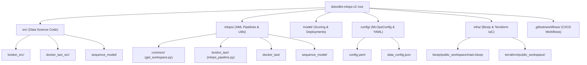
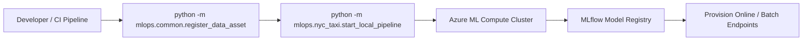

<!-- source: DeepWiki mcp.deepwiki.com · repo microsoft/dstoolkit-mlops-v2 · page 1 Overview · fetched 2026-11-09 -->

# Overview

Relevant source files

The following files were used as context for generating this wiki page:

- [.azure-pipelines/infra/bicep/infra_provision_bicep_pipeline.yml](.azure-pipelines/infra/bicep/infra_provision_bicep_pipeline.yml)
- [.azure-pipelines/infra/terraform/infra_provision_terraform_pipeline.yml](.azure-pipelines/infra/terraform/infra_provision_terraform_pipeline.yml)
- [README.md](README.md)
- [docs/design-decisions/ModelPromotion.md](docs/design-decisions/ModelPromotion.md)
- [docs/how-to/GettingStarted.md](docs/how-to/GettingStarted.md)
- [docs/how-to/OnboardingNewModel.md](docs/how-to/OnboardingNewModel.md)
- [docs/how-to/TestInitialSetup.md](docs/how-to/TestInitialSetup.md)
- [docs/media/conceptual-overview.png](docs/media/conceptual-overview.png)
- [docs/media/dataset-lifecycle.png](docs/media/dataset-lifecycle.png)
- [docs/media/github-workflows.png](docs/media/github-workflows.png)
- [docs/media/model-factory-workflow.png](docs/media/model-factory-workflow.png)

Model Factory (`dstoolkit-mlops-v2`) is an enterprise-grade MLOps template designed to operationalize Azure Machine Learning (AML) models using GitHub Actions or Azure DevOps [README.md:1-6](), [docs/how-to/GettingStarted.md:1-8](). It provides a repeatable structure for data science teams and software engineers to provision infrastructure, track and register datasets, execute training pipelines, and deploy models to batch and online endpoints with robust software engineering practices.

## High-Level Topology & Architecture

The repository is structured around distinct directories handling source code, orchestration logic, model deployment definitions, configuration, and infrastructure. 

### Diagram: Model Factory Topology & Code Entities

Sources: `README.md:7-15`, `config/config.yaml:1-50`

### Diagram: Operational Execution Workflow

Sources: `README.md:37-75`, `docs/how-to/GettingStarted.md:1-8`

---

## 1.1. Getting Started & Local Development

Setting up a local development environment involves configuring environment variables, establishing a workspace via DevContainers or Conda, and executing pipelines locally or via automated triggers [README.md:31-75](). Developers can initialize their environment using `.env` configurations (`SUBSCRIPTION_ID`, `RESOURCE_GROUP_NAME`, `WORKSPACE_NAME`) and run registration scripts like `python -m mlops.common.register_data_asset` [README.md:39-73]().

For detailed instructions on configuring your `.env` file, launching via VS Code DevContainers, setting up Conda environments, and running pipelines locally using `start_local_pipeline`, see [Getting Started & Local Development](#1.1).

Sources: `README.md:31-75`, `docs/how-to/GettingStarted.md:1-77`

---

## 1.2. Repository Layout & Onboarding a New Model

The codebase organizes responsibilities into `src/` for pure data science scripts, `mlops/` for Azure ML pipeline definitions and component wiring, `model/` for serving scoring assets, and `config/` for centralized yaml parameters [README.md:7-15](), [docs/how-to/OnboardingNewModel.md:1-26](). Onboarding a new model type requires defining execution properties in `config/config.yaml`, writing step scripts under `src/`, creating pipeline wrappers in `mlops/`, and adding scoring scripts under `model/`.

For a complete walkthrough of directory conventions and the step-by-step procedure to introduce a new model into the factory, see [Repository Layout & Onboarding a New Model](#1.2).

Sources: `README.md:7-15`, `docs/how-to/OnboardingNewModel.md:1-96`

---

## 1.3. Project Governance & Contributing

Model Factory maintains strict code quality and security standards through pre-commit hooks, linting configurations, standard licensing terms (`LICENSE.md`), and clear vulnerability reporting guidelines (`SECURITY.md`) [README.md:27-29](). Contributions follow a standardized pull request validation workflow and adherence to project codes of conduct.

For details on licensing, contribution workflows, security policies, and code linting setups, see [Project Governance & Contributing](#1.3).

Sources: `README.md:27-29`, `CONTRIBUTING.md:1-50`, `SECURITY.md:1-30`

---

