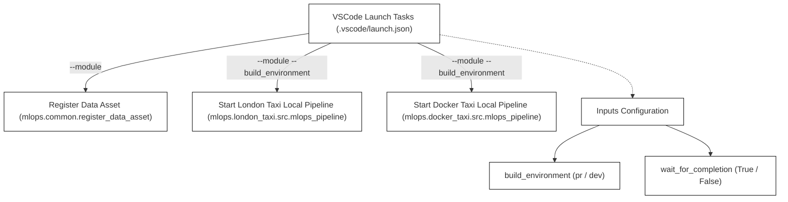
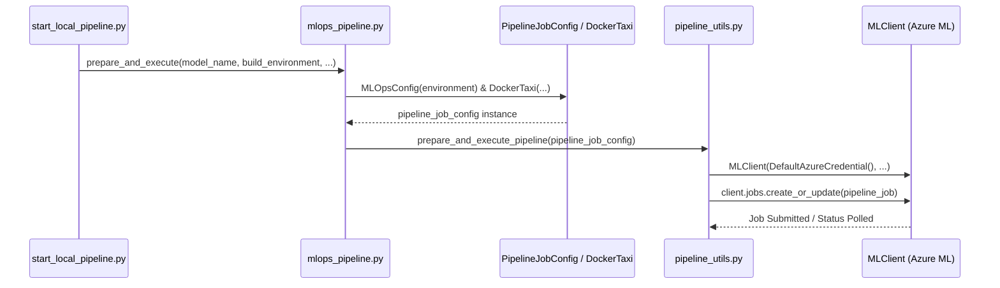

<!-- source: DeepWiki mcp.deepwiki.com · repo microsoft/dstoolkit-mlops-v2 · page 1.1 Getting Started & Local Development · fetched 2026-11-09 -->

# Getting Started & Local Development

<details>
<summary>Relevant source files</summary>

The following files were used as context for generating this wiki page:

- [.devcontainer/base/requirements.txt](.devcontainer/base/requirements.txt)
- [.env.sample](.env.sample)
- [.vscode/launch.json](.vscode/launch.json)
- [docs/how-to/GettingStarted.md](docs/how-to/GettingStarted.md)
- [docs/how-to/OnboardingNewModel.md](docs/how-to/OnboardingNewModel.md)
- [docs/how-to/TestInitialSetup.md](docs/how-to/TestInitialSetup.md)
- [mlops/common/naming_utils.py](mlops/common/naming_utils.py)
- [mlops/common/pipeline_job_config.py](mlops/common/pipeline_job_config.py)
- [mlops/common/pipeline_utils.py](mlops/common/pipeline_utils.py)
- [mlops/docker_taxi/src/mlops_pipeline.py](mlops/docker_taxi/src/mlops_pipeline.py)
- [mlops/docker_taxi/start_local_pipeline.py](mlops/docker_taxi/start_local_pipeline.py)
- [mlops/london_taxi/start_local_pipeline.py](mlops/london_taxi/start_local_pipeline.py)

</details>


## Purpose and Scope
This page details the developer setup and local environment configuration required to run, debug, and test Azure Machine Learning (AML) pipelines within the Model Factory (`dstoolkit-mlops-v2`) repository. It covers environment variable provisioning via `.env`, containerized development using devcontainers and pip requirements, IDE integration via VS Code launch tasks, and local pipeline execution leveraging entry-point scripts such as `start_local_pipeline.py`.

---

## 1. Environment Variables & Configuration Setup
Model Factory relies on Azure Machine Learning workspaces and cloud resources. Before running pipelines locally, you must configure your local environment variables.

### The `.env` File
Copy `.env.sample` to `.env` in the repository root and populate the required Azure identifiers:
* `SUBSCRIPTION_ID`: Azure subscription ID hosting the AML workspace.
* `RESOURCE_GROUP_NAME`: Name of the Azure resource group.
* `WORKSPACE_NAME`: Name of the target Azure ML workspace.
* `BUILD_BUILDID`: Defaults to `"local"` for local development runs [/.env.sample:1-5()].

Additional infrastructure parameters required by provisioning workflows and configuration classes are documented in `docs/how-to/GettingStarted.md` [docs/how-to/GettingStarted.md:35-46(), docs/how-to/GettingStarted.md:67-78()].

Sources: `[.env.sample:1-4](), [docs/how-to/GettingStarted.md:35-46](), [docs/how-to/GettingStarted.md:67-78]()`

---

## 2. Dependencies & Development Containers
Python dependencies required for Azure ML SDK v2 operations (`azure-ai-ml`, `azure-cli`, `azure-identity`), MLflow integration (`mlflow-skinny`, `azureml-mlflow`), and testing (`pytest`) are defined in `.devcontainer/base/requirements.txt` [/.devcontainer/base/requirements.txt:1-25()]. 

Developers can utilize VS Code Devcontainers, which automatically provision an environment containing the CLI tools and Python packages specified in `.devcontainer/base/requirements.txt`. Alternatively, create a local Conda or virtual environment and install the requirements via:
```bash
pip install -r .devcontainer/base/requirements.txt
```

Sources: `[.devcontainer/base/requirements.txt:1-25]()`

---

## 3. VS Code Launch Tasks & Debugging
The repository provides pre-configured debugging profiles in `.vscode/launch.json` [/.vscode/launch.json:1-51()]. These configurations enable interactive debugging of data registration and local model pipeline execution.

### Launch Configurations and Inputs
The launch tasks use dynamic input pickers (`build_environment` set to `pr` or `dev`, and `wait_for_completion` set to `True` or `False`) to pass runtime arguments to the modules [/.vscode/launch.json:52-73()].


*Figure 1: VS Code Launch Task Architecture mapping launch targets to Python modules.*

Sources: `[.vscode/launch.json:1-73]()`

---

## 4. Running Pipelines Locally via `start_local_pipeline`
Local pipeline execution is initialized through model-specific wrapper scripts (e.g., `mlops/london_taxi/start_local_pipeline.py` and `mlops/docker_taxi/start_local_pipeline.py`), which invoke `prepare_and_execute` [/.vscode/launch.json:30-50(), mlops/london_taxi/start_local_pipeline.py:1-6(), mlops/docker_taxi/src/mlops_pipeline.py:117-179()].

### Execution Flow
When a local pipeline script runs:
1. `mlops_pipeline.prepare_and_execute()` initializes `MLOpsConfig` with the target environment (`pr` or `dev`) [mlops/docker_taxi/src/mlops_pipeline.py:129()].
2. It instantiates the pipeline job configuration class (e.g., `DockerTaxi` extending `PipelineJobConfig`) [mlops/docker_taxi/src/mlops_pipeline.py:134-143(), mlops/common/pipeline_job_config.py:4-39()].
3. It delegates execution to `prepare_and_execute_pipeline()` in `mlops/common/pipeline_utils.py` [mlops/docker_taxi/src/mlops_pipeline.py:145(), mlops/common/pipeline_utils.py:161-187()].
4. `prepare_and_execute_pipeline()` authenticates via `DefaultAzureCredential`, retrieves compute targets using `get_compute()`, and submits the Azure ML pipeline job via `MLClient.jobs.create_or_update()` [mlops/common/pipeline_utils.py:168-187()].


*Figure 2: Sequence flow of local pipeline execution bridging natural language invocation to `pipeline_utils.py` and `MLClient`.*

Sources: `[mlops/london_taxi/start_local_pipeline.py:1-5](), [mlops/docker_taxi/src/mlops_pipeline.py:117-179](), [mlops/common/pipeline_utils.py:161-187](), [mlops/common/pipeline_job_config.py:4-38]()`

---

