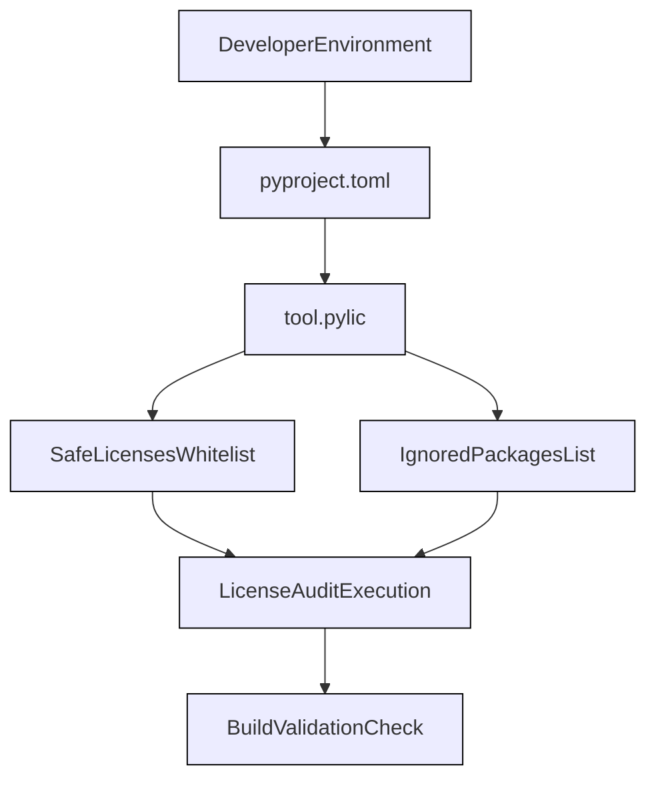
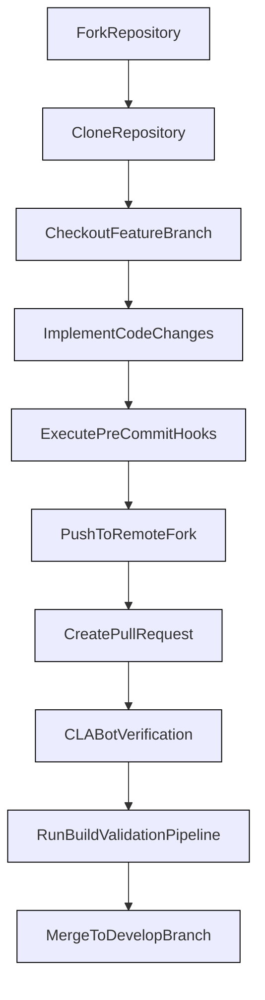

<!-- source: DeepWiki mcp.deepwiki.com · repo microsoft/dstoolkit-mlops-v2 · page 1.3 Project Governance & Contributing · fetched 2026-11-09 -->

# Project Governance & Contributing

Relevant source files

The following files were used as context for generating this wiki page:

- [.pre-commit-config.yaml](.pre-commit-config.yaml)
- [CODE_OF_CONDUCT.md](CODE_OF_CONDUCT.md)
- [CONTRIBUTING.md](CONTRIBUTING.md)
- [LICENSE](LICENSE)
- [SECURITY.md](SECURITY.md)
- [SUPPORT.md](SUPPORT.md)
- [pyproject.toml](pyproject.toml)

## Purpose and Scope
This document outlines the governance, licensing, contribution workflows, security policies, and automated quality gates governing the `dstoolkit-mlops-v2` repository (Model Factory). It establishes the operational contract between contributors and maintainers, defining compliance checks, static code analysis configurations, and vulnerability reporting procedures.

Sources: `CONTRIBUTING.md:1-76` [CONTRIBUTING.md:1-75](), `LICENSE:1-21` [LICENSE:1-21]()

---

## 1. Licensing & Legal Framework

The codebase operates under a multi-license model comprising the MIT License, Mozilla Public License 2.0 (MPL 2.0), and BSD-3-Clause [LICENSE:1-42](). Third-party dependency licenses are audited and enforced using `pylic` configuration within `pyproject.toml` [pyproject.toml:1-16]().

### License Compliance Architecture
The `pylic` tool inspects installed packages against an explicit whitelist of safe open-source licenses and ignores internal or known operational dependencies that lack standard metadata [pyproject.toml:1-25]().

*Figure 1: License audit pipeline configuration mapping tool definitions to compliance enforcement.*

Sources: `pyproject.toml:1-25` [pyproject.toml:1-25](), `LICENSE:1-42` [LICENSE:1-42]()

---

## 2. Contribution Workflow & Pull Request Lifecycle

Contributing to Model Factory requires following a structured lifecycle managed via GitHub forks, feature branching, and automated validation gates [CONTRIBUTING.md:1-62](). 

### Contribution Flow
1. **Fork & Clone**: Fork `dstoolkit-mlops-v2` and clone locally using standard git commands [CONTRIBUTING.md:6-16]().
2. **Environment Setup**: Install dependencies including Conda, Python 3.8, and Azure ML SDK v2 [CONTRIBUTING.md:21-23]().
3. **Branching**: Create a descriptive feature branch `git checkout -b [branch-name]` [CONTRIBUTING.md:24-30]().
4. **Validation**: Execute local tests, linting, and pipeline builds before pushing [CONTRIBUTING.md:35-37]().
5. **Pull Request**: Open a PR targeting the `develop` branch [CONTRIBUTING.md:48-52](). PRs require passing build validation and maintainer review [CONTRIBUTING.md:52-55]().
6. **CLA Integration**: Automated bots verify Contributor License Agreement (CLA) status upon PR submission [CONTRIBUTING.md:69-73]().

*Figure 2: Natural language to code entity space mapping for the contribution lifecycle.*

Sources: `CONTRIBUTING.md:1-73` [CONTRIBUTING.md:1-73]()

---

## 3. Code Quality, Linting & Pre-Commit Hooks

To maintain consistent coding styles and prevent regressions, the repository enforces strict linting and formatting standards configured in `.pre-commit-config.yaml` [`.pre-commit-config.yaml:1-14`].

### Configured Pre-Commit Hooks
* **Black (`ambv/black`)**: Opinionated code formatter enforced at version `24.1.1` [`.pre-commit-config.yaml:2-5`].
* **Flake8 (`PyCQA/flake8`)**: Style guide enforcement at version `7.0.0` [`.pre-commit-config.yaml:6-9`].
* **isort (`timothycrosley/isort`)**: Import sorting utility at version `5.13.2` [`.pre-commit-config.yaml:10-14`].

Sources: `.pre-commit-config.yaml:1-14` [`.pre-commit-config.yaml:1-14`]()

---

## 4. Security, Support & Code of Conduct

### Security Vulnerability Reporting
Security issues must not be reported via public GitHub issues [SECURITY.md:9-11](). Vulnerabilities should be submitted directly to the Microsoft Security Response Center (MSRC) via [https://msrc.microsoft.com/create-report](https://msrc.microsoft.com/create-report) or encrypted via PGP email to `secure@microsoft.com` [SECURITY.md:12-16](). Reports should include detailed reproduction steps, affected file paths, and potential impacts [SECURITY.md:19-28]().

Sources: `SECURITY.md:1-42` [SECURITY.md:1-41]()

### Support Policy
Support for Model Factory is community-driven and restricted to issues tracked via GitHub Issues [SUPPORT.md:1-11](). 

Sources: `SUPPORT.md:1-12` [SUPPORT.md:1-11]()

### Code of Conduct
All participants must adhere to the Microsoft Open Source Code of Conduct (`CODE_OF_CONDUCT.md`) [CODE_OF_CONDUCT.md:1-9](). Inquiries or concerns can be directed to `opencode@microsoft.com` [CODE_OF_CONDUCT.md:9]().

Sources: `CODE_OF_CONDUCT.md:1-10` [CODE_OF_CONDUCT.md:1-9](), `CONTRIBUTING.md:74-76` [CONTRIBUTING.md:74-75]()

---

